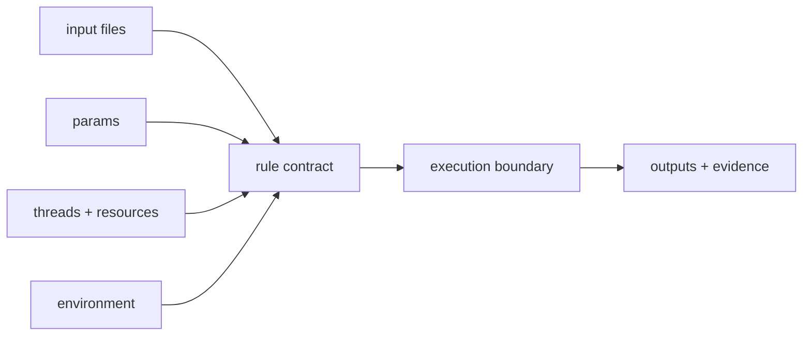
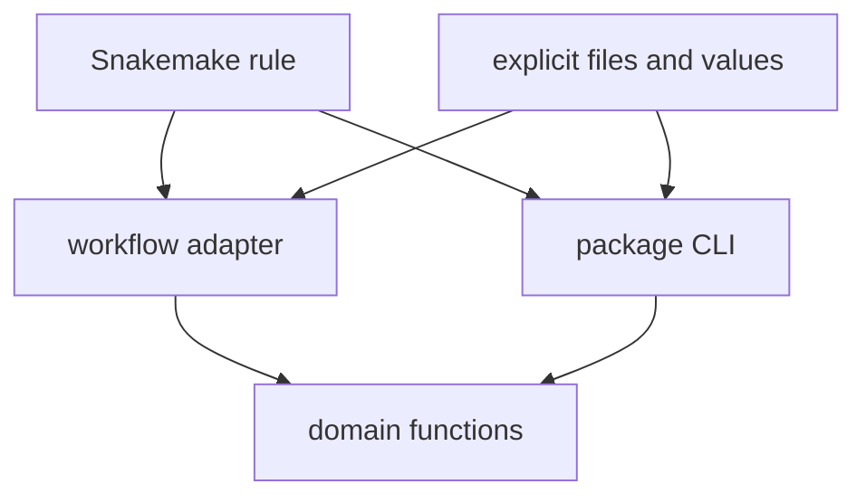

# Rule Logic, Scripts, and Software Ownership

A rule is the workflow-facing contract for one kind of job. It should let a reviewer
understand what can change the result, what runtime is required, and which evidence a
failure leaves behind. It should not contain every implementation detail.

The boundary is healthy when moving computation out of the Snakefile makes the rule easier
to inspect without making the job harder to explain.

## Read the rule before its implementation

Inventory these surfaces:

| Rule surface | Review question |
| --- | --- |
| `input` | which file contents can change the artifact? |
| `output` | which files does Snakemake own after success? |
| `params` | which non-file policy values change behavior? |
| `resources` | what schedulable capacity does the job request? |
| `threads` | what concurrency contract does the command receive? |
| `conda` or `container` | which runtime declaration applies? |
| `log` and `benchmark` | where can a reviewer inspect execution evidence? |
| `shell`, `script`, `notebook`, `wrapper`, or `run` | which execution boundary owns implementation? |

Do this before opening Python. Otherwise implementation details can distract from a
missing graph edge.



## Keep inline logic bounded

Small Python expressions belong comfortably in a Snakefile when they describe the graph:

- construct a path from wildcards
- choose a resource amount from declared input size
- map a checkpoint result to downstream inputs
- select a validated scalar config value

For example:

```python
resources:
    mem_mb=lambda wc, input: max(
        2000,
        int(1.5 * file_size_mb(input.fastq)) + 1000,
    )
```

The expression tells Snakemake how to plan capacity. Moving it into a domain package would
hide scheduler policy from the rule without creating useful reuse.

Long parsing, transformation, reporting, or network code does not belong inline merely
because Python is allowed there.

## Understand the execution choices

| Mechanism | Suitable ownership | Important trade-off |
| --- | --- | --- |
| `shell:` | concise command orchestration with explicit interpolation | imported package source may be invisible behind a stable command |
| `script:` | one workflow-owned implementation using injected Snakemake context | code is coupled to the job contract |
| `notebook:` | reviewable interactive or report-producing job | execution and publication still need bounded inputs and environment |
| `wrapper:` | versioned community or organizational adapter | external behavior and version must be reviewed, not assumed |
| `run:` | small Python graph-adjacent execution | shares the Snakemake process and can blur orchestration with computation |
| package CLI | reusable software with an ordinary interface | caller must expose package or image identity for rebuilds |

Choose from ownership and evidence, not perceived sophistication.

## Compare two capstone rules

### Workflow-adjacent provenance

The provenance rule uses:

```python
rule provenance:
    output:
        json=f"{PUBLISH_DIR}/{PUBLISH_VERSION}/provenance.json"
    log:
        f"{LOGS_DIR}/provenance.log"
    conda:
        config["_env_python"]
    script:
        "workflow/scripts/provenance.py"
```

The implementation depends on Snakemake's injected object, materialized config, workflow
base directory, current runtime, Git state, and clock. Its purpose is specific to this
workflow's execution receipt. Keeping it under `workflow/scripts/` makes that coupling
visible.

The rule also reveals a review pressure: it has no declared data inputs because it records
ambient run context. That may be intentional, but the output must not be described as a
pure function of declared files.

### Reusable trimming software

The trimming rule calls:

```bash
python3 -m capstone.trim_fastq \
    --in-fastq "{input.fastq}" \
    --out-fastq "{output.fastq}" \
    --out-json "{output.json}" \
    --q {params.q} \
    --min-len {params.min_len}
```

The full rule binds additional policy and evidence. `src/capstone/trim_fastq.py` exposes
ordinary functions and a command-line interface. It can be tested without constructing a
workflow, so package ownership is justified.

## Separate adapter from domain computation

Use this dependency direction:



The domain layer should not import global Snakemake state. The rule or adapter translates
workflow concepts into ordinary arguments.

## Work through a decomposition

Suppose a rule:

- reads FASTQ records
- trims low-quality tails
- writes a filtered FASTQ
- records counts in JSON
- chooses memory from input size
- places logs and benchmarks

Assign ownership:

| Decision | Owner | Reason |
| --- | --- | --- |
| input and output paths | rule | graph identity |
| quality threshold | validated config, bound by rule | workflow policy |
| memory formula | rule | scheduler policy |
| log and benchmark paths | rule | operational evidence |
| FASTQ parsing | package | reusable domain behavior |
| trimming algorithm | package | directly testable computation |
| CLI parsing | package adapter | ordinary software interface |
| environment | rule or deployment policy | execution contract |

This is not a file-placement exercise. It is a dependency-direction design.

## Do not hide files under scalar parameters

A common mistake is:

```python
params:
    adapters="data/panel/adapters.fasta"
```

The implementation may receive an explicit string, but Snakemake does not see adapter
contents as a file dependency. If contents change, prior output may remain accepted.

Prefer:

```python
input:
    fastq="data/{sample}.fastq.gz",
    adapters="data/panel/adapters.fasta"
```

Then pass `{input.adapters}` to the implementation. The file is explicit at both
interfaces:

- Snakemake can plan from its identity
- the package receives a normal path argument

## Avoid `run:` as an escape hatch

`run:` can call Python directly, but it executes in the Snakemake process. That means:

- imports share the workflow process
- environment separation differs from external commands
- large computations obscure the rule contract
- ordinary direct tests may be harder to construct

Use it for bounded graph-adjacent behavior when that execution model is intentional.
Do not use it to avoid creating a clear script or package interface.

## Preserve the contract when extracting code

Before extraction, capture:

- rule name
- named inputs and outputs
- parameters
- environment
- resources
- log and benchmark paths
- representative artifact content
- failure behavior

After extraction, compare the same evidence. Add direct package tests, but do not treat
them as replacements for the rule binding or dry-run.

| Evidence | Claim |
| --- | --- |
| unit test | domain function behaves for selected values |
| CLI test | ordinary software interface binds values and paths |
| rule listing | workflow parses and exposes the rule |
| dry-run | requested graph and files remain planned |
| bounded execution | adapter, runtime, and package work together |
| artifact comparison | intended result meaning is preserved |

## Review checklist

For one rule:

1. Name every file the implementation opens.
2. Confirm every material file appears under `input`.
3. Name every scalar that changes output meaning.
4. Trace each scalar to validated policy.
5. Identify the execution mechanism and why it fits ownership.
6. State which source, package, lock, or image identifies the implementation.
7. Explain how changing that identity invalidates prior output.
8. Confirm package code can be tested without Snakemake when reuse is claimed.
9. Identify ambient context such as clock, Git, environment, or working directory.
10. Record the narrowest negative experiment that would expose hidden coupling.

## Exit checkpoint

You understand the first boundary when you can:

- explain a rule without opening its implementation
- justify inline logic, a script, or a package from ownership
- detect an explicit path that is still missing from `input`
- separate direct software tests from workflow-binding evidence
- state which implementation change should invalidate an existing artifact
