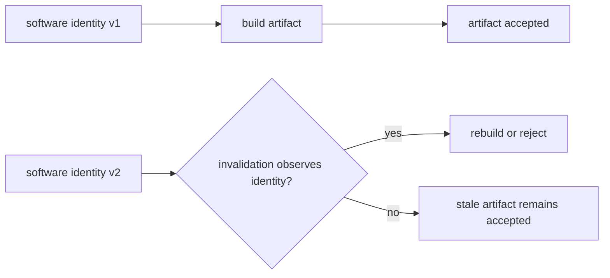
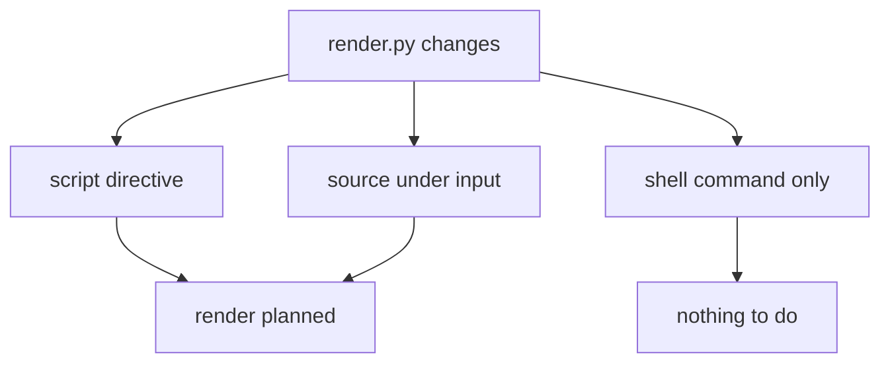

# Software Provenance, Drift, and Rebuild Evidence

Data freshness is only part of workflow freshness. Existing output can also become stale
when source code, installed packages, environments, images, wrappers, or external tools
change.

This lesson separates three obligations:

1. identify the software
2. invalidate artifacts when that identity changes
3. record what execution actually used

Provenance helps with the third. It does not automatically satisfy the first two.

## Define software drift

Software drift occurs when an implementation or runtime identity changes while the
workflow's declared data and requested target remain the same.

Examples:

- edit a `script:` file
- edit a local package imported by a stable shell command
- resolve a different patch version from the same environment declaration
- move a container tag to a new image
- update a wrapper revision
- change a compiled library loaded at runtime

The reproducibility question is causal:

> Does the system either rebuild the artifact or reject it after the material software
> identity changes?



## Choose an observable identity

Source code has many possible identities:

| Implementation form | Candidate identity |
| --- | --- |
| one workflow script | script contents or revision |
| local multi-module package | package artifact, source bundle, or repository revision |
| installed package | name, version, artifact hash, lock |
| wrapper | wrapper revision plus tool environment |
| container | immutable image digest |
| compiled tool | binary hash plus dependent libraries |

Choose the identity that matches the release and rebuild boundary. Listing one file is
appropriate for a bounded specimen, not necessarily a multi-module production package.

## Run the three-model audit

From the program directory:

```bash
gmake capstone-software-boundary-audit
```

Before opening `summary.tsv`, predict:

- whether each changed implementation will appear in the dry-run
- whether the subsequent invocation will execute
- whether the artifact marker will reach v2

The audit always starts from a converged v1 artifact. This matters: a missing output would
cause every model to run and conceal the drift distinction.

## Model A: `script:` makes its source visible

The first specimen binds:

```python
script:
    "workflow/scripts/render.py"
```

After the script marker changes, Snakemake plans the job through its code-change rerun
reasoning. The next execution writes a v2 marker.

Evidence chain:

```text
v1 execution
→ baseline dry-run plans no render job
→ script source changes
→ changed dry-run plans render
→ execution writes script-directive-v2
```

This proves behavior for the specimen and supported Snakemake toolchain. It does not prove
that every file the script imports is automatically tracked.

## Model B: a stable shell command hides package source

The second specimen invokes:

```bash
PYTHONPATH=src python -m software_specimen.render
```

The package module changes, but:

- the shell string is unchanged
- declared input data is unchanged
- output already exists
- package source is not a rule input

The dry-run plans no render job. The next ordinary invocation also does no work. The
artifact remains at v1.

The expected row is:

```text
PASS / REJECT / HIDDEN_PACKAGE_DRIFT_MISSES_RERUN
```

`PASS` means the experiment successfully reproduced the defect. Always retain the
decision and finding.

## Model C: declare the bounded source identity

The third specimen adds:

```python
input:
    source="data/source.txt",
    implementation="src/software_specimen/render.py"
```

After implementation changes, ordinary file dependency reasoning plans a rerun and the
artifact reaches v2.



The repair is deliberately small so the causal contrast is visible. For a real package,
prefer a scalable identity such as a built artifact, source bundle revision, lock, or image
digest.

## Understand rerun triggers as policy

Snakemake can consider several kinds of change when deciding whether output is stale,
including input timestamps or checksums, params, code, and software environments. Exact
defaults and behavior depend on supported Snakemake versions and invocation policy.

Do not teach a rerun trigger from memory. Record:

- Snakemake version
- command used
- baseline convergence
- changed surface
- dry-run reason
- artifact before and after execution

That is why the audit retains traces.

## Separate incremental and clean rebuild evidence

An incremental drift experiment asks:

> Does the existing artifact become invalid after software changes?

A clean rebuild asks:

> Can this source and runtime produce the artifact from absent outputs?

Both matter:

| Evidence | Defect it can expose |
| --- | --- |
| incremental rebuild | stale output accepted after source or environment drift |
| clean rebuild | missing dependency, unavailable tool, hidden setup state |
| repeated clean rebuild | nondeterminism under the same declared context |
| cross-context rebuild | executor, platform, or runtime-dependent meaning |

Deleting outputs before every test destroys the evidence needed to detect under-rebuild.

## Read provenance as a receipt

The capstone provenance script records:

- schema version
- timestamp
- Python version and executable
- platform
- Snakemake version
- Git commit when available
- materialized config

These fields help a reviewer interpret an execution. They also have limits:

| Field | Useful claim | Limitation |
| --- | --- | --- |
| Git commit | repository revision observed | does not prove clean worktree or package installation identity |
| Python version | interpreter observed | does not enumerate all dependency builds |
| platform | operating context string | does not capture full kernel, CPU, or filesystem behavior |
| config | materialized workflow policy | may include operational detail and secrets if not reviewed |
| timestamp | when receipt was generated | makes receipt bytes vary by execution |
| Snakemake version | orchestrator observed | does not identify every job tool |

The receipt explains; the rebuild contract invalidates.

## Avoid circular provenance claims

Weak reasoning:

> The output is reproducible because provenance.json records a commit.

Stronger reasoning:

> The release route builds from a reviewed revision and locked runtime, the rebuild policy
> observes those identities, and provenance records the identities actually used.

The stronger claim connects policy, behavior, and receipt.

## Design a drift experiment

For one real job:

1. converge the selected output
2. record its artifact identity and software identity
3. change only the material software surface
4. run a dry-run without deleting output
5. record the planning reason
6. invoke the workflow
7. inspect whether artifact meaning reached the new identity
8. restore the source and valid state

If the job does not rerun, decide whether:

- the software identity is hidden
- rerun policy excludes that trigger
- the selected change is not material
- a clean release rebuild is the intended invalidation mechanism

## Build a software bill appropriate to the claim

Useful records may include:

- repository revision and dirty state
- package artifact hashes
- exact environment resolution
- image digest
- wrapper revision
- command and params
- platform and executor
- output manifest

More fields do not automatically create stronger evidence. Every record needs a claim and
an inspection route.

## Exit checkpoint

You understand drift evidence when you can:

1. name the software identity that should invalidate one artifact
2. explain why stable shell text can hide local package changes
3. interpret all three audit rows with result and decision
4. distinguish incremental drift evidence from a clean rebuild
5. explain why provenance receipts support but do not cause reproducibility
