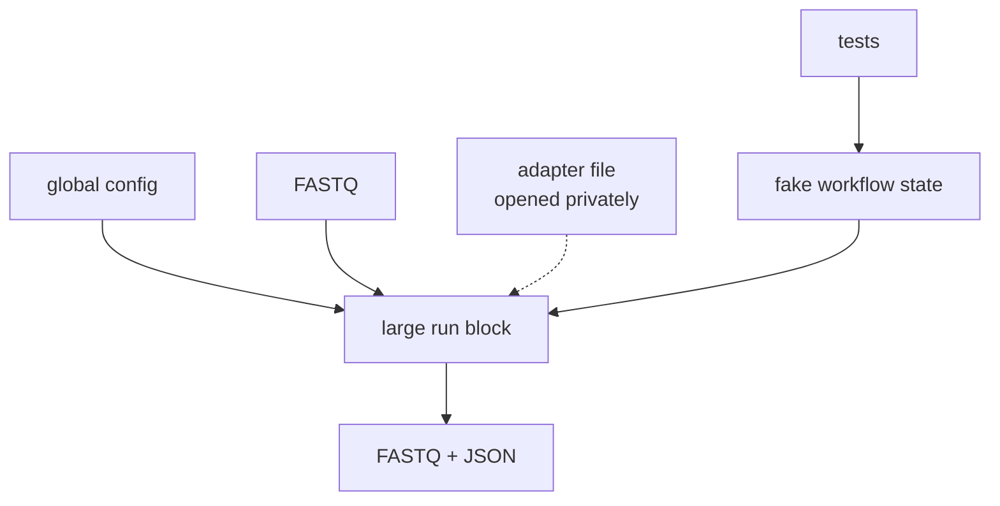
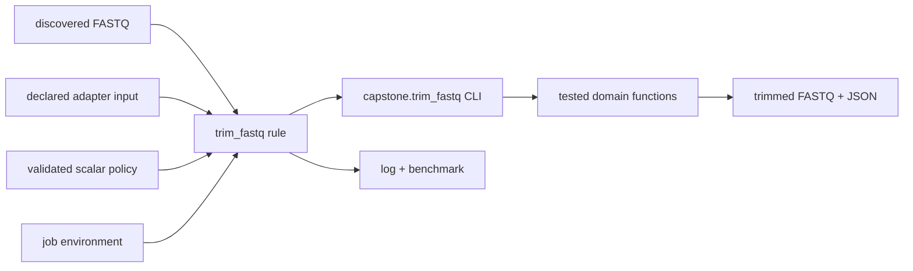

# Worked Example: Extract a Transformation Without Hiding Its Identity

This example begins with an overgrown trimming rule and ends with:

- a readable Snakemake contract
- directly tested domain functions
- an ordinary package command
- explicit data and policy files
- a named runtime declaration
- software identity and drift evidence

The goal is not fewer lines in the Snakefile. The goal is to preserve graph truth while
making computation testable and software drift reviewable.

## The starting rule

Imagine one `run:` block that:

- opens FASTQ input
- reads an adapter FASTA path from config
- trims quality tails and adapters
- filters short reads
- writes FASTQ and JSON
- catches malformed-record exceptions

It looks self-contained, but a reviewer must read the whole algorithm to discover the job
contract. The adapter file may be opened without appearing under `input`, and direct tests
must construct workflow state.



## Record behavior before moving code

Build a baseline table:

| Surface | Baseline |
| --- | --- |
| rule name | `trim_fastq` |
| data input | raw FASTQ selected from sample discovery |
| policy file | adapter FASTA |
| scalar policy | quality, minimum length, N fraction, overlap, poly-run threshold |
| outputs | trimmed FASTQ and JSON statistics |
| runtime | Python job environment |
| resources | memory from input size |
| evidence | log and benchmark |
| failure contract | nonzero execution and no trusted partial final |

Then capture:

- representative output content
- edge cases for quality, adapter, and poly-run trimming
- current dry-run
- runtime versions
- failure behavior for malformed FASTQ

Without this baseline, extraction can silently change semantics while tests merely confirm
that new code runs.

## Make file influences explicit

The adapter FASTA changes trimming behavior. It belongs under `input`:

```python
input:
    fastq=lambda wc: get_raw_fastq(wc),
    adapters=config["params"]["trim"]["adapters_fasta"]
```

The scalar policy remains under `params`:

```python
params:
    q=config["params"]["trim"]["q"],
    min_len=config["params"]["trim"]["min_len"],
    max_n_fraction=config["params"]["trim"]["max_n_fraction"],
    adapter_min_overlap=config["params"]["trim"]["adapter_min_overlap"],
    poly_run_min=config["params"]["trim"]["poly_run_min"]
```

This distinction is semantic:

- adapter contents have file identity and modification history
- thresholds are scalar policy already materialized from validated config

Before any package extraction, test that changing adapter contents plans the trimming job.

## Extract domain functions

Create ordinary interfaces:

```python
def trim_3prime(record: FastqRecord, qmin: int) -> FastqRecord:
    ...


def trim_adapters_naive_3prime(
    record: FastqRecord,
    adapters: list[str],
    min_overlap: int,
) -> tuple[FastqRecord, bool]:
    ...
```

These functions:

- receive domain values
- return domain values
- do not read config
- do not construct workflow paths
- do not import Snakemake

The capstone's `src/capstone/trim_fastq.py` and `fastqio.py` demonstrate this shape.

## Test domain behavior directly

Useful tests include:

| Case | Assertion |
| --- | --- |
| high-quality read | returned record is unchanged |
| low-quality 3′ tail | sequence and quality are clipped together |
| adapter seed present | earliest valid adapter hit determines cut |
| short adapter | ignored when below minimum overlap |
| terminal poly-A or poly-T | clipped only at configured run length |
| malformed FASTQ | parser rejects violated record invariant |

Run:

```bash
pytest -q tests/test_trim.py tests/test_fastqio.py
```

These tests establish selected domain behavior. They do not prove CLI parsing, workflow
binding, environment availability, or source-drift invalidation.

## Add an ordinary command interface

The CLI accepts explicit files and values:

```bash
python3 -m capstone.trim_fastq \
    --in-fastq data/raw/sample.fastq.gz \
    --out-fastq build/sample.trimmed.fastq.gz \
    --out-json build/sample.trim.json \
    --q 20 \
    --min-len 20 \
    --adapters-fasta data/panel/adapters.fasta
```

Test it from outside the repository root with explicit absolute paths. That challenges
current-directory coupling.

The CLI should:

- return nonzero for invalid input or policy
- create parent directories intentionally
- write parseable output
- avoid searching for repository config
- avoid changing scientific defaults behind the rule

## Bind the package from the rule

The repaired direction is:



The rule remains responsible for:

- local paths
- policy selection
- resources
- environment
- operational evidence

The package owns parsing and transformation.

## Audit the package identity

Now ask the question extraction often hides:

> What makes existing trimmed output stale when `src/capstone/trim_fastq.py` changes?

`PYTHONPATH=src python -m capstone.trim_fastq` is an explicit invocation, but the local
source files do not appear automatically as data inputs. The shell string can remain
unchanged after source edits.

For the teaching specimen, declaring the single implementation file makes the causal edge
visible. For the real capstone package, one file is not enough because trimming imports
`fastqio.py` and may gain more dependencies.

Choose a production-scale identity:

- built wheel hash
- source bundle revision
- exact environment containing the installed package
- container image digest

Then bind that identity to release or rebuild policy and test it.

## Run the bounded drift experiment

Use:

```bash
gmake capstone-software-boundary-audit
```

Read:

1. `route.txt`
2. `SOFTWARE_BOUNDARY_AUDIT_GUIDE.md`
3. `summary.tsv`
4. the three Snakefiles
5. changed dry-run traces
6. artifact markers in `report.json`

Explain the rows:

| Model | Planning after source drift | Artifact after invocation | Decision |
| --- | --- | --- | --- |
| script directive | rerun | v2 | accept bounded contract |
| hidden package source | quiet | v1 | reject stale acceptance |
| declared package source | rerun | v2 | accept bounded contract |

Do not transfer the one-file repair mechanically to the complete package. Transfer the
principle: software identity must be observable.

## Review the runtime declaration

The job uses `workflow/envs/python.yaml`, which selects Python 3.11 from conda-forge. Record
it as a compatibility declaration, not an exact lock.

The repository toolchain separately constrains Snakemake in `pyproject.toml`. The local
source becomes available through `PYTHONPATH`. These three surfaces answer different
questions:

| Surface | Answer |
| --- | --- |
| environment YAML | compatible job interpreter family |
| toolchain constraints | supported orchestrator range |
| `PYTHONPATH=src` | current source import location |

A more exact release would install a built package into a locked runtime or immutable
image and record that identity.

## Preserve operational evidence

Extraction must not lose:

- named log path
- benchmark path
- resource values
- command context
- package error output

The capstone rule writes resolved memory and input size to its log before invoking the
package command. This supports diagnosis. It does not replace package exceptions or
runtime provenance.

## Inspect provenance without overclaiming

The published provenance receipt records runtime, platform, Snakemake, Git, and config.
Use it to answer what the run observed.

It does not by itself prove:

- the Git worktree was clean
- the package installed matches the recorded commit
- every transitive dependency is locked
- a source change invalidated an existing result
- two platforms produce equivalent science

Add those claims only with corresponding evidence.

## Compare behavior after extraction

Use a matrix:

| Claim | Evidence before | Evidence after |
| --- | --- | --- |
| graph files preserved | baseline dry-run | repaired dry-run |
| adapter file triggers rebuild | controlled mutation | changed dry-run reason |
| trimming semantics preserved | fixture artifacts | domain and CLI comparisons |
| failure remains visible | malformed input receipt | nonzero CLI and absent trusted final |
| runtime remains supported | environment declaration | bounded job execution |
| source drift invalidates output | previously unknown | software identity experiment |

If one row is blank, the migration is not fully reviewed.

## Failure investigation

Suppose domain tests pass but workflow execution fails to import `capstone`.

Do not rewrite the algorithm. Inspect:

1. job command
2. `PYTHONPATH` or installed package
3. active job environment
4. current directory
5. package import location

The failure belongs to deployment binding, not domain semantics.

Suppose execution succeeds but adapter changes do not plan a rebuild. Inspect rule inputs
and the actual file opens. The failure belongs to graph truth.

## The completed handoff

A standalone handoff contains:

- final rule contract
- adapter/package ownership map
- direct domain and CLI tests
- environment exactness statement
- selected software identity
- incremental drift receipt
- representative artifact comparison
- failure evidence
- provenance interpretation
- remaining risks

For the capstone, remaining risks include the current path-based package import and the
fact that the job environment is a compatibility declaration rather than an exact lock.

## Transfer checklist

For another transformation:

1. inventory the job contract before editing
2. declare material file influences
3. extract ordinary domain functions
4. add a CLI or thin workflow adapter
5. test domain, interface, and rule binding separately
6. identify the software and runtime identities
7. test incremental invalidation without deleting output
8. compare representative artifacts and failures
9. interpret provenance within its claim boundary
10. record unresolved risks

You have completed the migration when another learner can reproduce the reasoning from
evidence rather than trusting that “the code was moved into a package.”
