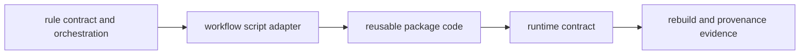
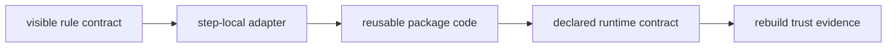

# Worked Example: Moving a Workflow Across the Software Boundary Safely

This file ties the whole module together around one realistic problem:

> a workflow step still works, but the repository can no longer explain where orchestration ends, where software begins, and why a rebuild should be trusted.

The question is not "how do we hide more code outside Snakemake?" The question is how to
give each layer one clear job.

## How to use this worked example

Treat this page like a software-boundary lab, not like a success story you read after the
fact.

For each repair step:

1. name which layer owns the behavior you are moving
2. predict what evidence should prove the move stayed honest
3. keep the rule contract visible while the implementation gets shorter

If you skip the ownership question, the example turns into code extraction theater instead
of reproducibility work.

## If you are learning this without the live class

Use the example in five passes instead of trying to absorb the whole software boundary in
one read:

1. label the current rule by contract, implementation, reuse, and runtime assumptions
2. stop after the `script:` extraction and check whether the rule still tells the truth
3. promote code into `src/` only after you can explain the reuse argument plainly
4. write the runtime contract before you discuss machine portability in the abstract
5. finish by explaining one rebuild with provenance instead of memory

If you cannot explain the shorter rule after pass 2, do not move more code yet. Most
Module 05 confusion starts when learners chase smaller files before they have named the
ownership boundary.

## The one-day teaching goal

By the end of this example, a learner should be able to rebuild one workflow step so that:

- the rule owns only orchestration and file contract
- the workflow script acts only as a step-local adapter
- reusable logic moves into package code for a reason
- runtime and provenance explain why rebuilt outputs should be trusted

That is the real outcome. Shorter files alone are not the outcome.

## The lab route

Work through the example in this order:

1. identify which parts of the current rule are file contract and which are implementation
2. move step-local code behind `script:` without changing the declared boundary
3. promote only genuinely reusable helpers into package code
4. bind the rule to an explicit runtime contract
5. finish by explaining a rebuild through provenance and drift evidence

Keep a small software packet as you go:

- one before-and-after note showing what the rule still owns
- one script excerpt showing adapter behavior instead of business sprawl
- one package helper candidate with a clear reuse argument
- one runtime contract note naming the environment surface in play
- one provenance note explaining why a rebuild should now be trusted

That packet is not overhead. It is the thing that turns "I extracted the code" into
"another maintainer can review why the software boundary is now clearer."

## What to keep beside you while you work

Keep these four surfaces visible while you move through the example:

- the rule boundary
- the workflow script
- the reusable package code
- the provenance or rebuild evidence

Those four surfaces are enough to explain whether the repository gained clarity or only
moved code around.

## The evidence packet you should keep visible

By the end of the example, keep one small packet that contains:

- one before-and-after rule view showing what still stays visible
- one script excerpt that acts as an adapter instead of a second hidden program
- one package-boundary note naming the reuse argument
- one runtime-contract note marking the step-execution surface
- one provenance note that explains why a rebuild should now be trusted

If one of those pieces is missing, the repository may look cleaner, but the learner still
cannot defend the move across the software boundary.

## The starting situation

Assume the repository already has:

- truthful rule contracts from Module 01
- explicit dynamic discovery from Module 02
- a stable publish boundary from Module 04

What it does not yet have is a strong software ownership story.

The maintainers currently live with:

- a publication rule with a long inline `run:` block
- implicit reliance on ambient host Python and libraries
- helper functions copied between scripts
- no easy way to explain why a rebuilt artifact differs from an earlier one

That is a good Module 05 starting point because the step still works. It is the trust
story around the step that is weak.

## What goes wrong when a learner trusts the starting situation

Use this card before you repair anything:

| If you notice... | The repository is hiding... | Smallest review surface |
| --- | --- | --- |
| a long `run:` block mixes path declarations and business logic | the rule boundary has not been named clearly | one ownership map on the current rule |
| a script wants to read undeclared files or globals | the workflow contract is becoming less honest after extraction | compare the rule contract with the script reads |
| helpers are copied between steps | reusable logic is trapped in step-local code | one call-site comparison with direct-test potential |
| the step works only on one machine | the runtime contract is ambient instead of declared | one environment note plus a rerun on the declared surface |
| a rebuild happened but nobody can explain why | provenance is missing or too weak to defend trust | one rebuild note tied to code or runtime drift |

If you can name the hidden defect first, the extraction stops feeling cosmetic.



The order matters. If the repository cannot explain the rule boundary first, moving code
into scripts or packages only hides the trust problem under a different directory.

## Keep the rule readable and honest

Start by reducing the rule to orchestration and contract:

```python
rule build_provenance:
    input:
        results="publish/v1/results.tsv"
    output:
        json="publish/v1/provenance.json"
    conda:
        "workflow/envs/python.yaml"
    script:
        "workflow/scripts/provenance.py"
```

This shorter rule is better because it still answers the important questions:

- which input gives the step context
- which output the step promises
- which runtime contract the step depends on
- where the implementation lives

If the rule becomes short by hiding undeclared reads or hidden global state, the
extraction failed.

Shorter is not automatically better. The shorter rule is only an improvement if the file
contract and runtime boundary became easier to review than they were inside the original
inline implementation.

## The rule-boundary audit before you celebrate

Before you call the extraction healthy, make sure you can answer all four of these:

| Question | Healthy answer |
| --- | --- |
| What stayed visible? | inputs, outputs, runtime contract, and other orchestration facts |
| What moved safely? | step-local implementation details that no longer belong in the rule |
| What would count as a hidden dependency? | undeclared reads, ambient globals, or runtime assumptions only visible in the script |
| What evidence proves the move stayed honest? | before-and-after rule view plus one focused run or planning surface |

If any row stays vague, keep repairing. The rule may be shorter, but the contract may be weaker.

## Why this first move matters educationally

Many learners assume the main goal is to get logic out of `run:` blocks.

Module 05 needs a stricter instinct:

- keep the rule honest first
- move implementation only when ownership becomes clearer
- treat shorter code as a side effect, not the goal

## Make the script a workflow adapter

`workflow/scripts/provenance.py` should translate declared Snakemake inputs and outputs
into ordinary Python calls, nothing more:

```python
from pathlib import Path

from capstone.provenance import build_provenance

payload = build_provenance(Path(snakemake.input.results))
Path(snakemake.output.json).write_text(payload, encoding="utf-8")
```

That makes the script workflow-adjacent code:

- it knows about the injected `snakemake` object
- it stays tightly coupled to one workflow step
- it should not grow into a general-purpose package by accident

The script is an adapter, not the whole software design.

Keep the layer boundaries explicit:

| Layer | What it knows | What it should not own |
| --- | --- | --- |
| rule | declared inputs, outputs, and runtime contract | implementation details or hidden ambient dependencies |
| workflow script | `snakemake` object and step-local orchestration | reusable domain logic that should be importable elsewhere |
| package code | ordinary Python behavior with explicit arguments | direct dependence on workflow globals or implicit path layout |

## Promote only the reusable part into package code

Now inspect the implementation itself.

If several steps need common metadata formatting, checksum helpers, or schema-building
logic, that reusable portion can move into `src/capstone/`. The key test is simple:

- can the code be called directly without a Snakemake context
- does it represent a reusable domain or utility behavior
- can you test it without running the workflow

If the answer is yes, package ownership is justified. If the logic still depends on
workflow-specific path layout or the injected `snakemake` object, it should stay beside
the workflow.

That is the important distinction:

- `workflow/scripts/` owns step-local adapters
- `src/` owns reusable software behavior

Do not move code into `src/` just because that directory feels more serious. Promotion is
earned only when the helper has a stable purpose outside one workflow step and can be
tested without the workflow engine standing beside it.

## A short checkpoint before you continue

Pause here and say one sentence like this:

> This helper belongs in `src/` because it can be imported and tested directly without a
> Snakemake context.

If that sentence is hard to defend, the code may still belong beside the workflow.

## Name the runtime contract explicitly

Next, bind the step to a runtime contract such as `workflow/envs/python.yaml`.

That file matters because it says the provenance step should not depend on whatever Python
happens to be installed on the host. It makes the runtime a reviewable input.

At the same time, keep the layers distinct:

- the rule-scoped environment defines what the step needs
- the repository-level environment helps contributors run and edit the project
- the container, when needed, defines a broader machine-portability surface

Those layers are related, but they do not replace each other.

Make that contract reviewable:

| Surface | What it governs |
| --- | --- |
| rule-scoped environment | software needed for one workflow step to execute honestly |
| repository environment | contributor-facing editing and local development convenience |
| container boundary | broader machine portability and deployment-level assumptions |

## Leave a rebuild trail behind

Finally, the repository needs to explain rebuilt outputs after software drift.

A provenance artifact for a published output should record enough software context to
answer questions later, for example:

- Python version
- Snakemake version
- package versions or image identity
- git commit or source revision
- relevant config or runtime metadata

Now imagine three edits:

1. `workflow/scripts/provenance.py` changes serialization details.
2. `workflow/envs/python.yaml` adds or updates a dependency.
3. reusable helper code under `src/capstone/` changes field ordering or metadata logic.

These are different surfaces, but each can invalidate trust in earlier outputs. The point
of provenance is to make that rebuild story explicit instead of folkloric.

Use a simple drift table when you explain rebuilds:

| Changed surface | Why outputs may need trust review |
| --- | --- |
| `workflow/scripts/provenance.py` | step-local serialization or orchestration may have changed |
| `workflow/envs/python.yaml` | runtime behavior may differ because dependencies or versions changed |
| `src/capstone/` helper code | reusable logic may now compute or format metadata differently |

## The rebuild audit before you move on

Do not just say "software changed." Test whether you can name the exact trust surface:

| Changed surface | Smallest honest evidence route |
| --- | --- |
| workflow-adjacent script code | `--list-changes code` plus the rule that owns the output |
| rule-scoped runtime declaration | environment diff plus rebuilt output evidence |
| reusable package code | direct tests plus rebuild evidence for the affected output |

If you cannot fill this table, the provenance story is still too vague for another maintainer.

## What the learner should notice now

The rebuild story is the real proof that the software boundary is working.

If a maintainer can explain:

- which software surface changed
- which outputs became stale
- which new provenance now defends the rebuilt outputs

then the repository has crossed the software boundary safely.

## The repaired software story

By the end of the repair, the workflow can be described cleanly:

1. the rule owns the file contract
2. the script owns step-local adaptation
3. package code owns reusable behavior
4. the runtime contract owns software context
5. provenance explains why rebuilt outputs should be trusted

That is what it means to move a workflow across the software boundary safely.



Read that diagram literally. If one step is missing, the repository may still run, but
the software-boundary story is not yet teachable.

## Review questions for the repaired design

When you inspect a repository shaped like this, ask:

1. which code still belongs at the rule boundary
2. which script is only an adapter and which helper is genuinely reusable
3. where is the runtime contract declared
4. which hidden dependency would still break reproducibility on another machine
5. how would a later maintainer explain a rebuild from provenance rather than memory

If those answers are visible, the module’s software-boundary story has landed.

## If the module still feels abstract

Do this recovery loop in order:

1. print the current rule and label what still belongs there
2. point to the script and say what makes it an adapter rather than a dumping ground
3. name one helper and say why it does or does not belong in `src/`
4. mark the exact runtime surface the step now depends on
5. connect one rebuild to one changed software surface and one provenance note

Most Module 05 confusion is not about Python itself. It is about losing track of which
layer owns which behavior once code starts moving.

Before leaving the module, make sure you can say all five of these out loud:

1. the rule still owns the file contract even after code extraction
2. the workflow script is an adapter, not a dumping ground
3. package code is justified only by real reuse and direct testability
4. the runtime contract is a reviewable input, not ambient machine luck
5. provenance should let the next maintainer explain a rebuild without relying on memory
