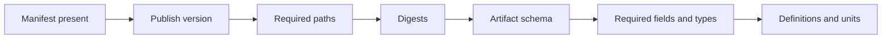
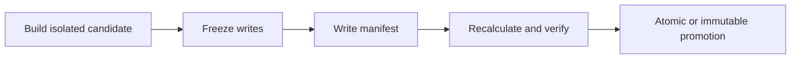
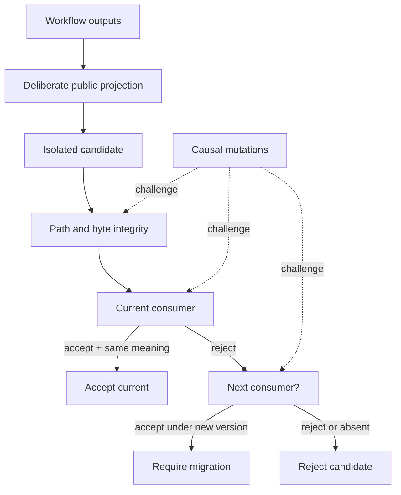

# Exercise Answers

These reference answers emphasize decision evidence. Different implementations are valid
when they preserve the same audience, boundary, integrity, semantic, and migration
contracts.

Compare your prediction before copying any implementation detail.

## Exercise 1: Classify an output tree by audience and promise

Reference classification:

| Artifact | Role | Publish? | Consumer or reason |
| --- | --- | --- | --- |
| discovery JSON | review evidence and membership authority | yes | downstream scope and release review |
| raw QC JSON | internal/review evidence | not by default | detailed diagnosis, unstable public need |
| trimmed FASTQ | execution state | no | analytical intermediate |
| screen JSON | internal result | no by default | projected into supported summary |
| summary JSON | public machine contract | yes | programmatic exact values |
| summary TSV | public interchange contract | yes | table consumers |
| trim log | diagnostics | no | unstable human troubleshooting |
| benchmark | diagnostics | no | performance analysis |
| HTML report | public human contract | yes | interpretation and navigation |

An allowlist might be:

```text
discovered_samples.json
summary.json
summary.tsv
report/index.html
provenance.json
```

`manifest.json` inventories that content boundary but normally does not include its own
digest. The public choice is justified by supported consumers, not file usefulness.

## Exercise 2: Write an executable v1 consumer contract

Reference fixture:

```json
{
  "publish_version": "v1",
  "required_paths": ["summary.json"],
  "artifact_path": "summary.json",
  "artifact_schema_version": 1,
  "required_fields": {
    "sample_id": "string",
    "reads_count": "integer"
  },
  "optional_fields": {
    "qc_status": "string"
  },
  "allow_additional_fields": true,
  "field_semantics": {
    "reads_count": {
      "definition": "number of sequencing reads",
      "unit": "reads"
    }
  },
  "missing_value_policy": "required fields may not be absent or null",
  "record_order": "not semantically significant"
}
```

The verifier should run checks in a diagnosable order:



Stopping at the first error is acceptable for a CLI, but a structured report should retain
enough failures for migration review. Reject Boolean values where an integer is required;
Python’s `bool` is a subclass of `int`.

## Exercise 3: Assemble and inventory an isolated candidate

Reference route:

1. create a new candidate directory;
2. copy or render only allowlisted artifacts;
3. parse each artifact;
4. compare accepted and published identities;
5. compare JSON, TSV, and HTML values;
6. run v1 consumer;
7. sort relative paths;
8. calculate exact-byte digests;
9. write manifest;
10. reverify manifest;
11. promote only after all checks pass.

Manifest shape:

```json
{
  "schema_version": 1,
  "publish_version": "v1",
  "files": [
    {"path": "discovered_samples.json", "sha256": "..."},
    {"path": "provenance.json", "sha256": "..."},
    {"path": "report/index.html", "sha256": "..."},
    {"path": "summary.json", "sha256": "..."},
    {"path": "summary.tsv", "sha256": "..."}
  ]
}
```

Absolute paths make a bundle host-specific. Unsorted or duplicate paths make comparison
ambiguous. A glob-based inventory can absorb stale files. The outer packet manifest is
the suitable place to inventory `manifest.json` plus review receipts.

## Exercise 4: Test additive compatibility against open and closed consumers

Expected:

| Consumer | Policy | Result |
| --- | --- | --- |
| open v1 | additional fields allowed | accept |
| closed v1 | only required and declared optional fields allowed | reject `qc_status` if undeclared |

The producer candidate is identical in both evaluations. Compatibility differs because
consumer tolerance differs.

A valid release statement:

> The added `qc_status` field is compatible with the declared open v1 fixture. The closed
> fixture rejects it, so release coordination or contract change is required for that
> consumer.

An invalid statement:

> Adding fields is backward compatible.

The latter hides consumer assumptions.

## Exercise 5: Detect semantic drift that preserves shape

Expected layer results:

```text
JSON parsing: pass
artifact schema_version: pass
reads_count integer type: pass
manifest digest: pass
reads_count semantic definition and unit: fail
decision: REJECT_CURRENT
```

A weak verifier:

```python
assert isinstance(record["reads_count"], int)
```

accepts both read counts and base counts. A semantic verifier also compares:

```python
assert field_semantics["reads_count"] == {
    "definition": "number of sequencing reads",
    "unit": "reads",
}
```

Changing only `unit` must fail. If the verifier accepts, field semantics are decorative
metadata rather than enforced contract data.

## Exercise 6: Corrupt a bundle after inventory

Expected failures:

| Mutation | Failure |
| --- | --- |
| alter summary bytes | `checksum mismatch: summary.json` |
| remove listed file | `manifest-listed artifact is missing` |
| add ambient file under closed boundary | `unexpected publish path` |
| duplicate manifest path | `manifest paths must be unique` |
| use `../outside.json` | path containment failure |

JSON parsing can still pass after whitespace is appended because syntax and integrity are
different.

Recovery should rebuild or restore the artifact from a trusted source, then regenerate
the manifest. Updating the digest alone certifies unexplained bytes and erases the alert.

For safe promotion:



## Exercise 7: Verify human and machine surfaces from one authority

Authority matrix:

| Fact | Authority | Derived surfaces |
| --- | --- | --- |
| accepted IDs | discovery artifact | JSON, TSV, HTML |
| exact metrics | governed summary model / JSON | TSV, HTML |
| narrative interpretation | report | human only |
| run identity | provenance JSON | report footer |
| public paths | manifest | report links |

Expected fault detection:

- beta omitted from HTML: identity equality fails;
- TSV rounded incorrectly: parsed numeric equality fails;
- report links `results/`: public-path containment fails;
- report labels reads as bases: displayed semantic-unit check fails.

Essential results should remain available in text or table form, labels should include
units, and the report should identify exclusions and limitations. Visual color alone
must not carry pass/fail meaning.

## Exercise 8: Classify the compatibility audit and damage its evidence

Reference decisions:

| Case | Decision |
| --- | --- |
| baseline | `ACCEPT_CURRENT` |
| additive field | `ACCEPT_CURRENT` |
| required-field removal | `REJECT_CURRENT` |
| path rename | `REJECT_CURRENT` |
| semantic drift | `REJECT_CURRENT` |
| integrity corruption | `REJECT_CURRENT` |
| versioned migration | `REQUIRE_MIGRATION` |

Mutation expectations:

| Mutation | Required gate response |
| --- | --- |
| additive case loses `reads_count` | additive case classification fails |
| semantic counterexample restores reads meaning | named counterexample inspection fails |
| corruption disabled | integrity counterexample inspection fails |
| current consumer stops requiring metric | consumer-contract integrity fails |
| v2 consumer expects v1 path | migration no longer has an accepting next consumer |

Bundles can remain parseable and visually plausible in every case. Producer-only tests
miss whether the fixture still exhibits its named risk and whether consumers remain
strict enough to detect it.

## Exercise 9: Design and test a v2 migration

Required paired result:

```text
C1(B2) = reject
C2(B2) = accept
decision = REQUIRE_MIGRATION
```

Mapping:

| v1 | v2 | Mapping |
| --- | --- | --- |
| `summary.json` | `metrics.json` | path break |
| schema 1 | schema 2 | structural break |
| `reads_count` | `read_bases` | semantic replacement |
| unit reads | unit bases | unit break |

`read_bases` cannot generally be reconstructed from `reads_count` without read lengths
and filtering details. The migration note should say so.

Readiness table:

| Consumer status | Action |
| --- | --- |
| v2 fixture passes and owner confirms rollout | migrate during overlap |
| owner or usage unknown | keep v1; investigate before retirement |
| cannot consume v2 | provide supported adapter, extend v1, or revise migration |

Retirement must depend on evidence such as acknowledgements, telemetry where appropriate,
or explicit policy—not merely the age of v2.

## Exercise 10: Submit a consumer-verifiable release packet

Reference review order:

1. `README.md` for claim boundary;
2. current consumer fixture;
3. candidate content manifest and integrity report;
4. compatibility summary;
5. detailed compatibility report;
6. next consumer and migration note;
7. review questions;
8. outer bundle manifest.

Suitable decision statement:

> The baseline and additive candidate are accepted by the declared open v1 consumer.
> Required-field removal, path rename, semantic drift, and byte corruption are rejected.
> The v2 candidate is rejected by v1 and accepted by the declared v2 consumer, so
> promotion requires migration and overlap review. This packet does not represent unknown
> external consumers or prove atomic deployment on the target storage system.

After altering a packet file, outer verification must name that path’s digest mismatch.
Restoring the file should return the packet to a verified state without changing the
claimed inner decision.

## Reasoning map



## Completion diagnosis

Classify differences from these answers:

- **equivalent implementation**: different code, same consumer-observable behavior;
- **different policy**: open/closed fields, partial publication, or retention differs and
  is explicitly tested;
- **missing evidence**: likely behavior without a saved consumer or integrity receipt;
- **contract defect**: path, structure, semantics, completeness, or bytes violate the
  current promise;
- **migration gap**: a new boundary exists without next-consumer or retirement evidence;
- **claim overreach**: the packet covers fewer consumers or storage guarantees than the
  prose claims.

Revise the claim when evidence is narrower. Compatibility honesty is part of publication.
