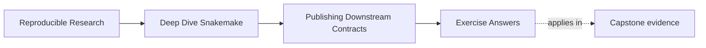

# Exercise Answers

<!-- page-maps:start -->
## Page Maps

<!-- page-maps:end -->

These answers are model explanations, not the only acceptable wording.

What matters is whether the reasoning protects downstream trust.

## Exercise 1: Separate internal state from the public bundle

What should remain internal:

- `results/sample-a/qc.json`
- `results/sample-a/trim.json`
- `results/sample-b/qc.json`
- `logs/summarize.log`

Why:

These files support workflow execution, detailed inspection, or debugging. They are not
yet a stable downstream-facing surface.

What could belong in the published contract:

- `publish/summary.tsv`
- `publish/report.html`

What is still missing:

- a versioned publish boundary such as `publish/v1/`
- a manifest and checksums
- provenance
- a clear explanation of artifact roles and stability

The main lesson is that copying a few files into `publish/` is not enough by itself.

## Exercise 2: Decide whether a change is compatible

Likely compatible within `v1`:

- adding a new optional field to `summary.json`

Likely versioning discussion:

- renaming the file to `published-summary.json`
- removing an existing field that consumers may rely on

Why:

An additive field can preserve the old contract if existing consumers still work. Path
changes and field removals often alter the public promise directly.

## Exercise 3: Diagnose a weak integrity surface

What the bundle cannot answer well:

- whether the bundle is complete
- whether files were altered or corrupted
- what software context produced the outputs

Why the report is not enough:

- it is a human-readable interpretation surface, not an inventory or identity surface

What to add first:

- `manifest.json` with published paths
- checksums for the published files
- `provenance.json` for software-context evidence

The report should remain useful, but it should not be the entire trust story.

## Exercise 4: Clarify artifact roles

A strong response would say:

> Scraping HTML is a weak machine contract because presentation markup is not a stable API.
> Machine consumers should read a structured artifact such as `summary.json` or
> `summary.tsv`. The report should help humans inspect and interpret the run, not serve as
> the only machine-facing surface.

Why:

- machine consumers need structured, stable data
- reports are valuable for humans but brittle as programmatic interfaces

## Exercise 5: Review publish drift

Risks:

- the report path change may break downstream users
- the manifest is no longer aligned with the published bundle
- downstream code reading from `results/` means the public boundary is not doing enough work

What should be repaired before approval:

- either restore the stable report path or treat the rename as a contract change
- update the manifest so it inventories the real bundle
- repair the publish contract so downstream consumers do not depend on `results/`

Does this require versioning discussion, repair, or both:

- both

The manifest mismatch is a repair inside the current review. The path rename and internal
file dependency both raise versioning and contract adequacy questions.

## Exercise 6: Build a minimal versioned bundle

A strong bundle exposes only stable machine and human surfaces plus integrity and
provenance evidence. Publication rules copy or render from internal results and write
atomically. Logs and intermediates remain internal because they support operation rather
than the consumer promise. The role table makes path, format, semantics, stability, and
intended audience explicit.

## Exercise 7: Generate and verify a manifest

The manifest orders normalized relative paths deterministically and records size and
SHA-256 for each governed artifact. Verification proves that the listed bytes match the
inventory; it does not prove scientific correctness or authenticate an untrusted
manifest. Altering one byte must produce a specific mismatch and a nonzero exit.

## Exercise 8: Write a downstream consumer test

The consumer accepts `publish/v1/` as its only location input, validates the summary
schema, and reads documented fields. An invalid type or absent required field fails with
a useful message. It intentionally knows nothing about rule names, `results/`, profiles,
or how the producer computed the summary. That separation proves the public boundary is
real.

## Exercise 9: Classify compatible changes

An optional additive field is usually compatible when consumers tolerate unknown fields.
A newly required field may break existing producers or fixtures. A type change and path
rename are breaking for consumers that follow the documented contract. Test results, not
hope, support the classification; a breaking path or semantic change requires a new
version or a deliberate compatibility layer.

## Exercise 10: Design a version migration

`v1` remains immutable or receives only documented compatible repairs while `v2` carries
the breaking contract. Migration documentation maps old paths and fields to new ones,
states support dates, and provides examples. Separate consumer tests prove both supported
versions. Neither version exposes internal working paths, so workflow internals can
evolve independently of public compatibility.

## Self-check

If your answers consistently explain:

- what is internal versus public
- what changed in the contract
- which artifact carries which responsibility
- what evidence supports downstream trust

then you are using the module correctly.
