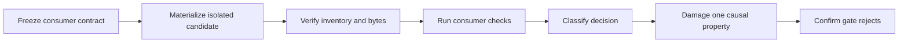
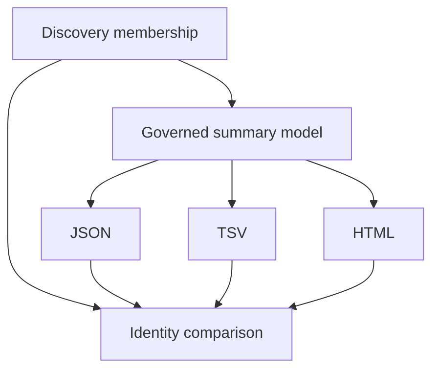

# Exercises

These exercises form one cumulative release review. You begin with an internal results
tree, define a current consumer, build and corrupt candidate bundles, classify evolution,
and finish with a versioned migration packet.

Work in the repository `artifacts/` tree or a separate learner repository. Do not edit the
tracked compatibility specimens while experimenting.

## Evidence rules

For every exercise, retain:

- consumer or audience;
- current promise;
- candidate change;
- prediction before execution;
- exact verifier output;
- decision: accept current, reject current, or require migration;
- claim limit.



## Exercise 1: Classify an output tree by audience and promise

Classify:

```text
results/discovered_samples.json
results/alpha/qc.raw.json
results/alpha/trimmed.fastq.gz
results/alpha/screen.json
results/summary.json
results/summary.tsv
logs/trim_alpha.log
benchmarks/trim_alpha.txt
report/index.html
```

For each, choose:

- execution state;
- diagnostic evidence;
- review evidence;
- public contract.

Then name:

- primary audience;
- decision supported;
- proposed public path, if any;
- stability promise;
- verifier.

Deliver an artifact-role table and a public allowlist. At least two artifacts must remain
internal for explicit reasons. “Useful” is not a sufficient reason to publish.

## Exercise 2: Write an executable v1 consumer contract

Define a consumer for:

```text
publish/v1/summary.json
```

Required record:

```json
{
  "sample_id": "alpha",
  "reads_count": 10
}
```

Declare:

- publish and artifact schema versions;
- required path;
- required fields and types;
- `reads_count` definition and unit;
- additional-field policy;
- missing-value policy;
- record ordering policy;
- integrity expectations.

Implement a verifier with at least these tests:

- accepted baseline;
- missing path;
- wrong publish version;
- missing required field;
- wrong type;
- changed unit;
- checksum mismatch.

Deliver the contract fixture, verifier, tests, and receipts. The verifier must report
specific failures rather than one generic incompatibility message.

## Exercise 3: Assemble and inventory an isolated candidate

Create:

```text
candidate/
├── discovered_samples.json
├── provenance.json
├── report/
│   └── index.html
├── summary.json
└── summary.tsv
```

Requirements:

- sample IDs agree across discovery, JSON, TSV, and HTML;
- JSON and TSV values agree;
- public paths come from an allowlist;
- manifest paths are relative, unique, and sorted;
- every listed artifact has a SHA-256 digest;
- the content manifest does not hash itself;
- an outer packet manifest can later cover the content manifest.

Run the v1 consumer before treating the candidate as promotable.

Deliver the candidate, manifest, cross-surface verification report, consumer report, and
a diagram of the candidate-to-promotion route.

## Exercise 4: Test additive compatibility against open and closed consumers

Add:

```json
{
  "qc_status": "pass"
}
```

to each summary record without changing existing fields.

Create:

- an open v1 consumer that permits additional fields;
- a closed v1 consumer that rejects undeclared fields.

Predict and then run both. Explain why:

```text
open consumer -> accept
closed consumer -> reject
```

is not contradictory.

Deliver paired contracts, paired reports, and a release decision that states exactly
which consumers the compatibility claim covers.

## Exercise 5: Detect semantic drift that preserves shape

Keep:

```json
{"reads_count": 40}
```

but change its contract meaning from:

```text
number of sequencing reads, unit reads
```

to:

```text
number of nucleotide bases, unit bases
```

Demonstrate:

- JSON parses;
- schema and integer type pass;
- checksum integrity passes;
- semantic compatibility fails.

Add a test that changes only the unit metadata. Then add a deliberately weak verifier
that checks only types and show that it accepts the unsafe candidate.

Deliver both verifier results and an explanation of why the weak verifier creates
silent analytical risk.

## Exercise 6: Corrupt a bundle after inventory

Using Exercise 3:

1. verify the clean candidate;
2. alter `summary.json` after `manifest.json` is written;
3. confirm JSON remains parseable;
4. run integrity verification;
5. independently calculate the digest;
6. restore from a trusted candidate source;
7. regenerate and reverify the manifest.

Repeat with:

- a missing manifest-listed file;
- an unexpected file in a closed boundary;
- a duplicate manifest path;
- an escaping path such as `../outside.json`.

Deliver separate receipts for each failure class. Do not repair corruption by replacing
the stored digest without explaining the changed bytes.

## Exercise 7: Verify human and machine surfaces from one authority

Build one in-memory summary model for `alpha` and `beta`. Generate:

- `summary.json`;
- `summary.tsv`;
- `report/index.html`.

Declare JSON authoritative for exact metric values and discovery authoritative for sample
membership.

Your verifier must compare:

```text
accepted IDs = JSON IDs = TSV IDs = HTML IDs
```

and compare every shared metric after parsing.

Introduce these faults one at a time:

- omit beta from HTML;
- round a TSV value incorrectly;
- link the report to an internal `results/` path;
- display reads as bases without changing the machine API.

Deliver the authority matrix, verifier, four rejection receipts, and a short accessibility
review of the report’s essential content.



## Exercise 8: Classify the compatibility audit and damage its evidence

Run:

```bash
cd programs/reproducible-research/deep-dive-snakemake/capstone
make publish-compatibility-audit
make publish-compatibility-selftest
```

Before reading `summary.tsv`, predict all seven decisions from `consumer-v1.json` and
`consumer-v2.json`.

Then copy specimens into your artifact workspace and apply separately:

1. remove `reads_count` from the additive case;
2. restore reads semantics in the semantic-drift case;
3. disable corruption in the integrity case;
4. remove `reads_count` from current consumer requirements;
5. make the v2 consumer expect the v1 path.

For each mutation, state:

- which classification or contract check must fail;
- whether the materialized bundle can still look plausible;
- what a producer-only test would miss.

Automate at least three mutation rejections.

## Exercise 9: Design and test a v2 migration

Migrate:

```text
v1: summary.json / reads_count / reads
v2: metrics.json / read_bases / bases
```

Create:

- v2 artifact schema;
- v2 consumer fixture;
- example v2 bundle;
- paired reports showing v1 rejects and v2 accepts;
- field and path mapping;
- statement about whether v1 values can be converted;
- overlap plan;
- retirement owner and evidence;
- rollback or extension condition.

If read lengths are unavailable, do not claim `read_bases` can be reconstructed from
`reads_count`.

Deliver a migration note and a decision table for consumers that are ready, unknown, or
unable to migrate.

## Exercise 10: Submit a consumer-verifiable release packet

Create:

```text
release-review/
├── README.md
├── candidate/
│   └── publish/
├── consumer-v1.json
├── consumer-v2.json
├── compatibility-report.json
├── compatibility-summary.tsv
├── integrity-report.json
├── migration-note.md
├── review-questions.md
└── bundle-manifest.json
```

`README.md` must state:

- public audience and authority;
- current contract;
- candidate change;
- integrity result;
- current and next consumer results;
- decision;
- promotion or migration route;
- limits of the evidence.

`review-questions.md` must ask:

- Which exact consumer accepted or rejected the candidate?
- Which required path, field, meaning, or digest drove the decision?
- Do human and machine sample identities agree?
- Is a same-version change actually tolerated?
- Does a migration have overlap and retirement evidence?
- Can weakening a fixture make the gate fail?

Alter one packet file after writing `bundle-manifest.json` and prove outer verification
fails. Restore it and verify again.

Deliver the packet plus a one-page downstream-maintainer review. Identify at least one
real consumer, policy, or platform not represented by your evidence.

## Completion check

Before reading the answers, confirm you have:

- one artifact-role inventory;
- an executable v1 consumer;
- a canonical candidate manifest;
- open and closed additive-field results;
- a semantic-drift rejection that passes structural checks;
- four distinct integrity failures;
- cross-surface identity and value checks;
- causal mutation tests;
- a v2 consumer and migration note;
- a portable release-review packet with outer integrity.

If your work contains only producer files, add consumer execution. If it contains only
consumer assertions, add the isolated candidate and exact bundle evidence they evaluated.
