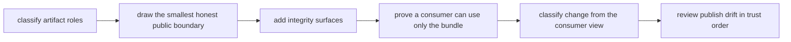

# Exercises

Use these after reading the five core lessons and the worked example. The goal is to make
your publish decisions visible through bundle design, verification evidence, and consumer
tests, not through vague claims that the output "looks ready."

## How to work through this set

Treat this as one full workshop day, not as ten disconnected prompts.

For each exercise, keep three things side by side:

- the bundle tree you are protecting
- the evidence route you actually ran
- one plain-language note about how a downstream consumer benefits from the decision

If your answer cannot point to a specific public artifact and a specific downstream use,
the exercise is not finished yet.

Before each answer:

1. classify the artifact role before you decide where the file should live
2. name the consumer who benefits from the boundary you are defending
3. keep the exact verification command or transcript that proves the bundle still works

If you skip that sequence, the day turns into folder rearrangement instead of contract
design.

Do them in order. The set is one day-long progression:

- Exercises 1-3 separate internal outputs from public promises.
- Exercises 4-6 build the versioned bundle and define artifact roles.
- Exercises 7-8 defend integrity and consumer use.
- Exercises 9-10 classify change and review downstream risk.

For every answer, keep three things:

- the boundary you are protecting
- the evidence route you actually used
- one short sentence explaining why the chosen publish surface helps a downstream user

## Recommended working layout

Build one small review packet as you go:

- an artifact-role table
- a public-tree sketch for `publish/v1/`
- a manifest and verification transcript
- one consumer test transcript
- one compatibility note for a simulated change

If you prefer a concrete tree, keep the day inside something like:

```text
module06-lab/
├── Snakefile
├── results/
├── publish/
│   ├── v1/
│   └── v2/
├── consumers/
├── artifacts/
│   ├── manifests/
│   ├── verification/
│   ├── compatibility/
│   └── reviews/
└── logs/
```

That makes it easier to prove which files are public, which checks belong to integrity,
and which notes belong to compatibility review.

Build one small downstream-contract review packet as you go:

- one artifact-role table classifying internal, diagnostic, human-facing, and
  machine-facing surfaces
- one public-tree sketch for the current versioned bundle
- one manifest and verification transcript
- one consumer test transcript that uses only the bundle
- one compatibility note for an additive or breaking change
- one maintainer-style review note ordered by downstream trust impact

If those six artifacts are missing, the day usually turns into "files moved into
`publish/`" instead of "a contract became reviewable."



Use that route on purpose. It keeps the day centered on downstream trust rather than on
producer convenience.

## What a strong day packet looks like

By the time you finish all ten exercises, your work should leave behind one small,
reviewable packet instead of ten disconnected publish fragments:

- one artifact-role table
- one public-tree sketch for the versioned bundle
- one manifest and verification transcript
- one consumer test that uses only the bundle
- one compatibility note written from the consumer's point of view
- one maintainer-style review note ordered by downstream trust impact

If you cannot point to those artifacts, the exercise day is still too dependent on tacit
classroom guidance.

## Exercise 1: Classify the current outputs

Take a workflow that produces internal results, logs, reports, and one or more structured
summaries. Classify every output as one of these:

- internal workflow state
- diagnostic artifact
- human-facing publish artifact
- machine-facing publish artifact

What to hand in:

- the artifact-role table
- one file that must remain internal
- one file that should become part of the public contract
- one missing artifact that keeps the current publish story weak

Study note:
If you struggle here, you are not really stuck on Exercise 1. You are discovering that
the workflow does not yet separate internal operational detail from public promise.

## Exercise 2: Draw the first publish boundary

Promote the smallest honest set of downstream-facing artifacts into `publish/v1/`.

What to hand in:

- the internal tree and public tree
- the rules that own publication
- one sentence for each included file explaining its job
- one sentence for each excluded file explaining why it stays internal
- one short sentence saying which downstream user the bundle is actually for

Study note:
The goal is not to publish many files. The goal is to publish the smallest honest
contract.

## Exercise 3: Separate machine and human surfaces

Choose one machine-readable summary and one human-readable report from the same workflow.
Explain why they are related but not interchangeable.

What to hand in:

- the authoritative machine-facing artifact
- the human-facing artifact
- the data relationship between them
- one reason scraping the report would weaken the contract

Study note:
If the same file is trying to satisfy both the machine and the human, stop and separate
the roles more clearly.

## Exercise 4: Write a manifest for the bundle

Create a manifest that inventories the public files with stable relative paths and SHA-256
checksums.

What to hand in:

- the manifest format
- the ordering rule for entries
- one successful verification transcript
- one reason absolute paths do not belong in the contract
- one sentence explaining why the manifest proves identity but not scientific meaning

Study note:
If your manifest cannot travel with the bundle to another machine, it is not yet a good
publish artifact.

## Exercise 5: Add provenance without confusing its role

Generate a provenance artifact for the published bundle that records enough software
context to explain the run later.

What to hand in:

- the provenance file
- the software details it records
- one trust question provenance answers well
- one trust question provenance does not answer without the contract itself

Study note:
Provenance becomes much easier once you stop asking it to replace the bundle contract.

## Exercise 6: Write a consumer test

Create a small program that receives only the bundle path and uses one documented
machine-facing artifact. It must not read `results/`, repository configuration, or
producer-only paths.

What to hand in:

- the consumer
- the schema or validation route it relies on
- a successful run against the bundle
- one producer detail the consumer intentionally does not know
- one sentence explaining why reading `results/` would weaken the contract

Study note:
This is the first exercise where the public contract has to prove it is real from the
outside.

## Midday self-check

Before you move into corruption, compatibility, and migration, make sure your packet can
already answer all of these:

- which outputs are internal workflow state and which outputs are part of the public promise
- which machine-facing artifact is authoritative for consumers
- which human-facing artifact is for inspection rather than programmatic use
- which artifact proves inventory and identity without pretending to prove semantic meaning

If you cannot answer those four questions cleanly, return to the earlier exercises and
make the contract packet more explicit before moving on.

## When you get stuck, diagnose the missing boundary first

Use this table before you start moving more files into `publish/`:

| If you are stuck on... | Check whether you are missing... | Typical repair |
| --- | --- | --- |
| Exercise 1 or 2 | one explicit artifact-role table | classify internal, human, and machine surfaces before promoting files |
| Exercise 3 or 6 | one authoritative machine-facing artifact | choose the consumer entrypoint before writing more reports |
| Exercise 4, 5, or 7 | one clear distinction between identity, context, and meaning | separate manifest, provenance, and file API roles explicitly |
| Exercise 8, 9, or 10 | one consumer-centered compatibility note | classify the change from the surviving consumer's view before versioning it |

Most weak Module 06 answers are not short on files. They are short on named public promises.

## Exercise 7: Corrupt the bundle and detect it

Alter one published file after the manifest is generated and run the verifier again.

What to hand in:

- the corrupted path
- the failed verification output
- an explanation of what checksum verification proves
- an explanation of what checksum verification does not prove

Study note:
Keep the distinction between identity and meaning explicit here. That distinction is one
of the module's central habits.

## Exercise 8: Simulate a downstream compatibility check

Change one bundle field, path, or artifact role and test the consumer from Exercise 6
against the new bundle.

What to hand in:

- the specific change
- the consumer outcome
- your compatibility classification
- whether the fix belongs in the current version or in a new public version
- one sentence written from the surviving consumer’s point of view, not the producer’s

Study note:
Do not classify from the author's perspective. Classify from the surviving consumer's
perspective.

## Exercise 9: Design a deliberate version migration

Create a `publish/v2/` contract for one breaking change while preserving a clear route for
existing `v1` consumers.

What to hand in:

- both public trees
- the migration note
- supported-consumer tests
- the reason internal workflow layout still does not belong to either API

Study note:
The point of `v2` is not novelty. The point is honesty about a changed promise.

## Exercise 10: Review a full publish change like a downstream maintainer

Review a change that touches publication rules, bundle contents, manifest logic,
provenance, and a consumer-facing schema.

What to hand in:

- findings ordered by downstream trust impact
- one corrected artifact-role table
- the narrow verification route for each correction
- one change that should be versioned, postponed, or removed

Study note:
Treat this as a downstream-maintainer review, not as a celebration that the workflow has
many outputs.

## What weak completion looks like

Do not call the day complete if your answers do any of these:

- use `publish/` as proof that a contract exists without naming the consumer surface
- treat a report as sufficient for machine consumption
- use provenance as if it replaces the manifest or the file API
- classify a change from the producer’s convenience instead of the consumer’s survival
- review a publish diff without ordering findings by downstream trust impact

## Mastery standard for this exercise set

Across all ten answers, Module 06 wants the same habits:

- you treat internal workflow state and public contracts as different promises
- you keep machine and human surfaces distinct
- you use manifests, checksums, and provenance for different jobs
- you review publish drift from the consumer's point of view

If your answer says only "the files are in publish now," keep going.

## Exit standard for the exercise day

You are done only when you can defend all of these clearly:

- why a downstream consumer reads the bundle instead of `results/`
- which artifact is authoritative for machines
- which artifact is authoritative for humans
- which artifact proves inventory and identity
- which change still belongs inside `v1` and which no longer does
