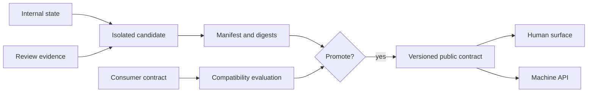
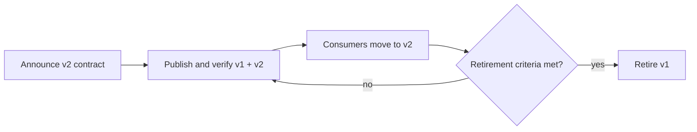

# Glossary

Publication vocabulary matters because apparently similar claims require different
evidence. A checksum can prove which bytes arrived, but not whether `reads_count` still
means reads. A schema can prove that a field is an integer, but not whether an existing
consumer tolerates a new field.

Use this glossary to name the promise, the consumer, the evidence, and the limit of a
release claim.

## Locate the terms in one release decision

The arrows describe different responsibilities:

- the candidate controls what may cross the boundary;
- the manifest controls byte identity and inventory;
- the consumer contract controls acceptable paths, shape, and meaning;
- promotion makes a verified candidate public;
- human and machine surfaces serve different consumers from shared authorities.

No single artifact replaces the others.

## Artifact roles and boundaries

### Internal state

Workflow-owned material needed for execution, caching, debugging, or detailed diagnosis.
Examples include trimmed reads, benchmark files, shell logs, and per-rule scratch output.

Internal does not mean unimportant. It means downstream users are not promised stable
paths, schemas, or meanings for the material.

### Diagnostic evidence

Evidence that helps explain a failure or performance problem, such as logs, benchmarks,
and low-level QC records. Diagnostic evidence may be retained without becoming part of
the public interface.

### Review evidence

Evidence needed to assess or defend a decision. Accepted and rejected discovery records
are review evidence when a consumer must understand why the release contains its exact
membership.

Publish review evidence when that reasoning is part of the outward promise. Do not
publish it merely because it exists.

### Public contract

The paths, schemas, meanings, versions, and stability promises that downstream users may
depend on. A directory becomes public through an explicit promise and verification, not
simply because it is named `publish/`.

### Publish boundary

The exact set of artifacts eligible for release. An allowlist defines this boundary more
safely than copying everything from a workflow output directory.

### Allowlist

An explicit collection of paths permitted in the candidate bundle. An allowlist prevents
logs, scratch files, stale artifacts, and accidental secrets from crossing the publish
boundary.

### Candidate bundle

An isolated, not-yet-public directory assembled from the allowlist. It is the object that
parsers, semantic checks, consumers, and integrity verification inspect.

The candidate should stop changing before its manifest is created.

### Atomic promotion

A publication operation in which consumers observe either the previous complete release
or the new complete release, never a partially copied mixture. Renaming a verified
directory on one filesystem or updating an immutable release pointer are common
strategies.

## Contracts and compatibility

### Consumer

A person or program that relies on published behavior. Different consumers may have
different tolerances even when they read the same artifact.

### Consumer contract

An executable statement of what one consumer requires: paths, publish version, artifact
schema, fields, types, additional-field policy, definitions, units, missing-value rules,
and ordering rules.

A consumer contract makes compatibility testable. It also exposes assumptions that prose
often leaves hidden.

### Producer contract

The outward behavior the publisher commits to provide. It should cover the same
dimensions that matter to consumers: location, syntax, schema, meaning, integrity, and
version policy.

### Compatibility

The result of evaluating a proposed producer release against named consumer contracts.
Compatibility is not an intrinsic property of a diff.

The useful form of the claim is:

> Candidate C is accepted by consumer fixture X under publish version V.

The vague form—“this change is backward compatible”—omits the consumer and the evidence.

### Additive change

A change that adds a path or field without removing or redefining existing behavior. It
is compatible only when the affected consumer permits additions.

An open consumer may accept a new `qc_status` field. A closed consumer that rejects
unknown fields may fail on the same candidate.

### Breaking change

A change that violates an existing consumer contract. Removing a required field,
renaming a required path, tightening a missing-value rule, or changing a unit can all be
breaking changes.

### Semantic drift

A change in definition, unit, population, denominator, or interpretation while path and
data type remain plausible. Semantic drift is especially dangerous because parsers and
shape-only schemas may continue to pass.

For example, retaining integer field `reads_count` while changing its unit from reads to
bases preserves syntax and type but changes the result being reported.

### Compatibility matrix

A table that evaluates each candidate version against each supported consumer fixture.
It makes partial compatibility and migration obligations visible.

| Candidate | v1 consumer | v2 consumer | Defensible decision |
| --- | --- | --- | --- |
| unchanged v1 | accept | reject | continue v1 |
| additive open-field v1 | accept if additions allowed | reject | continue v1 for named tolerant consumers |
| renamed path without overlap | reject | accept | breaking cutover |
| overlapping v1 and v2 surfaces | accept | accept | migration window |

### Claim limit

The boundary of what the evidence supports. If only one fixture was tested, the claim is
about that fixture—not every downstream consumer. If integrity was tested but semantics
were not, the claim is about bytes—not meaning.

## Versions and migration

### Publish version

The version of the outward bundle contract. It communicates which paths and compatibility
rules apply, such as `publish/v1/`.

### Artifact schema version

The version of one structured artifact's shape and meaning. It may change independently
of the outer publish version when the publish policy permits that relationship.

### Release identity

The immutable identity of one produced bundle, such as a run ID, timestamp plus digest,
or content-addressed release reference. Release identity answers “which instance?”;
contract versions answer “which interface?”

These three values must not be conflated:

| Value | Question answered |
| --- | --- |
| publish version | Which outward interface applies? |
| artifact schema version | How is this structured file interpreted? |
| release identity | Which exact produced bundle is this? |

### Migration

A planned transition from one supported contract to another. A migration names affected
consumers, supplies replacement paths or fields, and defines evidence for safe cutover.

### Overlap window

A period in which old and new contract surfaces are both published and verified. An
overlap window gives consumers time to migrate without treating an abrupt break as a
compatible release.

### Retirement criterion

Observable evidence required before an old contract is removed. Examples include all
registered consumers passing the new fixture, an agreed support date, and a rollback
route tested against the previous release.

## Integrity, authenticity, and meaning

### Manifest

A deterministic inventory of published relative paths and their digests, normally with
bundle and schema version information. Paths should be sorted, unique, and contained
inside the bundle.

A bundle manifest commonly excludes itself because including its own digest creates a
self-reference problem. An outer release packet can inventory the bundle manifest and
review receipts.

### Digest

A deterministic fingerprint calculated from exact bytes, such as SHA-256. A digest
supports equality and corruption detection; it does not explain what the bytes mean.

### Checksum

A recorded digest used for later verification. In this course, checksum evidence answers
whether a file matches the bytes inventoried at release time.

### Integrity

Evidence that the expected files are present and their bytes have not changed. Integrity
requires both inventory completeness and digest verification.

### Authenticity

Evidence about who or what authorized a release. A signature or trusted attestation can
support authenticity. A bare checksum cannot: an attacker who can replace a file may
also replace its checksum.

### Semantic validity

Evidence that values retain their declared definitions, units, populations, missing-value
rules, and relationships. Semantic validity requires domain-aware checks or comparison
with a governed authority.

The evidence layers answer different questions:

| Evidence | Question | Does not establish |
| --- | --- | --- |
| parser | Can the bytes be read? | required shape or meaning |
| schema | Does the structure conform? | byte identity or domain meaning |
| manifest digest | Are these the inventoried bytes? | correctness or authenticity |
| semantic assertion | Do definitions and units agree? | authorization |
| signature or attestation | Who authorized this object? | analytical correctness |
| consumer fixture | Can this named consumer still use it? | all consumers can use it |

## Human and machine surfaces

### Machine API

A structured public artifact designed for programmatic consumption. It needs stable
paths, documented schemas, explicit types, definitions, units, missing-value policy, and
version behavior.

### Human surface

A report or document designed for interpretation and review. It should preserve essential
results in accessible text or tables, explain exclusions and limitations, and avoid
encoding meaning only through color or layout.

### Authority

The artifact or governed model that owns one fact. Authority should be assigned per fact,
not granted vaguely to an entire directory.

### Authority matrix

A table mapping facts to their authority and derived surfaces. It prevents JSON, TSV, and
HTML from becoming three independent sources of truth.

| Fact | Authority | Derived surfaces |
| --- | --- | --- |
| accepted sample IDs | discovery artifact | JSON, TSV, HTML |
| exact metrics | governed summary model | JSON, TSV, HTML |
| run identity | provenance artifact | report footer |
| public path inventory | manifest | report navigation |
| interpretation and limitations | report narrative | human surface |

### Consumer entrypoint

The first documented artifact a consumer should open for a defined job. A human reviewer
may enter through the report; a program should normally enter through a structured file.
The entrypoint does not automatically become authority for every fact.

### File API

The durable documentation for public artifacts: paths, purposes, authorities, schemas,
definitions, units, missing-value rules, version policy, compatibility examples, and
deprecation route.

## Proof vocabulary

### Causal mutation

A deliberate change that should trigger one named guard while leaving unrelated layers
plausible. Changing semantic metadata without changing the integer value tests the
semantic guard. Changing bytes after manifest creation tests integrity.

### Discriminating proof

Evidence that separates nearby failure causes. If a test fails for path rename, semantic
drift, and checksum corruption with the same unexplained error, it detects trouble but
does not teach which contract was violated.

### Rejection evidence

A transcript or structured result showing that an unsafe candidate was rejected for the
intended reason. In a mutation audit, `PASS` can mean that the expected rejection was
successfully reproduced.

### Promotion receipt

A durable record connecting the candidate, manifest, verifier results, consumer fixtures,
release identity, and promotion decision.

## Confusion pairs

| Pair | Distinction |
| --- | --- |
| internal state / public contract | needed by the workflow / promised to consumers |
| diagnostic evidence / review evidence | explains operation / supports a decision |
| publish version / release identity | interface family / exact bundle instance |
| artifact schema / consumer contract | file conformance / one consumer's requirements |
| additive / compatible | description of change / result against a consumer |
| integrity / semantic validity | expected bytes / intended meaning |
| integrity / authenticity | unchanged object / authorized source |
| manifest / file API | inventory of one bundle / durable meaning and stability guide |
| human surface / machine API | interpretation / programmatic consumption |
| entrypoint / authority | where use begins / where a fact is owned |
| deprecation notice / retirement criterion | announced intent / evidence permitting removal |

## Use the vocabulary to diagnose a release

For each situation, name the violated concept before reading the answer.

1. `summary.json` parses and matches its digest, but `reads_count` now measures bases.
   **Semantic drift**; syntax and integrity are still intact.
2. A new field breaks a strict downstream parser. The change is **additive** but not
   **compatible** with that consumer contract.
3. A report rounds a value differently from JSON. The surfaces disagree with their
   shared **authority**.
4. A release directory contains an old debug log that a broad copy command collected.
   The **publish boundary** and **allowlist** failed.
5. A field removal is shipped under v1 while only the v2 fixture accepts it. The
   candidate needs a **migration** or a declared breaking cutover, not a compatibility
   claim.
6. A checksum matches a malicious replacement and its newly written checksum. Integrity
   may appear coherent, but **authenticity** has not been established.
7. A team says “all consumers are safe” after testing one fixture. The statement exceeds
   its **claim limit**.

## Retrieval check

Explain each answer without looking back:

- Why can an additive field be breaking?
- What evidence distinguishes semantic drift from checksum corruption?
- Why are publish version, artifact schema version, and release identity separate?
- What must be true before a candidate manifest is written?
- Why should a human report and machine API share authorities without sharing the same
  presentation?
- What evidence would justify retiring v1 after an overlap window?
- What can a consumer fixture prove, and where does its claim stop?

If an answer uses only “version it,” “add a checksum,” or “test it,” identify the missing
consumer, evidence layer, or decision criterion and answer again.
