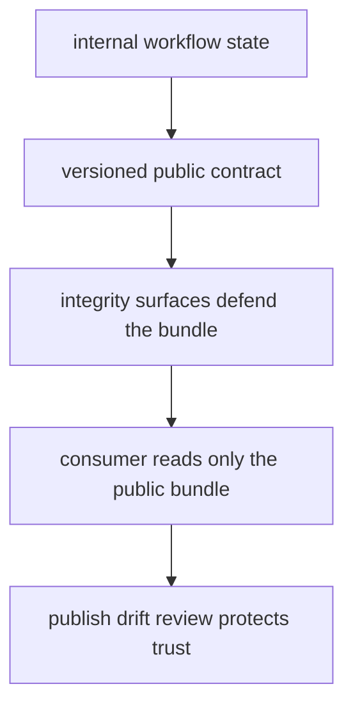
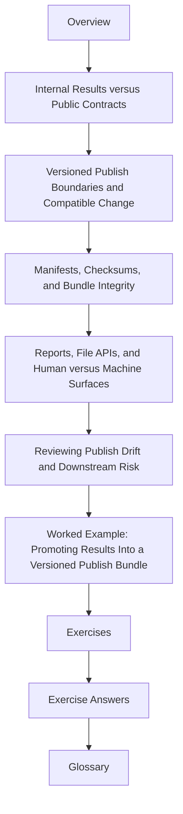

# Module 06: Publishing and Downstream Contracts

A workflow run is not automatically a downstream contract.

That distinction matters because a workflow usually produces many files that help it run,
debug, or explain itself, but only a smaller set of files should be safe for another
human, notebook, or pipeline to trust as published outputs.

This module is about drawing that line on purpose.

## What this day must accomplish

By the end of Module 06, you should be able to do five things without confusing internal
results for public promises:

- separate workflow-operational files from publishable downstream artifacts
- define a versioned bundle that another program can consume without reading `results/`
- explain the different jobs of manifests, checksums, provenance, and reports
- classify publish changes as compatible, incompatible, or incomplete
- review a bundle from a consumer’s point of view instead of the producer’s convenience

## The publish ladder for the whole module

Keep this order in front of you all day:



If a consumer must browse `results/`, the publish boundary is still weak. If a bundle has
no integrity surfaces, it is only a folder, not a contract.

## The running lab for the whole day

Use one repository story all day instead of several unrelated publication anecdotes:

- one workflow already creates rich internal outputs under `results/`
- one smaller publish bundle must be promoted under `publish/v1/`
- one machine-readable summary and one human-readable report both belong in the bundle
- one manifest and one provenance artifact must defend the bundle
- one consumer test must prove the bundle can be used without internal knowledge

Every page should help you answer one concrete downstream-trust question.

## If you are learning this without the live class

Treat Module 06 as a deliberate outside-in audit rather than as a bundle of publishing
tips.

Use it in five passes:

1. read the overview and draw the current boundary between `results/` and `publish/`
2. stop after the first two core lessons and write one artifact-role table from your own repository
3. add integrity surfaces only after you can say which machine-facing and human-facing artifacts are public
4. run one verifier and one consumer test before you decide whether the bundle is mature
5. finish by classifying one change from the downstream consumer's point of view instead of the author's convenience

If you cannot explain the public promise after pass 2, do not keep adding files to
`publish/v1/`. The bundle is not weak because it is small. It is weak when its promise is
unclear.

## Plan for the day

| Session | What you do | Evidence you keep |
| --- | --- | --- |
| artifact audit | classify internal, diagnostic, human, and machine-facing artifacts | artifact-role table |
| versioned promotion | move the smallest honest contract into `publish/v1/` | public tree and publish rules |
| integrity surfaces | add manifest, checksums, provenance, and validation | verification transcript |
| consumer view | read the bundle from a separate program with no access to internal paths | consumer test |
| compatibility review | simulate additive and breaking changes | compatibility note |
| independent practice | complete all ten exercises | publish review packet |

The day is successful when a downstream user can trust the bundle because the repository
taught them exactly what it means and how to verify it.

## The review packet you should build all day

Keep one compact packet beside every lesson and exercise:

- one artifact-role table classifying internal, diagnostic, human-facing, and machine-facing files
- one public-tree sketch for the current `publish/v1/` bundle
- one manifest-verification transcript
- one consumer test transcript that reads only the bundle
- one compatibility note written from the downstream user's point of view
- one short review note naming the strongest remaining trust risk

If those six artifacts are missing, the module is still too dependent on instructor
explanation and too weak as standalone learning material.

## Study route



Read the module in that order the first time.

The route matters:

- start by separating internal from public before you talk about versioning
- define the public contract before you decide which integrity surfaces it needs
- use the consumer test after the bundle already has a stable meaning

## The ten files in this module

1. Overview (`index.md`)
2. [Internal Results versus Public Contracts](internal-results-vs-public-contracts.md)
3. [Versioned Publish Boundaries and Compatible Change](versioned-publish-boundaries-and-compatible-change.md)
4. [Manifests, Checksums, and Bundle Integrity](manifests-checksums-and-bundle-integrity.md)
5. [Reports, File APIs, and Human versus Machine Surfaces](reports-file-apis-and-human-vs-machine-surfaces.md)
6. [Reviewing Publish Drift and Downstream Risk](reviewing-publish-drift-and-downstream-risk.md)
7. [Worked Example: Promoting Results Into a Versioned Publish Bundle](worked-example-promoting-results-into-a-versioned-publish-bundle.md)
8. [Exercises](exercises.md)
9. [Exercise Answers](exercise-answers.md)
10. [Glossary](glossary.md)

## How to use the file set

| If you need to... | Start here |
| --- | --- |
| decide which workflow outputs stay internal and which become public | [Internal Results versus Public Contracts](internal-results-vs-public-contracts.md) |
| version a bundle and classify compatible change | [Versioned Publish Boundaries and Compatible Change](versioned-publish-boundaries-and-compatible-change.md) |
| design manifests, checksums, and related integrity surfaces | [Manifests, Checksums, and Bundle Integrity](manifests-checksums-and-bundle-integrity.md) |
| separate machine-facing artifacts from human-facing artifacts | [Reports, File APIs, and Human versus Machine Surfaces](reports-file-apis-and-human-vs-machine-surfaces.md) |
| review publish drift before downstream trust is damaged | [Reviewing Publish Drift and Downstream Risk](reviewing-publish-drift-and-downstream-risk.md) |
| see the whole module as one publication repair | [Worked Example: Promoting Results Into a Versioned Publish Bundle](worked-example-promoting-results-into-a-versioned-publish-bundle.md) |
| test your own understanding | [Exercises](exercises.md) |
| compare your reasoning against a reference answer | [Exercise Answers](exercise-answers.md) |
| stabilize the module vocabulary | [Glossary](glossary.md) |

## The running question

Carry this question through every page:

> if another repository consumes this output next week, what exact public promise protects that use from internal workflow drift?

Good Module 06 answers usually mention one or more of these:

- a versioned publish path with a stable meaning
- a machine-readable summary that does not require scraping a report
- a manifest or checksum surface that can detect damage or mismatch
- provenance that explains software context without replacing the contract
- a consumer test that proves the bundle is usable without internal paths

## The pressure card for the whole module

Use this table when you get lost in details:

| If you are unsure about... | Ask this first | Likely next file |
| --- | --- | --- |
| whether a file belongs in `publish/v1/` | would a downstream user be justified in depending on this path next week | [Internal Results versus Public Contracts](internal-results-vs-public-contracts.md) |
| whether one change stays inside the current version | would an old consumer still find the same path and meaning | [Versioned Publish Boundaries and Compatible Change](versioned-publish-boundaries-and-compatible-change.md) |
| whether the bundle proves itself | which artifact covers inventory, identity, meaning, and context separately | [Manifests, Checksums, and Bundle Integrity](manifests-checksums-and-bundle-integrity.md) |
| which file a script or human should read first | are the machine-facing and human-facing roles separate and explicit | [Reports, File APIs, and Human versus Machine Surfaces](reports-file-apis-and-human-vs-machine-surfaces.md) |
| whether the change is safe to merge | what a downstream user would notice first if this lands | [Reviewing Publish Drift and Downstream Risk](reviewing-publish-drift-and-downstream-risk.md) |

## What the module should change in your head

If the day is working, you should feel these transitions:

- `results/` stops feeling like a convenient API
- a report stops sounding sufficient for machine consumers
- manifests and provenance stop blending into one fuzzy “metadata” bucket
- versioning stops feeling ceremonial once you try to protect downstream users
- publish review stops being “did the workflow finish?” and becomes “does the contract still hold?”

## Commands to keep close

These commands form the evidence loop for Module 06:

```bash
snakemake -n
snakemake publish/v1/manifest.json
python scripts/verify_publish.py --publish publish/v1
python scripts/consume_summary.py publish/v1/summary.json
```

They answer different questions:

- what the workflow plans to publish
- whether the declared bundle can be built
- whether the bundle still verifies itself as a contract
- whether a consumer can use the documented machine-facing surface

## What strong progress feels like by midday

By the middle of the day, you should already feel these shifts:

- `publish/` stops sounding like a copy destination and starts sounding like a defended promise
- a manifest stops sounding like generic metadata and starts sounding like bundle inventory plus identity evidence
- a report stops sounding sufficient on its own once a machine-facing summary is present
- compatibility review stops centering the author and starts centering the surviving consumer
- downstream trust starts looking like something you can test instead of something you assume

## Exit standard

Do not move on until all of these are true:

- you can explain why `results/` and `publish/v1/` are different promises
- you can name one compatible publish change and one change that needs a version discussion
- you can describe the distinct jobs of the manifest, report, provenance, and machine-readable summary
- you can show one consumer that reads only the public bundle
- you can review one publish drift scenario from the downstream user’s point of view
- you have completed all ten exercises and verified at least one bundle without access to internal workflow state

When those become ordinary, Module 06 has done its job.
