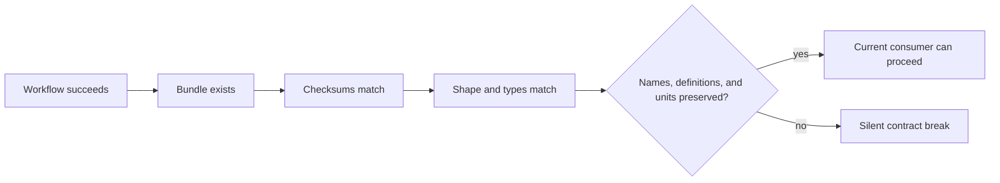
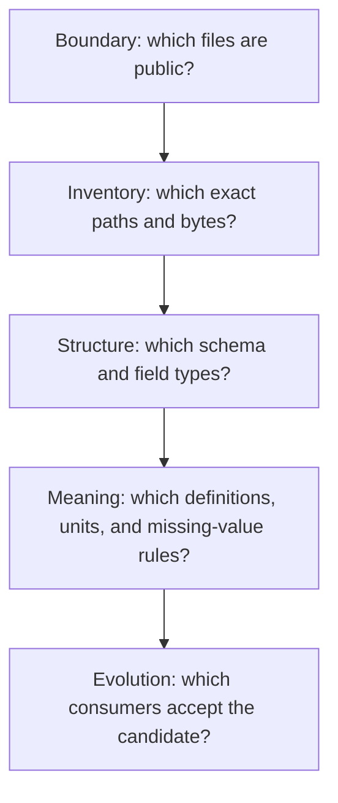

# Module 06: Publishing and Downstream Contracts

A workflow can finish successfully and still break every downstream user. Files may move,
required fields may disappear, an integer may keep its type while changing its unit, or a
bundle may be modified after its checksum inventory was written.

This module teaches publication from the consumer’s side. You will define what a consumer
is allowed to rely on, test candidate bundles against that contract, distinguish
integrity from compatibility, and require a real migration when meaning changes.

## The failure this module makes visible

Suppose `publish/v1/summary.json` contains:

```json
{
  "sample_id": "alpha",
  "reads_count": 10
}
```

A producer changes `reads_count` to mean nucleotide bases but keeps the field name and
integer type:

```json
{
  "sample_id": "alpha",
  "reads_count": 40
}
```

The workflow runs. JSON parsing succeeds. A checksum can match perfectly. The consumer is
still wrong because it interprets bases as reads.



Passing one layer never implies the next.

## Learning outcomes you must demonstrate

By the end, you should be able to:

- classify workflow outputs as internal state, review evidence, or public contract;
- write an executable consumer contract for required paths, versions, fields, types,
  meanings, and units;
- explain when an added field is compatible and when it is not;
- detect path, field, semantic, version, and checksum drift separately;
- design human and machine surfaces without making one scrape the other;
- verify that a public inventory contains canonical relative paths and matching digests;
- distinguish current-version acceptance, rejection, and migration-required decisions;
- design a version overlap and retirement plan grounded in consumer evidence;
- assemble a portable publish-review packet and prove its gate responds to causal damage.

“The files look reasonable” is not an exit claim.

## Prerequisites

You should already understand:

- declared file contracts and atomic outputs from Module 01;
- discovered membership and publish-set equality from Module 02;
- software identity from Module 05.

This module does not reteach those mechanisms. It uses them to answer a different
question: which completed artifacts may another system trust, and under what compatibility
rules?

## The running contract

The executable lab starts with a v1 consumer that requires:

| Surface | Consumer expectation |
| --- | --- |
| publish root | `publish/v1/` |
| machine artifact | `summary.json` |
| artifact schema | version `1` |
| required identity | `sample_id` string |
| required metric | `reads_count` integer |
| metric meaning | number of sequencing reads |
| metric unit | reads |
| extension policy | additional fields allowed |
| integrity | every manifest digest must match |

A v2 consumer expects `publish/v2/metrics.json` with `read_bases` measured in bases.
That is a migration target, not a same-version-compatible change.

## The seven candidate changes

The capstone audit materializes seven bundles:

| Candidate | Expected decision |
| --- | --- |
| unchanged baseline | `ACCEPT_CURRENT` |
| optional `qc_status` added | `ACCEPT_CURRENT` |
| required `reads_count` removed | `REJECT_CURRENT` |
| `summary.json` renamed inside v1 | `REJECT_CURRENT` |
| `reads_count` meaning changes from reads to bases | `REJECT_CURRENT` |
| artifact changes after manifest creation | `REJECT_CURRENT` |
| breaking path and semantic changes isolated under v2 | `REQUIRE_MIGRATION` |

The audit itself passes when each safe or unsafe case is classified correctly.

## Run the proof route

From the capstone:

```bash
cd programs/reproducible-research/deep-dive-snakemake/capstone
make publish-compatibility-audit
```

Read the generated bundle in this order:

1. `route.txt`;
2. `specimens/consumer-v1.json`;
3. `summary.tsv`;
4. candidate definitions under `specimens/cases/`;
5. materialized bundles under `workspace/`;
6. `report.json`;
7. `bundle-manifest.json`.

Then test the gate:

```bash
make publish-compatibility-selftest
```

The self-test weakens consumer expectations and damages counterexamples. A compatibility
claim is reviewable only when those mutations turn the gate red.

## Five independent review layers



Use the smallest layer that answers the current question, but do not collapse layers:

- a manifest inventories files; it does not define metric meaning;
- a schema constrains structure; it does not prove checksum integrity;
- a versioned directory marks a compatibility boundary; it does not migrate consumers;
- an HTML report serves humans; it is not automatically a machine API;
- successful generation proves producer execution; it does not prove consumer acceptance.

## Study route

Allow five to seven hours, including the exercises:

| Block | Read or do | Evidence to retain |
| --- | --- | --- |
| boundary | internal versus public contracts | artifact-role inventory |
| evolution | versioned boundaries and compatible change | consumer contract and decision matrix |
| integrity | manifests and checksums | corruption receipt and canonical inventory |
| audiences | reports and file APIs | human/machine authority table |
| drift | downstream-risk review | classified candidate report |
| integration | worked example | producer-to-consumer evidence ledger |
| practice | ten cumulative exercises | fixtures, receipts, migration packet |

Read in this order:

1. [Internal Results Versus Public Contracts](internal-results-vs-public-contracts.md)
2. [Versioned Publish Boundaries and Compatible Change](versioned-publish-boundaries-and-compatible-change.md)
3. [Manifests, Checksums, and Bundle Integrity](manifests-checksums-and-bundle-integrity.md)
4. [Reports, File APIs, and Human Versus Machine Surfaces](reports-file-apis-and-human-vs-machine-surfaces.md)
5. [Reviewing Publish Drift and Downstream Risk](reviewing-publish-drift-and-downstream-risk.md)
6. [Worked Example: Promoting Results Into a Versioned Publish Bundle](worked-example-promoting-results-into-a-versioned-publish-bundle.md)
7. [Exercises](exercises.md)
8. [Exercise Answers](exercise-answers.md)
9. [Glossary](glossary.md)

Write predictions before opening answers or audit reports.

## Keep a consumer evidence ledger

For every candidate change, record:

| Field | Required content |
| --- | --- |
| current consumer | exact fixture or executable expectations |
| producer change | path, structure, meaning, integrity, or version |
| prediction | accept, reject, or migration required |
| candidate bundle | isolated materialized artifact set |
| current result | compatible boolean and exact failures |
| next result | applicable consumer result for migration |
| decision | action and version boundary |
| claim limit | consumers or properties not covered |

This ledger prevents a producer diff from becoming the only evidence.

## Compatible change is consumer-relative

Adding `qc_status` is compatible in the lab because the v1 consumer explicitly permits
additional fields. Another consumer may use a closed schema and reject the same candidate.

Therefore say:

> This candidate is compatible with the declared v1 consumer fixture.

Do not say:

> Adding fields is backward compatible.

The narrower statement is both more accurate and more useful.

## Version decisions

Use these three outcomes:

### `ACCEPT_CURRENT`

The current consumer accepts the candidate, integrity holds, and required meaning is
unchanged. Retain the consumer regression test.

### `REJECT_CURRENT`

The candidate violates current path, version, field, semantic, or integrity expectations.
Restore the contract or propose a versioned migration.

### `REQUIRE_MIGRATION`

The current consumer rejects the breaking candidate, a declared next-version consumer
accepts it, and migration work remains explicit. This is not current compatibility.

## Common wrong turns

### “The schema version did not change”

That can be evidence of undocumented drift, not compatibility. Compare required meaning
and consumer behavior.

### “The new field is optional”

Optional to the producer is not the same as tolerated by the consumer. Read the consumer’s
additional-field policy.

### “The checksum matches”

You have proved byte identity relative to an inventory, not usefulness or meaning.

### “We published v2”

You have created a new boundary. You still need consumer fixtures, migration guidance,
overlap policy, and retirement criteria.

### “The report still looks right”

Visual plausibility does not protect machine consumers, and an HTML report may hide exact
units or missing-value behavior.

## Commands and questions

```bash
make verify-report
make publish-compatibility-audit
make publish-compatibility-selftest
```

| Command | Question |
| --- | --- |
| `verify-report` | does the current capstone publish bundle satisfy its built-in file contract? |
| compatibility audit | how does a declared consumer classify controlled candidate changes? |
| compatibility self-test | does the evidence fail when consumers or counterexamples are weakened? |

Use `make proof` only when a review question genuinely spans discovery, files, software,
contexts, performance, and publication.

## Exit proof

You are ready for Module 07 when you can provide:

- a classified artifact inventory with named owners and audiences;
- an executable current consumer contract;
- an accepted additive candidate and its tolerance rationale;
- rejected required-field, path, semantic, and checksum candidates;
- a versioned candidate accepted by a new consumer but rejected by the old one;
- a canonical bundle inventory and corruption receipt;
- separate human and machine surfaces with authority rules;
- a migration note with overlap and retirement criteria;
- causal self-tests showing the compatibility gate cannot be weakened silently;
- completed reasoning for all ten exercises.

If your evidence begins and ends with producer-side success, the downstream contract is
still untested.
