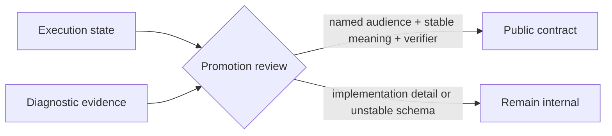
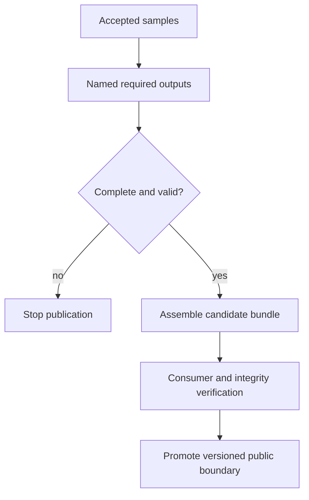

# Internal Results Versus Public Contracts

Snakemake owns many files so it can resume work, diagnose failures, and avoid unnecessary
recomputation. Downstream users should not have to understand that execution layout.

This lesson turns a crowded results tree into a deliberate public boundary. The central
skill is not copying files. It is deciding which paths and meanings the project is willing
to support.

## Begin with audiences and promises

Consider:

```text
results/
├── discovered_samples.json
├── alpha/
│   ├── qc.raw.json
│   ├── qc.trimmed.json
│   ├── trimmed.fastq.gz
│   ├── signature.json
│   └── screen.json
├── summary.json
└── summary.tsv
logs/
benchmarks/
.snakemake/
```

Every file may be useful. That does not make every file public.

Ask for each artifact:

1. Who reads it?
2. What decision do they make from it?
3. Which path, schema, and meaning may they rely on?
4. How long will that promise be supported?
5. Which check prevents accidental drift?

If those questions have no answer, the file is not yet a public contract.

## Four artifact roles

| Role | Primary audience | Stability expectation | Examples |
| --- | --- | --- | --- |
| execution state | Snakemake and workflow operators | may change with implementation | intermediates, shadow files, `.snakemake/` |
| diagnostic evidence | maintainers and incident reviewers | retained for stated investigations | logs, benchmarks, rejected candidates |
| review evidence | scientific or release reviewers | stable enough to support a named claim | discovery manifest, configuration summary |
| public contract | downstream people and programs | versioned path, structure, and meaning | summary JSON/TSV, report, provenance, manifest |

Roles can overlap, but state the overlap. A discovery manifest can be both workflow input
to later jobs and a published membership record.



Promotion is a design decision, not a directory copy.

## The capstone boundary

The capstone keeps per-sample processing under `results/` and publishes a smaller bundle:

```text
publish/v1/
├── discovered_samples.json
├── manifest.json
├── provenance.json
├── report/
│   └── index.html
├── summary.json
└── summary.tsv
```

This boundary offers:

- machine-readable sample membership;
- machine-readable metrics;
- a tabular interchange surface;
- a human report;
- governed run identity;
- an inventory with digests.

It does not promise:

- per-rule temporary files;
- internal directory structure;
- logs as a stable parsing API;
- Snakemake metadata;
- every benchmark column forever.

## Promote by consumer need

Suppose a downstream service needs sample ID, raw read count, and a top panel hit.
Publishing the entire `results/{sample}/` tree makes the service depend on:

- several paths;
- intermediate schemas;
- partial-completion behavior;
- file naming chosen for workflow convenience;
- future internal refactors.

A stable `summary.json` can project only the supported fields. The public artifact is not
“less transparent”; it is a deliberate API with a smaller compatibility surface.

Keep internal evidence available to authorized reviewers without declaring it all
downstream API.

## Write the boundary as an allowlist

Prefer named publish inputs:

```python
rule publish_manifest:
    input:
        discovery="publish/v1/discovered_samples.json",
        summary="publish/v1/summary.json",
        table="publish/v1/summary.tsv",
        report="publish/v1/report/index.html",
        provenance="publish/v1/provenance.json",
    output:
        manifest="publish/v1/manifest.json"
```

Avoid:

```python
glob.glob("publish/v1/**/*", recursive=True)
```

while constructing the public inventory. Ambient globbing can include stale files,
scratch output, or a manifest from an earlier run.



The allowlist makes absence and addition reviewable.

## Separate production from promotion

Generating an internal summary and promoting a public summary are different events.

Production asks:

- did all required analytical work finish?
- do internal artifacts satisfy their rule contracts?
- is the accepted sample set complete?

Promotion asks:

- which artifacts cross the boundary?
- do they satisfy public schemas and meanings?
- does the current consumer accept them?
- do hashes and inventory match?
- can promotion expose a partial bundle?

This separation lets publication fail safely without rerunning expensive analysis.

## Prevent stale-file publication

Suppose a previous run published `gamma`, while the new accepted set is `alpha,beta`.
Copying new files into an existing directory can leave `gamma` behind.

Safer patterns:

- assemble into a new versioned or release-specific candidate directory;
- verify the exact allowlisted paths;
- reject unexpected paths;
- write the manifest after candidate artifacts are complete;
- promote atomically where the storage system supports it;
- keep published versions immutable.

Cleaning an existing public directory before copying is less safe because consumers may
observe the boundary while it is incomplete.

## Public completeness is set equality

Let:

- `A` = accepted samples;
- `C` = samples with all required internal outputs;
- `P` = samples in the public machine-readable summary.

For a full publication:

```text
A = C = P
```

File presence alone cannot prove this equality. The verifier must compare identities.

If partial publication is supported, add:

- declared policy identifier;
- excluded accepted samples;
- machine-readable reasons;
- consumer-visible completeness status.

“Publish whatever exists” is not a partial-publication policy.

## Classify a concrete tree

| Artifact | Default role | Reason |
| --- | --- | --- |
| `results/alpha/trimmed.fastq.gz` | internal state | large intermediate tied to workflow implementation |
| `results/alpha/qc.trimmed.json` | review evidence | useful for diagnosis, not necessarily stable public API |
| `logs/trim_alpha.log` | diagnostic evidence | human troubleshooting format may change |
| `benchmarks/trim_alpha.txt` | diagnostic evidence | performance review, not analytical result |
| `publish/v1/summary.json` | public machine API | declared consumer parses it |
| `publish/v1/summary.tsv` | public interchange surface | supported tabular consumer path |
| `publish/v1/report/index.html` | public human surface | supported reading path, not scraping API |
| `publish/v1/provenance.json` | public review evidence | binds results to governed run identity |
| `publish/v1/manifest.json` | public inventory | defines paths and byte identities |

The classification can differ by project. What matters is that each promotion has an
audience, contract, and verifier.

## A boundary review exercise

Given an internal metric file:

```json
{
  "sample": "alpha",
  "raw_reads": 10,
  "trimmed_reads": 8,
  "worker_hostname": "node-17",
  "scratch_path": "/scratch/job-219",
  "debug_histogram": [1, 2, 5]
}
```

A public consumer needs sample, raw reads, and trimmed reads.

The supported projection should omit hostname and scratch path because they are
execution context. Whether to publish the debug histogram depends on a named consumer and
stability promise, not on its availability.

Reference projection:

```json
{
  "schema_version": 1,
  "records": [
    {
      "sample_id": "alpha",
      "raw_reads": 10,
      "trimmed_reads": 8
    }
  ]
}
```

Also define meanings and units. A field name alone is not enough.

## Boundary failure patterns

### Exposing internal paths as convenience

A consumer begins reading them, making refactoring expensive. Either promote and version
the path intentionally or keep it outside documented public surfaces.

### Publishing logs as data

Logs mix diagnostics with unstable wording. Emit a structured artifact for machine
consumers.

### One directory for internal and public files

Ownership and retention become ambiguous. Separate workflow-owned `results/` from
consumer-owned `publish/vN/`.

### Reusing the public directory in place

Stale files and partial visibility become likely. Build and verify an isolated candidate.

### Calling every retained file “provenance”

Retention does not define meaning. Name which evidence supports which claim.

## Review checklist

- [ ] Every candidate public artifact has a named audience and decision.
- [ ] Internal state, diagnostics, review evidence, and public contract are distinguished.
- [ ] Public paths are allowlisted.
- [ ] Public schemas project supported meaning rather than mirror internal layout.
- [ ] Accepted, complete, and published sample sets are compared.
- [ ] Unexpected and stale files cause rejection.
- [ ] Candidate assembly is isolated from the trusted public boundary.
- [ ] Human-readable files are not treated as implicit machine APIs.
- [ ] Each promoted path has a compatibility test.
- [ ] The published surface is small enough to support deliberately.

## What you should carry forward

A public boundary is a maintained promise to a named consumer. The next lesson asks how
that promise may evolve, which changes can remain inside the current version, and which
require a migration rather than optimistic release notes.
