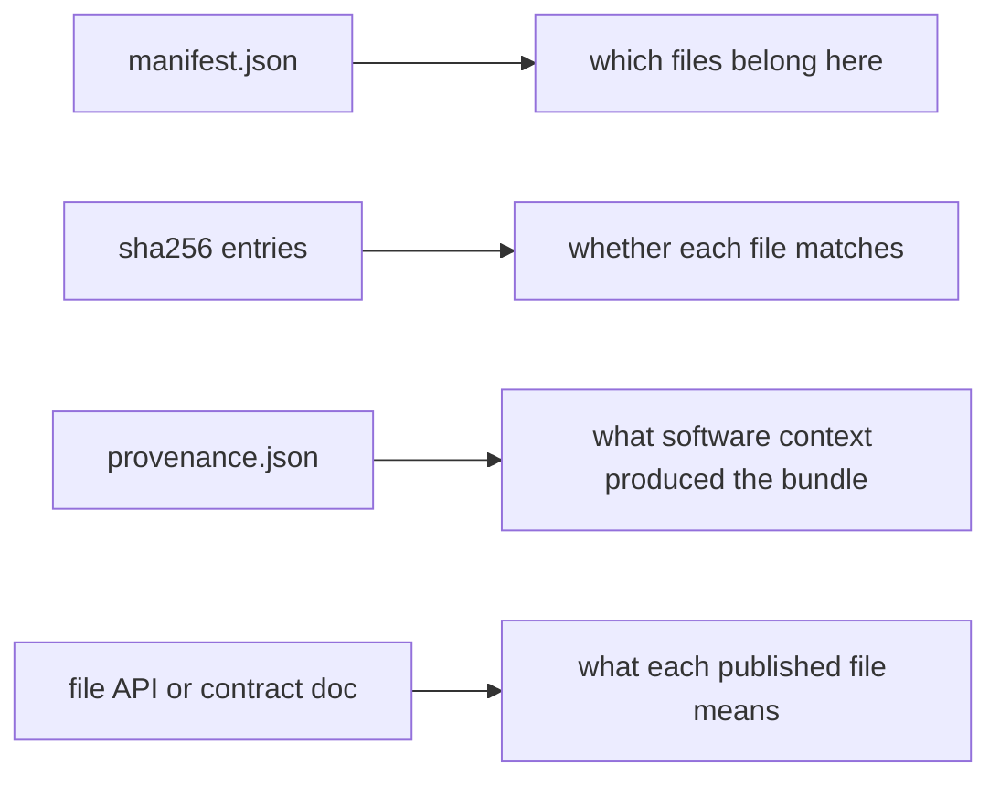

# Manifests, Checksums, and Bundle Integrity

Publishing is not finished when files are copied into `publish/v1/`.

The bundle also needs to defend itself.

That means a reviewer or downstream user should be able to answer questions like:

- what files belong in this bundle?
- how do I know whether the bundle is complete?
- how can I detect whether a file changed?
- where do I look for machine-checkable evidence versus human explanation?

This page is about the evidence surfaces that make a publish bundle reviewable.

## How to use this page

Read this page while imagining the bundle has just been downloaded by someone who was not
present when it was produced.

That person needs to answer at least four questions without asking the original author:

- what belongs in the bundle
- whether the bundle is complete
- whether the files match what was published
- what kind of context or meaning still needs a different artifact

This page is about teaching that separation cleanly.

## If you are learning this without the live class

Treat this page as a verification drill, not as a metadata glossary.

Use it in four passes:

1. write down which files in the bundle answer inventory, identity, meaning, and context
2. stop after the first manifest sketch and ask whether the bundle could travel to another machine unchanged
3. run one verifier route before you keep reading
4. finish by naming which trust question each artifact still cannot answer

If you keep calling all of these files "metadata," slow down and separate their jobs
again before you move on.

## A bundle should explain itself

The capstone publish bundle includes:

- `manifest.json`
- `provenance.json`
- `summary.json`
- `summary.tsv`
- `report/index.html`
- `accepted_samples.json`
- `rejected_samples.json`

Those files do not all do the same job.

One of the most common workflow mistakes is assuming that one file can answer every
question.

It usually cannot.

## What a manifest is good at

A manifest is strongest when it answers:

- which files are part of the published bundle
- how those files are named relative to the bundle root
- how to validate their identity

In the capstone, `manifest.json` records published paths and SHA-256 digests.

That is valuable because it makes the bundle inventory explicit instead of implied.

## What checksums are good at

Checksums answer a narrower but essential question:

> is this file the same file I expect?

They help detect:

- accidental corruption
- incomplete transfers
- silent replacement of one artifact with another

Checksums are not a substitute for meaning. They are evidence of identity.

## The integrity packet to keep beside you

Keep one five-line packet while you work through this page:

- one manifest excerpt with stable relative paths
- one checksum verification transcript
- one note saying what provenance answers
- one note saying what the file API answers
- one note saying what accepted and rejected discovery records explain that the manifest does not

That packet keeps the page grounded in reviewable evidence instead of abstract integrity language.

## Start by separating inventory, identity, meaning, and context

This four-way split is the main idea to keep:

| Question | Best artifact |
| --- | --- |
| What files belong here? | manifest |
| Is this exactly the file I expect? | checksum or digest |
| What does this file mean? | file API or contract note |
| What software context produced it? | provenance |

Once learners can keep those questions apart, publish integrity stops sounding like one
fuzzy metadata topic.

## One outside-in integrity scenario

Imagine a downstream reviewer receives only:

- `publish/v1/manifest.json`
- `publish/v1/provenance.json`
- `publish/v1/summary.json`
- `publish/v1/accepted_samples.json`
- `publish/v1/rejected_samples.json`

They should be able to answer:

- which files belong in the bundle
- whether those files match the published inventory
- what software context produced the bundle
- why the result set has its exact membership

They should not need to browse `results/` or infer rejected membership from missing files alone.

## What a manifest does not prove by itself

A manifest does not fully answer:

- what a file means
- whether the right files were published in the first place
- what software context produced those files
- whether the contract should have been versioned differently

That is why manifests need companion surfaces such as:

- a file API or contract note
- provenance
- review judgment about the publish boundary

## One useful separation

This separation matters because reviewers often ask the right question but check the wrong
artifact.

## One concrete teaching scenario

Imagine you receive `publish/v1/` from a collaborator.

- `manifest.json` tells you that `summary.json`, `summary.tsv`, and `report/index.html`
  belong in the bundle
- the SHA-256 digests tell you whether the files you have match the ones they published
- `provenance.json` tells you what repository and runtime context produced them
- a contract note tells you which file a machine should parse and which file a human
  should open first

If any one of those is missing, a different kind of confidence disappears.

That is the educational point: integrity is not one check, but several distinct checks.

## A weak integrity story

Weak shape:

- the bundle has files but no explicit inventory
- a report exists, so maintainers assume the bundle is self-explanatory
- checksums are absent, so transfers and comparisons rely on trust alone

This leaves a reviewer with no compact way to validate the bundle.

An equally weak variant is:

- the bundle publishes only accepted outputs
- reviewers must infer rejected membership from missing files

That weakens trust because membership decisions are now implied instead of recorded.

## A stronger integrity story

Stronger shape:

- the manifest names the published files
- checksum entries let others validate identity
- provenance records software context
- contract documentation explains how to interpret the artifacts

Now the bundle can answer more than one kind of question without forcing one file to do
everything.

## The beginner mistake to catch early

Beginners often assume that once a manifest exists, the bundle is self-documenting.

That gives the manifest too much responsibility.

A manifest can inventory and identify files without saying:

- why those files are public
- what a consumer should read first
- whether a checksum mismatch should be interpreted as corruption or a changed version

Integrity gets stronger when each artifact keeps a clear job.

## A practical review loop

When reviewing a publish bundle, ask:

1. Does the manifest enumerate the expected public artifacts?
2. Do the checksum entries cover the files the bundle promises?
3. Is provenance present for software-context questions?
4. Is there a document or guide that explains artifact meaning and stability?

If the answer to only the first question is yes, the integrity story is still incomplete.

## Common failure modes

| Failure mode | Why it hurts | Better repair |
| --- | --- | --- |
| manifest lists files but no digests | bundle completeness is visible but file identity is weak | include checksums for published artifacts |
| report is treated as the integrity surface | bundle validation becomes manual and human-only | keep machine-checkable inventory and digests separate |
| provenance is omitted because manifest exists | software context becomes untraceable | pair manifest integrity with provenance evidence |
| manifest includes internal or unstable files | public boundary becomes noisy and brittle | inventory only the intentional publish contract |
| reviewed discovery evidence stays internal while result membership is public-facing | consumers can see the result set but not defend its membership | publish accepted and rejected discovery records when they explain bundle membership |
| contract meaning lives only in author memory | downstream users cannot interpret the bundle confidently | document the role of each public artifact explicitly |

## What a reviewer should hear

When the bundle is designed well, the explanation sounds like this:

> The manifest tells us what belongs in the bundle, the checksums tell us whether those
> files are intact, the provenance tells us what produced them, and the contract note
> tells us how to interpret them.

That sentence is strong because it does not overload any single artifact.

## The explanation a reviewer trusts

Strong explanation:

> `manifest.json` tells us which files belong in `publish/v1/` and gives us digests to
> verify identity, while `provenance.json` explains the producing software context and the
> file API explains what each artifact means.

Weak explanation:

> the manifest is there, so the bundle is self-documenting.

The strong explanation respects the limits of each artifact. The weak explanation assigns
too much responsibility to one file.

## End-of-page checkpoint

Before leaving this page, you should be able to:

- explain what a manifest proves and what it does not prove
- explain why checksums are about identity rather than meaning
- describe why provenance is a separate integrity surface
- explain why a publish bundle still needs a file API or contract note

If you still use “metadata” as the main explanation for all of these files, slow down and
separate their jobs again. The whole point of the page is to make those jobs distinct.
