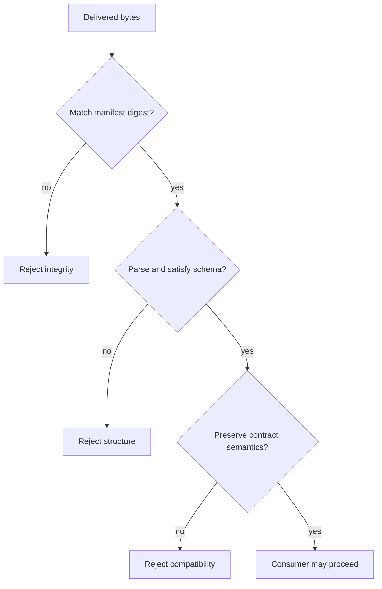
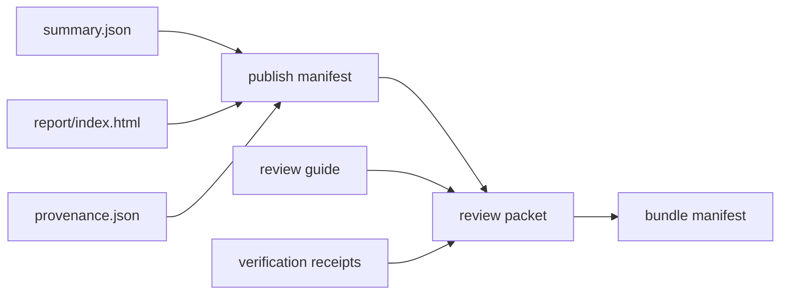

# Manifests, Checksums, and Bundle Integrity

A publish manifest answers two narrow but essential questions:

1. Which files belong to this bundle?
2. Do the delivered bytes match the inventoried bytes?

It does not prove that fields mean the right thing, that a consumer remains compatible,
or that the underlying analysis is scientifically valid. This lesson builds a portable,
canonical inventory and keeps its integrity claim separate from broader trust.

## A minimal manifest

```json
{
  "schema_version": 1,
  "publish_version": "v1",
  "files": [
    {
      "path": "summary.json",
      "sha256": "5f70..."
    },
    {
      "path": "summary.tsv",
      "sha256": "28c1..."
    }
  ]
}
```

The path is relative to the manifest’s directory. The digest is calculated over exact
file bytes. Entries use canonical path order.

That makes the bundle movable and its inventory deterministic.

## Integrity, structure, and meaning are separate



A checksum mismatch stops review before schema. A matching checksum moves review forward;
it does not complete it.

## Build from an allowlist

The manifest generator should receive named public artifacts:

```python
PUBLIC_PATHS = [
    Path("discovered_samples.json"),
    Path("summary.json"),
    Path("summary.tsv"),
    Path("report/index.html"),
    Path("provenance.json"),
]
```

Then verify and inventory:

```python
def file_entry(root: Path, path: Path) -> dict[str, str]:
    resolved_root = root.resolve()
    resolved_path = path.resolve()
    relative = resolved_path.relative_to(resolved_root).as_posix()
    return {
        "path": relative,
        "sha256": hashlib.sha256(resolved_path.read_bytes()).hexdigest(),
    }


entries = [
    file_entry(publish_root, publish_root / relative)
    for relative in sorted(PUBLIC_PATHS, key=lambda item: item.as_posix())
]
```

`relative_to` rejects paths outside the bundle root. Sorting before serialization prevents
filesystem enumeration order from changing the manifest.

## Reject ambiguous inventory

A verifier should reject:

- missing `manifest.json`;
- duplicate paths;
- non-canonical ordering if ordering is part of the manifest contract;
- absolute or escaping paths;
- manifest-listed files that are missing;
- unexpected files when the bundle contract is closed;
- checksum mismatches;
- unsupported digest algorithms;
- incompatible manifest schema or publish version.

If additional public files are allowed, declare how consumers discover and classify them.
Do not let ambient files become public simply because the verifier ignores them.

## The self-reference problem

Should `manifest.json` list its own checksum?

Direct self-hashing is circular: changing the stored hash changes the file being hashed.
Common designs:

- the content manifest inventories every public artifact except itself;
- an outer bundle manifest inventories the complete review packet, including the inner
  content manifest;
- a detached signature or transparency record authenticates the manifest.

The capstone uses an inner publish manifest and, for review bundles, an outer
`bundle-manifest.json`.



Each inventory has a different boundary. Name it.

## Corrupt after inventory

The compatibility audit’s integrity case:

1. writes a valid `summary.json`;
2. calculates its SHA-256;
3. writes `manifest.json`;
4. changes the summary bytes;
5. invokes the consumer verifier.

The JSON remains parseable. Required fields and meanings remain present. The verifier
reports:

```text
checksum mismatch: summary.json
```

This is a clean integrity experiment because no schema or semantic change is needed to
produce the rejection.

## Checksum scope matters

Hash exact stored bytes. Differences can arise from:

- newline normalization;
- JSON whitespace or key ordering;
- compression headers and timestamps;
- file metadata included by an archive format;
- regenerated HTML timestamps;
- platform-specific serialization.

If the public contract is logical JSON rather than exact bytes, you still need an
integrity definition. Options include:

- publish canonical serialized JSON and hash its bytes;
- hash a documented canonical form;
- retain exact-byte integrity while separately comparing logical content.

Do not silently switch between byte and logical identity.

## Manifest stability

For reproducible manifest bytes:

- use relative POSIX paths;
- sort entries;
- use one digest algorithm;
- serialize JSON with stable indentation and key ordering;
- terminate consistently with one newline;
- exclude run timestamps unless they are intentional manifest data;
- keep release occurrence metadata in provenance when appropriate.

This makes manifest diffs reviewable. It does not require analytical artifacts to be
byte-identical across tools unless that is a stated claim.

## Atomic candidate publication

A safe publication route:

1. create an isolated candidate directory;
2. write all public artifacts;
3. validate schemas and cross-file invariants;
4. run current consumer fixtures;
5. write the content manifest;
6. verify every digest from the candidate directory;
7. promote the complete candidate under an immutable release path;
8. update any mutable pointer only after promotion.

Hashing files while producers still write them creates a time-of-check/time-of-use race.
Freeze the candidate before inventory.

## A bundle verifier

Pseudocode:

```python
manifest = load_json(bundle / "manifest.json")
paths = [entry["path"] for entry in manifest["files"]]

require(paths == sorted(paths), "manifest paths are not canonical")
require(len(paths) == len(set(paths)), "manifest contains duplicate paths")

for entry in manifest["files"]:
    artifact = contained_path(bundle, entry["path"])
    require(artifact.is_file(), f"missing artifact: {entry['path']}")
    require(
        sha256(artifact) == entry["sha256"],
        f"checksum mismatch: {entry['path']}",
    )
```

After integrity succeeds, invoke schema and consumer checks. Keep the failure categories
distinct in the report.

## Hashes do not authenticate origin

If an attacker can replace both an artifact and its manifest entry, a matching checksum
does not establish authenticity.

Origin claims may require:

- a signature over the manifest;
- a trusted release service;
- content-addressed immutable storage;
- access controls and audit logs;
- a transparency record;
- independent replication.

This module’s checksum audit establishes internal bundle consistency, not cryptographic
publisher identity.

## Handle large files deliberately

For large artifacts:

- stream bytes into the digest rather than loading the whole file;
- record file size as an additional diagnostic;
- choose retry and partial-transfer behavior;
- verify after transport at the consumer side;
- avoid rehashing mutable files concurrently with production.

Example:

```python
def sha256_stream(path: Path) -> str:
    digest = hashlib.sha256()
    with path.open("rb") as handle:
        for block in iter(lambda: handle.read(1024 * 1024), b""):
            digest.update(block)
    return digest.hexdigest()
```

The block size affects performance, not digest meaning.

## Diagnose integrity failures

| Failure | First question | Do not conclude yet |
| --- | --- | --- |
| missing path | was candidate assembly incomplete or manifest stale? | analysis failed |
| checksum mismatch | did bytes change after inventory or during transfer? | schema is incompatible |
| unexpected file | is the public boundary closed or extensible? | extra file is harmless |
| path escape | was manifest constructed from untrusted paths? | file can be safely read |
| manifest order drift | did generator lose canonicalization? | artifact content changed |
| outer packet mismatch | which copied guide or receipt changed? | inner publish bundle is corrupt |

Use the exact failing layer.

## Hands-on corruption proof

Run:

```bash
cd programs/reproducible-research/deep-dive-snakemake/capstone
make publish-compatibility-audit
```

Find `integrity-corruption` in `summary.tsv`, then inspect:

- the case definition;
- materialized `summary.json`;
- materialized `manifest.json`;
- the current consumer failures in `report.json`.

Calculate the artifact digest independently and compare it with the manifest. Explain why
the same artifact can pass JSON parsing while failing integrity.

## Review checklist

- [ ] The manifest boundary is named.
- [ ] Public files come from an allowlist.
- [ ] Paths are relative, contained, unique, and canonical.
- [ ] Digests cover exact defined bytes.
- [ ] Candidate artifacts are frozen before inventory.
- [ ] Missing, unexpected, and corrupted files have distinct errors.
- [ ] Manifest self-reference is handled through an outer boundary or detached mechanism.
- [ ] Integrity verification precedes schema and semantic review.
- [ ] A matching checksum is not described as proof of meaning or origin.
- [ ] Large-file hashing is streamed and verified after delivery where required.
- [ ] Promotion exposes only a complete verified candidate.

## What you should carry forward

A manifest makes bundle membership and byte identity reviewable. It is the foundation for
delivery trust, not the whole building. The next lesson assigns authority between
machine-readable APIs and human reports so neither audience is forced to scrape the
other’s surface.
