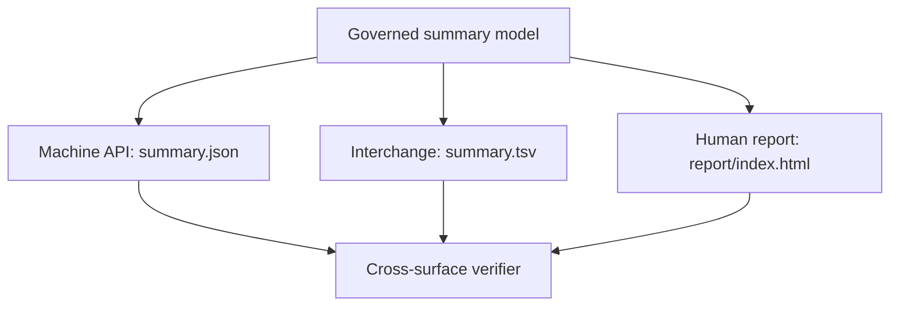
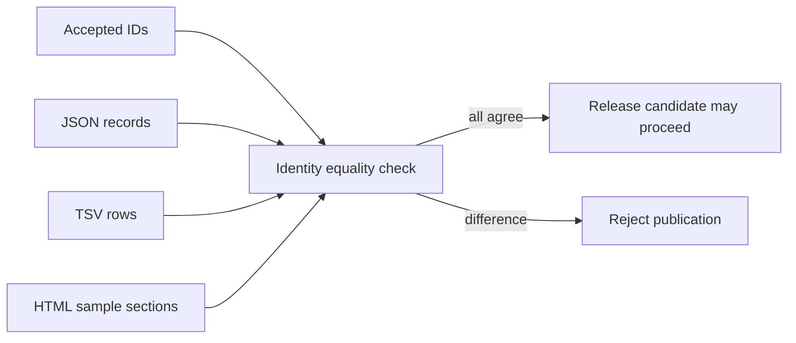

# Reports, File APIs, and Human Versus Machine Surfaces

A human report and a machine API can describe the same run without serving the same
contract. Humans need explanation, units, context, and visual hierarchy. Programs need
stable paths, schemas, types, and failure behavior.

This lesson gives each surface an authority rule and then verifies that both are generated
from the same governed data.

## Three audiences

| Audience | Typical question | Suitable surface |
| --- | --- | --- |
| analyst or scientist | what happened and which results deserve attention? | HTML or PDF report |
| downstream program | which exact values can I parse reliably? | JSON, TSV, Parquet, or another declared file API |
| reviewer or steward | which files, code, configuration, and evidence support the release? | manifest, provenance, verification report |

One person can occupy several roles. The contracts remain distinct.



Generate all views from one governed model. Do not generate the JSON by scraping the HTML
or the HTML by reverse-engineering a TSV with weaker semantics.

## Assign authority

A publish guide should answer:

- Which surface is authoritative for exact values?
- Which surface is authoritative for narrative interpretation?
- Which file defines sample membership?
- Which file inventories bundle bytes?
- Which disagreements cause publication failure?

For the capstone:

| Question | Authority |
| --- | --- |
| accepted sample IDs | `discovered_samples.json` |
| exact published metrics | `summary.json` |
| compact tabular exchange | `summary.tsv`, checked against JSON |
| human interpretation | `report/index.html`, generated from summary JSON |
| run identity | `provenance.json` |
| public path and digest inventory | `manifest.json` |

The HTML report is not authoritative for machine values merely because it displays them.

## Why scraping reports is fragile

An HTML consumer may depend on:

- element order;
- CSS classes;
- display formatting;
- rounded numbers;
- human labels;
- hidden accessibility text;
- JavaScript-rendered content.

A harmless design change can break the scraper. Worse, a scraper may continue working
while capturing the wrong column.

If machine use matters, publish a machine surface and test it. Do not call a scraper a
supported API unless the HTML structure itself is versioned and tested as one.

## Machine surfaces need more than valid syntax

For `summary.json`, declare:

- relative path;
- schema version;
- record identity;
- required and optional fields;
- field types;
- definitions and units;
- null and missing behavior;
- ordering rules;
- extension policy;
- compatibility tests.

Example:

```json
{
  "schema_version": 1,
  "field_semantics": {
    "reads_count": {
      "definition": "number of sequencing reads",
      "unit": "reads"
    }
  },
  "records": [
    {
      "sample_id": "alpha",
      "reads_count": 10
    }
  ]
}
```

A consumer fixture can verify this directly.

## TSV has its own contract

TSV is easy to inspect and widely supported, but define:

- header spelling and order;
- delimiter and quoting;
- newline convention;
- encoding;
- missing-value token;
- numeric formatting;
- row identity and order;
- whether comments are allowed.

Example:

```text
sample_id	reads_count
alpha	10
```

Do not assume a JSON schema automatically defines TSV behavior.

## Human reports need explicit units and limitations

A strong report shows:

- release and contract version;
- sample scope;
- metric labels with units;
- data-quality or completeness status;
- links or references to machine artifacts;
- generation identity;
- limitations and excluded samples;
- accessible tables or textual equivalents for essential figures.

It should not expose internal scratch paths, raw stack traces, or secrets simply because
they were available during rendering.

## Cross-surface consistency

Let:

- `J` = records in `summary.json`;
- `T` = rows in `summary.tsv`;
- `H` = sample cards or table rows in the HTML report;
- `A` = accepted discovery membership.

For a full release:

```text
ids(J) = ids(T) = ids(H) = A
```

For every shared metric:

```text
value_JSON(sample, field)
  = parsed_value_TSV(sample, column)
  = unrounded_source_value_HTML(sample, label)
```

The HTML may display rounded text, but its source model should preserve the exact value
and declare formatting.



## Avoid parallel calculation

Weak pattern:

- one script computes JSON;
- a second independently scans results for TSV;
- a third recomputes metrics for HTML.

The surfaces can diverge even when each script succeeds.

Stronger pattern:

1. build one validated in-memory summary model;
2. serialize JSON;
3. derive TSV from the same model;
4. render HTML from the same model;
5. parse outputs back through consumer-side checks;
6. compare identities and shared values.

This still requires format-specific tests, but it removes three competing calculation
authorities.

## A report change can still be breaking

Human surfaces also carry promises. Examples:

- removing a result interpretation used in review;
- hiding excluded samples;
- changing units without labeling;
- removing accessible table equivalents;
- renaming a stable report path;
- changing a warning from prominent to invisible.

Not every visual restyle requires a publish version. Evaluate whether supported human
decisions or navigation paths change.

## A machine field can be presentation-only

Fields such as:

```json
{
  "display_color": "#2a9d8f",
  "formatted_reads": "10 reads"
}
```

may help a frontend but can couple the machine API to presentation. Prefer raw governed
values and let the report renderer own styling. Publish presentation fields only when a
consumer needs them and their compatibility is supported.

## Consumer fixture examples

Machine consumer:

```python
payload = load_json(bundle / "summary.json")
assert payload["schema_version"] == 1
for record in payload["records"]:
    assert isinstance(record["sample_id"], str)
    assert isinstance(record["reads_count"], int)
```

Human smoke test:

```python
html = (bundle / "report" / "index.html").read_text(encoding="utf-8")
assert "Sequencing reads" in html
assert "alpha" in html
assert 'href="../summary.json"' in html
```

Add an HTML parser or accessibility checker for structural claims. String checks are only
a bounded example.

## Design an authority matrix

For every duplicated fact:

| Fact | Authoritative source | Derived surfaces | Drift check |
| --- | --- | --- | --- |
| accepted sample IDs | discovery JSON | summary, TSV, HTML | exact set equality |
| read count | summary model/JSON | TSV, HTML | parsed numeric equality |
| run commit | provenance JSON | report footer | exact string equality |
| publish paths | manifest JSON | report download links | link target subset |
| excluded samples | rejection or completeness artifact | report warning | identity and reason equality |

This matrix tells maintainers where to fix a disagreement.

## Failure patterns

### HTML is the only output

Programs scrape presentation. Add a stable machine surface and name it authoritative for
values.

### JSON mirrors internal objects

Implementation refactors become public breaks. Project a supported schema.

### JSON and TSV disagree

Independent calculations or formatting loss exist. Generate from one model and parse back
for comparison.

### Report omits rejected samples

Human reviewers see a clean story while machine evidence records exclusions. Add visible
completeness and exclusion context.

### Machine consumer relies on list order

If order is meaningful, declare and test it. Otherwise publish keyed records or require
consumers not to infer rank.

### Report links internal paths

The public surface leaks implementation ownership. Link only supported public artifacts.

## Hands-on review

Take one capstone release and build this table:

| Sample | Discovery | JSON | TSV | HTML |
| --- | --- | --- | --- | --- |
| sampleA | present? | present and values | present and values | present and displayed values |
| sampleB | present? | present and values | present and values | present and displayed values |

Record exact discrepancies. Do not resolve a mismatch by choosing whichever surface looks
most plausible; use the authority matrix.

## Review checklist

- [ ] Human, machine, and stewardship audiences have distinct supported surfaces.
- [ ] Exact-value authority is named.
- [ ] All views derive from one governed summary model.
- [ ] JSON semantics include definitions, units, and missing-value behavior.
- [ ] TSV encoding, headers, order, and missing values are specified.
- [ ] Reports display units, scope, exclusions, and limitations.
- [ ] Essential human content is accessible without scraping visual layout.
- [ ] Cross-surface sample IDs and values are verified.
- [ ] Report links remain inside the public boundary.
- [ ] Presentation fields do not leak into the machine contract accidentally.
- [ ] Human-surface changes are reviewed for decision impact.

## What you should carry forward

Different formats can serve different audiences while remaining consistent. Authority,
shared-source generation, and cross-surface verification keep a report from becoming an
accidental API and a machine file from becoming an unexplained data dump. The next lesson
uses these contracts to triage candidate drift from a downstream maintainer’s position.
