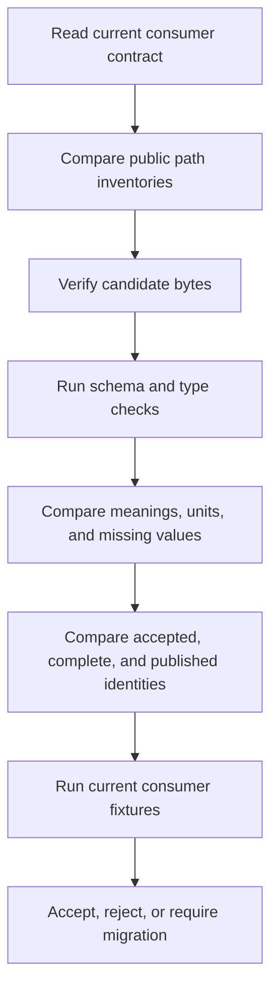
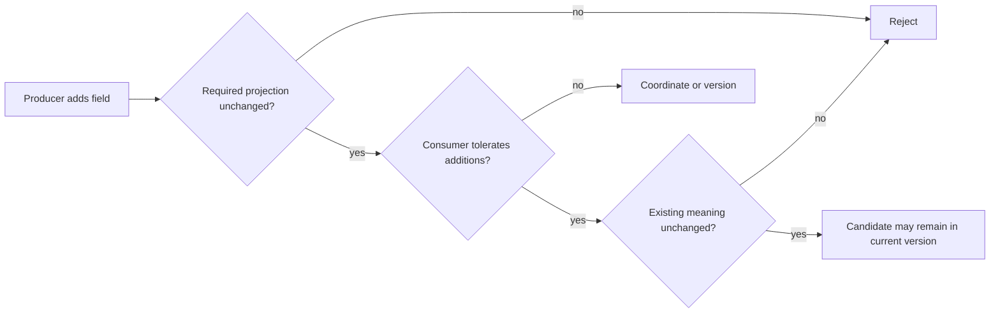

# Reviewing Publish Drift and Downstream Risk

Publish review is an outside-in investigation. Begin with what consumers rely on, then
classify the candidate’s effects on paths, bytes, structure, meaning, completeness, and
migration.

This lesson provides a repeatable triage route and shows why producer-side success is weak
evidence for downstream safety.

## Freeze the current contract first

Before inspecting a candidate diff, collect:

- current public path allowlist;
- artifact schemas;
- field definitions and units;
- consumer fixtures;
- completeness and partial-publication policy;
- integrity algorithm and manifest schema;
- supported human navigation paths;
- current publish version and retirement policy.

Without a baseline, reviewers can notice change but cannot classify compatibility.

## The outside-in route



Do not begin with the Snakefile diff. It explains implementation after consumer-visible
effects are known.

## Drift classes

| Drift class | Example | Primary evidence |
| --- | --- | --- |
| boundary | new or removed public file | path inventory diff |
| location | `summary.json` renamed | current consumer missing-path failure |
| integrity | file changed after manifest | digest mismatch |
| structure | required field removed | schema or consumer failure |
| type | integer becomes string | type assertion |
| semantics | reads become bases | field-definition comparison |
| completeness | accepted sample missing from summary | set equality |
| presentation | report hides exclusions | human contract review |
| version | breaking candidate remains under v1 | publish-version decision |
| migration | v2 exists without consumer or overlap | migration packet review |

One candidate can contain several classes. Report each rather than choosing the most
visible.

## Risk depends on failure mode

Use a risk matrix:

| Consumer effect | Detectability | Example | Risk |
| --- | --- | --- | --- |
| hard failure, immediate | high | required path removed | visible outage |
| hard failure, delayed | medium | field absent only for some records | partial outage |
| silent wrong result | low | unchanged integer now uses different unit | highest analytical risk |
| ignored safe extension | high | optional field under open contract | low |
| integrity mismatch | high with verification | modified artifact after inventory | delivery rejection |
| human misinterpretation | variable | report omits exclusions | review risk |

Silent semantic drift deserves more scrutiny than an obvious parser error.

## Compare producer and consumer evidence

Producer evidence:

- workflow completed;
- files were generated;
- schemas used by producer code passed;
- report rendered;
- tests for new code passed.

Consumer evidence:

- required paths remain locatable;
- current parser accepts the candidate;
- required fields and types remain available;
- meanings and units remain stable;
- completeness invariants hold;
- delivered bytes match inventory.

Both matter. Only the second directly supports compatibility.

## Read the capstone audit

Run:

```bash
cd programs/reproducible-research/deep-dive-snakemake/capstone
make publish-compatibility-audit
```

Start with the current consumer:

```text
specimens/consumer-v1.json
```

Then inspect `summary.tsv`:

```text
baseline                ACCEPT_CURRENT
additive-field          ACCEPT_CURRENT
required-field-removal  REJECT_CURRENT
path-rename             REJECT_CURRENT
semantic-drift          REJECT_CURRENT
integrity-corruption    REJECT_CURRENT
versioned-migration     REQUIRE_MIGRATION
```

`PASS` in the report means the named classification was reproduced. It does not mean
`semantic-drift` is safe.

## Investigate first failure without stopping reasoning

The compact report includes a first current-consumer failure. This accelerates triage:

```text
required publish paths are missing: ['summary.json']
checksum mismatch: summary.json
field semantics changed for reads_count
```

The first failure is not always the full impact. For v2, the old consumer may reject
version, path, schema, and fields. Use `report.json` for the complete failure set before
writing a migration note.

## Review same-version additions

For an added field:

1. confirm required fields remain;
2. read the consumer’s additional-field policy;
3. confirm new semantics do not redefine existing fields;
4. check other known consumers, not only the reference fixture;
5. verify inventories if the new field introduces a new file;
6. retain a regression fixture.



“Additive” describes the diff, not the compatibility result.

## Review path changes

A path rename affects:

- scripts with hard-coded paths;
- workflow inputs in other repositories;
- report download links;
- object-store keys;
- retention and access policies;
- cache and synchronization rules.

Ask for current-consumer execution. If the old path must disappear, require a new version
or an overlap mechanism with an owner and end condition.

## Review semantic changes

Compare a semantic ledger:

| Field | Current definition | Candidate definition | Current unit | Candidate unit | Decision |
| --- | --- | --- | --- | --- | --- |
| `reads_count` | sequencing reads | nucleotide bases | reads | bases | break |
| `qc_status` | absent | QC disposition | — | category | addition, consumer-dependent |

Also inspect:

- denominators;
- aggregation level;
- normalization;
- rounding;
- missing-value rules;
- filtering and inclusion criteria;
- rank or sort meaning.

These changes can preserve field name and type.

## Review completeness drift

A candidate may preserve every schema but omit one accepted sample. Compare:

```text
accepted A
complete C
JSON ids J
TSV ids T
HTML ids H
```

For full publication:

```text
A = C = J = T = H
```

If any set differs, report the exact differences:

- accepted but incomplete;
- complete but unpublished;
- published but unaccepted;
- machine/human disagreement.

Do not say only “counts differ.” Identities matter.

## Review versioned migrations

For `REQUIRE_MIGRATION`, verify:

- current consumer rejects for the intended reasons;
- next consumer accepts;
- new path and schema are documented;
- field mapping and semantic differences are explicit;
- v1 remains available for the promised overlap;
- producers can build both versions consistently if dual publication is promised;
- consumer readiness is observable;
- retirement has an owner and exit criteria.

A migration is not complete because a v2 test passes. It completes when supported
consumers have moved or the declared retirement policy is satisfied.

## Use causal mutations

Run:

```bash
make publish-compatibility-selftest
```

The gate should fail if:

- `reads_count` is removed from the “additive” case;
- semantic drift is removed from the semantic counterexample;
- corruption is removed from the integrity counterexample;
- the current consumer stops requiring `reads_count`.

This protects against a review suite that turns green by weakening expectations.

Add project-specific mutations:

- change only unit metadata;
- retain a field but change missing values;
- add an unexpected public file;
- remove one accepted sample from only the HTML report;
- make v2 consumer accept both old and new meanings accidentally.

## Write a review decision

Use this structure:

```text
Decision:
Consumer evaluated:
Candidate boundary:
Integrity result:
Path and schema result:
Semantic result:
Completeness result:
Migration requirement:
Evidence:
Claim limit:
```

Example:

> Decision: reject from v1. The current consumer locates and parses `summary.json`, but
> the candidate changes `reads_count` from reads to bases. Integrity and type checks pass;
> semantic compatibility fails. Publish the new metric only under a tested v2 contract
> with an overlap plan. This review covers the reference consumer fixture, not every
> external consumer.

## Triage table

| Observation | Immediate decision | Follow-up |
| --- | --- | --- |
| current consumer accepts, semantics stable | candidate may remain current | retain regression test |
| checksum mismatch | reject delivery | identify mutation or transfer fault |
| required path missing | reject current version | restore path or design migration |
| required field missing | reject current version | restore field or design migration |
| same shape, changed meaning | reject current version | create explicit semantic break |
| old rejects, new accepts under new version | require migration | review overlap and retirement |
| human and machine identities differ | reject publication | restore shared authority and regenerate |

## Review checklist

- [ ] The current contract is frozen before candidate inspection.
- [ ] Review begins from consumer-visible effects.
- [ ] Boundary, integrity, structure, semantics, completeness, and migration are separate.
- [ ] Silent semantic risk receives explicit attention.
- [ ] Current consumer fixtures execute against the candidate.
- [ ] First failure is used for triage, not mistaken for full impact.
- [ ] Identity set differences are reported exactly.
- [ ] Same-version additions rely on declared tolerance.
- [ ] Versioned breaks include next-consumer evidence.
- [ ] Causal mutations prevent fixture weakening.
- [ ] Decision text states evidence and claim limits.

## What you should carry forward

Publish drift becomes reviewable when a stable consumer baseline meets an isolated
candidate and produces classified evidence. The worked example now applies the full route:
selecting public files, building the bundle, corrupting it, classifying evolution, and
preparing a migration packet.
