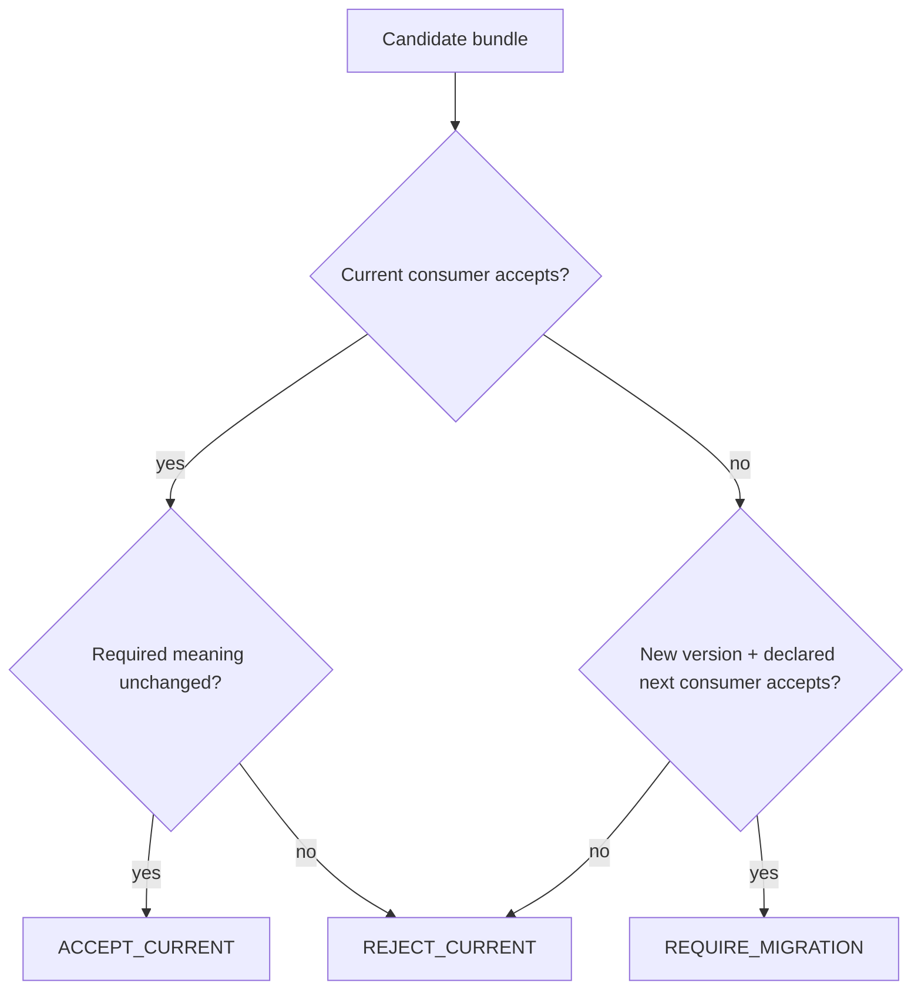
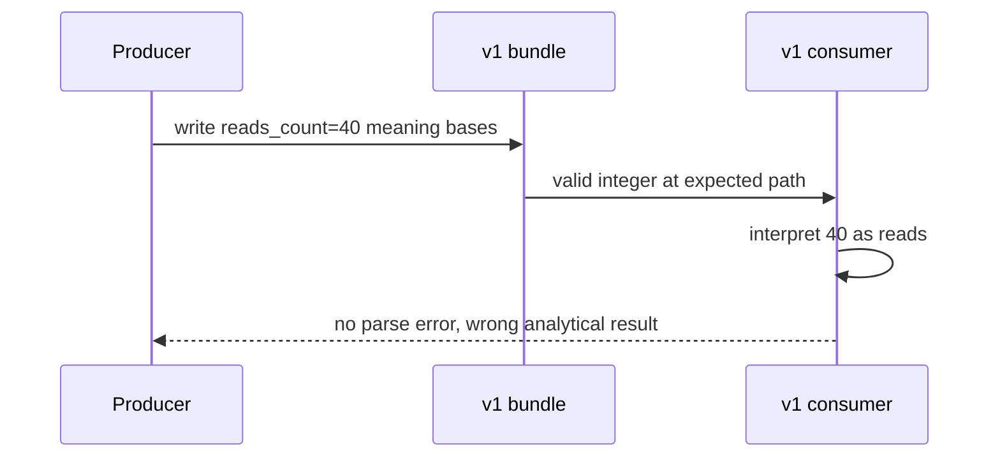

# Versioned Publish Boundaries and Compatible Change

`publish/v1/` is a compatibility promise. It says that consumers written for the v1
contract can continue finding and interpreting supported artifacts there.

A versioned directory does not make arbitrary changes safe. This lesson classifies change
against executable consumer expectations and builds a migration when the current
consumer must stop accepting the candidate.

## Compatibility is a relationship

Let:

- `C1` be the current consumer contract;
- `B` be a candidate bundle.

Current compatibility is:

```text
C1(B) = accept
```

The producer’s intention does not appear in that expression. Neither does “valid JSON”
or “workflow succeeded.”

For a breaking v2 candidate:

```text
C1(B2) = reject
C2(B2) = accept
```

That is a migration-required outcome, not evidence that B2 is backward compatible.



The explicit semantic check matters because a structurally permissive consumer can accept
bytes it will interpret incorrectly.

## What belongs in a consumer contract

For a file-based API, declare:

- publish version;
- required relative paths;
- artifact schema versions;
- required and optional fields;
- field types;
- definitions and units;
- missing-value behavior;
- ordering guarantees where relevant;
- additional-field policy;
- integrity expectations;
- completeness policy.

The capstone specimen expresses a focused subset in JSON:

```json
{
  "publish_version": "v1",
  "required_paths": ["summary.json"],
  "artifact_path": "summary.json",
  "artifact_schema_version": 1,
  "required_fields": {
    "sample_id": "string",
    "reads_count": "integer"
  },
  "allow_additional_fields": true,
  "field_semantics": {
    "reads_count": {
      "definition": "number of sequencing reads",
      "unit": "reads"
    }
  }
}
```

This is more useful than “v1 JSON” because it tells the verifier what the consumer
actually relies on.

## Classify change by consumer effect

| Producer change | Same-version default | Why |
| --- | --- | --- |
| add field tolerated by declared consumer | possibly compatible | required projection remains readable |
| add field to closed-schema consumer | breaking | parser rejects unknown property |
| remove required field | breaking | consumer cannot obtain required value |
| rename public path | breaking | consumer cannot locate artifact |
| widen integer to number | consumer-dependent | parser and domain assumptions may differ |
| change unit without changing field | breaking | same syntax carries new meaning |
| change missing value from absent to `null` | consumer-dependent | access and type behavior change |
| reorder an explicitly unordered object | compatible | consumer promises not to depend on order |
| reorder a documented ranked list | breaking | position has meaning |
| add a new independent public file | consumer-dependent | inventory strictness and discovery rules matter |

Words such as “additive” and “small” are not decisions. Run the current consumer.

## The additive-field experiment

Baseline record:

```json
{
  "sample_id": "alpha",
  "reads_count": 10
}
```

Candidate:

```json
{
  "sample_id": "alpha",
  "reads_count": 10,
  "qc_status": "pass"
}
```

The lab’s v1 consumer sets `allow_additional_fields: true` and therefore accepts the
candidate. Required fields and semantics remain unchanged.

A closed consumer would reject it:

```json
{
  "allow_additional_fields": false
}
```

The correct conclusion is:

> Adding `qc_status` is compatible with the declared open v1 consumer.

Do not generalize beyond the fixture.

## Required-field removal

Candidate:

```json
{
  "sample_id": "alpha"
}
```

The verifier reports:

```text
record 0 is missing required field reads_count
```

Keeping this under `publish/v1/` would make old consumers fail or invent a fallback. If
the metric is no longer supportable, introduce a new contract and a migration plan.

Deprecation before removal can help, but only when:

- old and replacement fields coexist for a declared interval;
- both meanings are documented;
- consumer telemetry or acknowledgements support retirement;
- a test proves the replacement consumer works.

## Path rename

Changing:

```text
publish/v1/summary.json
```

to:

```text
publish/v1/metrics.json
```

is breaking even when bytes are identical. Paths are part of a file API.

Safer transition choices:

- retain both paths in v1 with one designated authority and a retirement plan;
- introduce only `publish/v2/metrics.json`;
- provide a compatibility copy if duplication and divergence are controlled;
- ship a consumer adapter with tested behavior.

Avoid symlink-based promises unless every supported storage and consumer environment
handles symlinks consistently.

## Semantic drift

The most dangerous same-version break may preserve path, field, and type:

```text
v1 expectation: reads_count = number of sequencing reads, unit reads
candidate:      reads_count = number of nucleotide bases, unit bases
```

Schema shape passes. The downstream calculation is wrong.



Field semantics and units must be testable contract data, not only prose in a distant
guide.

## Design a v2 migration

The specimen makes the break explicit:

```text
v1: summary.json, schema 1, reads_count, unit reads
v2: metrics.json, schema 2, read_bases, unit bases
```

The old consumer rejects v2 because:

- publish version differs;
- required v1 path is absent;
- v1 schema and field are absent.

The new consumer accepts v2. A complete migration also needs:

1. reason for the new metric and path;
2. field mapping or statement that no direct mapping exists;
3. example v2 bundle;
4. executable v2 consumer fixture;
5. overlap period for v1 and v2;
6. owner and support window;
7. retirement criteria based on consumer evidence;
8. rollback or extension decision if consumers are not ready.

Creating `v2/` covers only one item.

## Do not overwrite old versions

If `publish/v1/` is mutable, a consumer cannot infer compatibility from its path. Prefer
immutable releases or release-addressed bundles inside each contract version:

```text
publish/
├── v1/
│   ├── release-2026-07-01/
│   └── release-2026-07-15/
└── v2/
    └── release-2026-08-01/
```

The timestamp here identifies a release occurrence, not a transitional code name. A
content-addressed or domain-specific release identifier may be preferable.

Define whether a `latest` pointer exists, who updates it, and whether consumers may treat
it as immutable.

## Version directory and schema version are distinct

`publish/v2/` identifies the file API boundary. `schema_version: 2` identifies the
artifact structure. They may move together in a simple system, but they answer different
questions.

| Version | Scope |
| --- | --- |
| publish boundary version | paths, artifact set, cross-file meaning, compatibility policy |
| artifact schema version | structure and semantics of one serialized artifact |
| tool version | implementation identity |
| data release identifier | one published occurrence or dataset state |

Do not reuse one number to stand in for all four unless the project deliberately couples
their lifecycle.

## Run the compatibility matrix

```bash
cd programs/reproducible-research/deep-dive-snakemake/capstone
make publish-compatibility-audit
```

Focus on:

```text
baseline             ACCEPT_CURRENT
additive-field       ACCEPT_CURRENT
required-field-removal REJECT_CURRENT
path-rename          REJECT_CURRENT
semantic-drift       REJECT_CURRENT
versioned-migration  REQUIRE_MIGRATION
```

Then inspect the exact current and next consumer failures in `report.json`. A decision
without supporting failures is not enough for a migration review.

## Migration review checklist

- [ ] Current consumer expectations are executable.
- [ ] Candidate compatibility is evaluated, not inferred from the diff.
- [ ] Additional-field tolerance is explicit.
- [ ] Required paths and fields remain available inside the current version.
- [ ] Field definitions, units, and missing-value rules remain stable.
- [ ] Breaking changes are isolated from the old boundary.
- [ ] A new consumer fixture accepts the new contract.
- [ ] Old consumers reject new meaning rather than silently misread it.
- [ ] Overlap, support ownership, and retirement evidence are named.
- [ ] Immutable release identity is separate from contract version.
- [ ] Rollback or extension conditions are defined.

## What you should carry forward

Versioning is a coordination mechanism. Current compatibility requires current-consumer
acceptance with preserved meaning. Breaking evolution requires a new boundary, a new
consumer, and a migration whose completion can be observed. The next lesson ensures the
bundle delivered under either version contains exactly the inventoried bytes.
