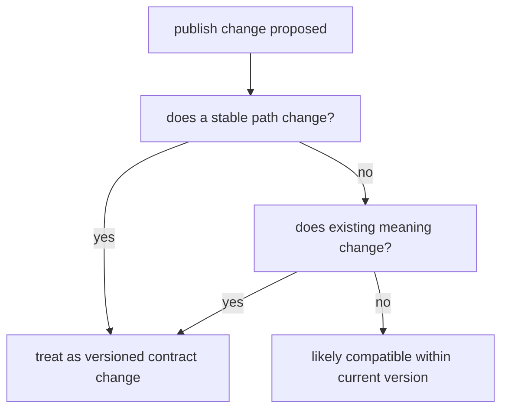

# Versioned Publish Boundaries and Compatible Change

Once you know which files belong in the public contract, the next question appears:

> how do downstream users know when that contract has changed?

That is the job of versioned publish boundaries.

Versioning is not a cosmetic folder name. It is how a workflow tells the downstream world
whether paths, payloads, and expectations are still stable.

## How to use this page

Keep one imaginary downstream consumer in front of you while you read.

That consumer might be:

- a notebook written last month
- another repository that reads `summary.json`
- a report builder that expects a stable `report/index.html`

Now ask one question repeatedly:

> if I change this bundle today, what will that consumer experience tomorrow?

That is the question versioning exists to answer honestly.

## `publish/v1/` is a promise, not a convenience path

When a workflow publishes under a path such as `publish/v1/`, it is saying:

- the files in this boundary are intentionally public
- their paths and meanings are being treated with compatibility discipline
- downstream users should not have to guess whether a change is safe

That is much stronger than simply storing outputs in a neat folder.

## Why versioning belongs to publish design

Without a versioned boundary, small publish changes become dangerous:

- a stable filename disappears
- a JSON field is removed
- a report path moves
- a manifest changes shape

Each change may feel local to the author. To downstream users, those are contract changes.

Versioning makes that change visible instead of surprising.

## Start with the public promise, not with the diff

Beginners often review publish changes by looking only at what changed in Git.

That is too producer-centered.

A better approach is:

1. state the current public promise
2. ask whether the old promise is still true after the change
3. decide whether the current version can still carry that promise honestly

This framing matters because a tiny diff can still be a major downstream change.

## One useful distinction: compatible change versus contract change

Not every improvement requires a new publish version.

Some changes are often compatible:

- adding a new optional JSON field
- improving report styling without changing report location or core purpose
- adding more documentation around the published bundle

Some changes are usually contract changes:

- renaming a published file
- removing a field consumers may already use
- changing a path that scripts or notebooks are expected to read
- changing the semantics of an existing artifact without signaling it

That is the judgment this page is trying to sharpen.

## A simple compatibility map

This is not a legal standard. It is a practical review tool.

## A learner-friendly rule of thumb

Inside one publish version, prefer changes that are clearly additive:

- new optional fields
- extra explanatory documentation
- a new helper artifact that does not replace or rename the current contract

Treat these as version-discussion triggers:

- file renames
- removed fields
- changed field meaning
- changed expectations about where consumers should read from

The point is not to freeze the bundle forever. The point is to stop calling breaking
changes "minor" just because they felt small to the author.

## The capstone example is already opinionated

The workflow contract guide explicitly treats `publish/v1/` as the smaller public
boundary.

That means files such as:

- `summary.json`
- `summary.tsv`
- `report/index.html`
- `manifest.json`
- `provenance.json`
- `discovered_samples.json`

are expected to be reviewed as part of a versioned surface, not as loose outputs.

## One concrete review scenario

Suppose `publish/v1/summary.json` currently contains:

- sample identifiers
- a QC status field
- a metric used by a downstream plotting notebook

Now imagine three possible changes:

1. add a new optional field called `cohort`
2. rename `qc_status` to `status`
3. keep the field name but change the meaning from per-sample QC to bundle-level QC

These changes are not equally risky.

- the first is often compatible
- the second is usually a contract change
- the third is also a contract change, even though the path and key name stayed the same

This is why semantic review matters as much as file review.

## Weak version discipline

Weak shape:

- publish files are renamed casually
- one run adds extra artifacts with no contract discussion
- consumers are expected to “just update” when the bundle changes

This creates hidden downstream work and weakens trust in the bundle.

## Strong version discipline

Strong shape:

- treat path stability as part of the public promise
- distinguish additive compatible change from breaking contract change
- bump the publish version when the old promise is no longer true
- document the meaning of the published files so reviews are concrete

This gives a workflow the same kind of discipline that software interfaces need.

## The beginner mistake to catch early

The most common beginner mistake is to think a version bump is only needed when the file
tree changes dramatically.

That is false.

Small-looking changes can still break downstream readers if they alter:

- stable paths
- stable field names
- stable semantics

The size of the edit is not the test. The survival of the old promise is the test.

## A practical review test

Ask these questions:

1. Would an existing downstream notebook still find the same path?
2. Would an existing parser still understand the same payload meaning?
3. Is the change additive, or does it alter an existing promise?

If the answer to the first or second question is no, treat the change as a contract change
unless you can defend compatibility clearly.

## Common failure modes

| Failure mode | What happens | Better repair |
| --- | --- | --- |
| publish path renamed casually | downstream automation breaks silently | treat path renames as versioned contract changes |
| optional fields removed later | consumers lose information without warning | prefer additive evolution inside a version |
| report meaning changes without documentation | humans and tools interpret the bundle inconsistently | document artifact roles and change semantics deliberately |
| new files appear in `publish/v1/` with no review | the boundary grows by drift rather than design | require a downstream-use reason for new public artifacts |
| version number never changes because change feels small locally | accumulated drift breaks consumer trust | use downstream compatibility, not author convenience, as the threshold |

## What a reviewer should hear

Good publish-version reasoning sounds like this:

> The old consumer can still find the same path and interpret the same meaning, so this
> stays inside `v1`.

Or:

> The old consumer would need code changes or a new semantic assumption, so we should not
> pretend this is still the same public version.

That kind of explanation teaches the team how to reason about stability.

## The explanation a reviewer trusts

Strong explanation:

> `publish/v1/summary.json` keeps the same role and core fields, so this change is
> compatible inside the current version; if we rename the file or change the meaning of an
> existing field, we should publish under a new versioned boundary instead.

Weak explanation:

> the structure changed a bit, but downstream users can adapt.

The strong explanation starts from the contract. The weak explanation pushes the burden
onto consumers after the fact.

## End-of-page checkpoint

Before leaving this page, you should be able to:

- explain why versioning belongs to publish boundaries rather than only release notes
- distinguish an additive compatible change from a contract-breaking change
- explain why path renames are often publish-boundary changes
- describe when a new publish version is the honest repair

If you still describe versioning mainly as folder naming hygiene, pause and reframe. This
page is really about how not to surprise downstream users.
