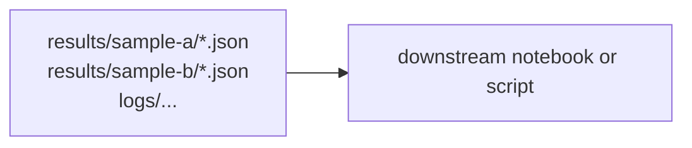
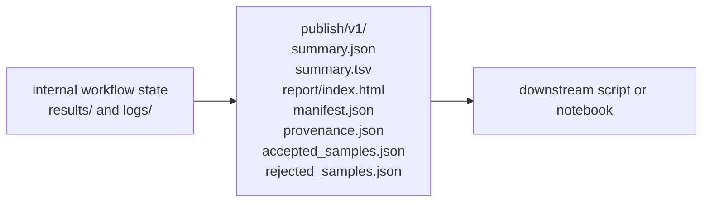
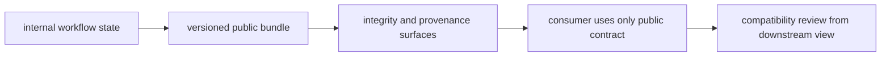

# Worked Example: Promoting Results Into a Versioned Publish Bundle

This file ties the whole module together around one realistic problem:

> a workflow already produces useful results, but downstream users still have no clear, reviewable contract they can trust.

The question is not "how do we copy more files into `publish/`?" The question is how to
turn internal results into a smaller, versioned bundle that another program can use
honestly.

## If you are learning this without the live class

Use the example in five passes instead of trying to absorb the whole publish boundary in
one read:

1. label which current files are internal, diagnostic, human-facing, or machine-facing
2. stop after the first `publish/v1/` sketch and ask whether a consumer can ignore `results/`
3. assign one clear job to each promoted artifact before you add integrity checks
4. run the verifier and the consumer test before you discuss compatibility
5. finish by classifying one change from the consumer's point of view instead of the producer's

If you cannot explain the bundle after pass 2, do not add more promoted files yet. Most
Module 06 confusion starts when learners chase a bigger publish tree before they have
named the public promise.

## How to use this worked example

Work through this page with the five core lessons nearby.

Do not treat it as a decorative summary. Treat it as a guided dry run of the exact review
questions the module is building:

- what stays internal
- what becomes public
- what each public artifact is responsible for
- how the bundle proves itself to a downstream user

## The one-day teaching goal

By the end of this example, you should be able to explain one publish bundle without
falling back on vague phrases like "final outputs" or "metadata."

You should be able to point to each promoted file and say:

- why it is public
- what audience it serves
- what evidence supports trusting it

## The lab route

Work through the example in this order:

1. separate internal workflow detail from files a downstream consumer should see
2. promote the smallest honest public bundle into `publish/v1/`
3. assign one clear job to each artifact in that bundle
4. verify the bundle through manifest and consumer checks
5. finish by classifying one compatible change and one breaking change

Keep one small review packet beside you while you read:

- a public tree sketch for `publish/v1/`
- one artifact-role table
- one manifest verification transcript
- one consumer test transcript
- one compatibility note for a simulated change
- one note naming why reviewed discovery evidence belongs in the public bundle

That packet is not overhead. It is the thing that turns "I published the files" into
"another maintainer can review why this bundle is a real contract."

## The starting situation

Assume the workflow already produces rich internal outputs under `results/`, such as:

- per-sample QC JSON files
- trimming summaries
- deduplication summaries
- screening summaries

Those files are useful, but they are not yet a downstream contract. If another notebook
or pipeline must browse `results/{sample}/` to discover what is safe to read, the publish
story is still weak.

The weakness becomes easier to see if you sketch the current situation:



This shape is convenient for the producer and hostile to the consumer, because the
consumer has to guess which files are stable enough to trust.

## What goes wrong when a learner trusts the starting situation

Use this card before you repair anything:

| If you notice... | The repository is hiding... | Smallest review surface |
| --- | --- | --- |
| consumers browse `results/` to discover what is safe | the public contract has not been named | one artifact-role table plus current tree |
| a report is treated as the only published output | machine and human surfaces are still blended | one consumer need and one report-inspection need side by side |
| a manifest exists but nobody can say what it proves | integrity roles are still fuzzy | one manifest note that separates identity from meaning |
| a compatibility discussion starts from "what changed for us" | the producer is centered instead of the consumer | one consumer test against the changed bundle |

If you can name the hidden defect first, the publish repair stops feeling like folder copying.

## What the learner should notice first

The workflow is not failing here.

The weakness is subtler: the repository is producing useful material, but it is still
making downstream consumers infer the public surface for themselves.

That distinction matters because many real repositories reach this stage and stop too
early.

## Promote only the right surfaces

Start by choosing the smallest bundle that another program can understand:

- `publish/v1/summary.json`
- `publish/v1/summary.tsv`
- `publish/v1/report/index.html`
- `publish/v1/provenance.json`
- `publish/v1/manifest.json`
- `publish/v1/accepted_samples.json`
- `publish/v1/rejected_samples.json`

That bundle is smaller than the full workflow state, but stronger as a contract because
each file has a named role.

The summarize and report rules should make the promotion visible:

```python
rule summarize:
    output:
        json="publish/v1/summary.json",
        tsv="publish/v1/summary.tsv"

rule report:
    input:
        json=rules.summarize.output.json
    output:
        html="publish/v1/report/index.html"
```

This matters because the report now depends on a machine-readable contract file rather
than inventing a separate truth.

The repaired shape should look more like this:



This is the central transition of the module: the consumer no longer reads the producer's
working tree directly. The consumer reads a smaller public bundle with named artifact
roles.

## The publish-boundary audit before you celebrate

Before you call the first bundle healthy, make sure you can answer all four of these:

| Question | Healthy answer |
| --- | --- |
| What stayed internal? | results, logs, and other workflow-operational detail not promised to downstream users |
| What became public? | one small versioned bundle with named artifact roles |
| What would count as a weak boundary? | a consumer still needing to inspect `results/` or infer stable files by habit |
| What evidence proves the boundary is real? | one publish tree, one verifier run, and one consumer test using only the bundle |

If any row stays vague, keep repairing. The bundle may exist, but the contract may still be weak.

## A short checkpoint before you continue

Pause here and ask:

- could a downstream script work only from `publish/v1/`?
- could a reviewer explain why each promoted file is public?
- could the internal workflow tree change without automatically breaking the consumer?

If the answer to any of these is no, the bundle is not yet ready.

## Give every artifact one job

The bundle works only if each artifact has a stable role:

- `summary.json` and `summary.tsv`: machine-facing contract files
- `report/index.html`: human-facing interpretation
- `manifest.json`: inventory and checksum evidence
- `provenance.json`: software-context evidence
- `accepted_samples.json`: reviewed accepted membership record
- `rejected_samples.json`: reviewed rejection record that explains non-membership

Once those roles are clear, a downstream maintainer can ask better questions:

- which file should my code read
- which file should a human inspect
- which file tells me whether the bundle is damaged
- which file tells me what software context produced the bundle

At this stage, sketch the bundle itself and refuse to continue until every file has one
role you can say aloud:

```text
publish/v1/
├── summary.json
├── summary.tsv
├── report/
│   └── index.html
├── manifest.json
├── provenance.json
├── accepted_samples.json
└── rejected_samples.json
```

If two files still sound interchangeable in your explanation, the bundle is not ready for
review yet.

## Why this role separation matters educationally

This is the moment where learners usually stop calling everything "the output."

That change in language is important. Once each artifact has one named job, bundle review
becomes more precise and much easier to teach.

## Inventory the contract explicitly

The publish rule should gather the promoted surfaces into a manifest with stable relative
paths:

```python
rule manifest:
    input:
        summary_json = rules.summarize.output.json,
        summary_tsv  = rules.summarize.output.tsv,
        report_html  = rules.report.output.html,
        provenance   = rules.provenance.output.json,
        accepted     = rules.publish_accepted_samples.output.json,
        rejected     = rules.publish_rejected_samples.output.json,
    output:
        json = "publish/v1/manifest.json"
```

The important thing is not the syntax. It is the claim the manifest makes: these are the
files that belong to the public bundle.

Use stable relative paths and checksums, for example:

```json
{
  "contract_version": "v1",
  "files": [
    {"path": "summary.json", "sha256": "..."},
    {"path": "summary.tsv", "sha256": "..."}
  ]
}
```

Do not write absolute machine-specific paths into the manifest. The contract must travel
with the bundle.

That portability question is not cosmetic. A downstream user should be able to untar the
bundle somewhere else and still run the verifier successfully:

```sh
python scripts/verify_publish.py --publish publish/v1
```

If verification only works from one original repository location, the publish contract is
still entangled with producer-only assumptions.

## The integrity audit before you move on

Do not just say "the bundle verifies." Test whether you can name what each integrity
surface actually does:

| Surface | Smallest honest claim |
| --- | --- |
| manifest plus checksums | these public files are the ones promised, and their bytes match the inventory |
| provenance | this software and run context produced the bundle |
| accepted and rejected discovery records | this is why the public result set has its exact membership |
| consumer test | a downstream user can use the documented machine-facing artifact without internal knowledge |

If you cannot fill this table, the bundle is still carrying an undifferentiated "metadata"
story instead of distinct trust surfaces.

## Verify the bundle from the consumer side

Now make the bundle prove itself through two routes:

```sh
python scripts/verify_publish.py --publish publish/v1
python scripts/consume_summary.py publish/v1/summary.json
```

The first route checks the bundle's internal coherence. The second route checks whether a
consumer can use the documented machine-facing surface without any secret knowledge of the
repository.

That second test is often where weak publish boundaries become obvious.

Pause here and imagine the consumer's starting point:

1. they have the bundle path
2. they do not know your internal `results/` layout
3. they should still be able to validate and use one documented machine-facing file

That is why the consumer command is educationally important. It proves the contract from
the outside rather than from producer memory.

At the same time, a human reviewer should be able to explain result membership without
opening the internal `results/` tree, because the accepted and rejected discovery records
now travel with the published bundle.

## What the learner should notice now

The bundle is no longer just "generated output." It has become something that can be
verified from the outside.

That is a major shift in maturity, and it is what Module 06 is trying to normalize.

## Think through change scenarios

Now imagine three possible changes:

1. `summary.json` gains a new optional field.
2. `report/index.html` is renamed to `report/report.html`.
3. another team starts reading `results/sample-a/kmer.json` because the publish bundle
   does not yet expose what they need.

These changes do not mean the same thing:

- the first may be a compatible additive change
- the second is likely a public-path compatibility problem
- the third is a warning that the bundle may need to grow, not permission to bypass it

That is exactly the judgment this module is trying to teach.

The compatibility review can be summarized in one simple matrix:

| Change | Consumer impact | Likely classification |
| --- | --- | --- |
| add optional field to `summary.json` | old consumers may still work | potentially compatible |
| rename `report/index.html` | documented public path changes | likely version discussion |
| read `results/` because bundle is missing something | consumer bypasses contract | bundle-design problem |

## The repaired publish story

By the end of the repair, the workflow can be described cleanly:

1. internal results remain workflow-operational detail
2. a smaller versioned bundle becomes the downstream contract
3. machine and human artifacts have different jobs
4. manifests and provenance defend different parts of trust
5. consumer tests review the bundle from the outside

That is what it means to promote results into a versioned publish bundle.



Read that diagram literally. If one step is missing, the repository may still publish
files, but the downstream contract is not yet teachable.

## Review questions for the repaired design

When you inspect a repository shaped like this, ask:

1. which files are public promises and which remain internal workflow state
2. which machine-facing artifact a downstream program should read first
3. where integrity evidence lives and what it can actually prove
4. which change would require a version discussion
5. how the bundle would behave for a consumer that knows nothing about `results/`

If those answers are visible, the module's publish story has landed.

## If the module still feels abstract

Do this recovery loop in order:

1. print the current artifact-role table
2. point to one machine-facing file and one human-facing file
3. say what the manifest proves and what it does not prove
4. run one consumer test with access only to `publish/v1/`
5. classify one changed file or path from the consumer's survival point of view

Most Module 06 confusion is not about versioning syntax. It is about losing track of
which bundle artifact owns which public promise.

If you want one final classroom-style check, try to explain the bundle in four sentences:

1. which file a downstream program should read first
2. which file a human should inspect first
3. which file proves inventory and identity
4. which file explains software context without replacing the contract

If that explanation is clear, the worked example has done its job.
