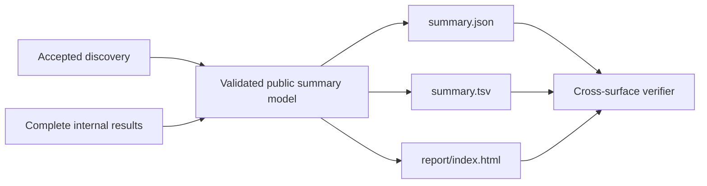
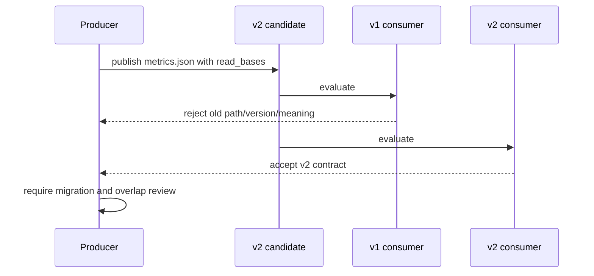

# Worked Example: Promoting Results Into a Versioned Publish Bundle

This example starts with a successful workflow and an unsafe delivery habit: downstream
users read whichever files they can find under `results/`. You will define a v1 consumer,
assemble an isolated bundle, verify integrity and meaning, classify candidate changes, and
prepare a v2 migration.

The goal is not merely to create `publish/v1/`. The goal is to make every promotion
decision reproducible from consumer evidence.

## Starting situation

```text
results/
├── discovered_samples.json
├── alpha/
│   ├── qc.raw.json
│   ├── trimmed.fastq.gz
│   └── screen.json
├── beta/
│   ├── qc.raw.json
│   ├── trimmed.fastq.gz
│   └── screen.json
├── summary.json
└── summary.tsv
logs/
benchmarks/
```

One script reads `results/summary.json`. Another scrapes an HTML report created
interactively. A reviewer downloads the whole tree. None of these consumers has a stated
compatibility contract.

## Write the evidence ledger

Before editing, create:

| Claim | Consumer | Prediction | Evidence | Decision |
| --- | --- | --- | --- | --- |
| selected files form the v1 boundary | downstream service | exact allowlist | candidate inventory | pending |
| bundle bytes are intact | delivery verifier | all digests match | manifest verification | pending |
| v1 summary remains interpretable | v1 fixture | accept baseline | consumer report | pending |
| safe additions stay readable | v1 fixture | accept added `qc_status` | candidate report | pending |
| breaks cannot hide inside v1 | v1 fixture | reject removal, rename, semantic drift | audit matrix | pending |
| v2 change has a migration route | v1 and v2 fixtures | old rejects, new accepts | paired reports | pending |

The ledger forces every producer claim to name a consumer.

## Classify the existing files

| Artifact | Role | Publish? | Reason |
| --- | --- | --- | --- |
| accepted discovery JSON | review evidence and membership authority | yes | consumers need run scope |
| per-sample raw QC JSON | internal or detailed review evidence | no by default | unstable implementation surface |
| trimmed FASTQ | internal analytical state | no | large intermediate, no current consumer |
| screen JSON | internal input to summary | no by default | summary projects supported meaning |
| summary JSON | machine API | yes | exact values for programs |
| summary TSV | interchange API | yes | table consumers |
| HTML report | human surface | yes | interpretation and navigation |
| provenance JSON | stewardship evidence | yes | code, config, software identity |
| logs | diagnostics | no | unstable wording and operational details |
| benchmarks | diagnostics | no | performance evidence, not result API |

This is a default classification for the scenario, not a universal rule.

## Define the v1 consumer

The consumer expects:

```json
{
  "publish_version": "v1",
  "required_paths": ["summary.json"],
  "artifact_path": "summary.json",
  "artifact_schema_version": 1,
  "required_fields": {
    "sample_id": "string",
    "reads_count": "integer"
  },
  "allow_additional_fields": true,
  "field_semantics": {
    "reads_count": {
      "definition": "number of sequencing reads",
      "unit": "reads"
    }
  }
}
```

The full release also supports discovery, TSV, report, provenance, and manifest paths.
The focused fixture isolates summary compatibility so each candidate failure remains
legible.

## Build one governed summary model

Accepted samples:

```text
A = {alpha, beta}
```

Complete samples:

```text
C = {alpha, beta}
```

Create:

```json
{
  "schema_version": 1,
  "field_semantics": {
    "reads_count": {
      "definition": "number of sequencing reads",
      "unit": "reads"
    }
  },
  "records": [
    {"sample_id": "alpha", "reads_count": 10},
    {"sample_id": "beta", "reads_count": 12}
  ]
}
```

Derive the TSV and HTML from this same model. Verify:

```text
A = C = ids(JSON) = ids(TSV) = ids(HTML)
```

Do not let each renderer rescan internal results independently.



## Assemble an isolated candidate

```text
candidate/
├── discovered_samples.json
├── provenance.json
├── report/
│   └── index.html
├── summary.json
└── summary.tsv
```

Verify schemas and cross-file equality before writing the manifest.

Then inventory the exact allowlist:

```json
{
  "schema_version": 1,
  "publish_version": "v1",
  "files": [
    {"path": "discovered_samples.json", "sha256": "..."},
    {"path": "provenance.json", "sha256": "..."},
    {"path": "report/index.html", "sha256": "..."},
    {"path": "summary.json", "sha256": "..."},
    {"path": "summary.tsv", "sha256": "..."}
  ]
}
```

Paths are relative and sorted. `manifest.json` is omitted from its own content inventory;
an outer review-packet manifest can cover it later.

## Run the current consumer before promotion

Focused command:

```bash
python scripts/verify_consumer_contract.py \
  --bundle candidate \
  --contract repro/publish-compatibility/consumer-v1.json \
  --report candidate-consumer-report.json
```

Expected:

```text
ACCEPT: bundle satisfies the consumer contract
```

For the complete capstone bundle, also run its publish verifier. Consumer compatibility
does not replace cross-file completeness or the wider public allowlist.

## Corrupt one artifact

After `manifest.json` is written, append whitespace to `summary.json`.

The file remains valid JSON. Its fields and meanings are unchanged. Verification should
report:

```text
checksum mismatch: summary.json
```

Restore the artifact from a trusted build, regenerate the manifest, and reverify. Do not
edit the digest to match unexplained bytes.

This proves integrity is independently enforced.

## Evaluate an additive change

Candidate record:

```json
{
  "sample_id": "alpha",
  "reads_count": 10,
  "qc_status": "pass"
}
```

Prediction: the v1 consumer accepts because:

- required fields remain;
- `reads_count` meaning and unit remain;
- additional fields are allowed.

Run the fixture. Record `ACCEPT_CURRENT`, but limit the claim to declared consumers. If a
known external parser uses a closed schema, include its fixture before release.

## Evaluate required-field removal

Candidate:

```json
{
  "sample_id": "alpha"
}
```

Expected failure:

```text
record 0 is missing required field reads_count
```

Decision: reject from v1. Restoring the field or designing a v2 migration are the honest
options. A release note saying “reads_count is now optional” does not change existing
consumer code.

## Evaluate a same-version path rename

Candidate inventory lists `metrics.json` instead of `summary.json` but still claims v1.

Expected failure:

```text
required publish paths are missing: ['summary.json']
```

Decision: reject from v1. The consumer cannot locate identical bytes at a new unsupported
path.

## Evaluate semantic drift

Candidate keeps:

```json
{"reads_count": 40}
```

but publishes:

```json
{
  "reads_count": {
    "definition": "number of nucleotide bases",
    "unit": "bases"
  }
}
```

Expected: shape and type pass, semantic comparison rejects.

This is the case most likely to evade ordinary producer tests. Retain it as a permanent
consumer regression fixture.

## Build the v2 boundary

The intended new contract:

```text
publish/v2/metrics.json
schema_version = 2
read_bases = integer
unit = bases
```

The v2 consumer:

```json
{
  "publish_version": "v2",
  "required_paths": ["metrics.json"],
  "artifact_path": "metrics.json",
  "artifact_schema_version": 2,
  "required_fields": {
    "sample_id": "string",
    "read_bases": "integer"
  }
}
```

Required evidence:

```text
v1 consumer against v2 candidate -> reject
v2 consumer against v2 candidate -> accept
```



This proves a migration target exists. It does not prove consumers have migrated.

## Write the migration note

Include:

```text
Current contract:
New contract:
Reason for break:
Path mapping:
Field mapping:
Semantic and unit changes:
Example bundles:
Consumer fixtures:
Overlap start and minimum duration:
Consumer readiness evidence:
Retirement owner:
Retirement criteria:
Rollback or extension condition:
```

For `reads_count` to `read_bases`, do not claim a universal one-to-one mapping. Converting
reads to bases may require read lengths and filtering knowledge. State when mapping cannot
be reconstructed from v1.

## Run the packaged matrix

```bash
cd programs/reproducible-research/deep-dive-snakemake/capstone
make publish-compatibility-audit
```

Read:

```text
artifacts/audit/reproducible-research/deep-dive-snakemake/publish-compatibility/
├── route.txt
├── summary.tsv
├── report.json
├── specimens/
├── workspace/
└── bundle-manifest.json
```

Expected decision sequence:

```text
ACCEPT_CURRENT
ACCEPT_CURRENT
REJECT_CURRENT
REJECT_CURRENT
REJECT_CURRENT
REJECT_CURRENT
REQUIRE_MIGRATION
```

Explain each decision from the v1 contract before opening the full report.

## Prove the gate can fail

```bash
make publish-compatibility-selftest
```

The gate must reject:

- an “additive” case that removes required data;
- a semantic-drift case whose semantic difference was erased;
- an integrity case with no corruption;
- a current consumer weakened to stop requiring the key metric.

A passing baseline without these causal mutations demonstrates execution, not
discrimination.

## Promote only after all layers pass

Promotion route:

1. accepted and complete membership agree;
2. public model validates;
3. JSON, TSV, and HTML agree;
4. candidate paths match the allowlist;
5. content manifest is canonical and verifies;
6. current consumer accepts, or a migration decision is approved;
7. candidate is promoted atomically under the correct version;
8. review packet receives an outer inventory.

If any layer fails, keep the trusted existing public boundary unchanged.

## Completed evidence ledger

| Claim | Observation | Decision |
| --- | --- | --- |
| selected files form v1 | canonical allowlist and no unexpected paths | retain boundary |
| bundle bytes are intact | every candidate digest matches | permit semantic checks |
| v1 summary remains interpretable | current fixture accepts baseline | accept current |
| safe addition stays readable | current fixture accepts `qc_status` | accept for declared open consumer |
| breaks cannot hide in v1 | removal, rename, semantics, corruption rejected | block candidates |
| v2 has a target consumer | v1 rejects; v2 accepts | require migration |

Add the exact report paths and hashes in your own ledger.

## Independent reproduction

Without reading the audit runner:

1. implement the v1 consumer from its JSON contract;
2. materialize the seven candidate bundles;
3. write each manifest before any intentional corruption;
4. classify each candidate;
5. implement the v2 consumer;
6. compare your matrix with `summary.tsv`;
7. explain any difference at the first contract check where behavior diverges.

Matching labels from memory is not completion. Predicting them from consumer expectations
is.

## Review questions

1. Why are internal per-sample files excluded from v1?
2. Which file is authoritative for exact machine metrics?
3. What does the publish manifest prove, and what does it not prove?
4. Why is `qc_status` compatible only relative to a tolerant consumer?
5. Why is a same-version path rename breaking?
6. How can semantic drift pass type validation?
7. Why is checksum corruption a different failure class?
8. What evidence makes the v2 candidate migration-ready?
9. What evidence would show consumers are ready to retire v1?
10. Which mutation proves the gate cannot pass by weakening expectations?

## Completion standard

Your worked packet should contain:

- artifact-role classification;
- v1 consumer fixture;
- isolated baseline candidate;
- canonical content manifest;
- corruption and recovery receipt;
- accepted additive case;
- rejected path, field, semantic, and integrity cases;
- v2 consumer and paired old/new results;
- migration note;
- causal self-test receipt;
- one explicit claim limitation.

The presence of `publish/v1/` is not enough. Promotion is complete only when downstream
trust is demonstrated from the consumer side.
