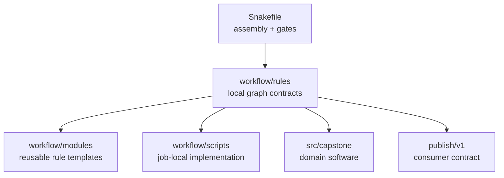
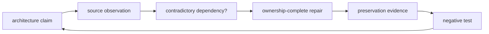

# Architecture Review, Drift, and Refactor Triggers

Architecture drift is a mismatch between the repository's claimed boundaries and its
actual dependency paths. It is not synonymous with a large file, an old directory, or a
maintainer's dislike of the layout.

This lesson turns architectural discomfort into observations, a bounded refactor, and
evidence that the workflow still means the same thing.

## Review claims before shapes

The capstone architecture guide claims four separated responsibilities:

- workflow orchestration and file contracts
- reusable implementation
- execution policy
- published artifacts and downstream trust

Treat each claim as falsifiable. For example:

| Claim | Observation that supports it | Observation that contradicts it |
| --- | --- | --- |
| the entrypoint owns visible assembly | includes and default target are easy to locate | substantial transformations obscure assembly |
| rules own file contracts | influential files appear under `input` | implementations open undeclared files |
| modules have explicit interfaces | caller binds config, files, policy, and names | module receives all config and invents local paths |
| package code is reusable | ordinary CLI and direct unit tests work | package imports workflow state or assumes repository layout |
| publish is a downstream boundary | versioned API doc and consumer verification agree | consumers reach into internal `results/` paths |

An architecture review should cite source or generated evidence in both columns. The
guide's claim is a hypothesis, not a verdict.

## Build a dependency-direction map

Start with intended direction:

Then look for reverse or bypassing arrows:

- package code reading global workflow config
- a module reading a caller-private key
- an included file mutating entrypoint policy
- public consumers reading `results/` directly
- a profile changing sample scope or published paths

One contradictory arrow is more useful than a claim that the repository “feels tangled.”

Turn that arrow into a bounded review cycle:

## Inventory review cost

Review pain becomes actionable when you can name what a reader must reconstruct:

| Review question | Expected starting surface | Drift signal |
| --- | --- | --- |
| what does a default run promise? | `rule all` and file API | target depends on hidden assembly logic |
| which files affect trimming? | trimming rule | adapter or threshold discovered in package code |
| what enters the QC module? | module declaration and `use rule` | full config passed with undocumented reads |
| which files are public? | `docs/file-api.md` | actual manifest or consumer differs |
| what changes between profiles? | profile config and policy guide | semantic config appears in an executor profile |

Count hops only after defining the question. “It took five files” is not automatically a
defect; a public artifact legitimately crosses production, promotion, manifest, and
verification boundaries. Drift exists when the route crosses unrelated owners or
requires private knowledge.

## Audit the capstone entrypoint without pretending it is settled

The current top-level `Snakefile` owns:

- configuration loading, validation, and defaults
- shared include and path roots
- bounded module runtime config
- workdir and wildcard policy
- sample-discovery checkpoint
- discovered-sample publication
- provenance production
- three rule-family includes
- default target

That list supports two observations:

1. assembly, gates, and the completion target remain visible
2. discovery and publication-adjacent rules make the entrypoint carry more than assembly

This is a real refactor candidate, not an automatic failure. Before moving the rules,
answer:

- Does discovery form a coherent local concern with its consumers?
- Does provenance belong with publication, or does keeping it top-level reveal a
  repository-wide obligation?
- Which constants and functions would an extracted file consume?
- Would the new include order become more fragile?
- Which rule names, dry-run jobs, and published hashes must remain equivalent?

If you cannot answer those questions, moving the code would shorten the file without
strengthening ownership.

## Use strong refactor triggers

A refactor is justified when at least one boundary causes an observable problem:

| Trigger | Evidence | Likely repair |
| --- | --- | --- |
| ownership cannot be stated | rules in one file answer unrelated review questions | regroup by file lifecycle or policy owner |
| hidden dependency causes under-rebuild | policy mutation produces a quiet dry-run | declare the file and pass it explicitly |
| module reuse leaks caller state | source audit finds undeclared config reads | bound config and caller-owned bindings |
| public contract and output disagree | consumer or manifest test fails | repair publisher, docs, or version |
| execution policy changes semantics | cross-profile plan or artifact diff | remove semantic keys from profiles |
| parse-time behavior blocks diagnostics | `--list-rules` requires network or input scan | move discovery to a rule or checkpoint |
| same defect recurs across implementations | duplicate fixes and divergent tests | extract a domain API with one owner |

These triggers connect repository shape to learning, correctness, or reviewability.

## Reject weak triggers

Do not begin a structural change from:

- a preferred maximum file length
- a desire for more folders
- the word “enterprise”
- hypothetical reuse with no second caller
- symmetry for its own sake
- a framework pattern copied from another ecosystem

Those ideas can prompt an audit. They cannot justify the result by themselves.

## Write a refactor claim

Use this structure before editing:

> Because **observation**, reviewers or the planner cannot reliably answer **question**.
> Move **decision** from **current owner** to **new owner**, while preserving **named
> behavior**. Accept the refactor only if **evidence** remains equivalent and **new guard**
> rejects the original drift.

Example:

> Because both capstone modules received the complete parent config, a reviewer could not
> bound their policy dependencies. Pass only environment and benchmark settings through a
> named runtime mapping, preserve imported rules and dry-run behavior, and add a source
> guard that rejects broad config passing or undeclared module config keys.

That refactor has a cause, boundary, invariant, and rejection test.

## Preserve behavior at several levels

“Tests pass” is too compressed for architecture review. Choose evidence by claim:

| Level | Preservation question | Evidence |
| --- | --- | --- |
| parse | does workflow assembly expose the same intended rules? | `snakemake --list-rules` |
| plan | are the same inputs, outputs, and jobs selected? | normalized dry-run or DAG |
| execute | do representative jobs succeed in supported environments? | bounded execution receipts |
| artifact | are deterministic outputs equivalent? | schema-aware comparison and hashes where appropriate |
| contract | do public paths and meanings remain compatible? | consumer tests and file API review |
| architecture | does the old hidden dependency now fail? | targeted negative test |

Not every refactor needs the full course proof route. Every refactor needs evidence that
matches the boundary it changes.

## Use a safe refactor sequence

For one boundary:

1. record the current source observation
2. capture a bounded rule list, plan, and representative artifact when applicable
3. state which decisions move and which remain
4. make the smallest ownership-complete change
5. rerun equivalent evidence
6. add a rejection test for the original coupling
7. update the architecture or file contract only if its human route changed
8. inspect the final diff for unrelated rearrangement

Avoid renaming, formatting, and ownership changes in the same patch. They make semantic
comparison harder even when each change is defensible.

## Distinguish deferral from neglect

Not every observed pressure should be repaired immediately. A deliberate deferral records:

- the exact observation
- why current behavior is still safe or reviewable
- the threshold that should reopen the decision
- the evidence that currently guards the risk

For the capstone entrypoint, a defensible threshold might be:

> Extract discovery when it gains another rule or when its dependencies force a second
> non-assembly concern into the entrypoint; until then, the rule list and walkthrough keep
> its role visible.

“We will clean it up later” has none of those properties.

## Conduct a thirty-minute review

Use one artifact route rather than touring every file:

1. start at the default target
2. follow `manifest.json` to one published artifact
3. trace that artifact back through promotion and internal producers
4. inspect one module or implementation boundary on the route
5. compare the observed ownership with `docs/architecture.md` and `docs/file-api.md`
6. run the narrow audit associated with the weakest boundary

Produce a table:

| Boundary | Claim | Observation | Decision | Evidence or follow-up |
| --- | --- | --- | --- | --- |
| module config | caller bounds runtime state | two-key mapping; source guard passes | accept | module interface self-test |
| entrypoint | assembly stays visible | three non-assembly rules remain top-level | watch | extract only with named concern and plan equivalence |
| public files | consumers use `publish/v1` | file API and manifest agree | accept | verify report |

The goal is a reviewable decision, not a score.

## Exit checkpoint

You understand architecture review when you can:

1. turn a vague complaint into a contradictory dependency arrow
2. distinguish a strong correctness or review trigger from a style preference
3. write a refactor claim with an invariant and rejection test
4. choose parse, plan, execution, artifact, contract, and negative evidence deliberately
5. defer a refactor with a threshold instead of hiding the remaining weakness
