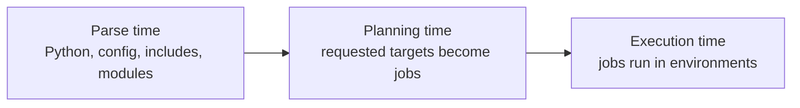
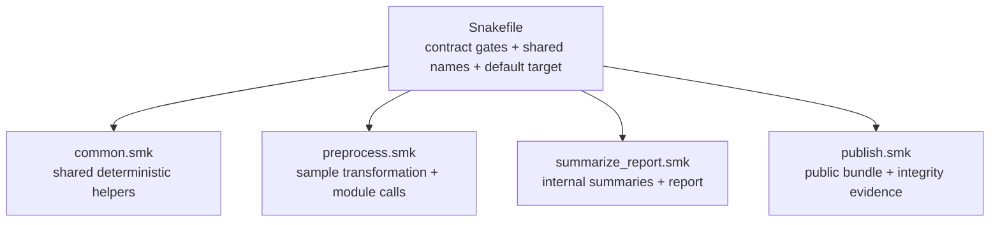

# Entrypoints, Repository Layers, and Visible Assembly

The top-level `Snakefile` is executable Python evaluated while Snakemake constructs the
workflow. It is not a table of contents and an `include` is not a runtime function call.
Those facts explain why entrypoint architecture affects correctness as well as reading
effort.

## Separate three times



| Time | Typical work | Failure meaning |
| --- | --- | --- |
| parse | imports, config loading, schema validation, path constants, includes, module declarations | the workflow cannot be assembled |
| planning | wildcard binding, input function evaluation, checkpoint-dependent reevaluation, resource selection | the requested DAG cannot be constructed |
| execution | shell commands, scripts, notebooks, wrappers, environment activation | one planned job failed |

Top-level Python runs before Snakemake knows whether the user requested one report or
the whole workflow. A network call or directory scan at top level therefore affects
every invocation, including `--list-rules` and many diagnostics.

## Inventory the entrypoint before moving code

Classify each top-level statement by responsibility:

| Responsibility | Appropriate entrypoint examples | Warning sign |
| --- | --- | --- |
| contract gate | `configfile`, schema validation, required-key checks | validation buried inside a rule |
| shared naming | a small set of reviewed path roots | every output path assembled independently |
| assembly | `include`, `module`, and `use rule` declarations | includes selected by undocumented ambient state |
| target selection | a visible default target or named public targets | the default changes through hidden Python logic |
| local rule | a small assembly-level rule whose presence clarifies the workflow | substantial domain transformation embedded at top level |
| parse-time computation | deterministic derivation from declared config | filesystem, clock, environment, or network discovery |

The classification is evidence. It tells you which decision would cross an ownership
boundary if moved.

## Includes merge one local workflow

Consider:

```python
include: "workflow/rules/common.smk"
include: "workflow/rules/preprocess.smk"
include: "workflow/rules/publish.smk"
```

The included files contribute to one assembled workflow. They can rely on names made
available by earlier assembly, and their rules enter the same rule namespace. This is
useful for local concern boundaries, but it is not an isolation mechanism.

The architectural question is:

> Can a reviewer name what each include contributes and which earlier names it is
> allowed to consume?

If the answer is “anything in the global workflow,” the file split shortens files
without controlling coupling.

## Modules create a caller boundary

A Snakemake `module` declares another workflow and `use rule` exposes selected rules
under caller-controlled names. That boundary can control:

- the config slice passed to the module
- the module Snakefile
- path rewriting or prefixes
- imported rule names
- rule overrides at the caller

A module is therefore not a more impressive include. It is appropriate when the caller
and reusable workflow need an explicit interface. The next lesson develops that
contract.

## A readable entrypoint shape

This small example keeps decisions visible without pretending the entrypoint is empty:

```python
from snakemake.utils import validate

configfile: "config/config.yaml"
validate(config, schema="config/schema.yaml")

RESULTS_DIR = config.get("results_dir", "results")
PUBLISH_DIR = config.get("publish_dir", "publish")
PUBLISH_VERSION = config["publish"]["version"]

include: "workflow/rules/common.smk"
include: "workflow/rules/preprocess.smk"
include: "workflow/rules/summarize.smk"
include: "workflow/rules/publish.smk"

rule all:
    input:
        f"{PUBLISH_DIR}/{PUBLISH_VERSION}/manifest.json"
    default_target: True
```

It tells a new maintainer:

1. where configuration enters and is checked
2. which path roots shape the local graph
3. which concern files assemble the workflow
4. which artifact represents completion

It does not prove that the included files honor those boundaries. It gives the reviewer
a falsifiable first model.

## What should leave the entrypoint

Move a decision only when its new owner is clearer.

| Current content | Likely owner | Preservation question |
| --- | --- | --- |
| long shell or Python transformation | `workflow/scripts/` or `src/` | do rule inputs, outputs, params, and logs still expose the whole contract? |
| one coherent local rule family | `workflow/rules/<concern>.smk` | can a reader still see assembly and final targets from the entrypoint? |
| reusable multi-rule workflow | `workflow/modules/<name>/` | are config, paths, rule names, and artifacts caller-controlled? |
| package membership or public path policy | contract or policy file | can consumers and tests read the policy independently of production? |
| filesystem discovery | checkpoint or reviewed manifest producer | does discovery become an artifact with identity and review evidence? |

Do not move code merely to make the `Snakefile` shorter. A hidden decision is worse than
a visible, well-owned one.

## Audit the capstone entrypoint honestly

The capstone `Snakefile` currently owns several kinds of behavior:

- configuration loading and schema validation
- an environment path injected into config
- defaults for directory and parameter trees
- a checkpoint and its shell command
- two publication-adjacent rules
- three includes
- the default target

That inventory creates a real review question:

> Which top-level rules clarify assembly, and which prevent the entrypoint from serving
> as a quick map?

Do not answer from line count. Trace dependencies.

### The checkpoint

`discover_samples` depends on repository-wide config defaults and produces a discovery
artifact used by later rules. Moving it into a discovery concern file may improve the
assembly map if:

- its required constants are explicit
- included rule files do not gain new reverse dependencies
- the dry-run plan and discovery evidence stay equivalent
- its role remains visible in the reading guide

### The provenance rule

`provenance` is a publication-supporting rule implemented by a script. It may belong
near publish rules if that file owns the public evidence surface. Moving it without
checking manifest and consumer expectations would be folder rearrangement, not an
architectural repair.

## Use an assembly map

Record what each included surface contributes:



Now add dependency-direction arrows. If `common.smk` imports a publish rule, or a module
reads a parent-private config tree, the arrow contradicts the intended layer story.

## Inspect assembly with bounded commands

From the capstone directory:

```bash
snakemake --list-rules
snakemake -n --printshellcmds
snakemake --dag > ../../../../artifacts/audit/reproducible-research/deep-dive-snakemake/module-07/dag.dot
```

Before running them, write predictions:

- which rule names should be present
- which target should be selected by default
- which jobs should appear for an unchanged repository

Interpret the results carefully:

- `--list-rules` proves that parsing exposed rule names, not that boundaries are sound
- dry-run proves a plan under the recorded inputs, not runtime correctness
- DAG output shows declared file edges, not Python import coupling or undocumented
  consumers

## Diagnose entrypoint failures by time

| Symptom | Likely time | First evidence |
| --- | --- | --- |
| `--list-rules` fails before listing anything | parse | import, config, validation, include path |
| rule list changes with an undeclared environment variable | parse | top-level Python and environment reads |
| rules exist but requested output cannot be derived | planning | target pattern, input function, wildcard constraints |
| plan is correct but a command fails | execution | log, environment, script contract |
| published path exists but downstream consumer breaks | file API | schema, compatibility policy, consumer test |

This table prevents a common mistake: refactoring directories when the failure actually
belongs to config validation or a runtime tool.

## Entrypoint review checklist

For one repository, answer:

- What must execute during every parse?
- Which config defaults are public policy, and who owns them?
- Which include order dependencies are intentional?
- Which rules must remain visible at first contact?
- Does the default target name a stable completion artifact?
- Can a diagnostic command run without unrelated external side effects?
- Which proposed move would reverse dependency direction?
- Which dry-run or audit would prove the move preserved behavior?

## Exit checkpoint

You understand visible assembly when you can:

1. classify every top-level statement by parse, plan, or execution responsibility
2. explain why an include is a local assembly tool rather than an isolation boundary
3. justify one entrypoint move by ownership and proof, not brevity
4. state what `--list-rules`, dry-run, and DAG output cannot establish
