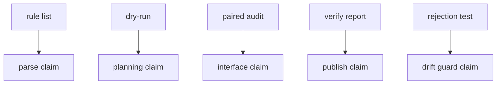
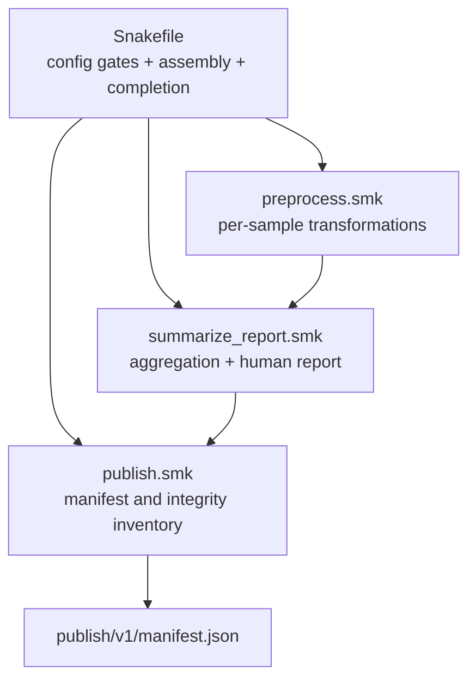

# Exercise Answers

These are model answers for the capstone, not scripts to copy without inspection. A
different conclusion is valid when it cites the repository and preserves the relevant
contract.

For each answer, compare:

- the observation
- the reasoning from that observation
- the evidence boundary

If your conclusion differs, identify which observation or risk judgment differs.

## Exercise 1: Define the completion contract

The default target is:

```python
f"{PUBLISH_DIR}/{PUBLISH_VERSION}/manifest.json"
```

With default config, that resolves to:

```text
publish/v1/manifest.json
```

`rule manifest` in `workflow/rules/publish.smk` directly depends on:

| Named input | Producer | Public path |
| --- | --- | --- |
| `summary_json` | `summarize` | `publish/v1/summary.json` |
| `summary_tsv` | `summarize` | `publish/v1/summary.tsv` |
| `report_html` | `report` | `publish/v1/report/index.html` |
| `provenance` | `provenance` | `publish/v1/provenance.json` |
| `discovered` | `publish_discovered_samples` | `publish/v1/discovered_samples.json` |

Those five members plus `manifest.json` agree with `docs/file-api.md`.

A suitable conclusion is:

> The default invocation promises production of a versioned manifest whose declared
> inputs cover the other documented public files. The target alone does not prove schema
> validity, semantic correctness, or that the hashes match current file contents.

The predicted route is supported when `snakemake --list-rules` exposes `all`, `manifest`,
the five producer rules, and their upstream transformations. The command proves successful
parsing and visible names. It does not inspect manifest bytes or module source.

Use different evidence for different claims:



## Exercise 2: Classify entrypoint work by execution time

A compact inventory is:

| Source surface | Responsibility | Time | Keep or review |
| --- | --- | --- | --- |
| config file and schema validation | reject invalid workflow policy | parse | keep |
| environment path and directory roots | derive shared assembly names | parse | keep, but keep narrow |
| `setdefault_tree` | materialize defaults | parse | keep near config gate |
| workdir and wildcard constraints | graph policy | parse/planning | keep visible |
| `discover_samples` checkpoint | create discovery evidence | execution with planning reevaluation | review location |
| discovery publication rule | promote one public member | execution | review with publish concern |
| provenance rule | capture run context | execution | review with evidence or publish concern |
| includes | assemble local rule families | parse | keep |
| `rule all` | define completion | planning | keep |

The most defensible candidate is discovery publication. It has a public-path concern but
lives above the publish include. A refactor claim could be:

> Because discovery publication is a public promotion rule outside the publish family, a
> reviewer must inspect two owners to understand publication. Move it only if
> `publish.smk` can consume its constants without gaining reverse dependencies. Preserve
> the visible rule name, manifest input, dry-run plan, and published bytes.

This remains a candidate, not a required repair. The current location is visible and the
workflow is small. Moving it without an import ledger could create an include-order
dependency that is harder to understand.

## Exercise 3: Map rule-family ownership

One useful ownership map is:



Ownership statements:

| Family | Ownership | Shared review question |
| --- | --- | --- |
| preprocessing | transforms each discovered sample and binds reusable QC/screen rules | do sample-level jobs declare files, policy, runtime, and evidence consistently? |
| aggregation/report | converts per-sample artifacts into machine and human summaries | is sample membership and meaning preserved through aggregation? |
| publication | inventories the public surface | does the manifest cover the intended downstream contract? |

The top-level publication and provenance rules are location pressures because they
participate in the public artifact lifecycle. They are not automatically defects:
provenance is repository-wide context, and discovery is tied to checkpoint planning.

A rejected regrouping is a catch-all “output rules” file containing summary, report,
provenance, copies, and manifest. It would group by the fact that every rule writes a file,
not by ownership. It would weaken the distinction between internal aggregation and public
promotion.

## Exercise 4: Audit a module interface from both sides

The current interface table is:

| Dimension | Caller declaration | Module read | Owner | Result |
| --- | --- | --- | --- | --- |
| config | `MODULE_RUNTIME_CONFIG` | `env_python`, `benchmarks_dir` | caller derives; module consumes | explicit and bounded |
| files | `use rule` input/output | named `input` and `output` | caller | explicit |
| imported names | `qc_raw`, `qc_trimmed`, `screen_panel` | module templates `qc`, `screen` | caller aliases | explicit |
| semantic policy | screen panel bound at caller | package command consumes path | caller should own | visible, but file edge remains questionable |
| runtime | bounded environment key | `conda` | caller policy exposed through module API | explicit |
| evidence | caller log and benchmark bindings | module writes named surfaces | caller | explicit |

The paired audit findings mean:

- `EXPLICIT_MODULE_CONTRACT_PRESERVED`: the control model keeps caller ownership visible
- `HIDDEN_MODULE_COUPLING_REPRODUCED`: the defect model successfully proves that broad
  config can change artifact meaning without a complete call site

Both experiments can report `PASS` because the audit is checking whether each intended
behavior was observed. The decision attached to hidden coupling is rejection.

The self-test is necessary because a dry-run can look correct in both designs. The graph
does not expose private config reads.

## Exercise 5: Promote a hidden file influence into the graph

Choose the screen panel. The current path travels:

```text
config["params"]["panel"]["fasta"]
  -> use rule screen_panel params.panel_fasta
  -> module shell
  -> capstone.screen_panel --panel-fasta
```

The command opens the panel file, but the panel is not a named Snakemake input. The visible
graph is:

```text
kmer.json -> screen.json
```

The actual computation is:

```text
kmer.json + panel.fasta -> screen.json
```

A corrected module template would expose the file:

```python
rule screen:
    input:
        kmer_json="kmer.json",
        panel_fasta="panel.fasta"
    output:
        json="screen.json"
    shell:
        """
        python3 -m capstone.screen_panel \
            --kmer-json "{input.kmer_json}" \
            --panel-fasta "{input.panel_fasta}" \
            --out-json "{output.json}"
        """
```

The caller would bind:

```python
use rule screen from screen as screen_panel with:
    input:
        kmer_json=f"{RESULTS}/{{sample}}/kmer.json",
        panel_fasta=config["params"]["panel"]["fasta"]
    output:
        json=f"{RESULTS}/{{sample}}/screen.json"
```

The package CLI already accepts a panel path, so the software interface need not discover
anything. The repair changes the graph contract.

A convincing experiment requires a converged disposable workflow:

1. dry-run reports nothing to do
2. modify only panel contents
3. dry-run plans `screen_panel` and downstream summary/publication
4. execute and confirm the result records the new panel influence

The file-contract audit demonstrates the same causal distinction with a smaller policy
file. It does not prove that the capstone screen rule has already been repaired.

## Exercise 6: Review the public file API as a consumer

For `summary.json`:

| Promise | Current evidence | Review result |
| --- | --- | --- |
| location | `publish/v1/summary.json` in file API | explicit |
| shape | UTF-8 JSON, newline, deterministic key ordering, `schema_version` | partly explicit |
| meaning | described as merged per-sample summary | too broad for field-level consumer implementation |
| evolution | path, removal, or semantic change treated as public contract change | explicit at policy level |
| integrity | manifest hash and verification route | independently reviewable |

The missing field-level semantics are a genuine documentation weakness. A consumer may
still need to inspect a specimen or producer to understand exact fields.

Change classifications:

- renaming `summary.json`: breaking public path change
- adding an optional field: potentially compatible, but only with tolerant-consumer
  evidence
- changing count to percentage under the same field: breaking semantic change
- nondeterministic TSV row order: reproducibility defect even if parsers still accept it

`gmake verify-report` can establish current file presence, parseability, membership, and
other bounded checks implemented by the verifier. It cannot decide whether a scientific
field has the meaning a downstream study assumes.

## Exercise 7: Audit a workflow script and a package command

The dependency comparison is:

| Influence | Provenance script | Trimming package |
| --- | --- | --- |
| workflow object | required | absent |
| declared input files | none | paths supplied by rule/CLI |
| config | complete injected mapping | explicit scalar CLI options and paths |
| clock | read directly | absent from core transformation |
| Git | subprocess from workflow base | absent |
| platform/Python | inspected | implementation context only |
| test interface | requires injected workflow context or seams | functions and CLI can be tested ordinarily |

Provenance belongs near the workflow because its purpose is to describe that run's
context. Trimming is package code because its functions and CLI have meaning without
Snakemake.

The provenance timestamp, commit, runtime, platform, and materialized config are
intentionally context-dependent. Therefore this statement is too broad:

> Every published file has identical bytes whenever declared file inputs are unchanged.

A narrower statement can distinguish deterministic scientific products from a provenance
receipt that records the execution event.

For trimming, working-directory invariance depends on callers supplying resolved or
correctly relative paths and the package avoiding repository searches. Test it by invoking
the CLI from two directories with explicit paths and comparing domain outputs.

## Exercise 8: Build a negative architecture guard

The implemented capstone guard uses this claim:

> QC and screen modules receive only the two declared runtime config keys.

It checks:

- both declarations say `config: MODULE_RUNTIME_CONFIG`
- the caller does not contain `config: config`
- both module sources read exactly `env_python` and `benchmarks_dir`

Useful deliberate failures are:

- replace one declaration with `config: config`
- add `config["private_policy"]` to a module

A helpful assertion message would be:

```text
screen module reads config key 'private_policy' outside the declared runtime interface
```

Limitations:

- source matching covers bracket-style config access only
- it does not detect filesystem or environment reads
- it does not prove the two values are valid
- it does not establish scientific correctness

The guard is architectural because it constrains dependency direction between caller and
module. It is not generic style lint.

## Exercise 9: Decide whether to extract top-level rules

A model comparison:

| Criterion | Keep current ownership | Extract named concerns |
| --- | --- | --- |
| visible assembly | executable obligations are visible but crowd the map | map becomes shorter |
| import surface | no new include dependencies | extracted files consume shared constants and helpers |
| concern cohesion | discovery and public evidence are split | publish or discovery lifecycle may become more coherent |
| include-order risk | current order is established | new files may depend on names created earlier |
| rule discoverability | top-level rules are easy to find | durable file names can make concerns easier to find |
| preservation evidence | current proof routes apply | rule list, plan, outputs, docs, and guards need comparison |

A defensible current decision is to keep the rules in place and record the pressure. The
workflow remains small, the rules are visible, and extraction would introduce an import
surface without yet removing a demonstrated correctness problem.

Reopen the decision if:

- discovery gains another rule or policy owner
- another publication-supporting rule appears top-level
- the walkthrough can no longer explain assembly in one bounded route
- include consumers require the same top-level rule from multiple concerns

Another learner may choose extraction now. That answer is valid if it names the new
concerns, inventories consumed names, and demonstrates equivalent rules, plans, and
artifacts.

## Exercise 10: Produce a bounded architecture review

An abbreviated model review follows.

### Review boundary

The default manifest route from the top-level target through preprocessing modules,
aggregation, publication, and the public file API.

### Accepted boundaries

- rule families group per-sample processing, aggregation/report, and manifest concerns
- module call sites bind local artifacts and names
- module runtime config is narrowed to two declared keys
- package transformations use ordinary command interfaces
- the versioned publish surface is documented separately from internal results

### Required repairs

Highest risk within the route:

> Panel FASTA contents affect `screen.json`, but the path is passed as a parameter rather
> than declared as an input. Promote it to a named input in the module template and caller,
> preserve the package CLI, and add a mutation test proving panel changes plan a rerun.

This is a reproducibility risk because it can produce stale accepted output.

### Deliberate deferrals

Top-level discovery and provenance rules remain in the entrypoint. Reopen their placement
when either concern grows or review evidence shows assembly is obscured.

### Verification matrix

| Evidence class | Model evidence | Limitation |
| --- | --- | --- |
| parse | rule list | no coupling proof |
| plan | dry-run for selected artifact | no runtime proof |
| execution | bounded capstone or audit run | only tested environment |
| artifact | manifest and verifier | only implemented checks |
| public contract | file API and consumer review | field semantics remain incomplete |
| negative | module source guard and paired audit | bounded to represented defect |

### Remaining risks

- adapter FASTA may have the same missing-input pattern as panel FASTA
- public JSON field semantics are not fully documented for independent consumers
- provenance intentionally depends on ambient context and needs carefully bounded
  reproducibility claims

The handoff succeeds when another learner can locate each claim and challenge it from the
packet. If they need an oral explanation of why hidden-coupling `PASS` is a rejected
design, the review is not yet standalone.
