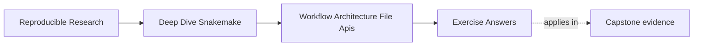

# Exercise Answers

<!-- page-maps:start -->
## Page Maps

<!-- page-maps:end -->

These answers are model explanations, not the only acceptable wording.

What matters is whether the reasoning makes repository ownership and review surfaces
clearer.

## Exercise 1: Read the repository entrypoint

What belongs in the entrypoint:

- config loading and validation
- visible workflow assembly
- stable defaults
- the default target or public target surface

What should probably move elsewhere:

- the 150-line `run:` block

Why this is an architecture issue:

The entrypoint should announce the workflow shape. Once it starts hiding large
implementation logic, the repository entry surface becomes less useful for review and
onboarding.

## Exercise 2: Judge a rule split

Why the split is weak:

- the filenames do not communicate ownership or workflow concern
- the split may reduce line count without improving architectural meaning

What kind of boundary would be stronger:

- rule families grouped by coherent workflow concern, such as preprocessing, summarization,
  publishing, or another clearly named domain

What a reviewer should infer from names:

- what the file owns
- which rules belong there
- how it relates to the visible workflow story

The key problem is not the number of files. It is the lack of an ownership signal.

## Exercise 3: Review a file-API gap

What architecture problem this creates:

- path promises are real, but they are undocumented
- downstream and workflow-facing boundaries blur together

Risks:

- refactors break notebooks and tests invisibly
- maintainers cannot tell whether a path rename is a contract change
- consumers depend on internal layout by accident

What to add first:

- a file API or contract document that distinguishes workflow-facing paths from public
  publish-facing paths

The goal is to make path promises reviewable instead of implied.

## Exercise 4: Diagnose hidden coupling

A strong review comment would say:

> This is not only a local code-quality problem. The helper changes repository behavior
> through undeclared files, unvalidated config, and import-time side effects, which means
> the visible rule and config surfaces no longer tell the full truth. That weakens the
> architecture because reviewers must inspect hidden layers to understand workflow meaning.

Why:

- architecture depends on visible boundaries staying trustworthy
- hidden dependencies move meaning away from the declared repository surfaces

## Exercise 5: Decide whether to refactor

Architecture signals:

- onboarding questions keep repeating
- ownership boundaries are no longer obvious
- path contracts and code-placement rules are not visible enough

What boundary to inspect first:

- the entrypoint and the contract docs

Why:

- if reviewers cannot find the assembly point or the path promises, the rest of the
  architecture will feel arbitrary too

What kind of refactor is justified:

- clarify the top-level assembly
- rename or regroup rule families around ownership
- strengthen file-API or contract docs
- make the split between `workflow/scripts/` and `src/` easier to explain

The refactor should improve reviewability, not only folder appearance.

## Exercise 6: Trace one public artifact

A strong trace begins with the documented public path and finds the publication rule,
its declared source result, any step-local script, reusable package call, semantic
configuration, and final target. It marks absent layers honestly rather than inventing
them. An undeclared style file or directory scan is a finding because the visible chain
does not explain the produced bytes.

## Exercise 7: Write a repository responsibility table

The entrypoint owns visible assembly; includes own coherent rule families; modules own
reusable workflow interfaces; scripts adapt declared Snakemake values to step-local
implementation; packages own independently testable logic; profiles own execution
policy; schemas validate contract data; publish docs define consumer promises. Moving a
hidden scan out of a package and declaring its path in the rule is a more direct repair
than creating another abstraction.

## Exercise 8: Detect architecture drift automatically

A useful check encodes one narrow repository claim and names the violating path. For
example, enumerate publish outputs, compare them with `FILE_API.md`, and fail on missing
or stale entries. The failing fixture demonstrates that the check protects an actual
boundary. A generic "architecture invalid" message is too vague to guide repair.

## Exercise 9: Compare two possible refactors

The ownership-based split is usually safer first because it improves navigation without
creating a new interface. A module or package becomes worthwhile when reuse, independent
testing, or a stable caller contract already exists. Choose the simplest structure that
makes current ownership truthful, and record measurable triggers rather than promising a
future abstraction by instinct.

## Exercise 10: Conduct an architecture review

Begin with the entrypoint and documented file API, compare the actual rule graph, then
inspect scripts and packages only where the trace leads. Findings about undeclared inputs,
unstable public paths, or hidden semantic config outrank naming preferences. Focused
dry-runs, contract tests, and direct package tests support findings without spending time
on unrelated full-suite execution.

## Self-check

If your answers consistently explain:

- who owns orchestration
- where path promises live
- where reusable code belongs
- what makes a refactor honest rather than cosmetic

then you are using the module correctly.
