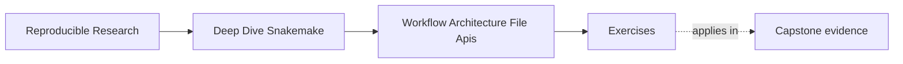

# Exercises

<!-- page-maps:start -->
## Page Maps

<!-- page-maps:end -->

Use these exercises to practice architectural judgment, not only folder vocabulary.

The strongest answers will name ownership, contract surfaces, and review consequences
clearly.

## Exercise 1: Read the repository entrypoint

You open a Snakemake repository and find that the top-level `Snakefile`:

- validates config
- includes three rule files
- contains a 150-line `run:` block
- sets the default target

Write a short review note that explains:

- which parts belong in the entrypoint
- which part should probably move elsewhere
- why this is an architecture issue rather than only a style issue

## Exercise 2: Judge a rule split

A teammate split one long rule file into six smaller files named:

- `part1.smk`
- `part2.smk`
- `part3.smk`
- `helpers.smk`
- `shared.smk`
- `misc.smk`

Explain:

- why this split is weak even if each file is shorter
- what kind of boundary would make the split stronger
- what a reviewer should be able to infer from the file names

## Exercise 3: Review a file-API gap

A repository publishes `publish/v1/summary.json`, but there is no file API or contract
document. Several notebooks also read directly from `results/`.

Explain:

- what architecture problem this creates
- what risks it introduces for refactors and downstream trust
- what documentation or contract surface you would add first

## Exercise 4: Diagnose hidden coupling

A helper module under `src/`:

- reads extra files the rules never declare
- assumes a config key that is not validated anywhere
- changes behavior during import

Write a short review comment that explains why this is not only a code smell, but an
architecture problem.

## Exercise 5: Decide whether to refactor

A workflow still runs, but new contributors keep asking:

- where do the main rules live?
- which files are public versus internal?
- whether `workflow/scripts/` or `src/` should own a new feature

Describe:

- which architecture signals you see
- what boundary you would inspect first
- what kind of refactor would be justified before the repository grows further

## Exercise 6: Trace one public artifact

Choose one published file and trace it backward through its owning rule, inputs, scripts,
package code, configuration, and entrypoint target.

What to hand in:

- an ownership diagram
- every declared dependency on the route
- any hidden dependency you discover
- the file API statement a consumer relies on

## Exercise 7: Write a repository responsibility table

Assign stable responsibilities to the entrypoint, rule includes, modules, scripts,
package code, profiles, schemas, and publish contract.

What to hand in:

- one sentence per layer
- one forbidden responsibility per layer
- two current files whose placement violates the table
- the least disruptive correction

## Exercise 8: Detect architecture drift automatically

Create a focused check for one repository claim, such as every public path being
documented, every include being reachable from the entrypoint, or scripts avoiding
undeclared repository scans.

What to hand in:

- the claim and automated check
- a passing repository state
- one deliberately failing fixture or edit
- the failure message a maintainer receives

## Exercise 9: Compare two possible refactors

Design two ways to repair the same crowded workflow: one ownership-based split and one
more abstract module/package design. Compare navigation, coupling, testability, and
consumer impact.

What to hand in:

- both proposed trees
- explicit trade-offs
- the design you choose now
- the evidence that would justify the more complex design later

## Exercise 10: Conduct an architecture review

Review an unfamiliar Snakemake repository without running its strongest gate first.
Follow entrypoint, rule graph, file API, code boundaries, and targeted checks.

What to hand in:

- findings ordered by reproducibility risk
- an updated repository map
- focused verification for each major finding
- three onboarding questions the repaired architecture should answer without oral help

## Mastery check

You have a strong grasp of this module if all ten answers consistently keep four ideas visible:

- repository layers need named responsibilities
- workflow splits should reflect ownership
- file APIs are part of architecture
- hidden coupling and doc drift are real architectural risks
