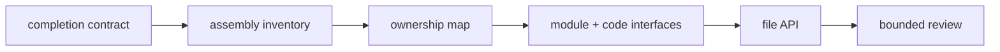
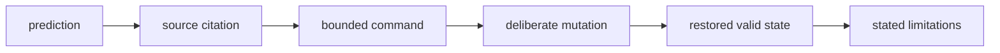

# Exercises

These ten exercises form one cumulative architecture review of the capstone. Use another
Snakemake repository only after you can produce the same evidence there.

Keep your notes under the repository's `artifacts/` directory. Suggested layout:

```text
artifacts/learning/snakemake-architecture/
├── completion-contract.md
├── assembly-inventory.md
├── ownership-map.md
├── module-interface.md
├── dependency-ledger.md
├── file-api-review.md
├── implementation-boundary.md
├── drift-guard.md
├── refactor-decision.md
└── architecture-review.md
```

Those names describe durable review surfaces. They are not delivery sequence labels.

## Working rules

For every exercise:

- write a prediction before running a command
- cite a source path and the relevant declaration
- state what the command or test cannot prove
- keep failed experiments as evidence, but revert deliberate mutations
- distinguish an observed defect from a possible pressure

Run capstone commands from:

```text
programs/reproducible-research/deep-dive-snakemake/capstone
```

If your environment lacks `snakemake`, complete the source audit and mark runtime evidence
as unavailable. Do not invent output.

The records accumulate along one artifact route:



Each claim also needs an evidence ladder:



## Exercise 1: Define the completion contract

Read the top-level `Snakefile`, `workflow/rules/publish.smk`, and `docs/file-api.md`.
Begin at the default target and identify what a completed default invocation promises.

Write `completion-contract.md` with:

- the exact default target path expression
- the config values that determine its resolved path
- the rule that produces it
- every direct input to that rule
- a comparison between those inputs and the documented public files
- one sentence distinguishing completion from independent trust

Before running anything, predict the visible rule names needed for this route. Then run:

```bash
snakemake --list-rules
```

Record which predictions were correct and what the rule list cannot establish.

**Done when:** a reader can name the completion artifact and its direct public members
without searching the whole repository.

## Exercise 2: Classify entrypoint work by execution time

Audit every top-level statement in `Snakefile`. Classify it as:

- parse-time gate or derivation
- planning-time graph behavior
- execution owned by a rule
- local workflow assembly
- completion target

Write `assembly-inventory.md` as a table with columns:

```text
source span | responsibility | time | required owner | move or keep | evidence
```

Choose one statement that looks misplaced. Do not move it yet. Write a refactor claim
that states:

- the observed review problem
- the proposed owner
- the behavior that must remain equivalent
- the narrowest command that could challenge the claim

**Done when:** your proposed move is justified by ownership and a preservation test, not
by file length.

## Exercise 3: Map rule-family ownership

Read the three included rule files and the top-level executable rules. Draw a Mermaid
diagram from the entrypoint to rule families and then to the public manifest.

Write `ownership-map.md` with:

- one ownership sentence per rule family
- one shared review question per family
- the global names each included file consumes
- any rule whose current location does not match its concern
- one candidate regrouping you reject and why

Use these tests on every claimed family:

1. Do its rules share a file lifecycle?
2. Do they share policy or a review question?
3. Would moving one rule force reviewers to reconstruct that concern across files?

**Done when:** every grouping has a reason stronger than “these rules are related.”

## Exercise 4: Audit a module interface from both sides

Inspect:

- `workflow/rules/preprocess.smk`
- `workflow/modules/qc_module/Snakefile`
- `workflow/modules/screen_module/Snakefile`

Write `module-interface.md` with one row for each interface dimension:

```text
config | files | imported names | semantic policy | runtime | logs and benchmarks
```

For each row, identify:

- the caller declaration
- the module read
- the owner
- whether the boundary is explicit

Then run:

```bash
gmake module-interface-audit
gmake module-interface-selftest
```

Explain both expected findings:

- `EXPLICIT_MODULE_CONTRACT_PRESERVED`
- `HIDDEN_MODULE_COUPLING_REPRODUCED`

Do not say only that the audit passed. Explain why the defect specimen is expected to
pass its reproduction check.

**Done when:** your table can detect a new module config read without relying on a
successful dry-run.

## Exercise 5: Promote a hidden file influence into the graph

Choose either:

- the screen panel FASTA
- the trimming adapter FASTA

Trace where its path enters config, a rule, and package code. Determine whether a change
to the file's contents is represented as a Snakemake input dependency.

Write `dependency-ledger.md` with:

- the current path flow
- the graph edge Snakemake currently sees
- the graph edge the computation actually needs
- a corrected rule declaration
- the corresponding CLI or function argument
- a dry-run experiment that mutates only the selected file

If you edit a specimen or disposable copy, demonstrate:

1. an immediate dry-run after convergence plans no work
2. changing the declared file plans the affected job
3. restoring the file returns to the prior state

The capstone file-contract audit provides a smaller paired model:

```bash
gmake file-contract-audit
gmake file-contract-selftest
```

**Done when:** you can explain why passing a file path under `params` is not the same as
declaring its contents under `input`.

## Exercise 6: Review the public file API as a consumer

Approach `publish/v1/` without reading internal results first. For each documented public
file, record:

- path
- intended consumer
- encoding or structure
- semantic promise
- compatibility policy
- verification evidence

Write `file-api-review.md`. Mark missing information explicitly rather than inferring it.

Then choose one hypothetical change:

- rename `summary.json`
- add an optional JSON field
- change a count field to a percentage
- reorder TSV rows nondeterministically

Classify the change as internal, compatible public extension, reproducibility defect, or
breaking public change. Defend the classification from the consumer's perspective.

If a publish tree is available, run:

```bash
gmake verify-report
```

State which checks establish membership and integrity and which semantic questions remain
for a consumer test.

**Done when:** your review distinguishes location, shape, meaning, and evolution for at
least one public artifact.

## Exercise 7: Audit a workflow script and a package command

Compare:

- `workflow/scripts/provenance.py`
- `src/capstone/trim_fastq.py`

Write `implementation-boundary.md` with two dependency ledgers. Include:

- declared files
- explicit scalar policy
- runtime and import context
- current directory assumptions
- environment reads
- clock, Git, platform, or network influence
- test interface

Answer:

1. Why is provenance workflow-adjacent?
2. Why can trimming be ordinary package code?
3. Which provenance bytes are intentionally context-dependent?
4. Which claim about determinism would therefore be too broad?
5. Could the package command run correctly from another working directory?

Propose one interface repair only if the ledger exposes hidden coupling. Do not move code
merely to make the two examples symmetrical.

**Done when:** placement follows dependency ownership rather than a preference for scripts
or packages.

## Exercise 8: Build a negative architecture guard

Choose one narrow claim:

- modules receive only declared runtime config
- package code does not import Snakemake
- public producers agree with the documented file API
- an influential policy file is declared as input

Write `drift-guard.md` with:

- the claim
- the source or artifact inspected
- the passing observation
- one deliberate mutation that should fail
- the exact failure message
- limitations of the guard

Implement the guard in a disposable copy or repository test, then:

1. run it against the valid state
2. make the mutation
3. capture the expected failure
4. revert the mutation
5. rerun the valid state

A useful failure message names the boundary, not just a line number.

**Done when:** the original architecture defect can no longer return silently.

## Exercise 9: Decide whether to extract top-level rules

Evaluate two designs for the current `Snakefile`:

- keep discovery, discovery publication, and provenance top-level
- assign them to one or more named local concerns

Write `refactor-decision.md` comparing:

| Criterion | Keep current ownership | Extract named concerns |
| --- | --- | --- |
| visible assembly | | |
| import surface | | |
| concern cohesion | | |
| include-order risk | | |
| rule discoverability | | |
| preservation evidence | | |

Choose one design for the repository as it exists today. State a measurable threshold
that would make you revisit the decision.

Do not invent a generic catch-all file. Proposed names must describe the enduring concern.

**Done when:** both keeping and moving have been evaluated as architectural choices, and
your decision includes a reopening threshold.

## Exercise 10: Produce a bounded architecture review

Assemble `architecture-review.md` from the prior records. Use this structure:

### Review boundary

Name the artifact route and source revision you reviewed.

### Accepted boundaries

For each accepted boundary, cite the source observation and evidence.

### Required repairs

Order defects by reproducibility or consumer risk. For each, include:

- contradictory dependency arrow
- smallest ownership-complete repair
- behavior to preserve
- negative test

### Deliberate deferrals

State the current guard and reopening threshold.

### Verification matrix

Separate parse, plan, execution, artifact, public contract, and negative evidence. Mark
anything not run.

### Remaining risks

Name at least one weakness outside this review's boundary.

Finish with a five-minute handoff test: give the packet to another learner and ask them to
identify the default artifact, one module contract, one public promise, one repaired
defect, and one unresolved risk. Revise any answer that requires oral rescue.

**Done when:** the review supports challenge and maintenance without depending on an
instructor.

## Completion standard

The set is complete only when:

- all ten records exist
- predictions and observations remain distinguishable
- every defect cites a source or artifact
- every proposed repair names behavior to preserve
- at least one negative check rejects a deliberate mutation
- public and internal paths are not treated as one stability class
- unavailable runtime evidence is marked rather than invented
- the final review names remaining risk
