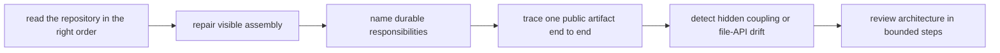

# Exercises

Use these after reading the five core lessons and the worked example. The goal is to make
architectural judgment visible through repository maps, responsibility tables, and focused
checks, not through folder opinions.

## How to work through this set

Treat this set as one full architecture-review workshop day.

For each exercise, keep three things together:

- the boundary you are naming
- the evidence route you actually used
- one plain-language note about how the decision helps the next maintainer read the
  repository correctly

If your answer cannot explain what a new reviewer should understand sooner than before,
the exercise is not complete yet.

Before each answer:

1. start from the entrypoint or public artifact instead of from the deepest helper
2. name the ownership boundary before you suggest a new file split
3. keep one command, diagram, or repository note that proves the boundary really exists

If you skip that order, the day turns into folder rearrangement instead of architecture
review.

Do them in order. The set is one day-long progression:

- Exercises 1-3 establish reading order and repository responsibilities.
- Exercises 4-6 trace public artifacts and file APIs.
- Exercises 7-8 expose coupling and automate one architecture claim.
- Exercises 9-10 review drift like a maintainer.

For every answer, keep three things:

- the boundary you are naming
- the evidence route you actually used
- one short sentence explaining why the decision improves repository legibility for the
  next maintainer

## Recommended working layout

Build one small architecture packet as you go:

- a repository reading order
- a responsibility table
- one artifact-trace diagram
- one file-API note
- one focused architecture check with a failing example

If you prefer a concrete tree for the audit packet, keep it inside something like:

```text
module07-lab/
├── maps/
├── ownership/
├── file-api/
├── checks/
└── artifacts/
    ├── reading-order/
    ├── traces/
    ├── drift/
    └── reviews/
```

That structure helps separate repository reading order, ownership claims, public path
contracts, and automated drift checks without mixing them into one vague review note.

Build one small architecture review packet as you go:

- one repository reading-order note that starts from the entrypoint and a public artifact
- one responsibility table for the main repository layers
- one artifact-trace diagram from public path back through its owners
- one file-API note distinguishing public paths from internal workflow state
- one architecture check with a deliberate failing example
- one maintainer-style review note ordered by reproducibility risk

If those six artifacts are missing, the day usually turns into "the folders feel messy"
instead of "the repository boundary is reviewable."



Use that route on purpose. It keeps the day anchored in repository legibility instead of
file-count aesthetics.

## Exercise 1: Read the repository in the right order

Choose a Snakemake repository you did not design recently. Record the order in which you
inspect its surfaces to understand how one public artifact is produced.

What to hand in:

- the reading order
- why the first surface belongs first
- one surface you deliberately postponed
- one architectural question the early reading order answered quickly

Study note:
If you start in helpers or packages before the entrypoint, you are usually learning the
wrong story first.

## Exercise 2: Repair a weak entrypoint

Take a top-level `Snakefile` that mixes visible assembly with too much inline behavior.
Reduce it to configuration, includes or modules, and final targets.

What to hand in:

- the before and after entrypoint
- the behavior that moved elsewhere
- the repository layer that now owns it
- one reason the new entrypoint is easier to review
- one sentence explaining what the entrypoint still teaches immediately after the repair

Study note:
The goal is not only brevity. The goal is honest visible assembly.

## Exercise 3: Write a repository responsibility table

Assign stable responsibilities to the entrypoint, rule families, modules, scripts,
package code, profiles, schemas, and publish contracts.

What to hand in:

- one sentence per layer
- one forbidden responsibility per layer
- two current files whose placement violates the table
- the least disruptive correction

Study note:
If two layers still sound interchangeable after you write the table, the repository
boundary is not named clearly enough yet.

## Exercise 4: Review a weak structural split

Find or invent a split with weak names such as `helpers.smk`, `misc.smk`, or numbered
parts. Replace it with ownership-based boundaries.

What to hand in:

- the weak tree
- the stronger tree
- the ownership sentence for each new boundary
- one abstraction you rejected because it was premature
- one sentence explaining why the rejected abstraction would have hidden ownership instead of clarifying it

Study note:
More files are not the win. Clearer ownership is the win.

## Exercise 5: Trace one public artifact end to end

Choose one published file and trace it backward through its owning rule, scripts, package
code, configuration, entrypoint target, and file API.

What to hand in:

- an ownership diagram
- every declared dependency on the route
- any hidden dependency you discover
- the contract statement a consumer relies on

Study note:
If the trace forces you into hidden scans or undocumented paths, that is already a real
finding.

## Exercise 6: Repair a file-API gap

Choose one path family that other people are already treating as stable, but which the
repository does not yet document clearly.

What to hand in:

- the current undocumented path family
- the file API statement you would add
- one internal path that must remain outside the contract
- one refactor that becomes safer after the file API exists

Study note:
This is where path stability stops being folklore and becomes architecture.

## Midday self-check

Before you move into hidden coupling, automation, and full review, make sure your packet
can already answer all of these:

- why the entrypoint belongs first in the reading order
- which repository layers own visible assembly, step logic, reusable code, and path contracts
- which public path is stable because the repository says it is stable
- which internal path must remain outside the contract even if it looks useful

If you cannot answer those four questions cleanly, return to the earlier exercises and
make the architecture packet more explicit before moving on.

## Exercise 7: Diagnose hidden coupling

Find one helper, script, or package module that reads undeclared files, depends on
import-time side effects, or assumes unvalidated config.

What to hand in:

- the coupling problem
- why it is an architecture issue rather than only a code smell
- the repository boundary it crosses incorrectly
- the smallest honest repair

Study note:
If a helper has to be read before the rule makes sense, coupling is already doing too
much architectural work.

## Exercise 8: Detect architecture drift automatically

Implement one focused check for an architectural claim such as:

- every public path is documented
- every include is reachable from the entrypoint
- scripts avoid undeclared repository scans

What to hand in:

- the claim and automated check
- one passing state
- one deliberately failing edit
- the failure message a maintainer receives
- one sentence explaining why this check is architectural rather than generic lint

Study note:
A vague failure message teaches almost nothing. Make the broken boundary obvious.

## Exercise 9: Compare two refactor designs

Repair the same crowded repository in two ways: one ownership-first design and one more
abstract design using deeper modules or packages.

What to hand in:

- both proposed trees
- trade-offs in navigation, coupling, and review
- the design you would choose now
- the evidence that would justify the more complex design later

Study note:
Choose the design that tells the truth today, not the one that merely looks more advanced.

## Exercise 10: Conduct a bounded architecture review

Review an unfamiliar Snakemake repository without reaching for the strongest execution
gate first. Follow entrypoint, rule ownership, file APIs, helper boundaries, and targeted
checks.

What to hand in:

- findings ordered by reproducibility risk
- an updated repository map
- focused verification for each major finding
- three onboarding questions the repaired architecture should answer without oral help

Study note:
This is a maintainer review, not a style preference exercise.

## What weak completion looks like

Do not call the day complete if your answers do any of these:

- start in helper code before the entrypoint or public artifact path
- split files without naming what durable responsibility each one owns
- document every path equally and blur public contracts with internal workflow state
- add an architecture check without saying which boundary it protects
- prefer the more abstract design only because it looks more advanced

## Mastery standard for this exercise set

Across all ten answers, Module 07 wants the same habits:

- you read repositories in an order that reveals ownership first
- workflow splits reflect durable responsibilities
- file APIs are treated as part of architecture
- hidden coupling and documentation drift are reviewed as real design problems

If your answer says only "the folders should be cleaner," keep going.

## Exit standard for the exercise day

You are done only when you can defend all of these clearly:

- why the entrypoint belongs first in the reading order
- which layer owns one public artifact at each step
- which paths are stable because the repository says they are stable
- which helper boundary is supporting the workflow and which is swallowing it
- which refactor is justified now and which would be architecture theater
