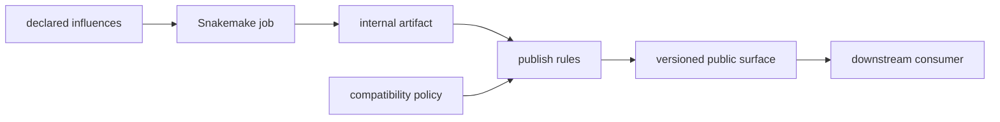
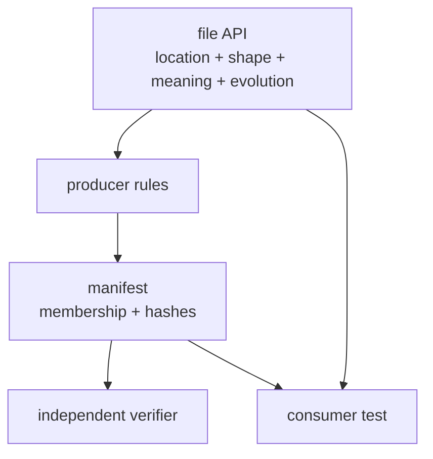

# File APIs, Public Paths, and Contract Documents

A file can play three different roles:

1. a declared edge in Snakemake's graph
2. an internal artifact exchanged by rules
3. a public artifact consumed outside the workflow

The path may look the same in all three cases. The promises are not the same. This lesson
teaches you to identify the audience, stability, schema, and evidence for each file
surface instead of treating the repository tree as an accidental API.

## Start with consumers, not folders

For any path, name the consumer before deciding whether it is stable:

| Consumer | Example | Contract Snakemake can enforce |
| --- | --- | --- |
| another rule | `results/{sample}/kmer.json` | declared file dependency and job ordering |
| a human reviewer | `publish/v1/report/index.html` | only the production path; usefulness needs review |
| an external program | `publish/v1/summary.json` | only the production path; schema needs separate checks |
| an operator diagnosing a run | `logs/{sample}/trim.log` | log association, not public compatibility |
| a scheduler or performance reviewer | `benchmarks/manifest.txt` | benchmark production, not downstream meaning |

“Generated by Snakemake” does not make a file public. “Used by one notebook” does not
make it private. Ownership follows the promised consumer relationship.

## Separate dependency contracts from compatibility contracts

A rule-level file contract tells Snakemake what can affect a job:

```python
rule render_report:
    input:
        source="results/summary.json",
        policy="config/report-policy.yaml"
    output:
        html="results/report/index.html"
```

The two inputs allow the planner to rebuild after either changes.

A public compatibility contract answers different questions:

- which path may a downstream consumer open
- which fields and encodings may it expect
- which ordering is deterministic
- how are breaking changes versioned
- which evidence proves the published set is complete

You need both. A perfectly declared DAG can publish an undocumented schema, and a
beautiful API document cannot repair a missing input edge.



Trust requires evidence beyond the production edge:



## Read the capstone boundary from its contract

The capstone's actual contract document is `capstone/docs/file-api.md`. It separates:

- workflow-owned internal state under `results/{sample}/`
- the downstream contract under `publish/v1/`

That distinction prevents an internal path from becoming permanent merely because a
learner found it convenient.

### Internal per-sample surfaces

The workflow exchanges files such as:

- `qc_raw.json` and `qc_trimmed.json`
- `trim.json`
- `dedup.json`
- `kmer.json`
- `screen.json`

Rules may rely on these paths. They still may change in a coordinated internal refactor
if every producer, consumer, test, and guide changes together.

### Public surfaces

The published contract contains:

| Path below `publish/v1/` | Consumer purpose |
| --- | --- |
| `discovered_samples.json` | identify the sample set actually resolved |
| `summary.json` | consume merged results programmatically |
| `summary.tsv` | inspect or import a compact table |
| `report/index.html` | review results as a human |
| `provenance.json` | interpret runtime and materialized configuration |
| `manifest.json` | verify ordered membership and hashes |

The version segment is part of the path. Changing a field's meaning while leaving the
path at `v1` can be more damaging than renaming an internal directory.

## Treat a file API as four promises

For every public artifact, document:

| Promise | Question | Example evidence |
| --- | --- | --- |
| location | where does the consumer open it? | exact path in `file-api.md` |
| shape | how is it encoded and structured? | schema, field table, parser test |
| meaning | what does each field or row represent? | semantic examples and invariants |
| evolution | which changes are compatible? | version policy and consumer tests |

Newline termination and deterministic key ordering are shape promises. A
`schema_version` field supports evolution, but it is not itself a policy. A reviewer must
still know which changes require a new published version.

## Trace one artifact through its owners

Use `summary.json` as the example:

1. per-sample rules produce internal JSON artifacts
2. the `summarize` rule declares those artifacts as inputs
3. `summarize` writes an internal merged result
4. publication rules promote the reviewed result into `publish/v1/summary.json`
5. the manifest inventories and hashes that published file
6. `scripts/verify_publish.py` checks the published surface

At each transition, record what changes:

| Transition | Owner | New guarantee |
| --- | --- | --- |
| sample artifacts to summary | summarization concern | deterministic aggregation |
| internal summary to public summary | publication concern | stable public path |
| public file to manifest entry | manifest rule | membership and integrity record |
| manifest plus files to verification report | verifier | independently checked evidence |

A path trace that ends at “the rule ran” is incomplete. Public trust begins where
workflow production ends.

## Do not hide file influences under `params`

Suppose a renderer reads a policy file:

```python
params:
    policy_path="config/report-policy.yaml"
```

Snakemake sees a string parameter, not the contents of a file dependency. After the file
changes, a dry-run can report nothing to do while the output still records old policy.

Declare the file:

```python
input:
    source="results/summary.json",
    policy="config/report-policy.yaml"
```

The capstone's file-contract audit reproduces both designs. Run:

```bash
gmake file-contract-audit
gmake file-contract-selftest
```

Read `result` and `decision` together. A `PASS / REJECT` row means the audit successfully
reproduced unsafe behavior; it does not approve the design.

## Distinguish complete output from safely published output

Writing directly to a trusted final path can destroy the previous good artifact before a
failing process exits. Snakemake's cleanup after a normal failure is useful but is not a
publication transaction.

A bounded same-filesystem pattern is:

1. write a sibling candidate path
2. validate content and required structure
3. rename the candidate to the final path only after success

This gives readers either the prior trusted file or the new complete file under the
assumptions tested. It does not prove durability across power loss, atomicity across
filesystems, or domain correctness.

The file-contract audit deliberately compares an in-place failure with a sibling-candidate
failure. The contrast is stronger evidence than advice to “write atomically.”

## Review a proposed change

Classify a change before calling it a refactor:

| Proposed change | Classification | Required review |
| --- | --- | --- |
| rename `results/{sample}/kmer.json` and update all internal consumers | internal contract change | graph, tests, guides, clean rebuild |
| rename `publish/v1/summary.json` | breaking public path change | new API version or migration policy |
| add an optional JSON field | possible compatible extension | schema and consumer tolerance evidence |
| change a field from count to percentage | semantic break | version bump even if the name stays |
| reorder a TSV nondeterministically | reproducibility defect | deterministic producer and regression test |
| add a log line | operational evidence change | log consumer review only if tooling parses it |

This table prevents “the bytes still parse” from standing in for compatibility.

## Build a consumer test

A useful consumer test starts outside the producer:

```python
from pathlib import Path
import json

publish = Path("publish/v1")
summary = json.loads((publish / "summary.json").read_text())
manifest = json.loads((publish / "manifest.json").read_text())

assert summary["schema_version"] == 1
assert "samples" in summary
assert "summary.json" in {entry["path"] for entry in manifest["files"]}
```

Adapt field names to the real schema; do not copy this as an assumed answer. The teaching
point is that a consumer checks only documented public paths and meanings. It should not
reach back into `results/` to compensate for a weak publish surface.

## Assemble an evidence route

From the capstone root:

```bash
gmake verify-report
```

Read the generated route first, then:

1. `FILE_API.md` for promises
2. `manifest.json` for public membership
3. `verify.json` for per-surface checks
4. `summary.json`, `provenance.json`, and discovery evidence together
5. bundle manifest for the review packet's own integrity

Each file answers a different question. No single green check proves dependency
completeness, compatibility, semantic validity, and atomic publication at once.

## File API review checklist

For one artifact, answer:

- Who is allowed to consume it?
- Is its producing rule's full input influence declared?
- Is it internal, operational, or public?
- Are location, shape, meaning, and evolution documented?
- What version identifies its compatibility contract?
- What verifies its membership and integrity?
- What test approaches it as a downstream consumer?
- What failure could expose a partial final?
- Which change would force a new public version?

## Exit checkpoint

You understand file APIs when you can:

1. distinguish a graph dependency from a downstream compatibility promise
2. classify capstone paths as internal, operational, or public
3. explain why a path passed through `params` can produce stale output
4. trace one published file from influences to independent verification
5. decide whether a proposed path or semantic change is internal, compatible, or breaking
