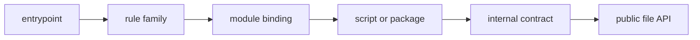
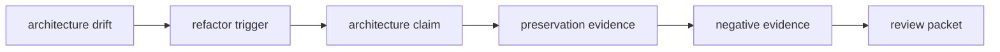

# Glossary

Use these terms to make an architecture claim precise. Each definition answers three
questions where useful:

- what is it
- who owns it
- what does it not prove

The vocabulary follows the artifact route:

Evidence terms follow a second route:

## Assembly and execution

**Entrypoint**

The top-level `Snakefile` that establishes contract gates, shared names, local workflow
assembly, and completion targets. It is executable Python evaluated during parsing, not a
passive table of contents.

**Parse time**

When Snakemake evaluates workflow Python, config, includes, module declarations, and rule
definitions. A successful parse proves that a workflow could be assembled under the
current context; it does not prove that a requested target has a valid plan.

**Planning time**

When requested targets become jobs through wildcards, input functions, checkpoints,
resources, and file dependencies. A successful dry-run is planning evidence, not execution
or interface evidence.

**Execution time**

When a planned job runs its shell command, script, notebook, or wrapper in an execution
environment. Runtime success does not prove the graph declared every influential file.

**Visible assembly**

The property that a reviewer can locate config gates, included concerns, module imports,
and completion targets without first reconstructing implementation internals.

**Include**

A parse-time mechanism that contributes definitions to the same local workflow and rule
namespace. It helps separate locally owned concerns but does not isolate config, Python
names, or ownership automatically.

**Default target**

The target Snakemake selects when the caller requests no explicit target. It defines a
completion promise, not independent proof that the produced artifact deserves trust.

## Ownership boundaries

**Rule family**

A locally owned group of rules sharing a file lifecycle, policy owner, or review question.
It is normally assembled with `include`.

**Workflow module**

A reusable Snakemake workflow or rule template imported through `module` and `use rule`.
Its boundary includes config, files, names, policy, runtime, and evidence.

**Module caller**

The local workflow that chooses a module, supplies bounded config, imports selected rules,
assigns local aliases, and binds repository-specific paths and policy.

**`use rule` binding**

The call site where a module-owned rule template becomes a caller-owned local rule. It can
override inputs, outputs, parameters, resources, logs, and benchmarks and therefore should
reveal local meaning.

**Ownership boundary**

A division that assigns a decision and its maintenance obligation to one reviewable
surface. A directory boundary is not an ownership boundary unless dependencies follow the
claimed direction.

**Dependency direction**

The allowed flow of decisions between owners. For example, a rule may pass explicit
arguments into package code; package code should not reach back into global workflow
state.

**Import ledger**

A human-readable inventory of global names an included file consumes. Snakemake does not
enforce this interface, so the ledger helps expose include-order and shared-state coupling.

**Interface dimension**

One aspect of a module contract: config, files, imported names, semantic policy, runtime,
or operational evidence. Auditing only input and output paths leaves the interface
incomplete.

## Files and consumers

**Declared input**

A file named under a rule's `input`. Snakemake can use its identity and metadata to build
dependency edges and plan reruns.

**File influence**

Any file whose contents can affect output. Every material file influence should normally
be a declared input; passing its path through `params` does not declare its contents.

**Internal file contract**

A path and shape used between rules inside the workflow. It can change through a
coordinated refactor when producers, consumers, tests, and guides change together.

**Public file API**

The documented downstream promise for artifact location, shape, meaning, and evolution.
In the capstone, this boundary is versioned under `publish/v1/`.

**Compatibility**

The property that an existing consumer continues to work with the promised meaning. A file
can remain parseable while becoming semantically incompatible.

**Promotion**

The deliberate transition from internal workflow state to a public artifact. Promotion
adds a consumer-facing promise; it is not merely a copy operation.

**Manifest**

An ordered inventory of published members and hashes. It supports membership and integrity
review but does not establish the scientific validity of each member.

**Atomic publication**

A bounded write pattern that validates a sibling candidate before renaming it to the final
path. Under tested filesystem assumptions, failure before rename preserves the prior
trusted final. It does not guarantee cross-filesystem atomicity or power-loss durability.

**Consumer test**

A test that approaches only documented public paths and meanings. It catches contract
breakage that producer-focused tests can miss.

## Implementation and coupling

**Workflow-adjacent script**

An implementation owned by one workflow job and commonly placed under
`workflow/scripts/`. It may use Snakemake's injected object, so its dependency audit must
include that object's files, config, and context.

**Package interface**

An ordinary function or command-line contract that has meaning without Snakemake. Package
code should accept paths and values rather than discover repository or workflow state.

**Hidden coupling**

An influential dependency that crosses a boundary without appearing at the expected call
site. Examples include broad config passing, undeclared file reads, current-directory
assumptions, and import-time environment access.

**Ambient input**

Context obtained outside declared files and explicit policy, such as clock time, Git
state, environment variables, platform, current directory, or a network service. Ambient
input must be prohibited, injected, materialized, or documented according to the claim.

**Source guard**

A targeted test of a source-level architecture claim, such as allowed module config keys.
It can reject recurrence of a known coupling pattern but cannot prove all runtime behavior.

**Negative evidence**

Evidence that a deliberate defect is rejected. A passing valid example establishes less
than a valid example paired with a mutation that fails for the expected reason.

## Review and change

**Architecture claim**

A falsifiable statement about ownership or dependency direction, such as “modules receive
only declared runtime config.” It needs observations that could support or contradict it.

**Architecture drift**

A growing mismatch between claimed boundaries and actual dependencies. Drift can exist
while every job still succeeds.

**Refactor trigger**

An observed correctness, maintenance, or review failure that justifies changing ownership.
File length or aesthetic preference alone is not a trigger.

**Preservation evidence**

Evidence that a refactor retained the intended parse surface, plan, execution, artifact,
or public contract. The relevant levels depend on the boundary changed.

**Deliberate deferral**

A recorded decision not to refactor yet, with the current safety argument, guarding
evidence, and a measurable condition that reopens the decision.

**Review packet**

A bounded set of claims, source observations, command receipts, decisions, and remaining
risks that another reviewer can challenge without oral context.

## Confusion pairs

| Do not collapse | Distinction |
| --- | --- |
| include / module | an include assembles one local workflow; a module creates a reusable caller boundary |
| rule family / package | a rule family owns graph contracts; a package owns ordinary software behavior |
| explicit path / declared input | a path can be passed explicitly while its file contents remain absent from the graph |
| completion / trust | reaching the default target does not independently validate its public meaning |
| deterministic shape / compatible meaning | stable JSON formatting does not prevent a semantic breaking change |
| runtime success / honest interface | hidden coupling can execute successfully |
| public artifact / operational evidence | consumers may rely on the former; logs and benchmarks primarily diagnose the run |
| pressure / defect | a crowded entrypoint may deserve review; a missing input edge is a reproducibility defect |
| passing experiment / accepted design | a defect-reproduction experiment should pass when it exposes the intended failure |
| rename / refactor | changing names alters navigation; changing ownership and dependency direction alters architecture |

## Retrieval check

Without returning to the definitions, explain:

1. why `config: config` weakens a module caller boundary
2. why a panel path under `params` may create stale output
3. why `--list-rules` cannot establish file API compatibility
4. why a manifest and consumer test answer different questions
5. why a deliberate deferral is stronger than an untracked intention to reorganize later
