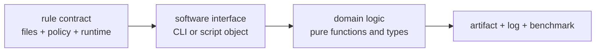

# Helpers, Scripts, Packages, and Coupling Control

Moving Python out of a rule can improve testing and readability. It can also hide the
files, policy, and ambient state that determine an artifact. The architectural question
is therefore not “where should Python go?” It is:

> Which interface lets the rule remain an honest account of the job while giving the
> implementation a clear owner?

This lesson compares four homes for logic and then audits the capstone's two Python
execution styles.

## Keep three contracts separate

A Snakemake job combines:

1. a workflow contract: files, parameters, resources, environment, logs
2. a software interface: function arguments, command-line options, return values
3. a domain contract: what the transformation means



The layers should point inward. Domain code should not reach outward to inspect a
Snakefile, global `config`, a working directory, or an undeclared repository path.

## Choose a code home by ownership

| Home | Owns | Should receive | Should not discover privately |
| --- | --- | --- | --- |
| rule body or small input function | graph construction and brief orchestration | wildcards, declared files, validated config | domain computation or network state |
| `workflow/scripts/` | one workflow-adjacent job implementation | injected `snakemake` contract | undeclared files or unrelated global config |
| `src/<package>/` | reusable software and domain logic | ordinary arguments or CLI options | Snakemake internals and repository layout |
| `scripts/` outside the workflow | repository operations, audits, and verification | explicit command-line paths | production rule state |

No home is inherently more advanced. A ten-line local input function can be clearer than
a generic utility package. A package is warranted when the software interface remains
meaningful without Snakemake.

## Rule code should explain the job before implementation code

A reviewer should be able to answer these from the rule:

- which files can change the output
- which values change the transformation
- which environment and resources it uses
- where logs and benchmarks go
- which implementation boundary it calls

For example, the capstone trimming rule declares raw FASTQ input, two outputs, quality and
adapter policy, runtime environment, resources, log, and benchmark. Its shell block calls:

```bash
python3 -m capstone.trim_fastq \
    --in-fastq "{input.fastq}" \
    --out-fastq "{output.fastq}" \
    --out-json "{output.json}" \
    --q {params.q} \
    --min-len {params.min_len}
```

The complete command has more options, but even this excerpt shows the direction:
Snakemake resolves local workflow meaning and passes it into ordinary software.

## Package code should work as ordinary software

`src/capstone/trim_fastq.py` contains domain functions, data structures, a pipeline, and a
CLI. This placement earns its keep because the code can be:

- imported by unit tests without constructing a workflow
- invoked through `python -m capstone.trim_fastq`
- passed paths and values explicitly
- reused by another caller that honors the same software interface

Use this test:

> Could I invoke and test the useful behavior with no global `snakemake` object?

If yes, package ownership is plausible. If no, either the code is workflow-adjacent or
its interface is still incomplete.

## A workflow script accepts a different kind of coupling

The capstone provenance rule uses:

```python
rule provenance:
    output:
        json=f"{PUBLISH_DIR}/{PUBLISH_VERSION}/provenance.json"
    log:
        f"{LOGS_DIR}/provenance.log"
    conda:
        config["_env_python"]
    script:
        "workflow/scripts/provenance.py"
```

The script receives Snakemake's injected object and reads:

- `snakemake.output.json`
- `snakemake.config`
- `snakemake.workflow.basedir`
- the active Python and platform
- the clock
- Git state

Keeping that implementation under `workflow/scripts/` is honest because it is tightly
coupled to one workflow job. But placement does not make every dependency declared.

## Audit ambient inputs honestly

The provenance output intentionally records execution context. Its bytes depend on state
that is not represented as ordinary rule inputs:

| Influence | How the script obtains it | Consequence |
| --- | --- | --- |
| current time | `datetime.now` | reruns produce different bytes |
| Git commit | subprocess in workflow base directory | repository state changes provenance |
| Python/platform | process inspection | execution context changes payload |
| complete config | injected workflow object | broad semantic and operational coupling |

This may be acceptable for a provenance receipt, but it changes the claim you can make.
The rule is not a pure deterministic transformation of declared input files.

A strong architecture document says:

> Provenance deliberately captures ambient execution context. It is rebuilt as run
> evidence, not treated as a content-addressed scientific result.

A weak one says “all outputs are deterministic” and ignores this exception.

## Avoid confusing explicit parameters with declared files

Explicit CLI options are necessary but not sufficient. Consider:

```python
params:
    adapters="config/adapters.fa"
```

Passing the string explicitly helps the software interface, but the planner still does
not see the referenced file as an input. If adapter contents influence output, write:

```python
input:
    fastq="data/{sample}.fastq.gz",
    adapters="config/adapters.fa"
```

Then pass `{input.adapters}` to the package command. One path now satisfies both
contracts:

- Snakemake sees a dependency edge
- the package sees an explicit argument

## Prefer domain names over generic helper buckets

A generic `helpers.py` tends to gather unrelated functions because its name defines no
ownership. Better boundaries describe the domain or mechanism:

| Weak bucket | More informative boundary |
| --- | --- |
| `helpers.py` with FASTQ parsing and manifest hashing | `fastqio.py` and `manifest.py` |
| `utils.py` with path policy and HTML rendering | `publish_paths.py` and `report.py` |
| `common.py` imported by package and workflow indiscriminately | package API plus a small local `common.smk` |

The capstone's `fastqio.py`, `manifest.py`, and `report.py` give a reader a useful first
hypothesis about ownership. Verify that hypothesis from imports and tests; names are
evidence to inspect, not proof.

## Measure coupling with a dependency ledger

Select one implementation and record every external dependency:

| Dependency | Visible at rule call site? | Stable interface? | Repair if hidden |
| --- | --- | --- | --- |
| input file | should be under `input` | yes, through named input | declare it |
| output path | should be under `output` | yes, through named output | bind it |
| scalar policy | should be under `params` or config gate | yes, with validation | pass it explicitly |
| environment | should be under `conda`, container, or deployment policy | yes | declare runtime |
| working directory | often implicit | fragile | pass paths or set an explicit working directory |
| environment variable | often implicit | fragile | declare and validate the supported interface |
| clock or random source | usually hidden | claim-dependent | inject, seed, or document ambient evidence |
| network service | usually hidden | unstable | materialize a versioned input or record a bounded service contract |

Do not count imports. Count decisions and observable influences.

## Refactor one hidden dependency

Suppose a package function opens `config/panel.fa` relative to the current directory.
Repair it in three coordinated places:

1. add the panel to the rule's named `input`
2. add a `--panel-fasta` option to the package CLI
3. accept a `Path` in the domain function

Then verify:

- changing the panel causes a dry-run to plan the job
- the CLI test can use a fixture path
- running from another working directory produces the same result
- no package code searches for repository paths

This is an architectural refactor because it changes dependency direction, not because
the function moved.

## Review import-time behavior

Importing package code should define behavior, not perform a run. Warning signs include:

- reading config files at module import
- scanning input directories to create global lists
- resolving the current Git commit on import
- creating output directories
- reading environment variables without a caller-visible policy

These actions blur parse, planning, and execution time. Put them behind explicit
functions and call them from the owner that can declare or document the dependency.

## Coupling review checklist

For one rule and its implementation:

1. List every file the process opens.
2. Confirm every influential file is a named `input`.
3. List every scalar that changes artifact meaning.
4. Trace each scalar to validated config or an explicit binding.
5. Identify clock, environment, Git, network, and working-directory reads.
6. Decide whether each ambient influence is prohibited, injected, or documented.
7. Confirm the package can be tested without Snakemake when reuse is claimed.
8. Confirm workflow-specific code remains near the rule when reuse is not claimed.
9. Run the same command from a different working directory when path coupling is at risk.
10. Record which evidence would fail if a new hidden dependency appeared.

## Exit checkpoint

You understand coupling control when you can:

1. separate workflow, software, and domain contracts
2. justify `workflow/scripts/` or `src/` from ownership rather than prestige
3. find an explicitly passed path that is still missing from `input`
4. explain the capstone provenance rule's deliberate ambient dependencies
5. refactor a hidden repository lookup into a rule edge, CLI argument, and function input
