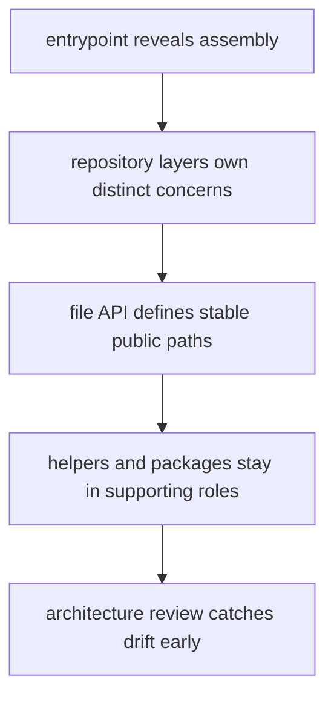
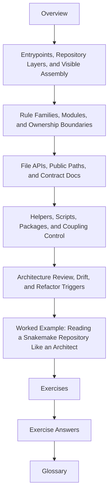

# Module 07: Workflow Architecture and File APIs

Workflow architecture becomes important as soon as one person can no longer keep the
whole repository in their head.

That is not a late-stage problem. It starts the moment a workflow gains:

- more than one rule family
- more than one place where code can live
- more than one audience reviewing the repository

This module is about making that repository shape legible on purpose.

## What this day must accomplish

By the end of Module 07, you should be able to do five things without relying on oral
tradition:

- read a workflow repository in a stable order that reveals ownership first
- keep the top-level `Snakefile` focused on visible assembly instead of hidden behavior
- explain what each repository layer owns and what it must not own
- define a file API that marks public paths as real architectural contracts
- decide when architecture drift has become serious enough to justify refactoring

## The architecture ladder for the whole module

Keep this order in front of you all day:



If a reader must start in helper code to understand the workflow, the architecture is
already telling the story in the wrong order. If public paths are undocumented, the
repository shape is still incomplete.

## The running lab for the whole day

Use one repository story all day instead of several unrelated folder debates:

- one public artifact must be traced from the top-level target back through its owners
- one crowded `Snakefile` must be reduced to visible assembly
- one repository layer must be caught taking on the wrong responsibility
- one file API gap must be repaired before a refactor spreads
- one architecture review must say which drift matters now and which can wait

Every page should help you answer one concrete architectural review question.

## Plan for the day

| Session | What you do | Evidence you keep |
| --- | --- | --- |
| repository reading order | trace one published artifact backward from target to contract | path-to-owner map |
| visible assembly | shrink the entrypoint to config, includes, and end targets | annotated `Snakefile` |
| ownership boundaries | classify rules, modules, scripts, package code, and contracts | responsibility table |
| coupling test | expose one undeclared file read or import-time side effect | failing architecture check |
| drift review | compare documented architecture against actual repository shape | findings report |
| independent practice | complete all ten exercises | architecture review packet |

The day is successful when a new maintainer can understand the repository without needing
the original author to narrate every directory.

## Study route



Read the module in that order the first time.

The route matters:

- start with visible assembly before you inspect helper code
- define repository ownership before you talk about refactoring
- document the file API before you judge whether path drift is acceptable

## The ten files in this module

1. Overview (`index.md`)
2. [Entrypoints, Repository Layers, and Visible Assembly](entrypoints-repository-layers-and-visible-assembly.md)
3. [Rule Families, Modules, and Ownership Boundaries](rule-families-modules-and-ownership-boundaries.md)
4. [File APIs, Public Paths, and Contract Docs](file-apis-public-paths-and-contract-docs.md)
5. [Helpers, Scripts, Packages, and Coupling Control](helpers-scripts-packages-and-coupling-control.md)
6. [Architecture Review, Drift, and Refactor Triggers](architecture-review-drift-and-refactor-triggers.md)
7. [Worked Example: Reading a Snakemake Repository Like an Architect](worked-example-reading-a-snakemake-repository-like-an-architect.md)
8. [Exercises](exercises.md)
9. [Exercise Answers](exercise-answers.md)
10. [Glossary](glossary.md)

## How to use the file set

| If you need to... | Start here |
| --- | --- |
| understand how the repository should introduce itself to a new reader | [Entrypoints, Repository Layers, and Visible Assembly](entrypoints-repository-layers-and-visible-assembly.md) |
| split workflow logic by ownership rather than panic | [Rule Families, Modules, and Ownership Boundaries](rule-families-modules-and-ownership-boundaries.md) |
| define which paths are public architectural promises | [File APIs, Public Paths, and Contract Docs](file-apis-public-paths-and-contract-docs.md) |
| stop helper code from swallowing the workflow story | [Helpers, Scripts, Packages, and Coupling Control](helpers-scripts-packages-and-coupling-control.md) |
| decide whether the repository needs an architecture repair | [Architecture Review, Drift, and Refactor Triggers](architecture-review-drift-and-refactor-triggers.md) |
| see the whole module as one architecture walkthrough | [Worked Example: Reading a Snakemake Repository Like an Architect](worked-example-reading-a-snakemake-repository-like-an-architect.md) |
| test your own understanding | [Exercises](exercises.md) |
| compare your reasoning against a reference answer | [Exercise Answers](exercise-answers.md) |
| stabilize the module vocabulary | [Glossary](glossary.md) |

## The running question

Carry this question through every page:

> if a new maintainer must change this repository tomorrow, which architectural boundary should teach them what is safe before they touch anything?

Good Module 07 answers usually mention one or more of these:

- an entrypoint that shows visible assembly
- repository layers with named responsibilities
- a file API that marks public paths explicitly
- helper or package placement that supports rather than hides workflow meaning
- a review route that detects architecture drift before it hardens

## What the module should change in your head

If the day is working, you should feel these transitions:

- a directory tree stops looking self-explanatory
- entrypoint brevity stops sounding cosmetic and starts sounding architectural
- file APIs stop feeling like extra docs and start feeling like ownership boundaries
- helper code stops looking neutral once it changes what a reviewer sees first
- “the repo is getting messy” becomes a reviewable claim instead of a vague feeling

## Commands to keep close

These commands form the evidence loop for Module 07:

```bash
snakemake --list-rules
snakemake -n
make tour
```

They answer different questions:

- which visible workflow surfaces exist
- whether the assembled target path still makes sense
- how the repository explains itself through one guided walkthrough

## Exit standard

Do not move on until all of these are true:

- you can explain what the top-level `Snakefile` owns and what it should not own
- you can name one justified repository layer and one misplaced concern
- you can trace one public artifact through its owners without guessing
- you can describe one file API promise a downstream user depends on
- you can say which architecture drift deserves refactoring now and which can wait
- you have completed all ten exercises and performed at least one bounded architecture review

When those become ordinary, Module 07 has done its job.
