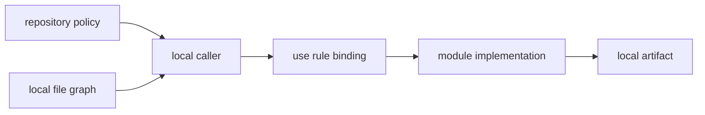
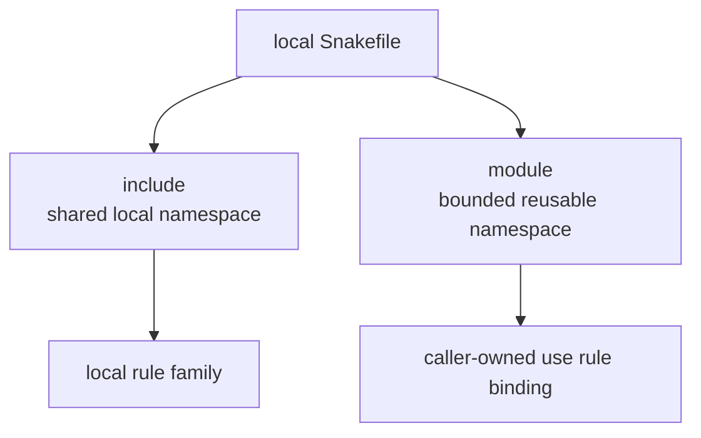

# Rule Families, Modules, and Ownership Boundaries

A split is useful when it makes a dependency easier to name and control. It is harmful
when it only moves that dependency somewhere a reviewer is less likely to look.

This lesson distinguishes two Snakemake mechanisms that can look similar in a directory
tree:

- an `include` assembles locally owned rules into one workflow
- a `module` gives a caller a boundary around rules owned as a reusable unit

The distinction is about ownership, not file count.

## Begin with the decision that must have an owner

Every rule depends on decisions such as:

- which input and output paths enter the local graph
- which configuration values change artifact meaning
- which environment runs the implementation
- which resources, logs, and benchmarks the repository requires
- which imported rule name becomes visible to callers

A useful boundary puts each decision where a reader would expect to review it.



The caller in this diagram owns local policy and paths. The module owns how the
transformation is performed. If the module reaches back into the caller's private config,
the arrow points in both directions and the boundary is no longer honest.

The two splitting mechanisms therefore create different shapes:



## Use rule families for local concerns

A rule family is a group of locally owned rules that share a review question. For the
capstone:

| File | Locally owned concern | Useful review question |
| --- | --- | --- |
| `workflow/rules/preprocess.smk` | per-sample transformations and module bindings | are sample paths and runtime obligations bound consistently? |
| `workflow/rules/summarize_report.smk` | aggregation and report production | can every summary row be traced to declared sample artifacts? |
| `workflow/rules/publish.smk` | public bundle construction | are membership, integrity, and compatibility evidence complete? |

These files are included because they are parts of this repository's workflow. They are
not independent products.

A rule belongs with a family when moving it would split one of these:

1. a file lifecycle
2. a policy decision
3. a review or failure domain

Line count is not on that list.

## Remember what `include` does

An include contributes definitions to the current workflow:

```python
include: "workflow/rules/preprocess.smk"
```

The included file can use names established by the assembled workflow. In the capstone,
`preprocess.smk` uses shared functions and config-derived path roots. That convenience is
also the risk: the file can silently acquire more global dependencies.

For an included rule family, write an import ledger even though Snakemake does not enforce
one:

| Consumed name | Owner | Why this family needs it |
| --- | --- | --- |
| `RESULTS_DIR` | top-level path policy | places internal results |
| `get_raw_fastq` | common discovery logic | maps a sample to its declared source |
| `_env_python` | runtime assembly | selects the repository environment |

If the ledger keeps growing, either the family owns too many concerns or shared state is
too broad.

## Use a module only when the caller boundary is real

A module is appropriate when a multi-rule or reusable transformation has its own
implementation ownership and the caller can state its local contract. Review five
dimensions:

| Interface dimension | Caller should reveal | Hidden-coupling warning |
| --- | --- | --- |
| configuration | the bounded values supplied to the module | `config: config` |
| files | local inputs and outputs | module invents repository paths |
| names | imported rule and local alias | wildcard import or unexplained renaming |
| runtime | environment and required execution context | module reads caller-private runtime keys |
| evidence | logs, benchmarks, and failure surface | evidence paths chosen inside reusable code |

A module declaration alone proves none of these. The `use rule` binding and module source
must be read together.

## Work through the capstone boundary

The capstone now builds a deliberately narrow module configuration:

```python
MODULE_RUNTIME_CONFIG = {
    "env_python": config["_env_python"],
    "benchmarks_dir": BENCH_DIR,
}
```

The preprocessing family passes that mapping:

```python
module qc:
    snakefile: "../modules/qc_module/Snakefile"
    config: MODULE_RUNTIME_CONFIG
```

This is better than `config: config` for a concrete reason. A reviewer can see that the
module receives two runtime obligations and does not receive:

- publication policy
- sample discovery settings
- trimming thresholds
- report compatibility settings
- unrelated path roots

The module reads the public names `env_python` and `benchmarks_dir`, not the parent's
private `_env_python` key. That small rename marks an interface: the caller may derive a
value privately, but the module consumes a stable concept.

## Read `use rule` as a call site

The module configuration is only one part of the contract. The local binding supplies the
file graph and operational evidence:

```python
use rule qc from qc as qc_raw with:
    input:
        fastq=lambda wc: get_raw_fastq(wc)
    output:
        json=f"{RESULTS}/{{sample}}/qc_raw.json",
        tsv=f"{RESULTS}/{{sample}}/qc_raw.tsv",
    log:
        f"{LOGS}/{{sample}}/qc_raw.log"
    benchmark:
        f"{BENCH}/qc_raw_{{sample}}.txt"
```

Read it from left to right:

1. `qc` after `from` identifies the module namespace.
2. `qc` after `use rule` identifies the module-owned rule template.
3. `qc_raw` is the name entering the local workflow.
4. the caller binds its raw-input discovery policy
5. the caller selects local artifact, log, and benchmark paths

The same implementation is imported again as `qc_trimmed` with a different input and
different local artifacts. Reuse is visible at the call sites; it does not erase the two
local meanings.

## Decide among include, module, script, and package

Use the narrowest boundary that makes ownership truthful.

| Need | Appropriate home | Reason |
| --- | --- | --- |
| several rules owned only by this workflow concern | included rule file | preserves one local workflow and rule namespace |
| reusable rule or rule bundle with caller-controlled bindings | module plus `use rule` | separates implementation ownership from local graph ownership |
| substantial implementation behind one rule | `workflow/scripts/` | keeps Snakemake file contract visible while moving computation |
| reusable domain logic independent of Snakemake | installable package under `src/` | gives ordinary code an ordinary API and tests |
| two similar rules with no stable shared contract | keep them local for now | premature reuse would hide their differences |

Do not promote a rule family to a module merely because two repositories might someday
use it. First state the interface without the phrase “and anything else from config.”

## Compare two designs

### Broad, hidden boundary

```python
module screen:
    snakefile: "../modules/screen_module/Snakefile"
    config: config

use rule screen from screen as screen_panel with:
    input:
        kmer_json=f"{RESULTS}/{{sample}}/kmer.json"
    output:
        json=f"{RESULTS}/{{sample}}/screen.json"
```

Suppose the module privately reads `config["params"]["panel"]["fasta"]`. A graph review
shows the input and output but not the reference data that changes the result. Execution
can succeed while the interface remains incomplete.

### Caller-owned policy

```python
use rule screen from screen as screen_panel with:
    input:
        kmer_json=f"{RESULTS}/{{sample}}/kmer.json"
    output:
        json=f"{RESULTS}/{{sample}}/screen.json"
    params:
        panel_fasta=config["params"]["panel"]["fasta"]
```

Now the local call site reveals the semantic dependency. The module owns screening; the
repository owns which panel its result means.

## Use evidence that can expose hidden coupling

From the capstone directory, run:

```bash
gmake module-interface-audit
gmake module-interface-selftest
snakemake --list-rules
```

The audit contains paired specimens:

- `explicit-contract` should report `EXPLICIT_MODULE_CONTRACT_PRESERVED`
- `hidden-coupling` should report `HIDDEN_MODULE_COUPLING_REPRODUCED`

Both rows pass because the second is a successful reproduction of a defect. Always quote
the finding with the result. “The interface audit passed” loses the lesson.

The self-test adds rejection evidence by mutating the specimens. The rule list only shows
that imported rules are visible; it cannot prove that config scope is narrow or that
policy ownership is correct.

## Perform a boundary review

For each module, make this table from source rather than intention:

| Observation | Capstone answer | Review result |
| --- | --- | --- |
| config expression at module declaration | `MODULE_RUNTIME_CONFIG` | bounded |
| config keys read inside module | `env_python`, `benchmarks_dir` | declared runtime concerns |
| local inputs and outputs | bound in each `use rule` | caller-owned |
| semantic policy | panel FASTA bound at screen call site | caller-visible |
| log and benchmark paths | bound at call site | caller-owned evidence |
| imported names | `qc_raw`, `qc_trimmed`, `screen_panel` | explicit |

Then try to falsify it:

- add a private config read inside a module and confirm the guard fails
- remove a caller binding and inspect whether planning exposes the missing contract
- change a local alias and confirm downstream target references fail visibly

Revert the mutation after recording the result. The point is to learn what evidence would
catch boundary drift.

## Diagnose common failures

| Symptom | Architectural cause | Repair |
| --- | --- | --- |
| included file uses many unexplained global names | local concern has an implicit import surface | document and narrow its consumed names |
| module receives the entire config | caller cannot bound policy dependencies | construct a purpose-specific config mapping |
| module chooses final repository paths | reusable implementation owns caller policy | bind paths through `use rule` |
| same rule imported under ambiguous names | local graph meaning is hidden | choose aliases that name the artifact role |
| module is independent but duplicates domain code | workflow reuse and code reuse are conflated | move domain logic to a tested package |
| rule family split by arbitrary size | no ownership boundary exists | regroup around file lifecycle or review concern |

## Exit checkpoint

You understand this boundary when you can:

1. explain why an include is convenient but not isolated
2. name the five dimensions of a module interface
3. trace one capstone module decision to its caller or implementation owner
4. choose among a rule family, module, script, and package using ownership evidence
5. state why a successful dry-run cannot prove the absence of hidden coupling
