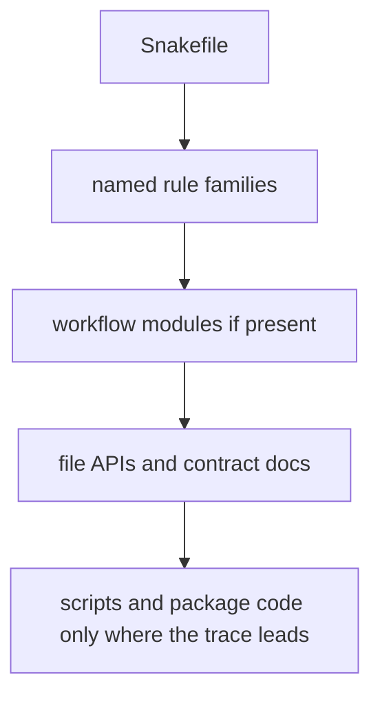
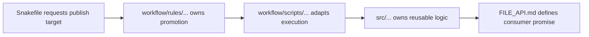
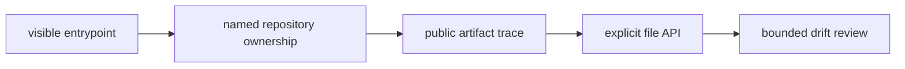

# Worked Example: Reading a Snakemake Repository Like an Architect

This file ties the whole module together around one realistic problem:

> a workflow repository still works, but new contributors cannot explain its shape without an oral tour.

The question is not "how do we inspect every file?" The question is how to read the
repository in an order that reveals ownership, path contracts, and drift risk quickly.

## If you are learning this without the live class

Use the example in five passes instead of trying to absorb the whole repository shape in
one read:

1. start at the entrypoint and write down what it visibly assembles
2. stop after the rule-family pass and ask whether the helper layers can still wait
3. trace one public artifact before you open deep implementation code
4. confirm the file API before you discuss refactoring
5. finish by deciding which drift signal matters now and which can wait

If you cannot explain the repository after pass 2, do not go deeper into helpers or
package code yet. Most Module 07 confusion starts when learners chase implementation
detail before they have named the visible architecture.

## How to use this worked example

Work through this page with the five core lessons nearby.

Do not treat it as a summary you skim after the module. Treat it as a guided architecture
walkthrough:

- where to start reading
- what to postpone
- how to trace one public artifact
- how to decide whether drift is real or only a vague discomfort

## The one-day teaching goal

By the end of this example, you should be able to explain one Snakemake repository
without falling back on phrases like "the important parts are spread around."

You should be able to say:

- which surface a new maintainer reads first
- which rule family or layer owns which concern
- where path promises become explicit
- which structural problem deserves refactoring now

## The lab route

Work through the example in this order:

1. start at the entrypoint and identify visible assembly
2. inspect named rule families before any helper code
3. separate reusable workflow modules from local assembly boundaries
4. confirm the public file contract and path promises
5. finish by deciding which architectural drift matters now

Keep one small architecture packet beside you as you read:

- a reading-order note
- an ownership table
- one artifact trace
- one file-API note
- one drift finding with a focused proof route

That packet is not overhead. It is the thing that turns "I explored the repo" into
"another maintainer can review why this reading order and boundary map are trustworthy."

## The starting situation

Assume you inherit the capstone and need to answer three questions quickly:

1. where is the workflow assembled
2. where do the main rule families live
3. where are public promises documented

If you cannot answer those questions in a stable order, the repository architecture is
already too opaque.

The whole walkthrough becomes easier if you visualize the reading order before opening
deep implementation code:

That sequence is not arbitrary. It protects the visible workflow story from being buried
under implementation detail too early.

## What goes wrong when a learner trusts the starting situation

Use this card before you repair anything:

| If you notice... | The repository is hiding... | Smallest review surface |
| --- | --- | --- |
| a new maintainer starts in helpers because the entrypoint teaches too little | visible assembly is too weak | one annotated entrypoint read |
| two repository layers can be described with the same sentence | ownership boundaries are not named clearly enough | one responsibility table |
| path stability is guessed from habit rather than docs | the file API is folklore instead of architecture | one file-API note plus one traced public path |
| "the repo feels messy" is the only drift argument available | architecture review has no focused boundary claim yet | one artifact trace plus one concrete drift finding |

If you can name the hidden defect first, the architecture review stops feeling like folder opinion.

## What the learner should notice first

The repository may still run perfectly.

The problem is that maintainers are depending on oral guidance instead of structure. That
is exactly the kind of architecture weakness that becomes expensive later even when the
workflow still executes correctly today.

## Start at the entrypoint

The top-level `Snakefile` is the right first file because it visibly:

- loads or validates config
- includes rule families or modules
- sets directory defaults when needed
- defines the main target

That is exactly what a good entrypoint should do.

The entrypoint should tell a reviewer, early, which visible workflow story they are about
to inspect. That is why the first architectural read should begin there rather than in
`src/` or a helper directory.

If the repository does not reward that reading order, the architectural problem is real,
not just personal preference.

## The entrypoint audit before you celebrate

Before you call the reading order healthy, make sure you can answer all four of these:

| Question | Healthy answer |
| --- | --- |
| What does the entrypoint reveal immediately? | config, major includes or modules, and final target assembly |
| What did you safely postpone? | helpers, scripts, or package code that support but do not define the visible story |
| What would count as an architectural warning? | needing deep implementation files before the workflow shape makes sense |
| What evidence proves the read order is honest? | an entrypoint note, rule-family pass, and one public-artifact trace |

If any row stays vague, keep repairing. The repository may run, but the architecture may still teach the story in the wrong order.

## Read rule families before helpers

Once the entrypoint is clear, inspect the named rule families.

This gives a workflow story such as:

- preprocessing creates internal working surfaces
- summarization promotes selected artifacts toward publication
- publishing assembles and verifies the public contract

That sequence teaches repository architecture and workflow meaning at the same time. If
you jump into helper code first, you lose the visible graph and start from implementation
detail instead of ownership.

At this stage, write one sentence per layer before you continue:

- what the entrypoint owns
- what one rule-family file owns
- what a helper or package layer should only support

If the same sentence still fits two layers, the repository boundary is not named clearly
enough yet.

## A short checkpoint before you continue

Pause here and ask:

- could a new maintainer explain the workflow shape without opening package code yet?
- do the rule-family names already signal concern boundaries?
- is the top-level assembly revealing more than it hides?

If the answer to any of these is no, the architectural story is already weaker than it
should be.

## Separate local assembly from reusable workflow modules

Now inspect `workflow/modules/` only after rule-family ownership is already visible.

That distinction matters:

- rule families group one repository's visible graph
- workflow modules expose reusable workflow bundles with their own boundary

Seeing both in the same pass helps a reviewer ask a better question: is this file here
because the repository needs local readability, or because the workflow boundary is
genuinely reusable?

This distinction becomes much easier to defend when you put it on paper:

| Surface | Why it exists | What it should not hide |
| --- | --- | --- |
| local rule family | readable ownership inside one repository | the visible graph |
| reusable workflow module | stronger caller boundary or reuse surface | ambiguous local overflow |

## Why this reading order matters educationally

This is the moment where repository inspection stops being a scavenger hunt.

The learner is no longer just finding files. They are using sequence to decide which
surfaces deserve trust first and which should be read only after the workflow story is
already visible.

## Confirm the file API explicitly

Architecture review is incomplete until the path contracts are visible.

The capstone keeps those in surfaces such as:

- `workflow/CONTRACT.md`
- `workflow/contracts/FILE_API.md`
- publish-facing contract notes

Those docs answer questions the tree alone cannot:

- which workflow paths are public
- which published paths are stable
- which changes count as contract changes instead of internal refactors

This is where architecture stops being intuitive and becomes reviewable.

The file API is what prevents maintainers from treating every path rename as a harmless
cleanup. Once path promises are documented, repository structure and public contracts stop
blurring together.

## The path-contract audit before you move on

Do not just say "the file API exists." Test whether you can name what it protects:

| Surface | Smallest honest claim |
| --- | --- |
| entrypoint and rule layers | this public path is intentionally produced from visible assembly |
| file-API document | this path is stable because the repository says it is stable |
| helper and package layers | these supporting files do not redefine the public promise silently |

If you cannot fill this table, the architecture still depends too much on oral tradition.

## Trace one artifact through its owners

Take one concrete public output such as `publish/v1/summary.json` and record the route:

Not every artifact passes through every layer. That is useful information. A missing layer
is not a defect. An unexplained jump across layers often is.

After drawing the trace, ask three review questions immediately:

1. could a new maintainer explain this path from the entrypoint backward?
2. did any hidden scan, side effect, or undocumented path appear in the middle?
3. does the trace end in an explicit public contract statement or only in producer memory?

## What the learner should notice now

The artifact trace is doing two jobs at once:

- it shows which surface owns each step
- it exposes where the visible repository story breaks and hidden assumptions begin

That is why this kind of trace is more educational than a generic folder tour.

## Catch architecture drift before it hardens

Now compare the documented repository shape with the actual one.

Typical drift signals include:

- a crowded entrypoint accumulating hidden logic again
- helper code becoming the first place reviewers must look
- public paths being used without contract updates
- modules or directories whose names no longer reveal ownership

At this stage, the review should not ask only "does it run?" It should ask "does the
repository still teach its own shape?"

That question is the real threshold between a merely functioning repository and one that
is sustainable to maintain.

## The repaired architecture story

By the end of the walkthrough, the repository can be described cleanly:

1. the entrypoint reveals visible assembly
2. rule families carry named ownership
3. reusable modules are distinct from local structure
4. file APIs define public path promises
5. helper and package code support the workflow instead of replacing its story

That is what it means to read a Snakemake repository like an architect.

Read that diagram literally. If one step is missing, the repository may still execute,
but the architecture story is not yet teachable.

## Review questions for the repaired design

When you inspect a repository shaped like this, ask:

1. which surface should a new maintainer read first and why
2. which layer owns one public artifact at each step
3. where the path contract becomes explicit
4. which helper or package boundary is supporting the workflow and which one is swallowing it
5. which drift signal would justify the next structural refactor

If those answers are visible, the module's architecture story has landed.

## If the module still feels abstract

Do this recovery loop in order:

1. point to the entrypoint and say what it visibly assembles
2. write one sentence per repository layer
3. trace one public artifact backward through its owners
4. mark which path becomes stable only because the file API says so
5. name one drift signal that justifies action now and one that can wait

Most Module 07 confusion is not about folder count. It is about losing track of which
architectural boundary should teach the next maintainer what is safe first.

If you want one final classroom-style check, summarize the repository in five lines:

1. where a new maintainer starts reading
2. which named rule family owns the public artifact you traced
3. where the path promise becomes explicit
4. which helper boundary is supporting the workflow rather than swallowing it
5. which drift signal would justify the next refactor now, not later
