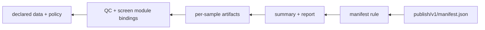
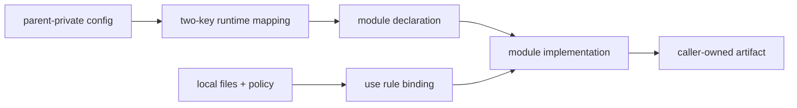

# Worked Example: Review One Artifact Across the Architecture

This worked example reviews the capstone through one public artifact:

```text
publish/v1/manifest.json
```

The goal is not to tour every directory. It is to explain how a requested public file
crosses assembly, local rule families, module and package boundaries, and verification.
Along the route, we will find and repair one real coupling defect: modules receiving the
entire parent configuration.

You can complete the reasoning without running the workflow. Command output adds evidence,
but every conclusion below also points to the source observation that supports it.

The review follows one artifact backward to its owners:



## Prepare an architecture packet

Create one note with these records:

1. completion contract
2. assembly inventory
3. rule-family map
4. module interface table
5. implementation dependency ledger
6. public artifact trace
7. drift finding
8. refactor claim
9. verification matrix
10. remaining-risk note

The records are cumulative. Do not replace an early prediction with the observed answer.
Keep both so a reviewer can see what changed your model.

## Begin at completion

The top-level default target is:

```python
rule all:
    input:
        f"{PUBLISH_DIR}/{PUBLISH_VERSION}/manifest.json"
    default_target: True
```

Write the first record:

| Question | Answer from source | Confidence |
| --- | --- | --- |
| What represents a complete default run? | the versioned publish manifest | high |
| Which values choose its path? | `publish_dir` and publish version | high |
| Does this prove every member is trustworthy? | no; it proves only the requested completion path | high |

This distinction matters. A target is a workflow promise, not independent verification.

Before reading producers, predict:

- the manifest rule should be visible after parsing
- its inputs should name every public file that it inventories
- the public file API should agree with those inputs
- a verification route should check both membership and artifact content

## Inventory assembly by responsibility

Read the top-level `Snakefile` from top to bottom once. Do not follow imports yet.
Classify statements:

| Responsibility | Observed surface |
| --- | --- |
| configuration gate | config file, schema validation, defaults |
| shared names | result, publish, log, benchmark, and runtime mappings |
| graph policy | workdir, wildcard constraint, local checkpoint policy |
| top-level rules | discovery, discovery publication, provenance |
| local assembly | common plus three rule-family includes |
| completion | default manifest target |

This inventory produces two findings:

- the entrypoint visibly explains how the workflow is assembled
- it also owns three executable rules, so it is not assembly-only

Do not immediately move those rules. Record the pressure:

> Discovery and provenance make the entrypoint slower to scan, but a move is justified
> only if a new concern owner and behavior-preservation evidence are clearer.

That is more honest than scoring the file by length.

## Confirm the parsed rule surface

From the capstone directory:

```bash
snakemake --list-rules
```

The current rule set should include:

```text
all
dedup_fastq
discover_samples
kmer_profile
manifest
provenance
publish_discovered_samples
qc_raw
qc_trimmed
report
screen_panel
summarize
trim_fastq
```

Interpret the receipt narrowly:

- parsing completed
- included and imported rule names became visible
- module aliases entered the local namespace

It does not prove that module config is bounded, paths are public, or implementations
declare all influences.

## Map local rule families

Now inspect the included files:

| Rule family | Rules or bindings it contributes | Shared review question |
| --- | --- | --- |
| `preprocess.smk` | QC bindings, trimming, deduplication, k-mer profile, screen binding | are per-sample transformations and evidence paths consistent? |
| `summarize_report.smk` | summary and report | does aggregation preserve the discovered sample contract? |
| `publish.smk` | manifest | does publication inventory the required public surface? |

Notice an asymmetry: `publish.smk` owns the manifest, while discovery publication and
provenance remain top-level. This may be intentional visibility or incomplete concern
grouping. Record it as a review question, not a proven defect.

The rule-family map should answer why rules live together. “They fit in the file” is not
an answer.

## Trace the manifest inputs

The manifest rule names:

```python
input:
    summary_json=rules.summarize.output.json,
    summary_tsv=rules.summarize.output.tsv,
    report_html=rules.report.output.html,
    provenance=rules.provenance.output.json,
    discovered=rules.publish_discovered_samples.output.json,
```

Compare those inputs with `capstone/docs/file-api.md`:

| Public surface | Producer | Manifest input? |
| --- | --- | --- |
| `discovered_samples.json` | `publish_discovered_samples` | yes |
| `summary.json` | `summarize` | yes |
| `summary.tsv` | `summarize` | yes |
| `report/index.html` | `report` | yes |
| `provenance.json` | `provenance` | yes |
| `manifest.json` | `manifest` | it is the inventory itself |

The contract and producer agree on membership at source level. That is not yet a hash or
schema check.

## Follow one internal branch through a module

`summary.json` depends on per-sample outputs. Follow the screen branch backward:

```text
publish/v1/summary.json
  <- internal summary
  <- results/{sample}/screen.json
  <- results/{sample}/kmer.json
  <- results/{sample}/dedup.fastq.gz
  <- results/{sample}/trimmed.fastq.gz
  <- discovered raw FASTQ
```

The screen job enters through a module binding:

```python
use rule screen from screen as screen_panel with:
    input:
        kmer_json=f"{RESULTS}/{{sample}}/kmer.json"
    output:
        json=f"{RESULTS}/{{sample}}/screen.json"
    params:
        panel_fasta=config["params"]["panel"]["fasta"]
```

The caller owns local input, output, and the panel that changes scientific meaning. The
module owns the reusable screening command.

## Find the hidden module coupling

Before the repair, both module declarations used:

```python
config: config
```

The module sources then read parent configuration:

```python
config["_env_python"]
config["benchmarks_dir"]
```

Build the interface table:

| Dependency | Visible at caller? | Necessary to module? | Finding |
| --- | --- | --- | --- |
| k-mer JSON | yes, `input` binding | yes | explicit |
| screen JSON | yes, `output` binding | yes | explicit |
| panel FASTA | yes, `params` binding | yes | explicit semantic policy |
| Python environment | hidden inside broad config | yes | interface leak |
| benchmark root | hidden inside broad config | yes | interface leak |
| all other parent config | supplied but unused | no | excessive authority |

The jobs could parse, plan, and execute successfully. The defect is that the caller could
not state the module's complete dependency surface without inspecting private module code.

## State the refactor before applying it

Use a bounded claim:

> Because the QC and screen modules receive the full parent config, reviewers cannot
> distinguish required runtime settings from accidental access to repository policy.
> Pass a named two-key runtime mapping, rename the module-facing environment key, preserve
> imported rule names and plans, and reject broad config passing or new undeclared module
> config reads.

The claim identifies:

- the observation
- the harmed review question
- the ownership change
- the behavior that must remain
- the guard that should reject recurrence

## Repair the caller boundary

The entrypoint now derives:

```python
MODULE_RUNTIME_CONFIG = {
    "env_python": config["_env_python"],
    "benchmarks_dir": BENCH_DIR,
}
```

Both declarations pass only that mapping:

```python
module screen:
    snakefile: "../modules/screen_module/Snakefile"
    config: MODULE_RUNTIME_CONFIG
```

The module reads public interface names:

```python
conda:
    config["env_python"]
params:
    benchdir=lambda wc: config["benchmarks_dir"]
```

The parent may change how it derives `_env_python` or `BENCH_DIR` without making those
private names part of the module contract. The module receives the two concepts it owns.

The repaired dependency direction is visible:



## Add a guard for the old defect

A source-level test checks:

- both caller declarations use `MODULE_RUNTIME_CONFIG`
- neither passes `config: config`
- each module source reads exactly `env_python` and `benchmarks_dir`

This guard is intentionally narrow. It does not prove:

- that the environment file exists
- that benchmark paths work on every executor
- that the module has no ambient filesystem dependencies
- that screening is scientifically valid

It does prove that a new direct config read cannot enter these two module sources without
changing the expected interface.

## Compare with the paired module experiment

Run:

```bash
gmake module-interface-audit
gmake module-interface-selftest
```

The generated audit contains two successful experiments:

| Model | Expected finding | Interpretation |
| --- | --- | --- |
| explicit contract | `EXPLICIT_MODULE_CONTRACT_PRESERVED` | caller-visible binding is preserved |
| hidden coupling | `HIDDEN_MODULE_COUPLING_REPRODUCED` | the experiment successfully demonstrates a defect |

The paired experiment teaches causality. The capstone source guard prevents recurrence in
the real workflow. Keep those two kinds of evidence distinct.

## Audit the implementation boundary

The module shell calls:

```bash
python3 -m capstone.screen_panel
```

Record the implementation ledger:

| Influence | Rule representation | Package representation |
| --- | --- | --- |
| k-mer data | named input | CLI path |
| panel FASTA | caller parameter | CLI path |
| output JSON | named output | CLI path |
| Python import location | runtime parameter | `PYTHONPATH` |
| environment | module config | `conda` |
| log | named log | stderr redirection |
| benchmark root | module config | directory creation parameter |

One concern remains: if panel FASTA contents affect the output but the path appears only
under `params`, Snakemake may not plan a rerun after the panel file changes. The
architecture review should carry this into the next file-contract audit rather than
declare the whole branch complete.

This is what honest review looks like: one repaired boundary can expose the next.

## Verify public promotion independently

Run the publication evidence route:

```bash
gmake verify-report
```

Read:

1. the generated route
2. copied file API
3. publish manifest
4. verification JSON
5. discovery, summary, and provenance together
6. review packet manifest

The route should answer different questions:

| Evidence | Question |
| --- | --- |
| file API | what is promised? |
| rule source | who produces and promotes it? |
| manifest | which public members and hashes were recorded? |
| verifier | do the current files satisfy bounded checks? |
| consumer-oriented review | can a downstream reader interpret them? |

Do not substitute a screenshot of the report for this evidence chain.

## Complete the architecture packet

A model packet now contains:

| Record | Worked conclusion |
| --- | --- |
| completion contract | versioned manifest is the default completion artifact |
| assembly inventory | gates and includes are visible; three executable rules remain top-level |
| rule-family map | preprocessing, aggregation/report, and manifest concerns are named |
| module interface | local files and policy are bound; runtime config is narrowed |
| implementation ledger | rule-to-package dependencies are mostly explicit |
| public trace | manifest membership agrees with the file API at source level |
| drift finding | broad config passed excessive parent state to modules |
| refactor claim | narrow runtime mapping plus source guard |
| verification matrix | source guard, paired audit, rule list, and publish evidence have distinct roles |
| remaining risk | panel FASTA may need promotion from `params` to declared input |

## Transfer the method to another repository

For a different Snakemake repository:

1. choose one completion artifact
2. trace it backward through public, internal, rule, and implementation owners
3. record every place policy or paths cross a boundary
4. find one arrow that contradicts the claimed dependency direction
5. write a refactor claim before changing code
6. preserve parse, plan, execution, artifact, and contract behavior as applicable
7. add a negative check for the old defect
8. finish by naming the next unresolved risk

You have completed the example when another learner can challenge your conclusion from
the packet without needing an instructor to reconstruct your reasoning.
