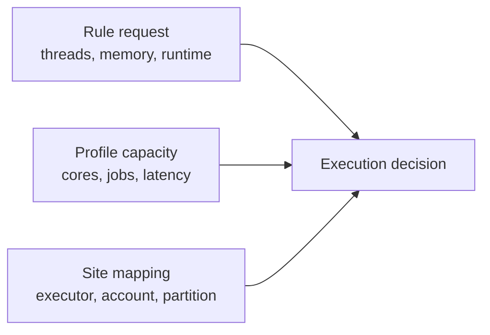
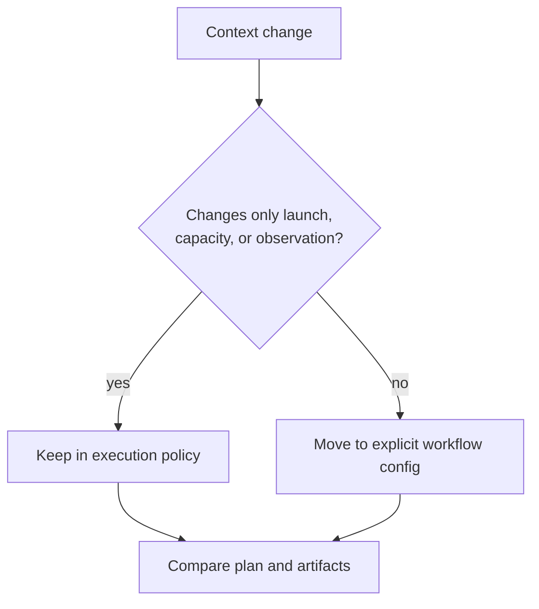

# Executors, Resources, and Context-Invariant Workflow Meaning

Moving a workflow from a laptop to CI or a scheduler changes real operating conditions.
It does not give the execution context permission to redefine the workflow.

The central question is:

> Which resource and executor differences may change how jobs run while samples, rules,
> paths, and artifact meaning stay invariant?

This lesson separates workflow requests, profile capacity, and site-specific executor
mapping.

## Three layers own different decisions

Treat resource handling as three cooperating contracts:

| Layer | Example | Owns |
| --- | --- | --- |
| workflow rule | `threads`, `mem_mb`, `runtime` | per-job work shape |
| execution profile | `cores`, `jobs`, `latency-wait` | run-level capacity and tolerance |
| operator overlay | executor plugin, account, partition | site-specific submission mapping |

The workflow says what one job needs. The profile says what the run may use. The operator
overlay says how those needs map to a real service.



Collapsing these layers creates different failure modes:

- queue names in rules tie workflow meaning to one site
- algorithm parameters in profiles let context redefine results
- undeclared memory needs force operators to guess from failures

## Read the specimen's rule request

Open:

```text
capstone/repro/context-invariance/Snakefile
```

The `normalize` rule declares:

```python
threads: 2
resources:
    mem_mb=512,
    runtime=5,
```

Those values are attached to the job, not to local, CI, or scheduler policy. Every context
sees the same request.

The rule does not declare:

- a queue
- an account
- a partition
- a scheduler command
- a context-specific result path

That is the intended boundary. A real scheduler profile can translate `mem_mb=512` and
`runtime=5` into site syntax without editing the rule's inputs, outputs, or algorithm.

## Compare request with available capacity

The preserving profiles provide different `cores` values:

- local: 2
- CI: 1
- scheduler-oriented: 8

Run:

```bash
make capstone-context-invariance-audit
```

The audit proves that all three contexts retain:

- the two-sample job domain
- the same D3 DAG
- the same output plan
- the same manifest path
- the same executed result bytes

It does not prove identical scheduling. CI has less available capacity, so Snakemake may
scale thread allocation or serialize work.

This distinction is important:

> Semantic equivalence is not performance equivalence.

If a tool changes numerical results based on thread count, then thread scaling is no longer
merely operational for that rule. The workflow must either enforce the required threads or
test the tool's equivalence explicitly.

## Use resource units that survive mapping

Portable declarations need documented units:

- `threads` is a count
- `mem_mb` is memory in megabytes
- `runtime` needs a repository convention that matches the executor mapping
- disk or scratch requests need an explicit unit and lifecycle

Avoid ambiguous names such as:

```python
resources:
    memory="large",
    time="long",
```

Those labels may be useful inside one institution, but they are not self-explanatory
workflow requests. If categories are necessary, document their mapping and ownership.

The capstone uses concrete `mem_mb` declarations in processing rules. For example,
`dedup_fastq` requests more memory than `qc_raw`. A reviewer can see the difference before
opening a cluster configuration.

## Resource functions are semantic inputs to scheduling

The capstone computes some memory requests from input size:

```python
mem_mb=lambda wc, input: max(
    2000,
    int(1.5 * file_size_mb(input.fastq)) + 1000,
)
```

This does not change artifact meaning directly. It changes the scheduler request derived
from declared input state.

Review a resource function for:

- deterministic inputs
- explicit units
- a safe minimum
- behavior when metadata is missing
- whether the same function is visible in every context

Do not hide a different sizing formula inside each executor profile. That makes capacity
review harder and can turn resource failures into context-specific folklore.

## Distinguish planning invariants from launch differences

The context audit retains two planning surfaces:

- D3 DAG for jobs and edges
- output summary for declared paths

These should remain invariant across preserving profiles. Launch details may differ:

| Surface | Must match? | Reason |
| --- | --- | --- |
| sample-specific jobs | yes | sample scope is workflow meaning |
| dependency edges | yes | graph logic is workflow meaning |
| trusted outputs | yes | downstream contract is workflow meaning |
| available cores | no | contexts have different capacity |
| queue and account | no | sites have different submission policy |
| command visibility | no | observability policy may differ |
| result bytes | yes for this specimen | execution context must not alter the transformation |

This table is more useful than saying the contexts are “the same” or “different.” It names
the comparison boundary.

## A scheduler-oriented profile is not a scheduler proof

The course's committed scheduler profile deliberately contains portable policy only. It
does not claim to submit to a real cluster.

That is honest because a real submission proof also depends on:

- an installed executor plugin
- site identity and credentials
- an account or allocation
- queue or partition policy
- shared or staged storage
- node environment availability

The context-invariance audit proves that adding those mappings must not alter workflow
meaning. It does not fabricate access to infrastructure.

Use an operator overlay for site-owned values:

```yaml
executor: slurm
default-resources:
  slurm_account: research-account
  slurm_partition: compute
```

The exact keys depend on the executor plugin and site. What matters here is ownership:
site mapping may translate resource requests, but it must not select samples or publish
paths.

## Detect an executor leak

Suppose a scheduler profile contains:

```yaml
config:
  samples:
    - alpha
```

The profile may be justified as a “smaller cluster test.” It is still a semantic leak:

- one sample-specific job disappears
- the manifest changes
- the scheduler context now answers a different analytical question

If a smaller smoke test is useful, make it an explicit semantic configuration with a
separate claim. Do not call it equivalent to the full workflow.



## Review resource changes with evidence

For a rule resource edit, keep:

- the old and new declaration
- measured or observed reason for the change
- expected mapping in each operating context
- a dry-run showing the resolved request
- confirmation that targets and paths did not change

For an executor-profile edit, keep:

- the changed policy key
- its owner
- the site assumption it represents
- the normalized plan comparison
- one limit the local audit cannot test

“The cluster needed more memory” is incomplete. Name which rule, which request, which
evidence, and which mapping.

## Common boundary failures

| Failure | Why it is weak | Repair |
| --- | --- | --- |
| queue name appears in a rule | one site leaks into workflow source | map queue policy in an operator overlay |
| memory exists only in scheduler config | workflow hides per-job work shape | declare portable resource needs on the rule |
| profile changes algorithm parameters | context changes artifact meaning | move parameters to semantic config |
| CI silently scales a sensitive tool's threads | outputs may differ despite the same graph | enforce or test thread-count equivalence |
| scheduler smoke test is called full equivalence | reduced sample scope is hidden | give the smoke test a distinct semantic claim |

## End-of-page checkpoint

You are ready to continue when you can:

- identify the owner of rule requests, profile capacity, and site mapping
- explain why the audit proves semantic equivalence but not performance equivalence
- show how D3 DAG and output summary protect different invariants
- explain why a scheduler-oriented profile is not evidence of real scheduler submission
- classify a reduced sample set as semantic configuration even when it is operationally
  convenient

If queue syntax still feels like the center of the lesson, return to the three ownership
layers. Executor portability begins with a stable workflow contract.
