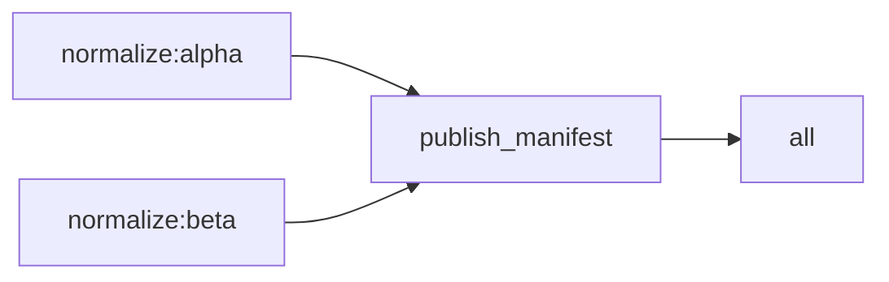
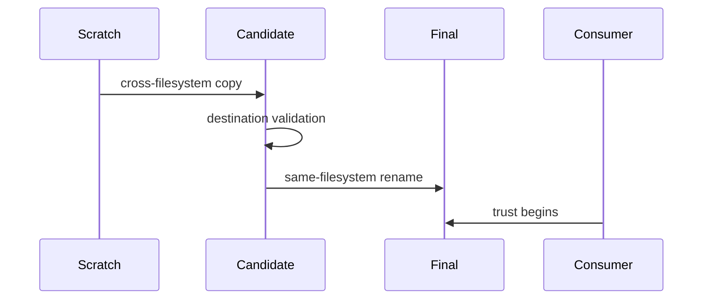

# Exercise Answers

These model answers show the required reasoning and evidence. Compare them with your packet
only after you have run the audit and inspected the generated files.

Different wording is acceptable. Missing source, plan, artifact, or rejection evidence is
not.

## Exercise 1: Classify all profile keys

A complete matrix includes:

| Profile | Key | Class | Preserving context allowed? |
| --- | --- | --- | --- |
| local | `cores` | capacity | yes |
| local | `latency-wait` | filesystem tolerance | yes |
| local | `printshellcmds` | observability | yes |
| local | `show-failed-logs` | observability | yes |
| CI | same four keys | same classes | yes |
| scheduler | same four keys | same classes | yes |
| trusted-path leak | `config.publish_root` | semantic override | no |
| sample-scope leak | `config.samples` | semantic override | no |

The preserving profiles contain no semantic or unknown keys. Their values differ, but
classification depends on effect:

- `cores` changes available capacity
- `latency-wait` changes visibility tolerance
- `printshellcmds` changes terminal evidence
- `config.publish_root` changes a contract path
- `config.samples` changes the job domain

The final two values are not safe merely because they appear in profile files. File
location does not decide ownership.

## Exercise 2: Prove the preserving semantic plan

All three preserving summaries contain:

```text
publish/stable/manifest.tsv
results/alpha.txt
results/beta.txt
```

The owning rules are `publish_manifest` and `normalize`.

All three normalized D3 DAGs contain:

```text
all
publish_manifest
normalize:alpha
normalize:beta
```

The dependency shape is:



Safe volatile fields to remove include:

- workflow UUID
- date
- host
- absolute run directory
- numeric job ID

These describe one invocation, not workflow meaning.

Fields that must remain include:

- wildcard-specific labels
- dependency edges
- output paths
- owning rules

Removing `normalize:beta` or `publish/stable/manifest.tsv` would normalize away the exact
semantic leaks the gate exists to detect.

## Exercise 3: Prove executed artifact equivalence

The artifact table is:

| Surface | Local | CI | Scheduler |
| --- | --- | --- | --- |
| manifest path | `publish/stable/manifest.tsv` | same | same |
| manifest members | alpha, beta | same | same |
| alpha result | `ALPHA PAYLOAD` | same | same |
| beta result | `BETA PAYLOAD` | same | same |

This supports:

> The preserving profiles materialize the same specimen contract and normalized result
> bytes.

It does not support:

- equal runtime
- equal cost
- equal thread allocation
- real scheduler submission
- shared-filesystem behavior

Equal bytes under local execution are semantic evidence for this bounded specimen, not an
infrastructure benchmark.

## Exercise 4: Diagnose the trusted-path leak

A model finding is:

> **High:** `trusted-path-leak/config.yaml` injects
> `publish_root=publish/context-specific`. The D3 DAG retains both sample jobs and the
> result bytes match local, but the output summary and executed run move the manifest from
> `publish/stable/manifest.tsv` to `publish/context-specific/manifest.tsv`. Execution
> context now selects the downstream contract path. Remove the override from profile
> policy and keep the path in semantic configuration.

The finding `TRUSTED_PATH_LEAK_REPRODUCED` is `PASS` because:

- the semantic override is visible
- the manifest path changes
- sample results remain unchanged
- manifest content remains unchanged

A DAG-only comparison misses this defect because graph topology does not encode the
contract-path distinction strongly enough.

## Exercise 5: Diagnose the sample-scope leak

A model finding is:

> **High:** `sample-scope-leak/config.yaml` injects `samples=[alpha]`. The trusted manifest
> location remains stable, but `normalize:beta`, `results/beta.txt`, and the `beta`
> manifest row disappear. The profile therefore narrows workflow meaning. Move sample
> selection to an explicit semantic config with a distinct claim.

The finding `SAMPLE_SCOPE_LEAK_REPRODUCED` is `PASS` because:

- the semantic override is visible
- the trusted path remains unchanged
- `beta` is removed from the plan
- `alpha` remains byte-identical
- manifest meaning changes

A path-only comparison misses this defect because the same final pathname can contain a
different sample domain.

## Exercise 6: Map rule resources into two contexts

The ownership table is:

| Layer | Model value | Meaning |
| --- | --- | --- |
| rule | `threads=2` | preferred per-job parallelism |
| rule | `mem_mb=512` | per-job memory request |
| rule | `runtime=5` | per-job runtime request under the repository convention |
| local profile | `cores=2` | run-level local capacity |
| scheduler profile | `cores=8` | run-level capacity for the portable specimen |
| site overlay | account and partition | operator-owned submission mapping |

When available cores are below requested threads, Snakemake can scale a rule's threads
down for that run. In this specimen, the shell transformation does not consume the
`threads` value, and artifacts remain equal.

That supports semantic equivalence for the transformation. It does not support equal
performance.

A tool whose reduction order or randomization changes with thread count requires explicit
equivalence testing or an enforced thread count. In that case, resource allocation can
affect semantic output.

Queue and account belong in a site overlay because they map the request to infrastructure.
Algorithm parameters belong in semantic config because they define artifact meaning.

## Exercise 7: Decide policy for three failures

### Incident A

Classification: deterministic environment defect.

Evidence: exit `127` and the same missing executable on each attempt.

Response:

- repair the declared environment
- do not retry
- retain the failed command and environment evidence

More attempts cannot install the executable.

### Incident B

Classification: transient executor failure.

Evidence: executor reports `PREEMPTED`, and the application never starts.

Response:

- allow a bounded retry
- retain the executor reason for each attempt
- stop if the application begins and then fails deterministically
- calculate maximum added core-time

Two additional attempts are defensible only if the retry cost fits policy.

### Incident C

Classification: measured filesystem visibility delay.

Evidence: successful producer plus delays of 3, 7, 4, and 6 seconds.

Response:

- document the filesystem assumption
- choose a bounded wait above the measured maximum, such as 15 seconds
- keep monitoring because four observations are a small sample
- do not add job retries

The wait addresses post-success visibility, not failed execution.

## Exercise 8: Design cross-filesystem publication

A model contract is:

```text
scratch owner: one job attempt
scratch result: ${SCRATCH}/sample.dat
destination candidate: results/.sample.dat.candidate
validation: content and checksum at destination
publication event: same-filesystem rename of candidate to results/sample.dat
trusted output: results/sample.dat
copy-failure residue: candidate removed or quarantined
cleanup owner: producing rule or explicit recovery command
```



Expected failure inventories:

| Failure | Scratch | Candidate | Final |
| --- | --- | --- | --- |
| computation | partial or absent | absent | absent |
| destination copy | complete source | partial | absent |
| after validation | complete source | validated | absent |
| after rename | optional residue | absent | complete |

A direct move from scratch to the final path may degrade to copy-then-delete across
filesystems. That exposes the final name before transfer completes.

## Exercise 9: Trace one rejected mutation

`test_preserving_profile_rejects_sample_scope_change`:

1. copies the tracked specimen
2. adds `config.samples=[alpha]` to the scheduler profile
3. runs the complete audit
4. requires a nonzero return code
5. checks that scheduler `policy_only_profile` and `same_semantic_plan` are false

This is rejection behavior: a preserving context becomes semantic and must fail.

`test_sample_scope_specimen_cannot_substitute_a_path_leak` is isolation behavior. It
changes the sample-scope counterexample into a path override, then requires:

- `trusted_path_unchanged` to be false
- `beta_removed_from_plan` to be false

The audit cannot call a path leak proof of a sample leak.

The baseline test is acceptance behavior: known policy-only variation passes.

The stale-workspace test proves that a previous artifact cannot contaminate a later audit.
Without cleanup, a removed `beta` job might appear to have produced an old result.

## Exercise 10: Write the maintainer review

A model review is:

> **High:** The proposed CI `config.samples=[alpha]` override changes workflow meaning.
> Compared with the local baseline, the plan loses `normalize:beta` and
> `results/beta.txt`, while the manifest loses its `beta` row. Profile policy must not own
> sample selection. Move the reduced sample set to a separately named semantic
> configuration and stop claiming that run is equivalent to the full workflow.
>
> **Accepted policy:** `cores=1` is CI capacity. The preserving audit demonstrates that
> lower capacity can retain the same specimen plan and artifacts.
>
> **Under-evidenced policy:** `latency-wait=30` does not alter the semantic plan, but the
> pull request provides no filesystem visibility measurements. Keep the current value or
> attach a measured visibility model.
>
> **Verification:** source classification, D3 DAG, output summary, executed manifest, and
> the sample-scope rejection test support these findings.
>
> **Limits:** no real scheduler submission, retry incident, shared-filesystem delay, or
> scratch promotion was tested.

The review distinguishes:

- harmless capacity
- semantic sample drift
- operational policy that may be safe but lacks evidence

“CI is different” would not make any of those decisions reviewable.

## Answer-key completion check

Across all ten answers, require the same reasoning chain:

```text
invariant
    -> source classification
    -> plan effect
    -> artifact effect
    -> rejected mutation
    -> bounded decision
```

If an answer skips from profile YAML directly to approval, return to the missing evidence
surface.
