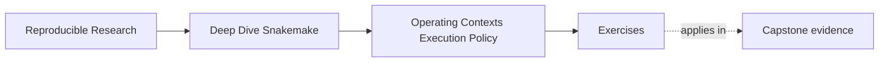

# Exercises

<!-- page-maps:start -->
## Page Maps

<!-- page-maps:end -->

Use these exercises to practice operating-context judgment, not only profile vocabulary.

The strongest answers will make the policy boundary and the semantic boundary explicit.

## Exercise 1: Decide whether a profile change is safe

A teammate proposes these profile changes:

- local: `latency-wait: 60`
- CI: `printshellcmds: false`
- SLURM: a different `publish_dir`

Write a short review note that explains:

- which changes look like operating policy
- which change looks like a semantic leak
- why the distinction matters

## Exercise 2: Review retries honestly

A workflow has started failing intermittently on one cluster. The proposed fix is:

- increase retries from 1 to 5
- do not inspect failed logs yet

Explain:

- why this may be a weak operating response
- what failure classification question should be asked first
- what evidence you would want before approving the change

## Exercise 3: Diagnose a storage-boundary problem

A scheduler-backed run stages outputs onto node-local scratch and later copies some of
them to shared storage. Reviewers have started checking the scratch directory directly when
the shared output is delayed.

Explain:

- what trust problem this creates
- when a file should count as a trusted output
- what policy or documentation boundary needs to be clarified

## Exercise 4: Compare contexts

A repository has `profiles/local`, `profiles/ci`, and `profiles/slurm`. No one has ever
compared their dry-runs side by side.

Write a short argument for why that comparison matters even if all three contexts appear to
“work.”

Your answer should focus on semantic drift rather than operational convenience.

## Exercise 5: Escalate a suspicious policy change

During review, you notice that one profile now sets a different config value that changes
how samples are filtered before publication.

Describe:

- why this is not just a profile difference
- which review surface should own that decision instead
- what should happen before the change is approved

## Exercise 6: Build a three-context policy matrix

Inventory every setting in local, CI, and scheduler profiles. Classify each as capacity,
observability, recovery, filesystem, executor mapping, or semantic leak.

What to hand in:

- the complete matrix
- disagreements that are justified by context
- any duplicate default that should be centralized or documented
- every setting that needs removal from profile policy

## Exercise 7: Normalize and compare plans

Request the same final target through all three profiles and capture dry-run evidence.
Normalize only volatile presentation details, then compare jobs, dependencies, wildcards,
and outputs.

What to hand in:

- the capture and normalization commands
- the semantic comparison
- one harmless operational difference
- one deliberately introduced semantic difference that the comparison catches

## Exercise 8: Map resources to two executors

Declare threads, memory, runtime, and temporary disk for a heavy rule. Map the abstract
resources to local limits and scheduler requests.

What to hand in:

- the rule declarations
- both policy mappings
- an explanation of units and defaults
- evidence that changing the mapping does not change output meaning

## Exercise 9: Verify scratch promotion

Execute or simulate a job through node-local scratch, validation, atomic promotion, and
cleanup. Interrupt it before promotion and inspect every location.

What to hand in:

- the storage lifecycle diagram
- success and interruption inventories
- the point where the output becomes trusted
- recovery behavior that cannot mistake scratch for publication

## Exercise 10: Write an operating-context drift gate

Implement a focused audit that compares governed profile keys and semantic dry-run
surfaces. Make it fail on a changed publish path or sample-filter setting.

What to hand in:

- the governed invariants
- passing and failing evidence
- a precise failure message
- an explanation of what remains intentionally context-specific

## Mastery check

You have a strong grasp of this module if all ten answers consistently keep four ideas visible:

- profiles own policy, not workflow meaning
- context changes should preserve trusted outputs
- retries and latency settings need a failure model
- storage and visibility assumptions must be reviewable
