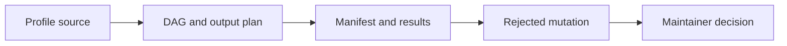
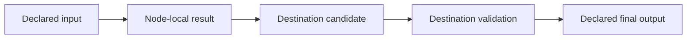

# Exercises

These ten exercises form one context-review lab. Work from the executable specimen and
retain one evidence packet rather than writing ten disconnected explanations.

## Prepare the lab

From the course directory, run:

```bash
make capstone-context-invariance-audit
```

Use this generated root:

```text
artifacts/audit/reproducible-research/deep-dive-snakemake/context-invariance/
```

Keep your own notes under the repository `artifacts/` tree:

```text
artifacts/study/reproducible-research/deep-dive-snakemake/context-review/
├── profile-matrix.md
├── plan-comparison.md
├── leak-findings.md
├── resource-map.md
├── failure-policy.md
├── storage-contract.md
└── maintainer-review.md
```

Do not edit the tracked specimen for these exercises. The rejection suite creates its own
disposable copies.

## Evidence progression



Every conclusion must cite the smallest evidence surface that supports it.

## Exercise 1: Classify all profile keys

Read the five profile files under:

```text
specimen/profiles/
```

Build a matrix with:

- profile name
- key
- value
- policy class
- allowed to vary across preserving contexts
- semantic effect if misused

Use these classes:

- capacity
- observability
- recovery
- filesystem tolerance
- executor mapping
- semantic override
- unknown

What to hand in:

- `profile-matrix.md`
- one sentence explaining why classification depends on effect, not file location
- every semantic key used by the two counterexamples
- confirmation that preserving profiles contain no semantic or unknown keys

Acceptance check:

Your matrix must distinguish `latency-wait` from `config` and must not label every
profile-local value as policy.

## Exercise 2: Prove the preserving semantic plan

Compare local, CI, and scheduler evidence under:

```text
workspace/evidence/<profile>/
```

Use both:

- `summary.stdout.txt`
- `d3dag.stdout.txt`

What to hand in:

- `plan-comparison.md`
- the output paths shared by all three profiles
- the job labels and dependency edges shared by all three profiles
- a list of fields you ignored as volatile
- a reason each ignored field is outside the semantic claim

Acceptance check:

Your comparison must retain wildcard-specific job labels and trusted output paths. A list
of rule names alone is insufficient.

## Exercise 3: Prove executed artifact equivalence

Inspect the three preserving run directories:

```text
workspace/runs/local/
workspace/runs/ci/
workspace/runs/scheduler/
```

Compare:

- manifest path
- manifest content
- `results/alpha.txt`
- `results/beta.txt`

What to hand in:

- an artifact comparison table added to `plan-comparison.md`
- the exact invariant claim supported by byte agreement
- one performance or infrastructure claim this evidence does not support

Acceptance check:

Do not infer equal runtime or real scheduler submission from equal artifacts.

## Exercise 4: Diagnose the trusted-path leak

Read:

```text
specimen/profiles/trusted-path-leak/config.yaml
workspace/evidence/trusted-path-leak/summary.stdout.txt
workspace/evidence/trusted-path-leak/d3dag.stdout.txt
```

Compare them with local evidence.

What to hand in:

- one high-severity finding in `leak-findings.md`
- source evidence showing the override
- plan evidence showing the changed path
- evidence showing sample jobs and result bytes stayed stable
- an explanation of why DAG-only comparison would miss the defect

Acceptance check:

Quote `TRUSTED_PATH_LEAK_REPRODUCED` and explain why PASS means successful defect
reproduction.

## Exercise 5: Diagnose the sample-scope leak

Read:

```text
specimen/profiles/sample-scope-leak/config.yaml
workspace/evidence/sample-scope-leak/summary.stdout.txt
workspace/evidence/sample-scope-leak/d3dag.stdout.txt
workspace/runs/sample-scope-leak/publish/stable/manifest.tsv
```

What to hand in:

- a second high-severity finding in `leak-findings.md`
- the missing job label
- the missing output path
- the missing manifest member
- evidence that the trusted manifest location remained stable
- an explanation of why path-only comparison would miss the defect

Acceptance check:

Quote `SAMPLE_SCOPE_LEAK_REPRODUCED` and identify the semantic owner that should replace
profile ownership.

## Exercise 6: Map rule resources into two contexts

Read the `normalize` rule and the local, CI, and scheduler profiles.

Build `resource-map.md` with:

- rule-level threads, memory, and runtime
- local and scheduler run-level capacity
- one hypothetical site overlay for account and partition
- units for every resource
- an explanation of what happens when available cores are below requested threads

Then inspect the three execution traces.

What to hand in:

- the three-layer ownership table
- one semantic invariant
- one performance property that may differ
- one case where thread scaling would require explicit equivalence testing

Acceptance check:

Queue and account values must not appear in the rule, and algorithm parameters must not
appear in the profile mapping.

## Exercise 7: Decide policy for three failures

Classify these incident cards:

### Incident A

The application exits `127` with `aligner: command not found` on every attempt.

### Incident B

The executor reports `PREEMPTED`; the application never starts.

### Incident C

The producer exits zero, and repeated measurements show its declared output becomes visible
after 3, 7, 4, and 6 seconds.

Write `failure-policy.md` with:

- failure class
- evidence
- correct first response
- whether retry or latency wait is justified
- maximum attempts or wait
- stop condition
- added cost or delay

Acceptance check:

Only Incident B may receive a retry. Only Incident C may justify latency wait. Incident A
requires environment repair.

## Exercise 8: Design cross-filesystem publication

Assume a job computes on node-local scratch and publishes to a shared `results/` filesystem.

Draw:



Create `storage-contract.md` containing:

- scratch owner
- cross-filesystem copy
- destination candidate path
- validation
- same-filesystem rename
- failure residue and cleanup owner
- point where trust begins

Add expected inventories for failure:

- during scratch computation
- during destination copy
- after validation but before rename
- after rename

Acceptance check:

Do not describe a direct move from node-local scratch to the final path as atomic.

## Exercise 9: Trace one rejected mutation

Run:

```bash
make capstone-context-invariance-selftest
```

Open:

```text
capstone/tests/test_context_invariance_audit.py
```

Choose one test that mutates a preserving profile and trace:

- the source mutation
- the plan or artifact effect
- the named finding that fails
- the assertion proving rejection

Then choose the isolation test that substitutes a path leak for a sample leak.

What to hand in:

- a rejection section in `leak-findings.md`
- one acceptance behavior
- one rejection behavior
- one isolation behavior
- why stale workspace replacement matters

Acceptance check:

Do not report only that seven tests pass. Explain what incorrect evidence one test rejects.

## Exercise 10: Write the maintainer review

Write `maintainer-review.md` for a proposed change containing:

```yaml
# ci profile
cores: 1
latency-wait: 30
config:
  samples:
    - alpha
```

Order the review as:

- findings by semantic risk
- accepted policy differences
- required repair
- verification evidence
- explicit limits

The review must answer:

- which setting is harmless policy
- which setting changes workflow meaning
- which plan and artifact facts prove the change
- where the sample selection should live instead
- which scheduler, retry, and storage claims remain untested

Acceptance check:

Your conclusion must not use “CI is different” as justification. It must cite the missing
job, output, and manifest member.

## Completion standard

Your packet is complete when another learner can:

- reconstruct all three preserving invariants
- distinguish the two semantic leaks
- see why rule resources and profile capacity have different owners
- reproduce your failure-policy decisions
- identify the exact storage publication event
- trace one mutation from source to failed finding
- approve or reject the proposed profile change without instructor explanation

Keep the packet under `artifacts/`. It is study evidence, not a new durable course source.
