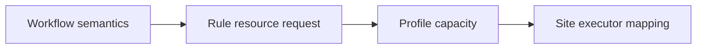
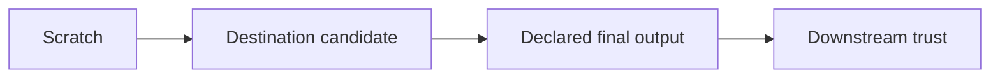

# Glossary

<!-- page-maps:start -->
## Glossary Maps

<!-- page-maps:end -->

Module 08 is about keeping one workflow honest across many places it can run. This
glossary helps you talk about local, CI, and scheduler-backed execution without letting
operating policy quietly rewrite workflow meaning.

## When to stop and check the glossary

Use this page when an operating-context discussion starts to blur these boundaries:

- policy versus semantics
- transient failure versus deterministic failure
- scratch presence versus trusted output
- context difference versus policy leak

If the discussion feels vague, one of those terms is probably carrying too much meaning at
once.

## Terms

| Term | Meaning in this module |
| --- | --- |
| operating context | The environment in which the workflow runs, such as local, CI, or scheduler-backed execution. |
| execution policy | Settings that change how the workflow runs or is observed without changing workflow meaning. |
| semantic drift | A change in workflow meaning, trusted outputs, or contract behavior that should not be happening through operating policy alone. |
| profile | A configuration surface that encodes operating policy such as executor defaults, logging, retries, or latency settings. |
| semantic profile key | A profile entry such as `config`, `configfile`, or `configfiles` that can override workflow meaning and therefore requires semantic review. |
| policy leak | A case where profile or context settings start changing workflow semantics instead of only operations. |
| context-invariant meaning | The idea that rule contracts, config meaning, and trusted outputs should stay stable across operating contexts. |
| semantic plan | The normalized set of jobs, wildcard labels, dependency edges, and declared output paths that represents planned workflow meaning. |
| rule resource request | A per-job declaration such as threads, memory, or runtime that describes work shape independently of one executor. |
| profile capacity | Run-level limits such as cores or job concurrency that constrain how declared work may be scheduled. |
| operator overlay | Site-owned executor, account, partition, queue, or storage mapping layered over portable workflow requests. |
| failure discipline | The explicit operating model for retries, latency waits, incomplete outputs, and failure evidence. |
| transient failure | A failure plausibly caused by operational conditions such as scheduling or visibility delay. |
| deterministic failure | A failure caused by a repeatable defect in workflow logic, runtime, or environment rather than transient operations. |
| resource exhaustion | A failure supported by memory, runtime, disk, or executor evidence showing that a job exceeded its declared or available resources. |
| retry budget | A bounded number of attempts, maximum added cost, retained evidence, and stop condition tied to a named transient failure class. |
| latency wait | A policy setting that allows for delayed output visibility, especially on slower or shared filesystems. |
| incomplete output | A partially written or interrupted output that requires explicit handling rather than casual trust. |
| staging | Temporary movement or placement of data during execution before promotion into trusted paths. |
| scratch space | A temporary execution surface, often local to one machine or node, that is not itself a contract surface. |
| destination candidate | A not-yet-trusted artifact copied onto the destination filesystem so it can be validated before same-filesystem publication. |
| trust transition | The explicit event, such as validated same-filesystem rename, that turns candidate state into a declared final output. |
| policy evidence | The files, dry-runs, and audit bundles that let a reviewer compare operating contexts honestly. |
| profile audit | A side-by-side review of profiles and dry-runs to confirm that context differences remain policy rather than semantic drift. |
| context-invariance audit | A source, plan, execution, and artifact comparison that proves preserving contexts match while reproducing named semantic leaks. |
| acceptance behavior | A gate's ability to pass known policy-only variation. |
| rejection behavior | A gate's ability to fail a known semantic mutation. |
| isolation behavior | A gate's ability to distinguish one leak class from another rather than reporting only that contexts differ. |

## How to use these terms

If an operating-context discussion starts to feel vague, ask which term has become
unclear:

- is this a policy difference or a semantic leak?
- is this output on scratch or on a trusted contract path?
- is this retry change explaining failures or postponing diagnosis?

That question usually exposes the real operating-boundary issue quickly.

## Confusion pairs worth fixing early

These pairs matter because operating-context mistakes often masquerade as ordinary config
changes:

- `operating context` versus `execution policy`: the operating context names where the
  workflow runs; execution policy names the settings that shape how it runs there.
- `transient failure` versus `deterministic failure`: one points to unstable operating
  conditions; the other points to a repeatable defect in workflow logic, runtime, or
  environment.
- `scratch space` versus trusted contract path: scratch is temporary execution space; a
  trusted contract path is part of the workflow's defended output surface.
- `rule resource request` versus `profile capacity`: the rule describes what one job needs;
  the profile describes what the run can provide.
- `profile audit` versus `context-invariance audit`: the profile audit inventories real
  capstone policy; the context-invariance audit adds known preserving and leaking cases,
  normalized plans, executed artifacts, and rejection tests.
- `scratch space` versus `destination candidate`: scratch is executor-private work state;
  the candidate is already on the destination filesystem but is not trusted until
  validation and publication.
- `rejection behavior` versus `isolation behavior`: rejection notices an invalid claim;
  isolation identifies which contract failed.

## Quick self-check

Before you leave Module 08, make sure you can answer these in a full sentence:

- If a workflow should mean the same thing locally and on Slurm, what invariant are you
  trying to preserve across those contexts?
- If increasing `latency-wait` fixes a shared-filesystem visibility issue without changing
  outputs, what kind of change is that?
- If a profile starts altering which files count as final outputs, what boundary failure
  has occurred?
- If you want side-by-side evidence that two contexts differ only in retries, logging, and
  executor settings, what review route inside this module should you run?
- If a cross-filesystem copy has completed but destination validation has not, which path
  role describes the artifact?
- If a gate catches a changed path but calls it a sample-scope leak, which gate behavior
  is missing?

## Terms you should be able to use by the end of the day

By the end of Module 08, you should be comfortable using these in a full sentence:

- execution policy
- semantic drift
- policy leak
- context-invariant meaning
- failure discipline
- scratch space
- destination candidate
- semantic plan
- context-invariance audit
- rejection behavior
- isolation behavior
