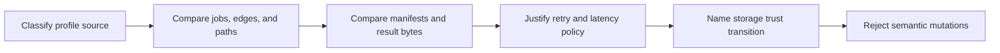
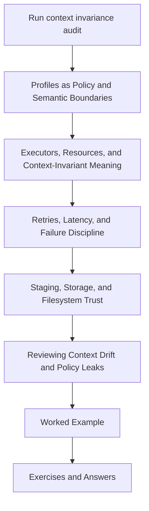

# Module 08: Operating Contexts and Execution Policy

A workflow that runs locally, in CI, and under scheduler-oriented policy can still be three
different workflows hidden behind one repository.

Module 08 teaches you to prove the narrower and more useful claim:

> Execution contexts may change capacity, observability, recovery, and site mapping while
> sample scope, planned jobs, trusted paths, and artifact meaning remain invariant.

## Begin with executable evidence

From the course directory:

```bash
make capstone-context-invariance-audit
```

Read:

```text
artifacts/audit/reproducible-research/deep-dive-snakemake/context-invariance/
├── route.txt
├── CONTEXT_INVARIANCE_AUDIT_GUIDE.md
├── summary.tsv
├── specimen/
├── report.json
└── workspace/
```

The expected summary is:

```text
CONTEXT_POLICY_PRESERVED        PASS
TRUSTED_PATH_LEAK_REPRODUCED   PASS
SAMPLE_SCOPE_LEAK_REPRODUCED   PASS
```

The final two rows are successful defect reproductions. Do not describe all three PASS
results as profile approval.

## The module's evidence spine



Every lesson attaches to this route. The audit establishes context invariance for a bounded
local specimen. The failure and storage lessons explain claims that require additional
operating evidence.

## What this session must accomplish

By the end of Module 08, you should be able to:

- classify profile keys by effect rather than file location
- prove that preserving profiles retain one semantic plan and artifact set
- diagnose trusted-path and sample-scope leaks separately
- separate rule resource requests, profile capacity, and site mapping
- justify retries and latency waits from named failure evidence
- design a cross-filesystem trust transition
- explain acceptance, rejection, and isolation behavior in a context gate

“The profiles look similar” does not satisfy any of these outcomes.

## Prerequisites

Before this module, you should be able to:

- read a Snakemake rule's input and output contract
- inspect a dry-run
- distinguish internal results from trusted publish paths
- run the capstone's supported Make targets

If those are not yet comfortable, revisit Modules 01, 03, and 06 before diagnosing
execution-context drift.

## Read the module in this order



The order matters:

- classify ownership before discussing executors
- prove semantic plans before debating performance
- classify failures before changing retries
- define path roles before trusting scratch
- understand findings before writing a review

## The ten module files

1. Overview (`index.md`)
2. [Profiles as Policy and Semantic Boundaries](profiles-as-policy-and-semantic-boundaries.md)
3. [Executors, Resources, and Context-Invariant Workflow Meaning](executors-queues-and-context-invariant-workflow-meaning.md)
4. [Retries, Latency, and Failure Discipline](retries-latency-and-failure-discipline.md)
5. [Staging, Storage, and Filesystem Trust](staging-storage-and-filesystem-assumptions.md)
6. [Reviewing Operating-Context Drift and Policy Leaks](reviewing-operating-context-drift-and-policy-leaks.md)
7. [Worked Example: Proving Context Invariance and Catching Policy Leaks](worked-example-auditing-local-ci-and-slurm-without-semantic-drift.md)
8. [Exercises](exercises.md)
9. [Exercise Answers](exercise-answers.md)
10. [Glossary](glossary.md)

## Use each lesson for one question

| Question | Teaching surface |
| --- | --- |
| What may a profile own? | profiles lesson |
| Where do resource requests, capacity, and site mapping belong? | executor lesson |
| When are retries or waits justified? | failure lesson |
| When does staged data become trusted? | storage lesson |
| How should a maintainer order findings and judge a gate? | drift-review lesson |
| How do all surfaces connect in one reproducible route? | worked example |
| Can I produce the evidence without prompts? | exercises |

Avoid reading all five core lessons as repeated warnings about policy. Each one resolves a
different review problem.

## The running specimen

The specimen contains:

- one workflow
- one semantic base config
- two sample inputs
- three preserving profiles
- one trusted-path leak
- one sample-scope leak

The preserving profiles vary:

- cores
- latency tolerance
- shell-command visibility

They must preserve:

- `alpha` and `beta`
- both normalize jobs
- dependency edges
- `publish/stable/manifest.tsv`
- manifest membership
- result bytes

## Commands to keep close

| Question | Command |
| --- | --- |
| Build the evidence packet | `make capstone-context-invariance-audit` |
| Prove the gate rejects mutations | `make capstone-context-invariance-selftest` |
| Compare the capstone's real profile files | `make capstone-profile-audit` |
| Run the full learner proof route | `make proof` |
| Run clean-room capstone confirmation | `make capstone-confirm` |

The context-invariance audit uses a bounded specimen because it needs known preserving and
leaking cases. The profile audit packages the capstone's real profiles. Use both when
reviewing the production capstone.

## A serious-session schedule

| Work block | Activity | Evidence retained |
| --- | --- | --- |
| ownership | classify five profile files | profile matrix |
| planning | compare D3 DAGs and output summaries | normalized plan table |
| execution | compare manifests and results | artifact table |
| failure | classify three incident cards | retry and latency record |
| storage | design destination-side publication | path-role contract |
| rejection | trace one mutation test | rejected finding |
| review | write findings in risk order | maintainer review |

The session is complete when the evidence packet can be reviewed without your narration.

## Know the proof boundary

The audit proves:

- profile key classification for the specimen
- plan and artifact invariance under three local executions
- detection of two semantic leak classes
- rejection and isolation behavior

It does not prove:

- real scheduler submission
- correct account or partition
- performance equivalence
- shared-filesystem latency bounds
- justified retries
- cross-filesystem scratch promotion

The lessons show how to collect those additional forms of evidence without mislabeling the
local audit.

## Exit standard

Do not leave Module 08 until you can:

- quote all three findings with their correct meanings
- explain why a DAG-only gate misses path drift
- explain why a path-only gate misses sample drift
- place threads, cores, and account mapping in the correct ownership layers
- classify deterministic, transient, resource, visibility, and publication failures
- draw scratch, destination candidate, and final output as distinct states
- trace one rejected mutation from source to failed finding
- state at least one explicit limit in your review conclusion

Then complete all ten exercises. If the answer packet depends on an instructor explaining
what each artifact means, the module is not yet complete.
