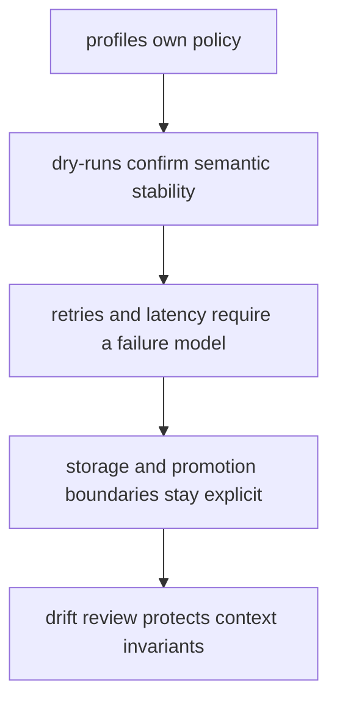
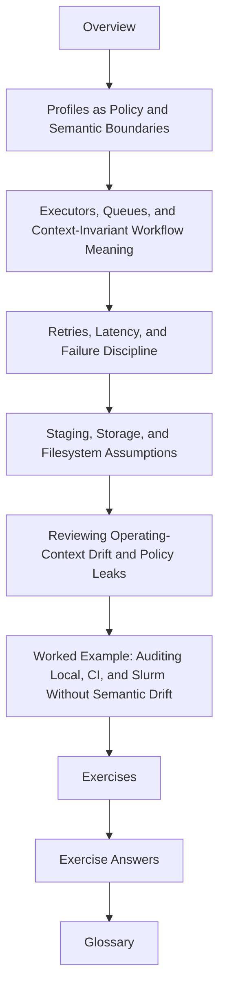

# Module 08: Operating Contexts and Execution Policy

A workflow that only works under one command on one machine is not yet operationally
serious.

But a workflow that changes meaning every time the operating context changes is not
reproducible either.

This module is about keeping those two truths separate.

## What this day must accomplish

By the end of Module 08, you should be able to do five things without confusing policy
for workflow meaning:

- classify which settings belong in profiles and which do not
- compare local, CI, and scheduler contexts without semantic drift
- explain retries and latency waits through a failure model rather than habit
- mark where scratch, staging, and shared storage become trusted outputs
- review operating-context changes as policy diffs instead of local folklore

## The context ladder for the whole module

Keep this order in front of you all day:



If a profile changes published meaning, sample membership, or public paths, it has crossed
the boundary. If a retry hides an unexplained defect, the policy is lying.

## The running lab for the whole day

Use one repository story all day instead of several unrelated profile examples:

- one repository has `local`, `ci`, and `slurm` operating contexts
- one shared final target must plan the same semantic work in all three
- one deliberate profile leak must be detected and rejected
- one scratch or staging route must show when trust begins
- one policy audit must tell the next maintainer what changed and why

Every page should help you answer one concrete review question about operating context.

## Plan for the day

| Session | What you do | Evidence you keep |
| --- | --- | --- |
| context inventory | read local, CI, and scheduler profiles line by line | classified policy matrix |
| plan comparison | request the same targets in each context | normalized dry-run comparison |
| failure discipline | decide whether retries and latency changes are justified | failure-policy note |
| storage boundary | trace scratch, staging, and publication through one rule family | promotion diagram |
| drift review | inject one semantic profile leak and catch it | failing audit evidence |
| independent practice | complete all ten exercises | operating-context review packet |

The day is successful when different contexts change how the workflow runs and is observed,
but not what counts as a correct and trusted outcome.

## Study route



Read the module in that order the first time.

The route matters:

- start with profile boundaries before you debate executors
- compare semantic plans before you change retries
- define trusted storage boundaries before you call scratch output “done”

## The ten files in this module

1. Overview (`index.md`)
2. [Profiles as Policy and Semantic Boundaries](profiles-as-policy-and-semantic-boundaries.md)
3. [Executors, Queues, and Context-Invariant Workflow Meaning](executors-queues-and-context-invariant-workflow-meaning.md)
4. [Retries, Latency, and Failure Discipline](retries-latency-and-failure-discipline.md)
5. [Staging, Storage, and Filesystem Assumptions](staging-storage-and-filesystem-assumptions.md)
6. [Reviewing Operating-Context Drift and Policy Leaks](reviewing-operating-context-drift-and-policy-leaks.md)
7. [Worked Example: Auditing Local, CI, and Slurm Without Semantic Drift](worked-example-auditing-local-ci-and-slurm-without-semantic-drift.md)
8. [Exercises](exercises.md)
9. [Exercise Answers](exercise-answers.md)
10. [Glossary](glossary.md)

## How to use the file set

| If you need to... | Start here |
| --- | --- |
| decide what profiles may and may not own | [Profiles as Policy and Semantic Boundaries](profiles-as-policy-and-semantic-boundaries.md) |
| compare executor differences without changing workflow meaning | [Executors, Queues, and Context-Invariant Workflow Meaning](executors-queues-and-context-invariant-workflow-meaning.md) |
| justify retries and latency changes honestly | [Retries, Latency, and Failure Discipline](retries-latency-and-failure-discipline.md) |
| review scratch, staging, and trusted output boundaries | [Staging, Storage, and Filesystem Assumptions](staging-storage-and-filesystem-assumptions.md) |
| audit policy drift across contexts | [Reviewing Operating-Context Drift and Policy Leaks](reviewing-operating-context-drift-and-policy-leaks.md) |
| see the whole module as one context audit | [Worked Example: Auditing Local, CI, and Slurm Without Semantic Drift](worked-example-auditing-local-ci-and-slurm-without-semantic-drift.md) |
| test your own understanding | [Exercises](exercises.md) |
| compare your reasoning against a reference answer | [Exercise Answers](exercise-answers.md) |
| stabilize the module vocabulary | [Glossary](glossary.md) |

## The running question

Carry this question through every page:

> if this workflow runs in a different context tomorrow, which exact boundary proves the meaning stayed the same?

Good Module 08 answers usually mention one or more of these:

- a profile setting that is clearly policy rather than semantics
- a dry-run or comparison route that protects target meaning
- a retry or latency change justified by a named failure class
- a storage boundary showing when an output becomes trusted
- a drift gate that fails when policy leaks into semantics

## What the module should change in your head

If the day is working, you should feel these transitions:

- profile files stop looking harmless by default
- “it works in CI” stops sounding like enough evidence on its own
- retries stop sounding helpful when the failure class is still unknown
- scratch stops sounding like publication just because bytes exist there
- context review becomes a first-class part of reproducibility rather than an operations afterthought

## Commands to keep close

These commands form the evidence loop for Module 08:

```bash
snakemake --profile profiles/local -n
snakemake --profile profiles/ci -n
snakemake --profile profiles/slurm -n
make profile-audit
```

They answer different questions:

- what the workflow plans under one local policy surface
- whether CI changes semantics or only operating policy
- how a scheduler context maps the same workflow meaning
- whether the repository already packages its context review honestly

## Exit standard

Do not move on until all of these are true:

- you can name one setting that belongs in a profile and one that does not
- you can show one semantic comparison across local, CI, and scheduler contexts
- you can explain one retry or latency change through an explicit failure model
- you can say where scratch ends and trusted output begins
- you can describe one drift check that catches a semantic profile leak
- you have completed all ten exercises and caught at least one deliberate context leak

When those become ordinary, Module 08 has done its job.
