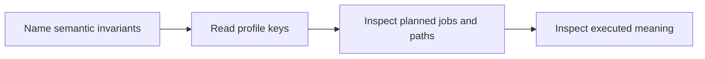

# Profiles as Policy and Semantic Boundaries

A Snakemake profile is a collection of command-line defaults. That description is
technically correct and educationally incomplete.

The design question is:

> Which decisions may a profile make without creating a different workflow?

This lesson gives you a procedure for answering that question from source, plans, and
executed artifacts.

## Begin with workflow meaning

Before opening a profile, write down the workflow facts that must not depend on execution
context. For the Module 08 specimen they are:

- samples `alpha` and `beta` are in scope
- one `normalize` job runs for each sample
- both jobs feed `publish_manifest`
- the trusted output is `publish/stable/manifest.tsv`
- the manifest names both normalized results

These are semantic invariants. A profile may change how quickly or where the jobs run. It
may not silently change those five facts.

This order prevents a common review error. If you begin by reading profile keys, every key
looks like an environment detail. If you begin with invariants, a key that changes sample
scope or trusted paths is visibly crossing a boundary.



## Classify profile keys by effect

Do not classify a key by where it is written. Classify it by what it can change.

| Policy class | Typical keys | Allowed effect |
| --- | --- | --- |
| capacity | `cores`, `jobs` | how many jobs may execute concurrently |
| observability | `printshellcmds`, `show-failed-logs` | which operational evidence appears |
| recovery | `rerun-incomplete`, bounded retries | how known failure states are handled |
| filesystem tolerance | `latency-wait` | how long Snakemake waits for declared files to become visible |
| executor mapping | executor plugin, account, partition | where jobs are submitted |
| semantic override | `config`, `configfile`, `configfiles` | workflow values, sample domains, paths, or algorithms |

The first five classes can be operating policy. The last class deserves semantic review.
That does not mean every use of `config` in a profile is malicious. It means the profile is
now capable of redefining workflow meaning, so “policy-only” is no longer an honest default
claim.

Unknown keys need the same caution. A reviewer should not approve an unfamiliar key merely
because it appears in profile YAML. Classify its effect first.

## Read the three preserving profiles

Run the audit from the course root:

```bash
make capstone-context-invariance-audit
```

Then open:

```text
artifacts/audit/reproducible-research/deep-dive-snakemake/context-invariance/
└── specimen/
    └── profiles/
        ├── local/config.yaml
        ├── ci/config.yaml
        └── scheduler/config.yaml
```

Their differences are small but real:

| Surface | Local | CI | Scheduler |
| --- | ---: | ---: | ---: |
| cores | 2 | 1 | 8 |
| latency wait | 5 | 5 | 60 |
| print shell commands | yes | no | yes |
| show failed logs | yes | yes | yes |

These differences affect scheduling, patience, and visibility. They do not alter the
specimen's base config:

```yaml
samples:
  - alpha
  - beta
publish_root: publish/stable
```

The important claim is not that the profile files look reasonable. The claim is that their
effects stay operational.

## Prove effect, not appearance

The audit asks Snakemake for:

- an output summary
- a D3 DAG
- a printed dry-run
- a complete execution

It then compares:

- output paths and owning rules
- wildcard-specific jobs
- dependency edges
- manifest path and content
- normalized result bytes

All three preserving profiles must produce the same semantic plan and artifacts.

Why use several surfaces? Because each catches a different kind of leak:

| Comparison | Leak it can catch |
| --- | --- |
| profile source | direct semantic override |
| output summary | changed trusted or intermediate paths |
| D3 DAG | changed samples, jobs, or dependencies |
| manifest | changed declared membership |
| result bytes | changed executed meaning at stable paths |

A profile diff alone proves intent. The combined route tests effect.

## Counterexample: same graph, different contract path

Open:

```text
specimen/profiles/trusted-path-leak/config.yaml
```

It contains ordinary policy keys and one semantic override:

```yaml
config:
  publish_root: publish/context-specific
```

The workflow still plans two `normalize` jobs and one `publish_manifest` job. Both sample
results contain the same bytes. The run exits zero.

But the trusted output is now:

```text
publish/context-specific/manifest.tsv
```

instead of:

```text
publish/stable/manifest.tsv
```

This is semantic drift because downstream trust depends on execution context. The same DAG
topology does not rescue the profile.

## Counterexample: same final location, different sample domain

Now open:

```text
specimen/profiles/sample-scope-leak/config.yaml
```

It overrides:

```yaml
config:
  samples:
    - alpha
```

The manifest path remains `publish/stable/manifest.tsv`. The `alpha` result is unchanged.
Execution still succeeds.

Yet:

- the `beta` job disappears from the D3 DAG
- `results/beta.txt` disappears from the output summary
- `beta` disappears from the manifest

The same final path does not imply the same workflow meaning.

```mermaid
flowchart TD
  profile["Profile override"]
  path{"What changed?"}
  graph["Jobs or sample domain"]
  contract["Trusted path"]
  bytes["Artifact meaning"]
  reject["Semantic review required"]

  profile --> path
  path --> graph --> reject
  path --> contract --> reject
  path --> bytes --> reject
```

## Interpret the audit findings precisely

The summary contains:

```text
CONTEXT_POLICY_PRESERVED        PASS
TRUSTED_PATH_LEAK_REPRODUCED   PASS
SAMPLE_SCOPE_LEAK_REPRODUCED   PASS
```

The second and third PASS results mean the audit successfully reproduced defects. They do
not approve those profiles.

A defensible review sentence is:

> Local, CI, and scheduler profiles preserve the same plan and artifacts, while the audit
> separately demonstrates that profile-level config can change trusted paths or sample
> scope without causing execution failure.

“All profiles passed” erases the lesson.

## Decide where a setting belongs

Use this decision route:

1. Does the value change inputs, outputs, sample membership, algorithm parameters, or
   published meaning?
2. If yes, place it in a visible workflow configuration contract and review it as
   semantics.
3. If no, does it map declared resource needs, executor behavior, recovery, or
   observability?
4. If yes, it may belong in a profile.
5. If neither answer is clear, do not merge the key until its effect is understood.

Moving a value out of a profile does not make it safe by itself. The destination must have
a schema, ownership, and review route appropriate to semantic configuration.

## Distinguish repository policy from site policy

A portable course repository can own:

- workflow-facing profile defaults
- declared resource categories
- evidence and comparison commands

A real computing site may own:

- account names
- partitions
- executor plugin installation
- storage mounts
- queue limits

Those site values can live in an operator-maintained overlay. They still must not redefine
sample scope, algorithms, or contract paths.

This distinction keeps the course realistic without pretending that one committed
scheduler profile can encode every institution.

## Reject dishonest evidence

Run:

```bash
make capstone-context-invariance-selftest
```

The self-test mutates disposable profiles and requires the audit to fail when:

- CI chooses a different publish root
- scheduler policy removes a sample
- a counterexample no longer demonstrates its named leak
- one leak is substituted for another
- stale evidence survives a later run

A useful gate must know what to reject. A script that only reproduces its original green
case does not establish a review boundary.

## Review checklist

Before approving a profile change, record:

- the semantic invariants for the affected target
- every changed profile key and its policy class
- the normalized plan comparison
- any changed trusted path or sample-specific job
- the executed artifact comparison when meaning could change
- one rejection case that protects the claim
- limits not tested, such as scheduler submission or scratch promotion

Do not accept “needed for CI” or “needed for the cluster” as a classification. Those phrases
name a context, not an effect.

## End-of-page checkpoint

You are ready to continue when you can:

- classify the five preserving profile keys by effect
- explain why `config` in a profile crosses into semantic review
- show why a DAG-only comparison misses the trusted-path leak
- show why a path-only comparison misses the sample-scope leak
- quote all three audit findings without treating reproduced defects as approval

If you cannot name the invariant before reading the profile, repeat the evidence route.
