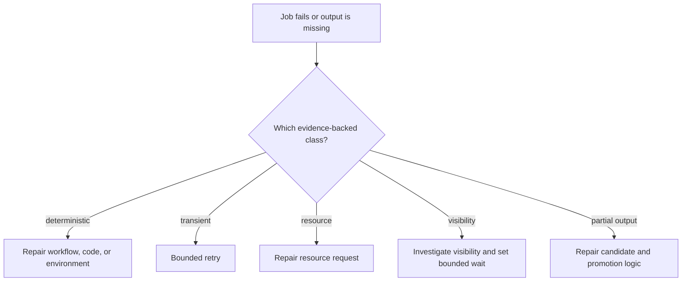
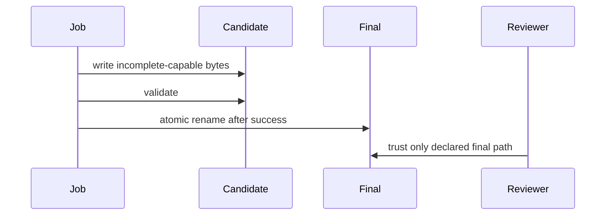

# Retries, Latency, and Failure Discipline

A retry policy is not evidence that a workflow is robust. It is a response to a named
failure model.

The practical question is:

> What failed, what evidence distinguishes the failure class, and which policy response
> improves recovery without hiding a deterministic defect?

This lesson teaches that decision before introducing retry counts or latency values.

## Preserve the first failure

Before rerunning anything, retain:

- the rule and wildcard values
- command or script invocation
- exit status
- stderr and rule log
- scheduler or executor reason, if available
- declared inputs and outputs
- any incomplete or candidate output paths
- resource request and observed resource use

The first failure is often the least contaminated evidence. Repeated attempts can overwrite
logs, clean partial state, or produce one lucky success that hides the original cause.

Configure visibility accordingly:

```yaml
printshellcmds: true
show-failed-logs: true
```

Those settings do not fix failure. They keep diagnosis possible.

## Classify before changing policy

Use at least five classes:

| Failure class | Typical evidence | Appropriate first response |
| --- | --- | --- |
| deterministic workflow or code defect | same command fails the same way on every attempt | repair code, input declaration, or environment |
| transient infrastructure failure | eviction, service interruption, temporary network failure | consider a bounded retry |
| resource exhaustion | out-of-memory or time-limit reason, usage near request | repair request or workload shape |
| visibility delay | producer exits successfully but declared output appears late on shared storage | investigate storage, then justify bounded latency wait |
| incomplete publication | candidate or partial file remains after interruption | repair atomicity and cleanup discipline |

Retries may help the second class. They do not repair the other four.



If you cannot choose a branch, collect more evidence. “Flaky” is a symptom, not a failure
class.

## Understand what a retry changes

A retry asks Snakemake to attempt a failed job again. It does not:

- change invalid input
- install a missing dependency
- increase memory unless the resource expression changes by attempt
- make a non-atomic writer safe
- prove that the previous failure was transient

Retries also multiply cost. If a job requests 4 cores for 30 minutes and receives two
additional attempts, one logical job can consume up to six core-hours.

Record a retry budget:

| Field | Example |
| --- | --- |
| failure class | transient executor eviction |
| evidence | scheduler reason `PREEMPTED` |
| attempts allowed | 2 additional attempts |
| maximum added cost | 8 core-hours |
| stop condition | repeated identical application exit |
| retained evidence | each attempt's log and executor reason |

The budget turns “try again” into a reviewable policy.

## Use attempt-aware resources carefully

Snakemake can vary resources by attempt. A memory request might grow after an
out-of-memory failure.

That can be defensible when:

- the first failure is proven to be resource exhaustion
- the growth is bounded
- the maximum fits available infrastructure
- each attempt remains observable

It is weak when:

- memory grows for every failure class
- deterministic application errors receive larger machines
- no one records the final successful request

Resource escalation is not a generic retry strategy. It is a specific response to measured
resource pressure.

## Understand latency wait

`latency-wait` gives a declared output time to become visible after a producer finishes.
It is not:

- a general job timeout
- a network retry
- a fix for writing the wrong path
- a substitute for atomic publication

Before raising it, establish:

1. the producer exited successfully
2. the output was written to the declared path
3. the delay is a filesystem visibility effect
4. the observed delay distribution supports the proposed bound

One observation is weak. Capture several delays:

| Attempt | Producer exit | First visible | Delay |
| --- | --- | --- | ---: |
| A | 10:00:00 | 10:00:03 | 3 s |
| B | 10:05:00 | 10:05:07 | 7 s |
| C | 10:10:00 | 10:10:04 | 4 s |

A 30-second wait is then conservative and explainable. Raising the value from 30 to 300
because “the cluster is slow” is not.

## Separate missing output from delayed output

These messages can look similar:

- output does not exist because the command wrote elsewhere
- output exists on node-local scratch but was never promoted
- output was promoted but shared storage visibility is delayed
- output was removed because the job failed

Only the third supports `latency-wait`.

Trace the exact path:

```text
command destination
    -> candidate path
    -> promotion operation
    -> declared Snakemake output
    -> observer visibility
```

If any transition is unnamed, debug that transition before changing policy.

## Treat incomplete outputs as evidence

After a failed job, Snakemake may mark or remove incomplete outputs. `rerun-incomplete`
allows those jobs to be planned again.

That policy is useful only if the rule's publication design is honest:

- write to a candidate path
- validate candidate content
- rename atomically to the declared output
- preserve logs when validation or promotion fails

If a rule writes directly to the final path, another process can observe partial bytes
before Snakemake handles the failure.



Retries do not create this boundary. Rule design does.

## Compare policy across contexts

Different contexts can justify different recovery policy:

- CI may fail fast to keep defects visible
- a preemptible executor may allow bounded retries
- shared storage may require a larger measured latency wait

The semantic invariants still remain:

- same sample set
- same rule graph
- same declared outputs
- same artifact meaning

Run:

```bash
make capstone-context-invariance-audit
```

The audit proves those semantic facts for the specimen. It does not prove that any retry or
latency value is justified. That requires failure evidence from the real operating
context.

## Review three cases

### Missing executable

Evidence:

```text
/bin/bash: aligner: command not found
```

Classification: deterministic environment defect.

Response: repair the environment declaration. Do not retry.

### Executor eviction

Evidence:

```text
executor_reason=preempted
application_exit=none
```

Classification: plausibly transient infrastructure failure.

Response: retain the executor reason and allow a bounded retry if cost and policy permit.

### Declared output appears 12 seconds late

Evidence:

- producer exits zero
- output path is correct
- repeated measurements show visibility between 8 and 14 seconds

Classification: visibility delay.

Response: document the storage assumption and use a bounded wait above the measured tail.
Do not call it a retry problem.

## Write a failure-policy record

For every changed retry, wait, or incomplete-output setting, record:

```text
rule or rule family:
operating context:
observed symptom:
failure class:
evidence:
policy change:
maximum attempts or wait:
added cost:
stop condition:
verification:
```

This record can be short. Its purpose is to stop settings from becoming folklore after the
incident is forgotten.

## Common failure-policy mistakes

| Mistake | What it hides | Better response |
| --- | --- | --- |
| retry every nonzero exit | deterministic defects | classify executor and application failures separately |
| increase wait until green | wrong paths or failed promotion | measure the visibility boundary |
| discard failed logs after success | original cause | retain attempt-specific evidence |
| grow memory on any retry | code and environment defects | require out-of-memory evidence |
| rerun partial final outputs | unsafe publication | write candidate, validate, rename |

## End-of-page checkpoint

You are ready to continue when you can:

- distinguish five failure classes from their evidence
- explain why latency wait is not a general retry
- calculate the maximum added cost of a retry budget
- name the transition where an incomplete candidate becomes a trusted output
- state what the context audit proves and what failure evidence it cannot provide

If your first proposed repair is still “try more times,” return to the classification
table.
