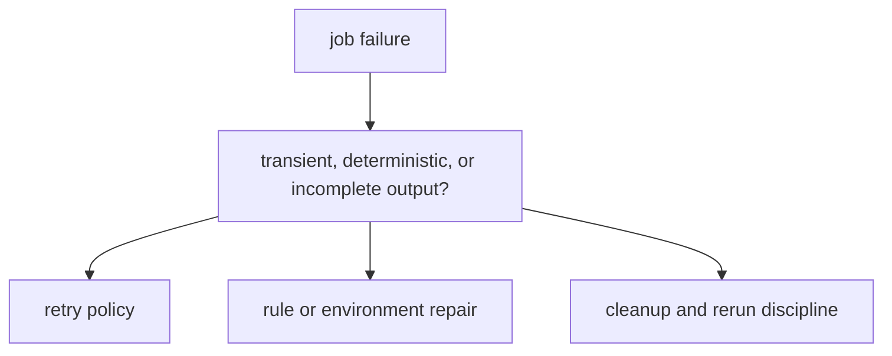

# Retries, Latency, and Failure Discipline

Not every failure means the workflow is wrong.

But not every repeated failure is transient either.

This page is about the difference.

Retries, latency waits, and incomplete-output handling are useful operating tools only when
they support understanding instead of hiding defects.

## How to use this page

Read this page with one real failure mode in mind.

Do not ask only whether more retries would make the pipeline pass. Ask:

> what class of failure am I looking at, and does this policy change improve diagnosis or only suppress symptoms?

That is the difference between robust operation and ritualized guesswork.

## Operational help should not become a correctness crutch

Settings such as:

- retry counts
- latency waits
- rerun-incomplete behavior
- failed-log visibility

can improve robustness and reviewability.

They become risky when they are used to avoid harder questions:

- why is this rule unstable?
- why are outputs incomplete?
- why does visibility lag matter here?
- why does one environment need more “help” than another?

If those questions disappear behind higher retry counts, the policy boundary is masking a
real defect.

## Failures need categories

A strong operating posture separates at least three kinds of failure:

- likely transient operational failures
- deterministic workflow or environment failures
- incomplete or partially written outputs that need explicit cleanup behavior

Those categories do not deserve the same response.

Retries may help the first.

They usually do not fix the second.

The third requires honest output-discipline rather than wishful reruns.

## Start by naming the failure class before changing policy

The most common bad habit in operations is to adjust retries first and classify second.

Reverse that order.

1. decide whether the failure is plausibly transient
2. decide whether it is deterministic
3. decide whether the output state is incomplete or untrustworthy
4. only then decide which policy lever, if any, is appropriate

This sequence prevents policy from turning into superstition.

## The capstone profiles hint at this boundary

The capstone profiles include operational settings such as:

- `rerun-incomplete: true`
- `latency-wait`
- visible shell commands and failed logs

These are useful precisely because they stay visible as policy.

They do not pretend to explain *why* a failure happened. They only define how the system
should respond once the failure exists.

## One useful contrast

This matters because one policy knob should not answer all three branches.

## One concrete review exercise

Imagine three situations:

1. a job fails because the scheduler evicted it transiently
2. a rule fails every time because an undeclared dependency is missing
3. a step writes partial output that lingers after interruption

These situations do not deserve the same response:

- retries may help the first
- retries hide the second
- explicit incomplete-output handling and cleanup discipline matter for the third

This is the kind of judgment this page wants to normalize.

## A weak failure posture

Weak shape:

- retries increase whenever failures become annoying
- latency waits are raised without examining storage or visibility assumptions
- incomplete outputs remain after failure and are treated as normal clutter

This makes operating policy look helpful while understanding gets worse.

## A stronger failure posture

Stronger shape:

- use retries only when transient failure is plausible
- use latency waits as explicit filesystem-policy decisions, not as superstition
- keep failed logs visible enough that maintainers can inspect root causes
- treat incomplete outputs as contract and cleanup questions, not as background noise

Now the workflow fails in ways that remain understandable.

## The beginner mistake to catch early

Beginners often celebrate that a higher retry count made a flaky run go green.

That is not automatically success.

If the change did not also improve the team's ability to explain the failure class, the
policy may have bought silence rather than robustness.

## A practical test

Ask these questions when a failure-related setting changes:

1. What class of failure is this setting meant to address?
2. Would this change help diagnose the issue or only postpone it?
3. Could the same setting be hiding a deterministic defect in the workflow or runtime?

If the second answer is “only postpone it,” the policy is probably doing the wrong job.

## Common failure modes

| Failure mode | What goes wrong | Better repair |
| --- | --- | --- |
| retries increase with no failure classification | true defects stay alive longer | define which failures are plausibly transient first |
| latency waits become folklore | storage problems stay unnamed | treat latency as an explicit filesystem and visibility assumption |
| incomplete outputs are left ambiguous | reruns and review become murky | use explicit incomplete-output policy and cleanup expectations |
| failed logs are hidden to reduce noise | diagnosis gets slower and more anecdotal | keep failure evidence accessible during review |
| teams celebrate resilience without understanding failure cause | policy success masks semantic risk | pair policy changes with root-cause review |

## What a reviewer should hear

A strong explanation sounds like this:

> This retry or latency policy exists because we have identified a real transient or
> visibility-related failure class, and we still preserve failed evidence and incomplete
> output discipline so the root cause stays reviewable.

That is stronger than "we increased retries to make it pass," because it names the model
behind the policy.

## The explanation a reviewer trusts

Strong explanation:

> this retry and latency policy exists because the operating context may introduce genuine
> scheduling or visibility delays, but we still inspect failed logs and treat incomplete
> outputs as evidence, not as harmless leftovers.

Weak explanation:

> we raised retries so the workflow would stop failing.

The strong explanation names the failure model. The weak explanation only suppresses the
symptom.

## End-of-page checkpoint

Before leaving this page, you should be able to:

- explain when retries are justified and when they are suspicious
- explain why latency waits should be tied to real visibility assumptions
- describe why incomplete outputs are a policy and contract concern
- explain how failure evidence supports operating review

If you still think of retries mainly as a convenience feature, revisit the page. This
module wants failure policy to remain explainable, not merely comforting.
