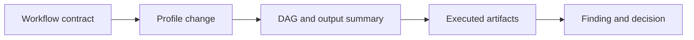
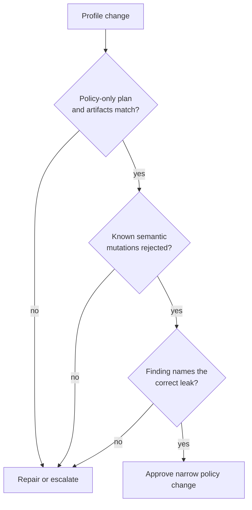

# Reviewing Operating-Context Drift and Policy Leaks

Operating-context drift often arrives in a small diff:

- one profile key
- one higher retry count
- one alternate path
- one “CI-only” sample filter

Review size does not predict semantic risk. This lesson shows how to turn a profile change
into a falsifiable review rather than an environment-specific explanation.

## State the claim before reading evidence

A useful review claim is:

> Local, CI, and scheduler policy vary execution capacity and observability while
> preserving sample scope, planned jobs, dependencies, trusted paths, and artifact meaning.

This names what may differ and what must not.

Weak claims are hard to test:

- “the profiles are equivalent”
- “the cluster version works”
- “CI uses normal overrides”

Equivalent in what sense? Works for which target? Normal according to which ownership
boundary? Rewrite vague claims before approving the diff.

## Read evidence in causal order

Use this order:

1. workflow and semantic config define intended meaning
2. profile source introduces operating differences
3. Snakemake plan reveals jobs, edges, and paths
4. execution materializes artifacts
5. review gate compares invariants



Starting from a green gate without tracing this chain encourages circular reasoning: the
change is safe because the audit passed, and the audit is trusted because the change looks
safe.

## Build a comparison matrix

For each context, record:

| Surface | Local | CI | Scheduler | Invariant? |
| --- | --- | --- | --- | --- |
| profile policy keys | cores, latency, visibility | cores, latency, visibility | cores, latency, visibility | no |
| semantic profile keys | none | none | none | yes: all absent |
| sample jobs | alpha, beta | alpha, beta | alpha, beta | yes |
| trusted manifest | `publish/stable/manifest.tsv` | same | same | yes |
| manifest members | alpha, beta | same | same | yes |
| normalized bytes | same | same | same | yes |

The matrix prevents a harmless difference, such as `cores`, from distracting from a
dangerous one, such as a missing sample.

## Run the discriminating audit

From the course root:

```bash
make capstone-context-invariance-audit
```

Read:

```text
artifacts/audit/reproducible-research/deep-dive-snakemake/context-invariance/
├── summary.tsv
├── report.json
├── specimen/
└── workspace/
```

The report contains each profile's:

- parsed source
- key classification
- normalized output plan
- normalized D3 DAG
- manifest path and content
- result bytes
- exact command and trace locations

Do not cite the complete JSON as if volume were proof. Quote the smallest fields that
support the claim.

## Interpret findings by name

The audit emits:

| Finding | Review interpretation |
| --- | --- |
| `CONTEXT_POLICY_PRESERVED` | accept the three preserving profiles for this specimen claim |
| `TRUSTED_PATH_LEAK_REPRODUCED` | reject context-specific trusted-path selection |
| `SAMPLE_SCOPE_LEAK_REPRODUCED` | reject context-specific sample selection |

All three should be `PASS`.

The leak rows pass when defects are present and observable. A report that says only “three
checks passed” is misleading.

Review language should retain the distinction:

> The preserving profiles passed semantic comparison. The two counterexamples also passed
> because their named leaks were successfully reproduced and detected.

## Order findings by semantic risk

Use severity based on contract impact, not YAML size.

### High: workflow meaning differs

Examples:

- sample domain changes
- trusted path changes
- algorithm parameter changes
- a rule or dependency disappears

These require semantic review and usually removal from profile policy.

### Medium: failure or storage policy lacks evidence

Examples:

- retries increase without a failure class
- latency wait increases without visibility measurements
- scratch promotion changes without a trust-transition review

These may be legitimate, but the evidence is insufficient.

### Low: classified operational policy changes

Examples:

- command visibility changes
- available cores change
- a site overlay maps an account or partition

These still need ownership and narrow verification. They do not need invented semantic
risk.

## Require three gate behaviors

A trustworthy context gate needs:

| Behavior | Question |
| --- | --- |
| acceptance | does known policy-only variation pass? |
| rejection | do known semantic leaks fail the preserving claim? |
| isolation | can the gate distinguish a path leak from a sample leak? |

The context self-test covers all three:

```bash
make capstone-context-invariance-selftest
```

It mutates disposable profiles. In particular, it rejects a sample-scope specimen that
substitutes a trusted-path leak. That isolation check matters because a generic “something
changed” gate cannot teach a maintainer where ownership failed.



## Do not normalize away semantics

Plan comparison usually removes volatile details:

- workflow identifiers
- timestamps
- absolute temporary paths
- job IDs

Keep:

- rule names
- wildcard labels
- dependency edges
- declared outputs
- sample membership

An over-aggressive normalizer can make distinct workflows look equal. Every removed field
needs a reason tied to the claim.

The audit deliberately retains both D3 DAG labels and output paths because either surface
alone misses one counterexample.

## Review a proposed profile change

Suppose a pull request changes:

```yaml
cores: 1
config:
  samples:
    - alpha
```

A strong review finding is:

> **High:** `profiles/ci/config.yaml` narrows the semantic sample domain. The normalized
> plan loses `normalize:beta`, `results/beta.txt`, and the `beta` manifest row. Move this
> decision to an explicit semantic config with a distinct test claim; do not describe the
> CI run as equivalent to the full workflow.

This finding:

- names the owning surface
- shows plan and artifact effects
- proposes a durable repair
- avoids vague “profile concern” language

## Review a retry change

Suppose another profile change raises retries after occasional failure.

Do not automatically label it semantic drift. Ask for:

- executor and application failure evidence
- failure classification
- bounded attempts and cost
- retained attempt logs
- stop condition

The finding may be medium severity because the policy claim is under-evidenced, not because
the workflow plan changed.

## Write a review record

Keep a compact record:

```text
claim:
contexts compared:
semantic invariants:
allowed policy differences:
source observations:
plan observations:
artifact observations:
rejection evidence:
decision:
limits:
```

Example decision:

> Accept the core and latency differences. Reject the CI sample override because it
> removes a planned job and manifest member. Scheduler submission and shared-storage
> behavior remain outside this local audit.

The limit prevents a local execution packet from being misrepresented as infrastructure
certification.

## When to escalate

Escalate out of profile review when a change affects:

- semantic config schema
- public file contract
- sample discovery
- rule input or output
- algorithm parameters
- manifest or report meaning

Those belong to workflow, configuration, or publication review. The profile diff may have
revealed the issue, but the profile should not own its resolution.

## Common review failures

| Failure | Consequence | Better review |
| --- | --- | --- |
| compare profiles but not plans | indirect semantic effects remain hidden | retain D3 DAG and output summary |
| compare plans but not artifacts | stable paths can contain changed meaning | execute a bounded specimen |
| gate has no mutation tests | green result may be non-discriminating | prove rejection and isolation |
| report says only “PASS” | reproduced defects look approved | quote finding names |
| infrastructure limits are omitted | local proof is overclaimed | state what was not executed |

## End-of-page checkpoint

You are ready to finish the module when you can:

- write a falsifiable context-invariance claim
- read source, plan, and artifact evidence in causal order
- order findings by semantic risk
- explain acceptance, rejection, and isolation behavior
- state why both D3 DAG and output paths remain in the normalized comparison
- write an explicit limit for scheduler and storage claims

If your review conclusion is still “the profiles look fine,” the evidence route is not
finished.
