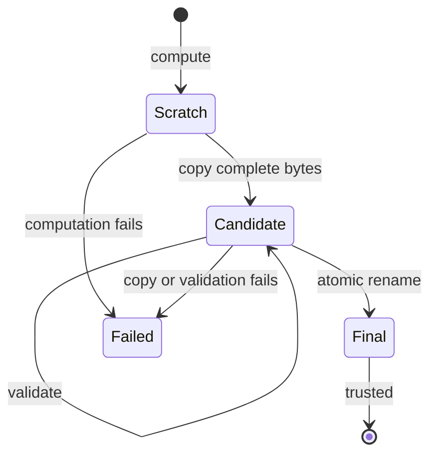
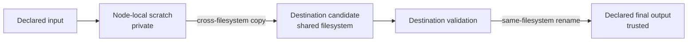

# Staging, Storage, and Filesystem Trust

An artifact can exist without being safe to consume.

That distinction becomes critical when jobs use node-local scratch, shared filesystems, or
remote storage. The operating-context question is:

> Which state is this artifact in, and what event makes the declared output trustworthy?

This lesson traces that state transition instead of treating storage as invisible
infrastructure.

## Name four path roles

Use four roles when reviewing one job:

| Role | Purpose | May downstream consumers trust it? |
| --- | --- | --- |
| declared input | workflow-owned source for this job | yes, under the input contract |
| execution scratch | private working state near the executor | no |
| destination candidate | complete artifact being prepared on the trusted filesystem | not yet |
| declared final output | Snakemake output after successful promotion | yes |

The path role matters more than whether bytes are present.



Trust begins at `Final`, not at `Scratch` or `Candidate`.

## Start from the declared output

For one rule, identify:

1. the exact `output:` path Snakemake tracks
2. the filesystem that owns that path
3. any scratch or staging path used before it
4. the validation performed before publication
5. the operation that makes the final name visible
6. residue retained or removed after failure

If the rule only declares a final path but the command writes elsewhere, that transfer is
part of the rule contract. It cannot remain operator folklore.

## Why direct final writes are weak

This shell shape exposes the final name too early:

```bash
tool input.dat > results/sample.dat
```

During execution:

- the file exists
- its size changes
- another process can open it
- interruption can leave valid-looking partial bytes

Snakemake will not mark the job successful until the command exits and outputs exist, but
external readers do not necessarily know the job state. A direct final write weakens the
filesystem trust boundary.

A safer same-filesystem shape is:

```bash
candidate="results/.sample.dat.candidate"
tool input.dat > "${candidate}"
validate-result "${candidate}"
mv "${candidate}" results/sample.dat
```

The candidate and final path must be on the same filesystem for rename atomicity.

## Understand the cross-filesystem trap

Node-local scratch and shared results usually live on different filesystems. A direct:

```bash
mv "${SCRATCH}/sample.dat" results/sample.dat
```

may become copy-then-delete rather than an atomic rename. The final name can be visible
while bytes are still arriving.

Use two transfers:

1. copy from scratch to a candidate path on the destination filesystem
2. validate the destination candidate
3. rename that candidate to the final name on the same destination filesystem

```bash
scratch_result="${SCRATCH}/sample.dat"
destination_candidate="results/.sample.dat.candidate"
final_result="results/sample.dat"

tool input.dat > "${scratch_result}"
validate-result "${scratch_result}"
cp "${scratch_result}" "${destination_candidate}"
validate-result "${destination_candidate}"
mv "${destination_candidate}" "${final_result}"
```

This costs another destination-side validation, but it protects the event that establishes
trust.

## Draw the transfer boundary



The copy and rename solve different problems:

- copy crosses the storage boundary
- rename publishes the trusted name

## Review the failure windows

| Failure moment | Expected visible state | Recovery requirement |
| --- | --- | --- |
| computation fails in scratch | no final output | retain job log; scratch may be cleaned or retained for diagnosis |
| scratch validation fails | no destination candidate or final | report validation failure |
| cross-filesystem copy fails | incomplete candidate, no final | remove or quarantine candidate |
| destination validation fails | complete-looking candidate, no final | preserve evidence; reject publication |
| rename succeeds | final appears atomically | job may report success |
| process dies after rename | final exists | verification must decide whether completion evidence is sufficient |

The last row deserves attention. If a job performs more required work after final
publication, the declared output can become visible before job success. Put publication at
the end of the required operation or use additional declared outputs to represent the full
contract.

## Distinguish storage models

### Local filesystem

Local development often has:

- one host
- immediate metadata visibility
- candidate and final paths on one filesystem

This is the simplest model, not proof that shared execution behaves identically.

### Shared filesystem

A scheduler-backed workflow may have:

- many producer and observer nodes
- metadata visibility delay
- shared destination paths
- node-local scratch

Here, `latency-wait` may address measured visibility after successful publication. It
cannot repair a failed copy or wrong path.

### Object or remote storage

Remote storage may not expose POSIX rename semantics. Publication may instead depend on:

- object completion
- checksums
- versioned keys
- a manifest written only after all objects validate

Do not copy a local rename recipe into a non-POSIX model and call it atomic. Define the
storage system's actual commit event.

## Keep scratch private to the job

Scratch paths should not become implicit inputs to later rules.

Weak:

```python
input:
    "/node-scratch/sample.dat"
```

That path may not exist on another node and is not a stable workflow surface.

Stronger:

- the producing job owns scratch
- it promotes to a declared output
- downstream rules depend only on the declared output

Snakemake `shadow` execution can help isolate job-local working files, but it does not
remove the need for declared outputs and honest publication.

## Place logs and failure evidence deliberately

Logs have a different lifecycle from final artifacts. Decide:

- whether logs write directly to durable storage
- whether scratch logs are copied after failure
- which executor reason is retained outside node-local state
- how candidates are named so reviewers can distinguish residue from final outputs

If a node disappears, evidence left only on its scratch filesystem disappears with it.
For expensive or difficult jobs, durable logging may matter more than retaining large
scratch artifacts.

## Connect storage to incomplete-output policy

`rerun-incomplete` can replan jobs Snakemake considers incomplete. It does not decide
whether a candidate is safe to promote.

The rule still needs:

- private or clearly named candidate state
- validation before final publication
- no final path on failed validation
- cleanup or quarantine rules for residue

Use a candidate naming convention based on ownership, not a generic `temp` directory. For
example:

```text
results/.sample.dat.candidate
```

The name states its relationship to the final artifact and avoids becoming an accidental
durable bucket.

## Compare contexts without changing trusted paths

Local and scheduler contexts may use different scratch roots:

```text
local:     workspace-local scratch
scheduler: node-local scratch
```

They should still publish the same declared final output:

```text
publish/stable/manifest.tsv
```

The trusted-path leak in the context-invariance audit demonstrates the opposite design:
execution context changes the final contract path. That profile passes execution and fails
semantic invariance.

Run:

```bash
make capstone-context-invariance-audit
```

Use `TRUSTED_PATH_LEAK_REPRODUCED` to study path semantics. Do not claim that this audit
tests scratch copying or shared-filesystem delay; the specimen executes on one local
filesystem.

## Write a storage contract

For each rule family that stages data, record:

```text
declared input:
scratch location and owner:
destination filesystem:
candidate path:
validation:
publication event:
declared final output:
visibility assumption:
failure residue:
cleanup owner:
```

This is enough for another maintainer to reconstruct when trust begins.

## Review checklist

Reject or repair a storage change when:

- downstream rules consume scratch directly
- cross-filesystem movement is called atomic without a destination candidate
- the final name appears before validation
- latency wait is used without a measured visibility model
- local and scheduler contexts publish to different contract paths
- all failure evidence remains on disposable node storage

Accept context-specific scratch only when the final contract and trust transition remain
stable.

## End-of-page checkpoint

You are ready to continue when you can:

- label declared input, scratch, destination candidate, and final output
- explain why cross-filesystem `mv` may not publish atomically
- name the exact event that establishes trust
- distinguish visibility delay from failed promotion
- state why the context audit catches path drift but cannot prove scratch safety

If “the file exists” is still your completion criterion, repeat the failure-window table.
