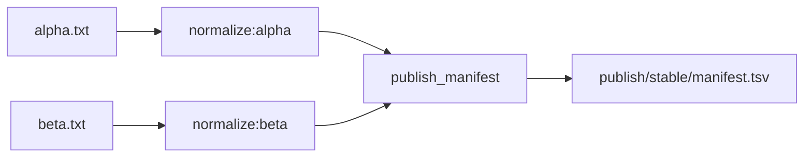
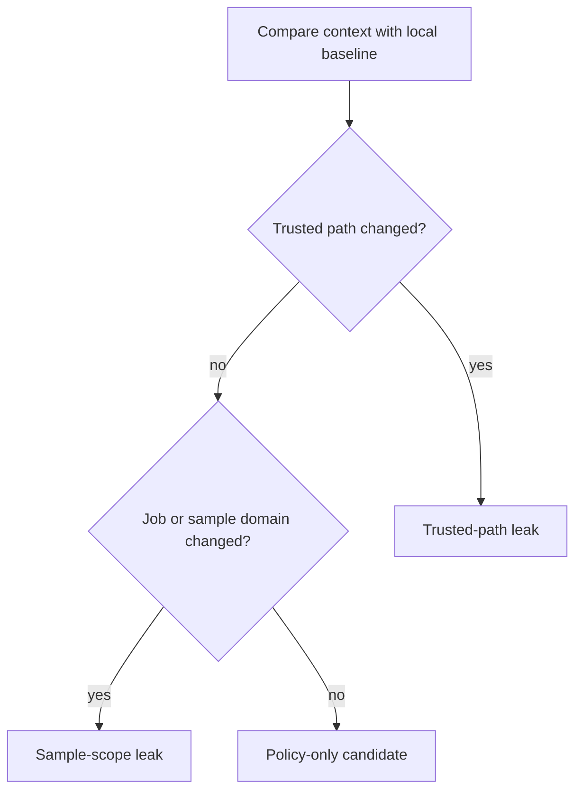

# Worked Example: Proving Context Invariance and Catching Policy Leaks

This worked example answers one concrete review question:

> Do local, CI, and scheduler-oriented policies preserve one workflow meaning, and can the
> review route reject a profile that changes trusted paths or sample scope?

You will inspect source, build the evidence packet, interpret all three findings, and run
the rejection suite. No instructor-only setup is required.

## The repository claim

The specimen promises:

- samples `alpha` and `beta` are processed
- each sample receives one `normalize` job
- both jobs feed one `publish_manifest` job
- the trusted path is `publish/stable/manifest.tsv`
- local, CI, and scheduler policies may change capacity and observability only

Write these invariants down before opening profile files. They are the standard against
which profile effects will be judged.



## Read the workflow before the profiles

Open:

```text
capstone/repro/context-invariance/Snakefile
```

The semantic values come from:

```python
configfile: "config/base.yaml"

SAMPLES = sorted(config["samples"])
PUBLISH_ROOT = config["publish_root"]
```

`normalize` declares portable work shape:

```python
threads: 2
resources:
    mem_mb=512,
    runtime=5,
```

`publish_manifest` writes the trusted output selected by `PUBLISH_ROOT`.

At this point you can predict two dangerous override classes:

- change `SAMPLES`, and jobs plus manifest membership change
- change `PUBLISH_ROOT`, and the downstream contract path changes

That prediction comes from workflow source, not from the audit script.

## Read semantic config

Open:

```text
capstone/repro/context-invariance/config/base.yaml
```

It contains:

```yaml
samples:
  - alpha
  - beta
publish_root: publish/stable
```

This file owns workflow meaning for the specimen. A profile that injects replacements for
these values crosses from execution policy into semantic configuration.

## Classify the preserving profiles

Compare:

```text
profiles/local/config.yaml
profiles/ci/config.yaml
profiles/scheduler/config.yaml
```

Build this matrix before running anything:

| Key | Local | CI | Scheduler | Class |
| --- | ---: | ---: | ---: | --- |
| `cores` | 2 | 1 | 8 | capacity |
| `latency-wait` | 5 | 5 | 60 | filesystem tolerance |
| `printshellcmds` | true | false | true | observability |
| `show-failed-logs` | true | true | true | observability |

None contains `config`, `configfile`, or `configfiles`.

Source inspection supports the policy-only claim. It does not finish the proof because an
indirect or misunderstood key could still alter the plan.

## Build the evidence packet

From the course directory:

```bash
make capstone-context-invariance-audit
```

The command creates:

```text
artifacts/audit/reproducible-research/deep-dive-snakemake/context-invariance/
├── CONTEXT_INVARIANCE_AUDIT_GUIDE.md
├── PROOF_GUIDE.md
├── bundle-manifest.json
├── report.json
├── route.txt
├── specimen/
├── summary.tsv
└── workspace/
    ├── evidence/
    └── runs/
```

The audit copies the specimen into isolated run directories. It does not execute inside
the course source tree.

## Read the summary without misreading PASS

Open `summary.tsv`. The expected rows are:

```text
finding	result
CONTEXT_POLICY_PRESERVED	PASS
TRUSTED_PATH_LEAK_REPRODUCED	PASS
SAMPLE_SCOPE_LEAK_REPRODUCED	PASS
```

Interpret them separately:

- the first approves the preserving profiles for the specimen's claim
- the second confirms that the path counterexample really changes a trusted path
- the third confirms that the scope counterexample really removes a sample

The last two are successful defect reproductions.

## Compare preserving plans

For each preserving profile, inspect:

```text
workspace/evidence/<profile>/summary.stdout.txt
workspace/evidence/<profile>/d3dag.stdout.txt
```

The output summary should name:

```text
publish/stable/manifest.tsv
results/alpha.txt
results/beta.txt
```

The D3 DAG should contain:

- `all`
- `publish_manifest`
- `normalize:alpha`
- `normalize:beta`

The audit removes volatile job identifiers and compares rule labels and edges. It does not
remove wildcard labels or output paths because those are semantic evidence.

## Compare preserving artifacts

Inspect:

```text
workspace/runs/local/publish/stable/manifest.tsv
workspace/runs/ci/publish/stable/manifest.tsv
workspace/runs/scheduler/publish/stable/manifest.tsv
```

Each should contain:

```text
sample	artifact
alpha	results/alpha.txt
beta	results/beta.txt
```

Then compare `results/alpha.txt` and `results/beta.txt` across the three run directories.
The audit records this comparison under each profile's `artifacts` section in
`report.json`.

You now have three kinds of agreement:

- source contains only classified policy keys
- plans contain the same jobs, edges, and paths
- execution produces the same manifest and result bytes

## Inspect the trusted-path counterexample

Open:

```text
specimen/profiles/trusted-path-leak/config.yaml
```

The key addition is:

```yaml
config:
  publish_root: publish/context-specific
```

Read its summary trace. It still plans:

```text
results/alpha.txt
results/beta.txt
```

but its manifest path is:

```text
publish/context-specific/manifest.tsv
```

The graph topology remains familiar. The results remain byte-identical. A DAG-only or
result-only comparison would miss the leak.

The relevant report checks are:

- `semantic_override_visible`
- `trusted_path_changed`
- `sample_results_unchanged`
- `manifest_meaning_unchanged`

All must be true for `TRUSTED_PATH_LEAK_REPRODUCED` to pass.

## Inspect the sample-scope counterexample

Open:

```text
specimen/profiles/sample-scope-leak/config.yaml
```

It contains:

```yaml
config:
  samples:
    - alpha
```

The trusted manifest path stays stable. Yet:

- `normalize:beta` disappears from the D3 DAG
- `results/beta.txt` disappears from the output summary
- the manifest contains only `alpha`

The relevant report checks are:

- `semantic_override_visible`
- `trusted_path_unchanged`
- `beta_removed_from_plan`
- `alpha_preserved`
- `manifest_changed`

All must be true for `SAMPLE_SCOPE_LEAK_REPRODUCED` to pass.



## Connect resource policy to the result

The profiles expose 1, 2, or 8 cores. The rule requests two threads.

The audit proves that output meaning remains stable under these specimen executions. It
does not prove:

- equal runtime
- equal parallel efficiency
- equal scheduler queue behavior
- numerical equivalence for a tool whose algorithm depends on thread count

Record the narrow conclusion:

> Capacity changes preserved the specimen's plan and bytes.

Do not expand it to:

> Every tool is executor-independent.

## Connect failure policy without inventing an incident

The preserving profiles vary `latency-wait`, but this local specimen does not reproduce
shared-filesystem delay.

Therefore:

- the audit may classify `latency-wait` as filesystem policy
- it may prove that the value does not alter this semantic plan
- it may not prove that 60 seconds is the correct scheduler wait

A real wait change needs measured visibility evidence. A real retry change needs an
executor or application failure class. Keep those claims outside this packet unless you
have that evidence.

## Connect storage trust without overclaiming

The specimen executes on one local filesystem. It does not use node-local scratch.

The trusted-path counterexample still teaches one storage lesson: the final contract path
must not vary by execution context.

It does not prove:

- cross-filesystem copy safety
- destination candidate validation
- atomic rename on shared storage
- remote-object commit semantics

Use the storage lesson's path-role record for those questions.

## Prove the gate can reject lies

Run:

```bash
make capstone-context-invariance-selftest
```

The suite creates disposable copies and requires failure when:

- CI chooses another publish root
- scheduler policy removes `beta`
- the path counterexample no longer changes its path
- the scope counterexample no longer removes `beta`
- the scope counterexample changes a path instead of scope
- stale evidence survives a rebuild

The isolation case is especially important. A gate should identify the boundary that
failed, not merely report that two contexts differ.

## Write the final review

A complete review can be concise:

> **Invariant:** both samples, all four jobs, the trusted manifest path, manifest
> membership, and normalized result bytes must match across local, CI, and scheduler
> policy.
>
> **Evidence:** all three preserving profiles contain only classified policy keys and have
> identical normalized output summaries, D3 DAGs, manifests, and results.
>
> **Rejection:** the self-test rejects both context-specific publish paths and narrowed
> sample domains, and it distinguishes those failure classes.
>
> **Decision:** accept the preserving profiles for this specimen.
>
> **Limit:** no real scheduler submission, shared-filesystem delay, retry incident, or
> scratch promotion was tested.

## Reproduce the reasoning independently

Without reading `report.json`, use only:

- the five profile files
- output-summary traces
- D3 DAG traces
- executed manifests

Write all three findings yourself. Then compare your result with `summary.tsv` and the
guide.

If your conclusion treats all PASS rows as approval, repeat the counterexample sections.
If your conclusion claims scheduler or storage behavior, narrow it to the evidence that
actually ran.
