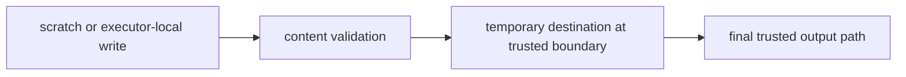
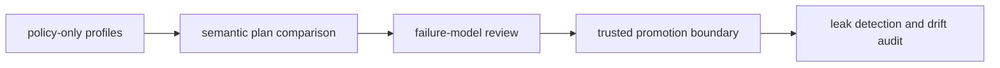

# Worked Example: Auditing Local, CI, and Slurm Without Semantic Drift

This file ties the whole module together around one realistic problem:

> a repository claims that local, CI, and scheduler contexts only change operating policy, but nobody has recently proved that claim.

The question is not "do these profiles all run?" The question is whether they preserve one
semantic workflow while changing context honestly.

## If you are learning this without the live class

Use the example in five passes instead of trying to absorb the whole context audit in one
read:

1. read the profile files directly and classify what each key is allowed to own
2. stop after the first normalized dry-run comparison and ask whether the same workflow still exists
3. write the failure class before you discuss retries or latency changes
4. draw the storage and promotion route before you treat any bytes as trusted
5. finish by injecting one leak and proving the audit can catch it

If you cannot explain the semantic invariants after pass 2, do not keep tuning profile
details yet. Most Module 08 confusion starts when learners chase flags before they have
named what must stay invariant.

## How to use this worked example

Work through this page with the five core lessons nearby.

Do not treat it as a summary after the fact. Treat it as a guided context audit:

- what to inspect first
- what should stay invariant
- where to classify retries and storage assumptions
- how to catch one real policy leak

## The one-day teaching goal

By the end of this example, you should be able to explain one three-context repository
without falling back on "each environment just needs different settings."

You should be able to say:

- which settings are policy only
- which outputs and paths must stay invariant
- which failure policies are justified by named failure classes
- where temporary bytes stop and trusted outputs begin

## The lab route

Work through the example in this order:

1. read the profile files directly and classify what they own
2. compare the same target across all contexts
3. inspect retries and latency through a failure model
4. confirm where scratch ends and trusted output begins
5. finish by injecting one semantic leak and catching it

Keep one small audit packet beside you while you read:

- a profile comparison sheet
- one normalized dry-run comparison
- one failure-class note
- one storage lifecycle diagram
- one drift finding with its exact proof route

That packet is not overhead. It is the thing that turns "the profiles seem fine" into
"another maintainer can review why the contexts preserve one semantic workflow."

## The starting situation

Assume you inherit a workflow with three operating contexts:

- local development
- CI
- Slurm

The repository claims these contexts change execution policy, not workflow meaning. That
claim is only trustworthy if the review route can prove it.

Before you read any deeper, write down the invariants the repository is claiming:

- the same trusted targets should exist in every context
- the same publish paths should remain authoritative
- the same semantic config should mean the same work everywhere

If those invariants are not explicit, every later profile comparison will feel more
confusing than it needs to.

## What goes wrong when a learner trusts the starting situation

Use this card before you repair anything:

| If you notice... | The repository is hiding... | Smallest review surface |
| --- | --- | --- |
| profiles differ but nobody can say which settings are harmless | the policy boundary is still undefined | one classified profile matrix |
| local, CI, and Slurm all "work" but no one compared their plans | semantic invariance is being assumed, not proved | one normalized dry-run comparison |
| retries were raised after frustration instead of diagnosis | failure policy is folklore instead of reviewable policy | one failure-class note |
| scratch bytes are treated as done because they exist | the trust boundary is still implicit | one storage lifecycle diagram |

If you can name the hidden defect first, the context audit stops feeling like YAML comparison.

## What the learner should notice first

The repository may already run in all three contexts.

That is not yet enough.

The weakness is subtler: the team is trusting an unproven claim that the contexts mean the
same workflow. This example is about making that claim auditable.

## Read the profile surfaces directly

Start with the profile files themselves:

- `profiles/local/config.yaml`
- `profiles/ci/config.yaml`
- `profiles/slurm/config.yaml`

These should be small enough to compare line by line. A healthy first impression is that
they mostly differ in:

- jobs or cores
- latency patience
- failed-log visibility
- executor mapping
- rerun and recovery policy

That already tells you something useful: the profiles are adjusting context rather than
trying to smuggle the whole workflow through flags.

The first profile pass is easier if you sketch it as a table:

| Surface | Local | CI | Slurm | Should remain semantic invariant? |
| --- | --- | --- | --- | --- |
| trusted targets | same | same | same | yes |
| publish paths | same | same | same | yes |
| retries or latency | may differ | may differ | may differ | no |
| executor mapping | none | CI runner | scheduler queue/account | no |

## Compare the plans, not only the flags

Now request the same final target through all three contexts:

```sh
snakemake --profile profiles/local --dry-run
snakemake --profile profiles/ci --dry-run
snakemake --profile profiles/slurm --dry-run
```

This matters because dry-runs reveal whether policy differences preserve the same
workflow story. The right question is not only "did the profile file change?" It is:

> does the planned workflow still mean the same thing?

Normalize only volatile executor noise. Keep target names, rule names, wildcard bindings,
and declared inputs and outputs. Those are the semantic facts the audit exists to defend.

That is why dry-run comparison is stronger than "the profiles look similar." It tests the
workflow story the profiles actually produce.

## The context-invariance audit before you celebrate

Before you call the comparison healthy, make sure you can answer all four of these:

| Question | Healthy answer |
| --- | --- |
| What stayed invariant? | targets, trusted paths, and semantic workflow meaning |
| What changed safely? | executor mapping, observability, latency patience, or other operating-policy details |
| What would count as a leak? | profile changes that alter publish paths, sample scope, or other semantic surfaces |
| What evidence proves the difference is policy only? | one normalized dry-run comparison for the same target across contexts |

If any row stays vague, keep repairing. The profiles may differ legitimately, but the audit is still too weak.

## A short checkpoint before you continue

Pause here and ask:

- do the same targets still exist in every context?
- are the declared trusted outputs and paths unchanged?
- have you proven invariants yet, or only listed different flags?

If the answer to the third question is yes, the audit is still too shallow.

## Judge retries and latency honestly

Next, inspect any context-specific retry or latency settings.

These are not automatically good or bad. They only make sense when paired with a failure
model:

- visibility delay may justify more `latency-wait`
- transient infrastructure trouble may justify limited retries
- semantic defects or broken publication boundaries should fail fast instead

This is where operating policy becomes honest review rather than cargo-culted resilience.

At this stage, force yourself to write the failure class before you touch any retry or
latency setting. That one sentence is often the difference between a real policy repair
and a superstition.

## Mark where trust begins in storage

Now inspect staging and storage assumptions.

The workflow may use scratch or executor-local storage during execution, but a maintainer
must still be able to say:

- where temporary work lives
- what must happen before promotion
- when a final output becomes trusted

If a reviewer starts treating scratch output as equivalent to published output, the
repository has lost one of its most important operating boundaries.

Make the storage story visible:



This diagram matters because it shows exactly where bytes exist before trust begins and
where promotion turns temporary work into contract work.

## The storage-boundary audit before you move on

Do not just say "scratch is temporary." Test whether you can name the trust transition:

| Surface | Smallest honest claim |
| --- | --- |
| scratch or executor-local write | bytes exist, but they are not yet trusted outputs |
| validation and staging | the repository is still deciding whether promotion is justified |
| publish or final trusted path | downstream trust begins here, not earlier |

If you cannot fill this table, the repository is still too vulnerable to accidental trust leaks.

## What the learner should notice now

At this point the review is doing more than comparing profiles.

It is defending two different truths at once:

- the workflow means the same thing
- the operating context still matters operationally

That is the core educational move in Module 08.

## Inject and catch one semantic leak

Now imagine three possible profile edits:

1. the Slurm profile raises `latency-wait`
2. the CI profile changes a publish path to make artifacts easier to collect
3. the local profile raises retries after unexplained intermittent failures

These do not mean the same thing:

- the first may be a legitimate policy response
- the second is a semantic leak because trusted paths changed by context
- the third may be safe or unsafe depending on the failure class

The review route should catch the second case through dry-run or governed-profile audit
evidence instead of through memory.

That is the teaching moment to pause on: a profile change can be small in YAML and still
large in semantic risk.

## The repaired operating-context story

By the end of the audit, the repository can be described cleanly:

1. profiles own operating policy rather than workflow meaning
2. local, CI, and Slurm contexts plan the same semantic work
3. retries and latency settings are justified by named failure classes
4. scratch and promotion boundaries remain explicit
5. drift review fails when policy leaks into semantics

That is what it means to audit local, CI, and Slurm without semantic drift.



Read that diagram literally. If one step is missing, the repository may still run in
three places, but the context story is not yet teachable.

## Review questions for the repaired design

When you inspect a repository shaped like this, ask:

1. which profile differences are clearly policy and which are suspicious
2. whether the same final target means the same thing in each context
3. which retry or latency setting still lacks a failure model
4. where bytes exist before trust begins
5. which audit surface would fail first if a profile started changing semantics

If those answers are visible, the module's context story has landed.

## If the module still feels abstract

Do this recovery loop in order:

1. point to one semantic invariant that all three contexts must preserve
2. compare the same target in local, CI, and Slurm without normalizing away the real semantics
3. name one retry or latency change and tie it to one failure class
4. mark the exact point where scratch stops and trusted output begins
5. inject one profile leak and say which audit surface should fail first

Most Module 08 confusion is not about schedulers themselves. It is about losing track of
which boundary proves policy stayed separate from workflow meaning.

If you want one final classroom-style check, explain the repository in four sentences:

1. which differences across contexts are clearly policy
2. which target or path must stay invariant everywhere
3. which retry or latency setting is justified by a named failure class
4. where scratch ends and trusted output begins
