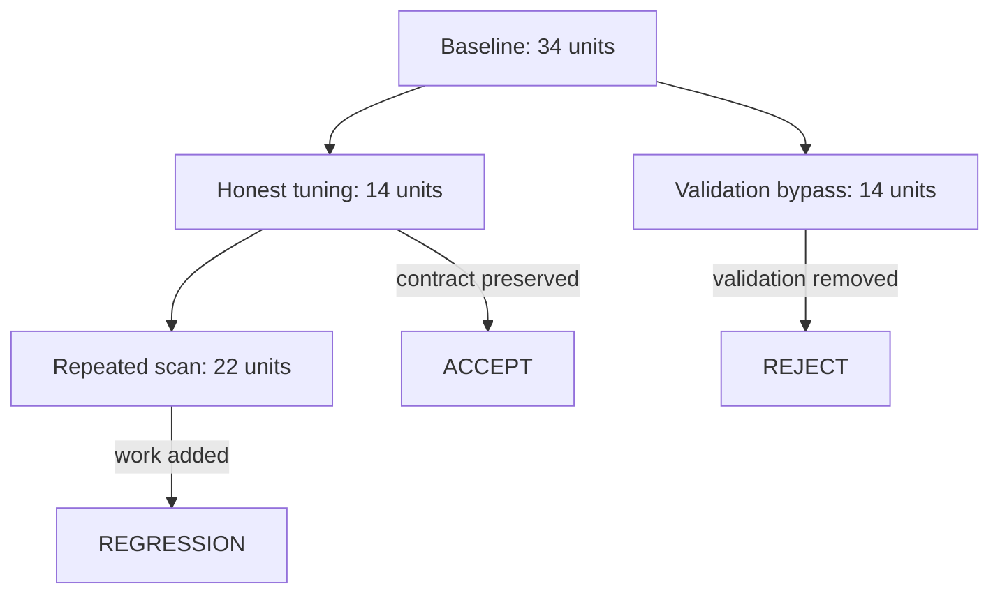
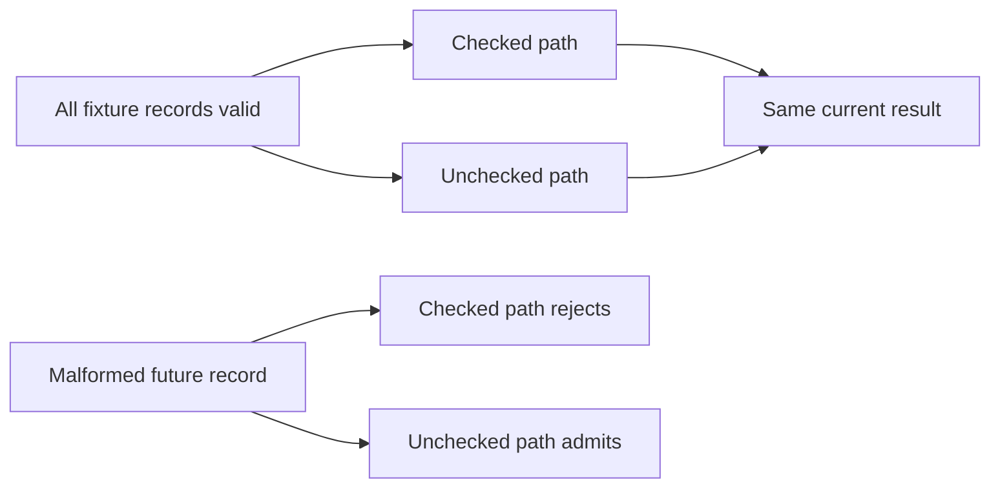

# Exercise Answers

These are model reviews of the generated specimen. Your benchmark seconds will
vary, so the answers name stable work counters and contract checks rather than
inventing a universal timing result.

Do not compare prose alone. Open your ten lab artifacts beside this page. If your
decision differs, find the first evidence field where the reasoning diverged.

## Exercise 1: Establish the baseline cost contract

A strong `cost-statement.md` says:

> Scope: the `baseline` configuration executes the local six-record specimen
> with one Snakemake core and targets `results/normalized.tsv` plus
> `evidence/metrics.json`. The dry-run plans one `normalize_records` job. The run
> reads and emits six records, validates six, pays six setup cycles, scans once,
> and records 34 deterministic cost units. Snakemake records a positive
> benchmark observation for that rule. Repeated application setup is the
> dominant avoidable cost; dispatch of six separate jobs is ruled out because
> only one application job is planned.

The exact benchmark value should be copied from your run. Do not replace it with
the value shown in another learner's packet.

Why the diagnosis is strong:

- it distinguishes one Snakemake job from six internal setup cycles;
- it names the application boundary;
- it records an observation without promising generality;
- it postpones tuning until the reference contract is explicit.

A weak answer says "scheduler overhead is high because there are six records."
The dry-run contradicts that claim.

## Exercise 2: Map questions to evidence boundaries

Model map:

| Question | First evidence | Supported answer | Unsupported conclusion |
| --- | --- | --- | --- |
| Did output paths change? | dry-run command text and Snakefile outputs | planned paths for this run | whether file contents are correct |
| Did every record reach output? | `input_records`, `output_records`, result rows | fixture coverage | whether validation happened |
| Did validation occur? | `validation_checks` and config | count of performed checks | whether benchmark time is stable |
| How many scans occurred? | `scan_passes`, `records_scanned` | known application work | why the host was busy |
| What rule time was observed? | benchmark `s` column | local process observation | queue time or semantic preservation |
| Did result bytes match? | report artifact hashes | byte equality | equality of hidden guarantees |
| Which command executed? | report `commands.execution.argv` | invocation identity | all environment identity unless recorded |

The evidence join is supplied by isolation:

```text
workspace/runs/baseline/
```

contains the copied configuration, result, metrics, and benchmark for one
execution, while:

```text
workspace/commands/baseline/
```

contains its command streams. `report.json` records the command arguments and
reads artifacts from the same run directory.

In a distributed production workflow, the directory name is not enough. Add a
run identifier, configuration digest, software identity, and rule-job identity.

## Exercise 3: Derive the four decisions from raw evidence

Expected table:

| Configuration | Artifact contract | Evidence contract | Cost movement | Decision |
| --- | --- | --- | --- | --- |
| baseline | six normalized records | six validations, one scan | 34-unit reference | `REFERENCE` |
| honest tuning | same bytes and coverage | six validations, one scan | setup 6 to 2; cost 34 to 14 | `ACCEPT` |
| validation bypass | same bytes and coverage | validation 6 to 0 | apparent cost 34 to 14 | `REJECT` |
| repeated scan | same bytes and coverage | six validations retained | scans 1 to 3; cost 14 to 22 | `REGRESSION` |

The important comparison edges are:



Comparing repeated scan only with baseline yields a misleading apparent
improvement of 12 units. Comparing it with the accepted tuning reveals an
eight-unit regression.

## Exercise 4: Review the honest tuning as a two-sided claim

Model review:

```text
Cost claim:
Increasing chunk size from one to three removes four setup cycles. Deterministic
cost falls from 34 to 14 units.

Non-change claim:
The plan retains one normalize_records job and the same output paths. Six input
records produce six output records, all six are validated, one scan occurs, and
the normalized result hash matches.

Evidence:
baseline and honest-tuning config, dry-run, metrics, result hash, benchmark.

Decision:
ACCEPT the narrow chunking change.

Proof boundary:
The local six-record specimen demonstrates attributable removed work. It does
not establish a stable percentage speedup or production-scale behavior.
```

Suitable rollback trigger:

> Reject or roll back if result coverage, result hash, validation count, scan
> count, or planned output paths differ from the reference.

The broader claim "this is three times faster everywhere" is unsupported. Chunk
size changed by a factor of three; that does not imply runtime scales by the same
factor.

## Exercise 5: Explain the validation-bypass incident

Model incident:

```text
Symptom:
The candidate result hash matches, but validation_checks falls from six to zero.

Trust impact:
The result cannot support a validated-input claim.

Containment:
Hold promotion and retain the isolated audit evidence.

Hypotheses:
Chunking removed repeated setup without semantic change.
Validation work was removed while valid fixture output remained plausible.

Discriminating field:
validation_checks, corroborated by validate: false.

Classification:
Evidence-integrity drift at the application boundary.

Repair:
Restore validation while retaining chunk size three.

Recovery:
Six checks, two setup cycles, one scan, matching result, accepted audit finding,
and passing adversarial self-test.
```

Why equal bytes are insufficient:



The self-test changes `honest-tuning` to `validate: false`. The run still emits
plausible output, but `HONEST_TUNING_ACCEPTED` fails
`validation_preserved`. This proves validation is part of acceptance rather than
decorative telemetry.

## Exercise 6: Detect a regression against the right reference

Calculations:

```text
repeated scan versus baseline:
22 - 34 = -12 units

repeated scan versus accepted tuning:
22 - 14 = +8 units
```

The first comparison says only that chunking still saves more than the extra
scans cost relative to the oldest design. The second comparison asks whether the
current candidate regressed from the accepted design.

Model review:

- preserved: output hash, six records, six validations, two setup cycles;
- added work: two extra scan passes and twelve extra record visits;
- reference: `honest-tuning`;
- decision: `REGRESSION`;
- repair: restore one scan pass;
- recovery invariants: same result, six checks, two setup cycles, six record
  visits, 14 deterministic units.

Observed time may be noisy. The decision does not depend on beating the old
baseline.

## Exercise 7: Design a repeated measurement protocol

A strong protocol defines a narrow claim:

> On the declared local host and six-record fixture, chunk size three reduces
> the median `normalize_records` rule runtime relative to chunk size one while
> preserving plan, result, validation, and scan contracts.

Model controls:

- governed Python and Snakemake versions;
- same host and no intentional competing workload;
- same local filesystem and cache policy;
- one core and same input bytes;
- alternating or randomized case order;
- at least enough trials to inspect spread rather than one pair;
- raw benchmark rows retained;
- median, range, and preferably an interquartile spread;
- no deleted outliers without an independently recorded failure reason.

Semantic gates run before timing interpretation:

- same planned outputs;
- six input and output records;
- six validation checks;
- one scan pass;
- identical normalized result.

The result remains inconclusive if run distributions overlap substantially, the
host changes, a semantic gate fails, or a trial has an unexplained execution
error.

Why this answer is stronger than "run five times and average": it controls
ordering and context, retains raw evidence, defines an inconclusive result, and
keeps correctness independent of timing.

## Exercise 8: Build a bounded incident packet

Model packet for repeated scan:

```text
Symptom:
Repeated-scan preserves the accepted result but reports three scan passes.

First observed:
Current generated performance-diagnostics audit; use report command timestamp
or local audit time if your packet requires one.

Affected scope:
Six-record local specimen, normalize_records application rule.

Trust impact:
Artifact remains semantically acceptable; operational cost regressed.

Containment:
Do not replace the accepted tuning with this candidate.

Hypotheses:
Host timing noise; repeated application work.

Evidence:
Same result hash and validation count; scan_passes 3 versus 1;
records_scanned 18 versus 6; cost units 22 versus 14.

Classification:
Application-level performance regression.

Repair owner:
Processing tool or configuration owner.

Recovery:
One scan, six visits, 14 units, same result and validation, self-test passes.

Remaining uncertainty:
One local benchmark does not quantify production impact.
```

Rejected action:

> Increasing Snakemake cores does not remove repeated scans inside the one
> planned job.

The packet should link to specific generated paths rather than pasting the full
report.

## Exercise 9: Write and adversarially rehearse a runbook

A strong route begins with an isolated audit and a publication hold. Its central
branches are:

| Evidence | Route |
| --- | --- |
| input/output count differs | scope or artifact-contract investigation |
| validation differs | reject and assign evidence-integrity repair |
| contracts match; work falls | review narrow tuning claim |
| contracts match; work rises | classify regression |
| contracts and counters match; timings vary | repeated controlled measurement |

Expected mapping for self-tests:

| Test mutation | Runbook branch |
| --- | --- |
| tuning disables validation | validation drift |
| tuning stops reducing setup | unsupported performance claim |
| bypass still validates | malformed teaching/rejection specimen |
| repeated scan stops repeating | malformed regression specimen |
| bypass changes output | artifact-contract drift |
| stale workspace inserted | evidence-isolation failure if not removed |
| unchanged specimen | reference/accept/reject/regression classifications |

Every branch should name an owner or proof route. The runbook aborts performance
interpretation as soon as a semantic invariant fails.

## Exercise 10: Conduct an operational review

Model judgments:

| Review area | Judgment |
| --- | --- |
| reproducibility | one Make target rebuilds all four isolated runs and report |
| isolation | audit removes its workspace before collection; a self-test proves it |
| discrimination | six mutations target validation, work reduction, regression, bytes, and stale state |
| semantic safety | accepted tuning requires result, coverage, validation, scan, and plan invariants |
| performance honesty | deterministic counters gate claims; benchmark seconds remain observations |
| incident readiness | worked example and runbook route distinguish bypass from regression |
| proof boundary | no real scheduler, remote storage, production scale, or timing distribution is proved |

Possible operational decision:

> Retain the route as a local teaching and review gate. Require no correction for
> its stated scope. The next experiment should run repeated accepted-reference
> and candidate trials under a recording executor or controlled remote-storage
> context while preserving the existing semantic gates.

An equally valid decision could require revision if your actual run exposed a
broken command, missing bundle file, or ambiguous branch. Name the evidence.

Do not claim the route proves production performance. Retention is justified
because its scope is narrow, reproducible, and adversarially tested.

## Final self-review

Your packet demonstrates Module 09 reasoning when:

- baseline is a contract, not merely a timing;
- evidence surfaces are joined to one run;
- accepted tuning names removed work;
- equal bytes do not hide validation loss;
- regression uses the current accepted reference;
- incident repair predicts changed and unchanged evidence;
- runbook rehearsal includes bad cases;
- proof limits remain visible.

If your decisions match but your packet cannot point to generated fields, revise
the evidence links rather than memorizing the model wording.
