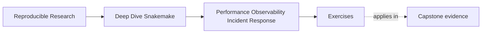

# Exercises

<!-- page-maps:start -->
## Page Maps

<!-- page-maps:end -->

Use these exercises to practice evidence-first workflow judgment, not only performance
vocabulary.

The strongest answers will keep workflow truth visible while diagnosing speed or incident
problems.

## Exercise 1: Name the dominant cost class

A workflow now takes 40 minutes instead of 25.

You collect three observations:

- `snakemake -n -p` already feels noticeably slower than before
- benchmark files for the heavy rules look unchanged
- the discovered sample list is much larger than last week

Write a short review note that explains:

- which cost class looks dominant
- which cost classes are not the strongest lead right now
- what you would inspect next before proposing any fix

## Exercise 2: Choose the right evidence surface

A teammate says:

> The latest run rebuilt `summary.tsv`, and I think the aligner has become slower.

Explain which artifact you would inspect first and why.

Then explain which artifact you would inspect second if the first artifact does not support
the claim.

Your answer should distinguish workflow-state evidence from rule-local runtime evidence.

## Exercise 3: Triage a flaky cluster-only incident

A workflow passes locally and in CI, but one scheduler-backed profile now fails
intermittently. The proposed fix is to raise retries and increase `latency-wait`.

Describe:

- why this is not yet a sufficient response
- which incident class you would test first
- which two or three evidence surfaces you would consult before approving any policy change

## Exercise 4: Review a suspicious optimization

A pull request claims to "speed up the workflow" by doing all of the following:

- removing one declared input from a slow rule because it "rarely matters"
- deleting benchmark files because they create clutter
- grouping several tiny QC jobs into one aggregation step

Write a short review note that explains:

- which change may be a valid tuning move
- which changes are semantic or evidence regressions
- what proof you would require before approving the valid part

## Exercise 5: Draft a runbook entry

Write a minimal runbook entry for this recurring problem:

> `make tour` is slower than expected, and a reviewer is unsure whether the issue is
> workflow shape, operating context, or tool runtime.

Your runbook entry should include:

- the first command to run
- the next evidence surfaces to inspect
- one escalation trigger
- one command that proves the repair honestly

## Exercise 6: Establish a measured baseline

Measure planning time, total execution time, and one heavy rule across at least five
comparable runs. Record input size, operating context, and software identity.

What to hand in:

- the measurement commands and raw records
- median and range for each surface
- environmental factors held constant
- one reason the baseline may not generalize

## Exercise 7: Build an incident evidence packet

Inject a slow rule or intermittent failure into a disposable workflow and collect only
the evidence needed for another maintainer to reproduce and classify it.

What to hand in:

- precise symptom, scope, and first observed time
- dry-run, summary, relevant log, benchmark, and provenance excerpts
- current incident classification
- facts still unknown

## Exercise 8: Tune one boundary at a time

Choose a justified optimization such as grouping tiny jobs or reusing an environment.
Measure before and after without changing inputs, target membership, or output semantics.

What to hand in:

- the hypothesis and single changed boundary
- repeated measurements
- semantic output comparison
- a decision to keep or revert the change

## Exercise 9: Diagnose a context-specific regression

Create or study a run that is healthy locally but slow or flaky under a scheduler profile.
Separate queue delay, launch overhead, filesystem latency, resource pressure, and tool time.

What to hand in:

- evidence for each plausible cost class
- the class supported most strongly
- one policy change you reject
- the smallest experiment that tests your leading explanation

## Exercise 10: Rehearse and revise a runbook

Give your runbook to someone who did not write it. Ask them to diagnose the incident from
the recorded state without additional verbal instructions.

What to hand in:

- the original runbook
- points where the reader stalled or made an unsafe assumption
- the revised route and escalation criteria
- evidence that the revised route reaches the correct proof command

## Mastery check

You have a strong grasp of this module if all ten answers consistently keep four ideas
visible:

- "slow" must be split into named cost classes
- evidence surfaces should be chosen by question, not by habit
- incident response should classify before it edits
- performance work must preserve workflow meaning and reviewability
